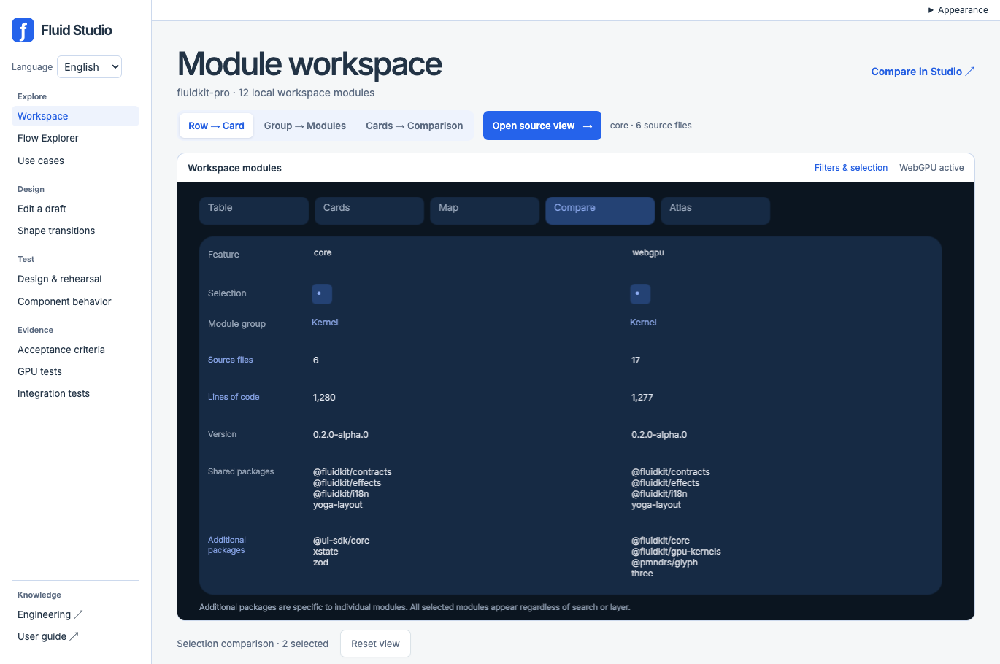
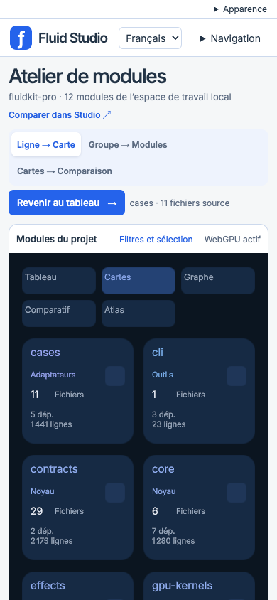
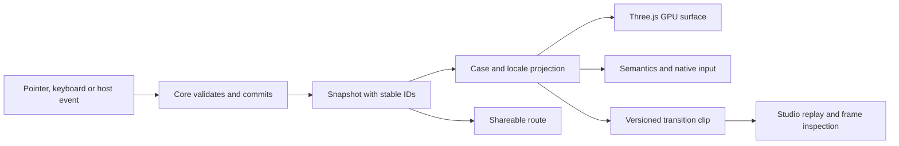

# FluidKit Pro

**A WebGPU-first TypeScript framework for building interfaces that change shape as a person’s task changes.**

Imagine looking at a home for sale. The listing gives you the asking price. Your next question is “What would that cost me each month?” In the original FluidKit design, the price could expand into a mortgage calculator with that home’s price already filled in. You could explore a different down payment right there, with the listing still in view.

FluidKit calls this **liquid by design**. Developers give a component several useful forms and describe how its content travels between them. The source alpha puts that part in your hands today. The longer-term ambition is for an application to recognise the question you are trying to answer and have the relevant data ready when you choose the next form.

## What a fluid component looks like today

Open **Developer tools → Input & state proof** in Studio. Type a project name and start validation. The button becomes a progress indicator, then opens into a card with the result. Open the detail and the name you typed is still editable. You can see what happened to your request in the same place you made it.

The same idea works across several objects. In the workspace, select the `core` and `webgpu` packages. Switch from rows to cards, then choose **Compare**. The two cards come together into a single comparison. Each name becomes a column heading above its package’s figures. Switch back to cards and both packages are still selected.



**Source alpha** · [MIT license](LICENSE) · Deutsch / English / Français · [Run it locally](#run-it-locally)

## Where a change of form helps

A developer defines which forms are useful for a task, which event connects them, and which values each form needs. Studio includes four workflows to explore. Architecture review uses this checkout’s package manifests and source files. Property, commerce and travel are labelled simulations with synthetic records.

| Workflow | How the next question changes the interface |
| --- | --- |
| **Review a codebase** | “Which package is largest?” calls for a sorted table. “What depends on what?” calls for a map. Pick two to four packages and the comparison shows their common dependencies and where their lists differ. |
| **Find a home** | Rent is enough to browse. Open the Berlin apartment and the €295 service charge puts its €1,590 rent in perspective. Compare its rent with a second listing, then return to the one you want to ask about. |
| **Choose a product** | A shopper chooses a lamp from the catalogue, then needs the price of a particular finish. In the detail view, graphite costs €89 and sand costs €94. The checkout handoff checks stock for the chosen variant. |
| **Plan a trip** | A traveller finds three nights in Lisbon for €468. Advance the scenario clock while considering the offer. Once the quote expires, the case blocks the booking handoff. |

## Features you can try today

- **Transform, split and combine.** A row can become a card, a group in the size atlas can unfold into its actual members, and selected cards can merge into a comparison. Stable IDs tell the renderer which parts belong together. Six optional effects shape the movement. Try the staggered arrivals of Silk Cascade or the local refraction of Liquid Lens. Reduced Motion shows the destination immediately.
- **Explore and share a workspace.** Work in a sortable table, cards, a dependency map, a size atlas, a comparison or a detail view. A link restores the view, sort order, group and selection. The separate Flow Explorer shows which events the workflow accepts from each state.
- **Design in motion.** In Studio, preview an edit against the current dataset before applying it. Record a change, play it backwards or pause where two labels pass each other. You can ask AI to critique selected frames or propose a draft for your review. [Studio review workflow](knowledge/engineering/ai-review.md)
- **Adapt the presentation.** Switch between German, English and French with a transition paused. The text and number formats change while the selection and playback position hold. Eight palettes and a custom accent let you explore the same flow in your product’s colours.

| Sortable module table · German | Cards at phone width · French |
| --- | --- |
|  |  |

All three screenshots come from a running WebGPU surface. [Screenshot provenance](docs/readme/assets/m11-workspace-screenshots.json)

## Run it locally

With Node.js 24 or later and npm installed, run these commands from the repository root.

```sh
npm ci
npm run dev --workspace @fluidkit/studio -- --port 3010
```

Open Studio in [English](http://127.0.0.1:3010/en), [Deutsch](http://127.0.0.1:3010/de) or [Français](http://127.0.0.1:3010/fr). For a first run, open the comparison pictured above and switch to cards to see where the two columns go. The workspace, transitions and handbooks run locally without an AI account. [Open the pictured comparison](http://127.0.0.1:3010/en?view=compare&sort=name&direction=asc&selected=&group=all&picked=core&picked=webgpu)

For optional OpenAI review or authoring through the Vercel AI SDK, copy the environment template to `.env.local` at the repository root, set `OPENAI_API_KEY` there and restart Studio. The server holds the key. In Rehearsal you choose the frames and inspect what will be sent before you start a review. [Environment template](.env.example)

## Why render the workspace on the GPU?

The usability idea is *object constancy*. If a row's name and values move together into a card, your eye has a path to follow. That matters most when several objects move at once. Research on animated data graphics supports testing this approach for tracking changes. Whether it helps a particular audience depends on the task. [Heer and Robertson, *Animated Transitions in Statistical Data Graphics*](https://idl.uw.edu/papers/animated-transitions)

A shared GPU scene puts geometry, material effects and sharp text on the same clock. The same transition can run live or stop at an exact point for inspection. Across three languages, four widths and two backends, the recorded desktop run checked 3,024 transition positions and found no text collisions. All 48 reverse-replay checks reproduced the original midpoint image. [Test conditions and results](docs/qa/2026-11-20-m11/gpu-locale-review.md)

Studio shows the active backend. WebGPU is the default, with a Three.js WebGL2 fallback on compatible devices. Performance depends on the scene and hardware. HTML serves the editor, navigation and searchable handbooks. The GPU workspace has a semantic and native-input bridge for keyboard focus and text composition. Canvas text is harder for a simple DOM scraper to extract, but delivered data, accessible labels and screenshots remain readable. Content access belongs on the server. [Rendering, accessibility and trade-offs](knowledge/engineering/why-fluid.md)

## From explicit actions to inferred intent

The original product brief asks what an interface could prepare *before* someone clicks. Consider an early FluidKit design for a gaming laptop search. You open the same two models several times to check specifications. Comparing them is one plausible next step. The application could fetch the two spec sheets in the background and offer to bring the cards together. If you keep browsing, you keep your place. A useful measure of that suggestion would be whether shoppers reach a decision with less backtracking.

**Who decides when the UI changes?** FluidKit starts in **Manual**, where the application handles explicit events. In **Hybrid**, a proposed change waits for approval. In **Auto**, the host can permit a reversible change, such as opening a detail view. Try those rules in the input proof with its simulated suggestion. A purchase or booking needs its own authorised action.

The live AI in Studio already helps people author and review interfaces. Ranking likely next steps, preloading read-only data and testing whether a suggested view helps users finish their task are roadmap work. The host defines the available states and transitions, so it can add that assistance to a flow people can already use manually. [Product plan](docs/implementation-plan.md) · [Feature status](docs/feature-status.md)

<details>
<summary><strong>How the toolkit fits together</strong></summary>

The core commits a valid event once. The URL, GPU scene and semantic controls all derive from the same state. A transition clip describes how to draw the change, so replay can run locally without repeating a business action.



| Package | Responsibility |
| --- | --- |
| [Contracts](packages/contracts) and [Core](packages/core) | Typed snapshots, guarded events, component identities and routes. |
| [Effects](packages/effects), [GPU kernels](packages/gpu-kernels) and [WebGPU](packages/webgpu) | Transition sampling, TypeGPU kernels, Three.js materials, text and hit testing. |
| [Internationalization](packages/i18n), [React](packages/react) and [Cases](packages/cases) | Locale-aware projections, host bindings and case data. |
| [Studio](apps/studio), [Testing](packages/testing) and [Server](packages/server) | Visual authoring, replay, checks, local projects and optional AI providers. |

</details>

## Guides, checks and license

Start with the user guide for a walkthrough or the engineering handbook for contracts, Mermaid flows and test evidence. Both have offline editions in Studio. German contains the full reference, with edited chapter guides in English and French. [User guide](knowledge/public/index.md) · [Engineering handbook](knowledge/engineering/index.md) · [Acceptance criteria](docs/acceptance-matrix.md)

```sh
npm run check             # types, lint and unit tests
npm run build             # packages and Studio
npm run knowledge:export  # portable offline handbooks
```

FluidKit Pro is available as a source alpha under MIT. Bundled fonts and third-party components retain their own licenses. [Release guide](docs/release/public-source.md) · [MIT license](LICENSE) · [Third-party notices](THIRD-PARTY-NOTICES.md)
