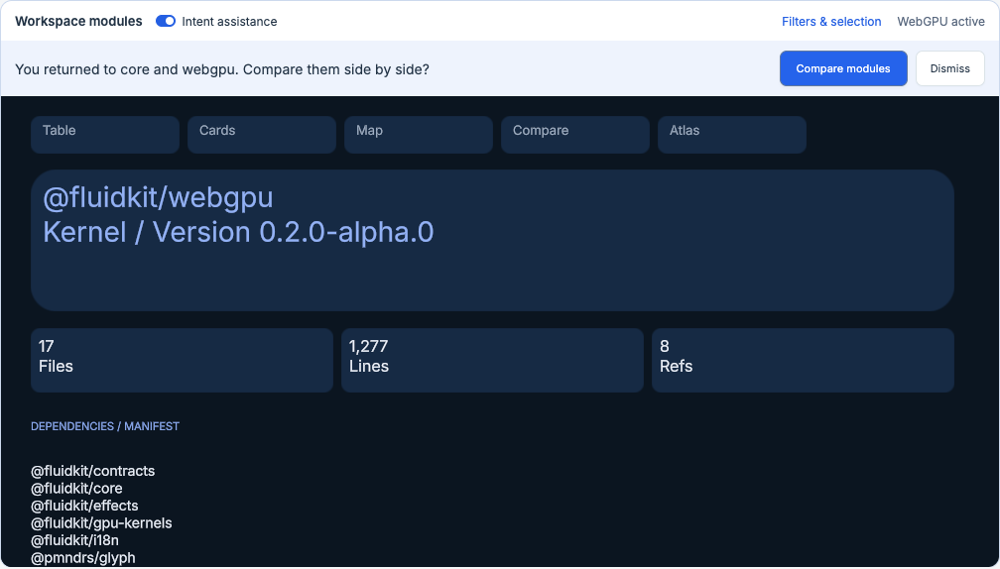
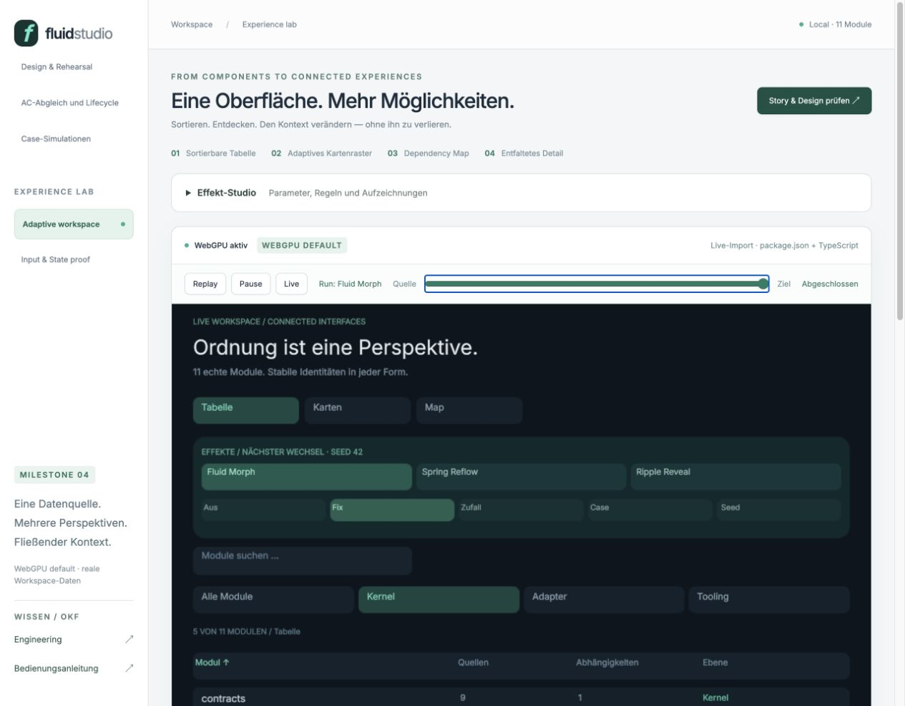
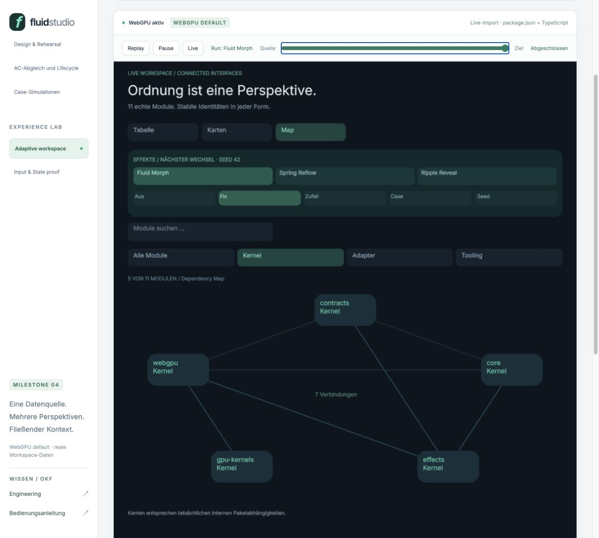
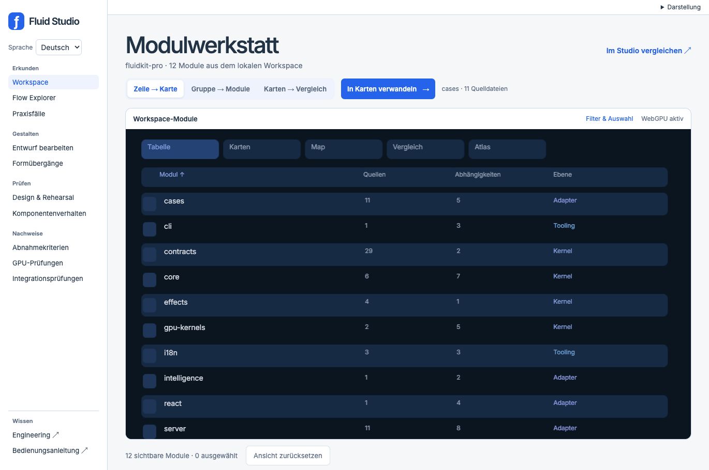
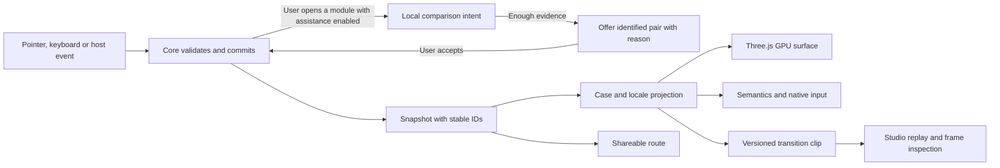

# FluidKit Pro

**FluidKit Pro is a TypeScript framework for interfaces that can recognise a change in what someone is trying to do and transform to help them do it.**

Picture someone shopping for a laptop. At first they browse. A few minutes later they are switching between the same two models to check memory and battery life. Their task has changed, but the catalogue is still making them open one spec sheet, remember a value and go back for the other. This is why we built FluidKit. An application can notice the pattern, offer a comparison, and turn the two product cards into columns with matching specifications on the same row. The shopper decides whether that would help. Their choices carry into the new interface.

**Try intent recognition in the workspace.** Enable intent assistance and open `core`, then `webgpu`, twice in that order. Return to the table between visits. Studio offers to compare those precise modules and tells you what prompted the suggestion. Accept it and you can see that both use `yoga-layout`, while only `webgpu` lists `three`. Dismiss it and you can carry on exploring. The modules and dependencies come from this checkout’s package manifests. [Run Studio locally](#run-it-locally) · [How intent works](#from-explicit-actions-to-inferred-intent)



The workspace stays on the module until you decide. [See the comparison that opens](docs/readme/assets/m11-workspace-en.png) · [Intent walkthrough and browser evidence](docs/qa/2026-11-23-intent/browser.json)

**Source alpha** · [MIT license](LICENSE) · Deutsch / English / Français

## Why a fluid interface?

| What people gain | What it looks like in a product |
| --- | --- |
| **Get help when the task changes.** | Returning to the same two records can mean you are weighing a choice. FluidKit can suggest a view that puts the differences in reach. You can also open that view yourself. |
| **Keep your place.** | Sort by file count and follow the selected module to its new position. Its name and selection travel together. |
| **See detail when you need it.** | The workspace atlas starts with three groups. Open *Kernel* and its area unfolds into the packages that make up its total. The overview stays simple, and the breakdown is one action away. |
| **Understand what an action did.** | Start validation in Studio’s **Input & state proof**. The button becomes a progress indicator, then a result card in the same place. Open the detail and the project name you typed is still editable. |
| **Choose the view that answers the question.** | Scan values in a table, trace relationships on a map, or bring two records together to inspect their differences. Your selection carries through each step. |
| **Give a product a recognisable feel.** | A team can use the same restrained motion whenever a collection expands and a different cue when items come together. People encounter that pattern again across the product. |

Two design principles guide these choices. *Object constancy* gives the eye something recognisable to follow. *Progressive disclosure* gives a person more information when their question calls for it. In controlled studies of statistical graphics, well-designed transitions helped participants track changes between views. Fluid Studio lets teams rehearse that idea with their own flows. [Transition research](https://idl.uw.edu/papers/animated-transitions) · [Progressive disclosure](https://www.nngroup.com/articles/progressive-disclosure/)

<details>
<summary><strong>See the same five packages as a table and a map</strong></summary>

| Which package has the most files? | How are the packages connected? |
| --- | --- |
|  |  |

Both views keep the *Kernel* filter and the selected `webgpu` package. The table gives you a file count for each package. The map reveals seven relationships from their manifests. These two captures come from the 2 November 2026 build. [Capture record](docs/readme/screenshots.json)

</details>

## From explicit actions to inferred intent

Developers define the forms a component can take and which transitions the application allows. FluidKit can then use observed actions to suggest a transformation that fits the task. In the original product brief, a home buyer moves from reading an asking price to working out what they can afford. The proposed transformation is for that price to open into a mortgage calculator with the amount already filled in. The calculator is a design example. The module comparison above exercises both parts in the running workspace.

**What the workspace recognises today.** Its local recogniser looks for deliberate, repeated visits to a pair of modules in the current session. It ranks candidate pairs and can return *unclear*. A single visit gives Studio too little evidence to suggest a change. You can inspect the visits behind a proposal before deciding. Accepting opens the existing comparison with those two IDs. The recogniser needs no API key or model call.

In 16 scripted sessions with labelled goals, the recogniser identified six of seven intended comparisons and stayed quiet in eight of nine sessions with other goals. Two sessions had identical visits and different goals: comparing two packages and looking up one fact in each. That is why Studio offers a choice. [Evaluation and individual outcomes](docs/qa/2026-11-23-intent/evaluation.json)

**Who decides?** Manual control is the default. Turning on assistance in the workspace lets FluidKit offer a change for your approval. Active text entry takes precedence. The separate input proof demonstrates the host’s **Manual**, **Hybrid** and **Auto** policies, including a simulated reversible action. A purchase or booking needs its own authorised action.

**What comes next.** A catalogue could prepare the two spec sheets while a shopper is still browsing. Intent-driven preloading, learning from outcomes and recognising other kinds of intent are future work. The product question is how often a suggestion helps someone finish their task with less backtracking, and how often it interrupts for the wrong reason. Answering that takes independently evaluated sessions with real users. Studio’s optional cloud AI already serves a separate purpose in authoring and design review. [Product plan](docs/implementation-plan.md) · [Feature status](docs/feature-status.md)

## Where a change of form helps

The architecture review below uses this checkout’s package manifests and source files. Property, commerce and travel are labelled simulations with synthetic records.

| Workflow | How the next question changes the interface |
| --- | --- |
| **Review a codebase** | “Which package is largest?” calls for a sorted table. “What depends on what?” calls for a map. Pick two to four packages and the comparison shows their common dependencies and where their lists differ. |
| **Find a home** | Rent is enough to browse. Open the Berlin apartment and the €295 service charge puts its €1,590 rent in perspective. Compare its rent with a second listing, then return to the one you want to ask about. |
| **Choose a product** | A shopper chooses a lamp from the catalogue, then needs the price of a particular finish. In the detail view, graphite costs €89 and sand costs €94. The checkout handoff checks stock for the chosen variant. |
| **Plan a trip** | A traveller finds three nights in Lisbon for €468. Advance the scenario clock while considering the offer. Once the quote expires, the case blocks the booking handoff. |

## Features you can try today

- **Choreograph a view change.** Match a row to a card, split a group into its members, or merge selected records. Choose among six optional effects, set one per case, or use Reduced Motion to open the destination immediately.
- **Share the working context.** A workspace link restores the view, sort order, group and selection. The separate Flow Explorer shows which events the workflow accepts from each state.
- **Adapt the presentation.** Switch between German, English and French with a transition paused. The text and number formats change while the selection and playback position hold. Eight palettes and a custom accent let you explore the same flow in your product’s colours.

| Sortable module table · German | Cards at phone width · French |
| --- | --- |
|  |  |

The English comparison, German table and French mobile view were captured on WebGPU. [Screenshot provenance](docs/readme/assets/m11-workspace-screenshots.json)

## Design and review the interaction in Studio

Designers and developers can try two transitions for the same action on the same data. Play a guided flow, take over at any step, or pause and capture a frame. Studio shows the reference and candidate side by side with their state and revision. A developer can replay the handoff a designer wants to change. Optional AI review works on frames the team chooses. [Rehearsal guide](knowledge/public/rehearsal.md) · [Frame comparison](knowledge/public/comparison.md) · [AI review](knowledge/public/ai-analysis.md)

One review caught a problem that was invisible in both the starting and finished layouts. About a tenth of the way from comparison columns back to cards, a summary followed its card too early and a selection marker crossed the package title. Keeping the outgoing text in place until the handoff and fading the marker earlier fixed it. The repeat check sampled 3,024 positions across three languages, four widths and two backends with no text collision detected. All 48 reverse-replay checks reproduced the original midpoint image. [Test conditions and results](docs/qa/2026-11-20-m11/gpu-locale-review.md)

## Why WebGPU and Three.js?

When two cards become a comparison, their edges, labels and backgrounds all have to arrive together. FluidKit draws them in **one scene on a shared timeline**. A transition can cross component boundaries, and Studio can stop at any point to inspect the actual frame.

**Materials can tell you what changed.** In the guided showcase, Silk Cascade settles rows into cards. Open a card with Liquid Lens and the background bends around it while its text stays sharp. Three.js provides the scene and programmable materials. FluidKit combines its shading language, TSL, with typed shader functions from TypeGPU. A team can build a distinctive material on that foundation and reuse it across components. [Three.js renderer and materials](https://threejs.org/manual/pages/webgpurenderer) · [TypeGPU integration](https://docs.swmansion.com/TypeGPU/ecosystem/typegpu-three/)

**There is room to grow.** WebGPU can run many independent calculations in parallel and reuse recorded rendering commands. Those capabilities make denser visualisations and simulations worth exploring. Another possibility is on-device assistance. ONNX Runtime Web already supports running models with WebGPU. Local inference is a future direction for FluidKit, with rendering and inference sharing the device’s resources. [WebGPU specification](https://www.w3.org/TR/webgpu/) · [ONNX Runtime Web](https://onnxruntime.ai/docs/tutorials/web/ep-webgpu.html)

Chrome, Edge, Firefox and Safari support WebGPU on compatible systems. FluidKit checks the device, prefers WebGPU and shows when it uses the Three.js WebGL2 fallback. Studio uses HTML for editing, navigation and searchable guides. A semantic and native-input bridge provides keyboard focus and text composition for the GPU workspace. Canvas exposes less plain text to simple DOM scrapers, but delivered data, accessible labels and screenshots remain readable. Access control belongs on the server. [Browser and OS support](https://web.dev/blog/webgpu-supported-major-browsers) · [Implementation matrix](https://github.com/gpuweb/gpuweb/wiki/Implementation-Status) · [Accessibility and rendering trade-offs](knowledge/engineering/why-fluid.md)

## Run it locally

You’ll need Node.js 24 or later, npm and a browser with a supported GPU backend. If you already have the source, start at `npm ci` in the repository root.

```sh
git clone https://github.com/rotorstar/FluidKit.git
cd FluidKit
npm ci
npm run dev --workspace @fluidkit/studio -- --port 3010
```

Open Studio in [English](http://127.0.0.1:3010/en), [Deutsch](http://127.0.0.1:3010/de) or [Français](http://127.0.0.1:3010/fr). For a first tour, filter the table to *Kernel* and sort by file count. Pick a package and open the dependency map to see which other packages it connects to. To try the two-card transition immediately, open the pictured comparison and switch to cards. The workspace, transitions and handbooks run locally without an AI account. [Open the pictured comparison](http://127.0.0.1:3010/en?view=compare&sort=name&direction=asc&selected=&group=all&picked=core&picked=webgpu)

For optional OpenAI review or authoring through the Vercel AI SDK, copy the environment template to `.env.local` at the repository root, set `OPENAI_API_KEY` there and restart Studio. The server holds the key. In Rehearsal you choose the frames and inspect what will be sent before you start a review. [Environment template](.env.example)

<details>
<summary><strong>How the toolkit fits together</strong></summary>

An existing product can start with one workspace. A standalone React host in this repository uses the same core, surface and package data as Studio and runs without Next.js. Your application can keep its navigation and checkout while FluidKit handles an interaction such as selecting and comparing records. [React host example](scripts/react-host/main.tsx)

The core commits a valid event once. The URL, GPU scene and semantic controls all derive from the same state. A transition clip describes how to draw the change, so replay can run locally without repeating a business action.



| Package | Responsibility |
| --- | --- |
| [Contracts](packages/contracts) and [Core](packages/core) | Typed snapshots, guarded events, component identities and routes. |
| [Effects](packages/effects), [GPU kernels](packages/gpu-kernels) and [WebGPU](packages/webgpu) | Transition sampling, TypeGPU kernels, Three.js materials, text and hit testing. |
| [Internationalization](packages/i18n), [React](packages/react) and [Cases](packages/cases) | Locale-aware projections, host bindings and case data. |
| [Studio](apps/studio), [Testing](packages/testing) and [Server](packages/server) | Visual authoring, replay, checks, local projects and optional AI providers. |

</details>

## Guides, checks and license

Start with the user guide for a walkthrough or the engineering handbook for contracts, Mermaid flows and test evidence. Both have offline editions in Studio. German contains the full reference, with edited chapter guides in English and French. [User guide](knowledge/public/index.md) · [Engineering handbook](knowledge/engineering/index.md) · [Acceptance criteria](docs/acceptance-matrix.md)

```sh
npm run check             # types, lint and unit tests
npm run build             # packages and Studio
npm run knowledge:export  # portable offline handbooks
```

FluidKit Pro is available as a source alpha under MIT. Bundled fonts and third-party components retain their own licenses. [Release guide](docs/release/public-source.md) · [MIT license](LICENSE) · [Third-party notices](THIRD-PARTY-NOTICES.md)
