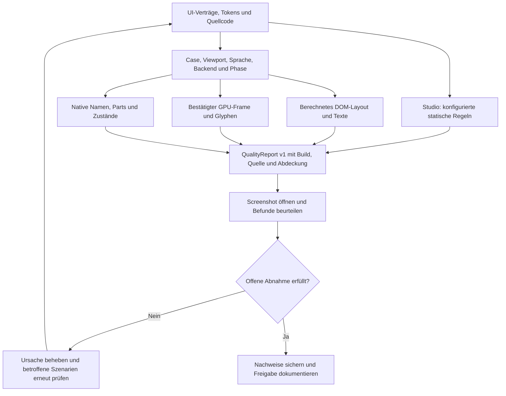
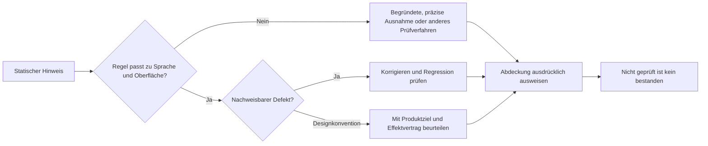
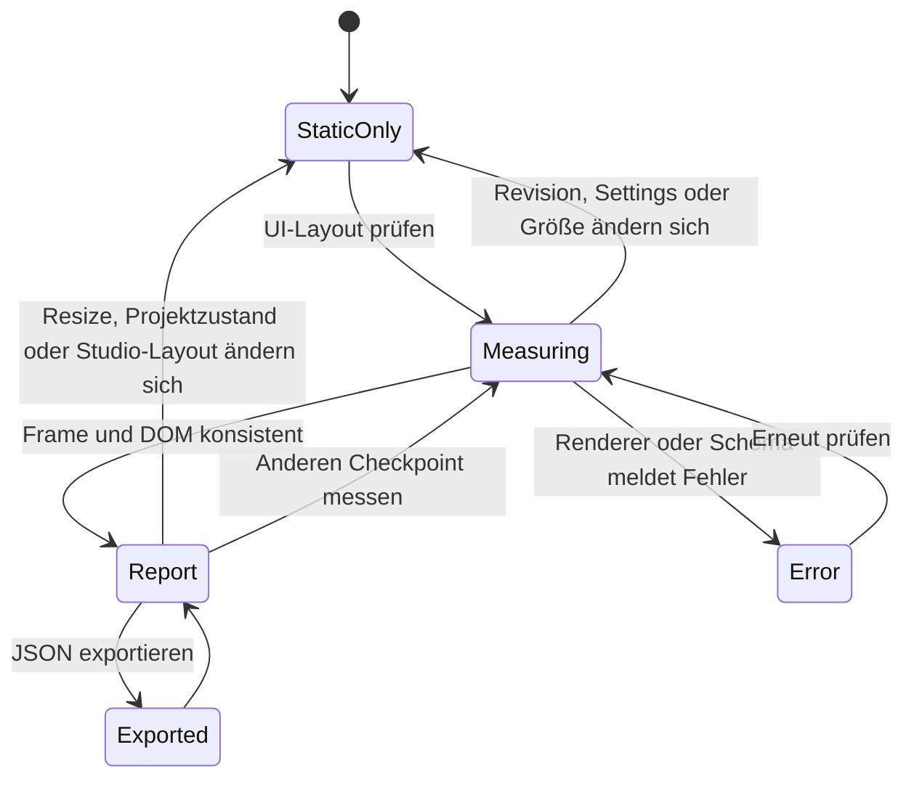

# Kombinierte Designprüfung

Stand: 2026-11-01. Implementierter M4-Flow für T19/T43, lokales Gate für T30 nach
[ADR-0005](../decisions/0005-design-quality.md). QualityReport v1 und die statische Build-Integration sind implementiert.
Manuelle Abnahmen und der externe CI-Betrieb bleiben separat.
[Nachweise und Grenzen](../milestones/m4.md).

Der statische Bericht und Next.js verwenden dieselbe aus Build-Quellen erzeugte
Build-ID. Der Server übergibt ein validiertes Artefakt als Props; der Client lädt
keinen Node-Prüfer. Der Qualitätsreport selbst wird von der geometrischen
DOM-Prüfung ausgenommen, um keine rekursiven Befunde zu erzeugen; seine Darstellung
gehört zur expliziten Screenshot-Abnahme. Geschlossene Details-Inhalte zählen
nicht als sichtbare DOM-Texte. Replay ohne aktive Brücke lässt Semantik offen.
