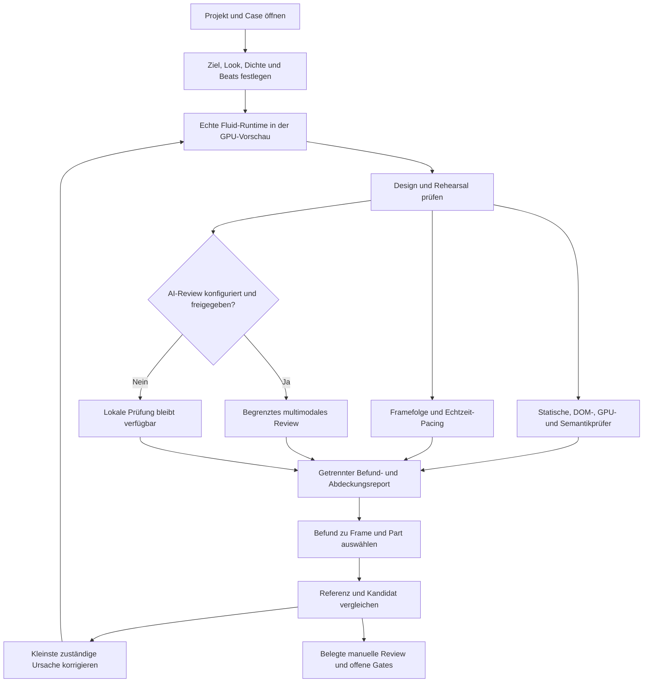
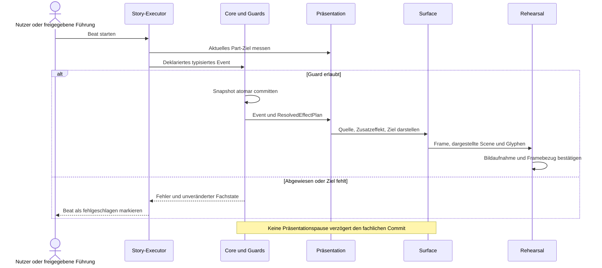
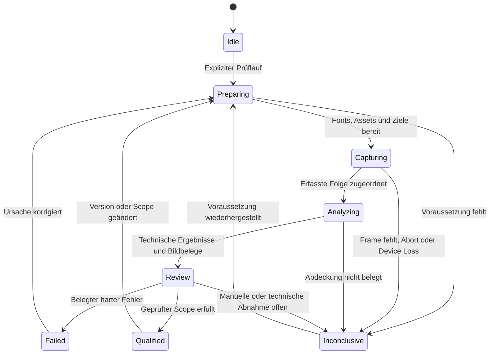
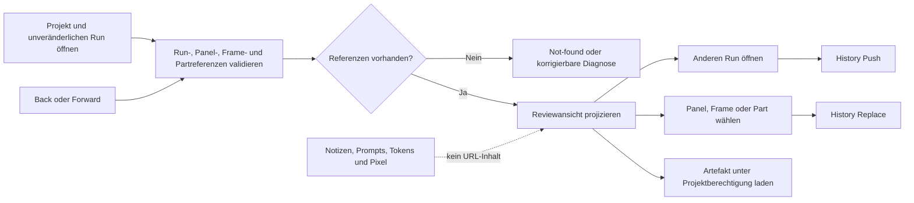
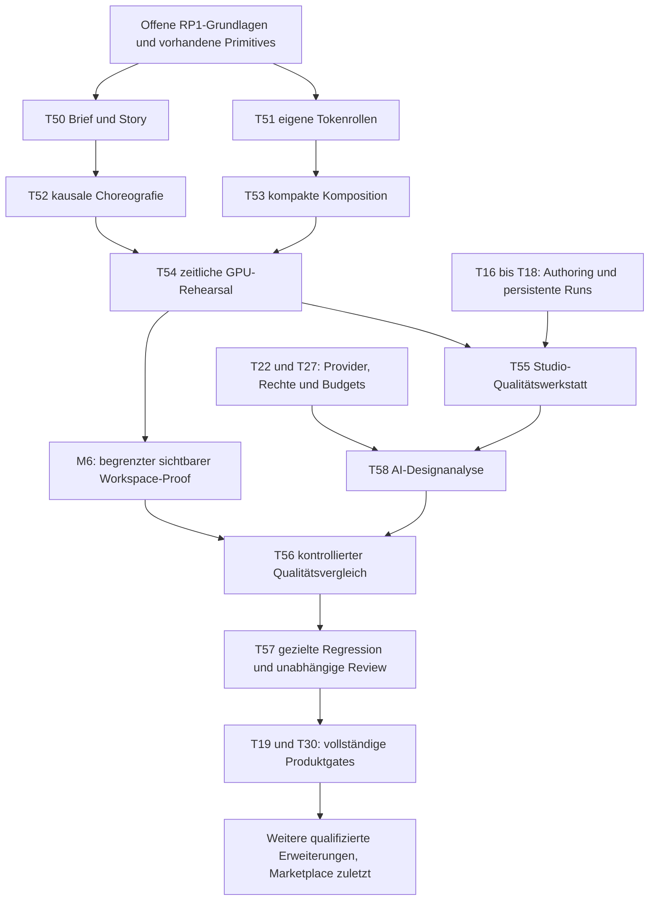

# Studio-Designprüfung und Rehearsal-Flows

Planstand: **2. November 2026**, T50–T58. Diese Flows beschreiben das Ziel und werden durch den unten ausgewiesenen lokalen Umsetzungsschnitt ergänzt. M5-Prozent-Checkpoints und M6-Einzelbilder sind kein Vollscan.

## Userflow im Studio

## Ereignis, Ursache und Darstellung

## Daten und AI-Grenze

```mermaid
flowchart LR
    Full["Vollständiger Capture und Rohbefunde"] --> Store["Versionierter Run mit lokalen Zugriffsrechten"]
    Store --> Selection["Begrenzte Frameauswahl und Brief"]
    Selection --> Redact["Sensitive Pixel vor Aufnahme redigieren und Metadaten minimieren"]
    Redact --> Preview["Datenumfang, Provider und Budget anzeigen"]
    Preview --> Auth{"Projektfreigabe und Rechte vorhanden?"}
    Auth -->|Ja| Reserve["Qualitätsbudget reservieren"]
    Reserve --> Model["Serverseitiger Review-Provider"]
    Model --> Validate["Schema und Frame-, Part- und Bildreferenzen validieren"]
    Validate --> Findings["Vorschläge mit Begründung und Unsicherheit"]
    Findings --> Diff["Überprüfbare Änderungsvorschau"]
    Diff --> Policy["Projektpolicy oder Reviewfreigabe"]
    Policy --> Apply["Erlaubte Änderung und erneute Prüfung"]
    Auth -->|Nein| Local["Kein Upload, lokale Prüfung verfügbar"]
    Model --> Usage["Tatsächliche Usage und Reservierung abrechnen"]
    Full --> Deterministic["Technische Analyse aller erfassten Frames"]
    Deterministic --> Hard["Unabhängige harte Gates"]
    Findings -. "können keine Gates aufheben" .-> Hard
```

## Capture-State und Abdeckung

AI-Review hat eine eigene Abdeckung ausgewählter Bilder. Es ersetzt weder den
technischen Vollscan noch fehlende manuelle Prüfungen. `Qualified` benennt einen
expliziten Scope, keine automatische Gesamtreleasefreigabe.

## URL- und Reviewzustand

Runpfad: `/studio/projects/:projectId/runs/:runId`.
Reviewquery: `panel`, `frame`, `part`. Datenzugriff ist separat berechtigt;
ein URL-Bezug erteilt keine Rechte. Scene-/Kamerafortschritt bleibt Präsentation,
Frameauswahl ändert keinen fachlichen Snapshot.

## Abhängigkeiten und nächster visueller Milestone

Der M6-Proof nutzt die minimalen Teilumfänge; ein konfigurierter Live-AI-Provider
ist kein Voraussetzungstrick, um die frühe visuelle Richtungsprüfung zu verzögern.
Die vollständige T58-Abnahme bleibt eine eigenständige Aufgabe.

## Ausgeführter lokaler Schnitt M6

```mermaid
flowchart LR
    User["Expliziter Start in /studio/rehearsal"] --> Runner["StoryRunner: aktueller Part und Eventvertrag"]
    Runner --> Core["Isolierter Core: Guards und Revision"]
    Core --> GPU["WebGPU bevorzugt / tatsächliches Backend sichtbar"]
    GPU --> Sensitive{"Sensitive Parts vorhanden?"}
    Sensitive -->|Ja| Deny["Keine Pixelaufnahme"]
    Sensitive -->|Nein| Capture["Ausgewähltes Canvasbild direkt im Rendercallback"]
    Capture --> Local["Lokaler Vergleich und offener Abdeckungsreport"]
    Capture --> Approval["Bis zu drei Bilder bewusst freigeben"]
    Approval --> Auth["Loopback-Origin / HttpOnly-Session / CSRF"]
    Auth --> Limit["Bodylimit / Reservierung / ein laufender Aufruf"]
    Limit --> SDK["Vercel AI SDK 7: generateText + Output.object"]
    SDK --> Count["Direktes OpenAI: tatsächlichen SDK-Input zählen"]
    Count --> Cap{"Höchstens 24.000 Tokens?"}
    Cap -->|Nein oder unbekannt| Block["Keine Generierung; sichere Diagnose"]
    Cap -->|Ja| OpenAI["Unveränderte Anfrage / Standard-Tier / store false"]
    SDK --> Optional["Optional: separat qualifiziertes Gateway"]
    OpenAI --> Refs["Schema und bestehende Bild-/Partreferenzen"]
    Optional --> Refs
    Refs --> Findings["Nur Vorschläge; kein Gate und keine Mutation"]
    Findings --> Assess["Menschlich bestätigen oder verwerfen und begründen"]
    Assess --> Export["Lokaler Reviewexport mit Herkunft und Usage"]
    SDK --> Accounting["Usage oder konservativ gehaltene Reservierung"]
    Missing["Kein Provider konfiguriert"] --> Local
```

Die Sensitive-Prüfung findet **vor** dem Lesen der Pixel statt, auch wenn die
Darstellung noch ausgehende Parts enthält. Ein allgemeiner Maskierungsrenderer ist noch
nicht implementiert. Kontinuierliche Filmaufnahme, natives Pacing, Runpersistenz
und verteilte Budgetierung folgen; sie sind durch diesen Schnitt nicht abgenommen.
