# Effektmodell und Studio-Flow

Stand: 2026-11-03. Historischer M3-Proof für T48/T49; [Nachweise und offene Gates](../milestones/m3.md).
[M7](../milestones/m7-plan.md) ergänzt die folgenden Verträge für drei neue Rezepte.
Die [Nachqualifikation vom 4. November](m7-qualification.md) trennt Workspace-
Events, native Browserjourneys und isolierte Lifecycle-/Privacy-Prüfungen.
Neue Flows sind ein Architekturvertrag; ihr ausgeführter Nachweis steht einzeln im AC-Register.
[Entscheidung](../decisions/0004-typegpu-effects.md).

## Visuelle Sequenz und Fachzustand

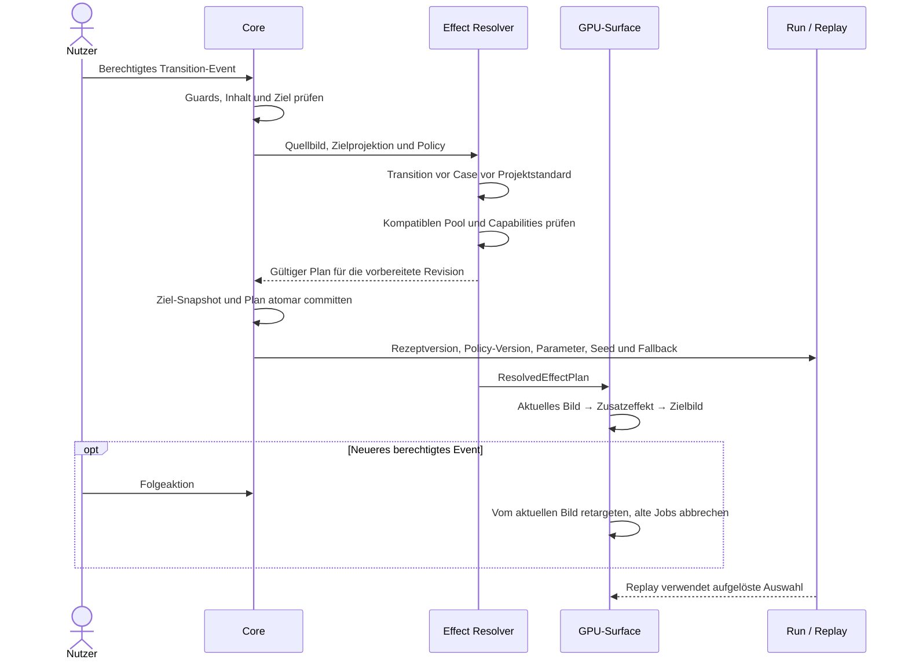

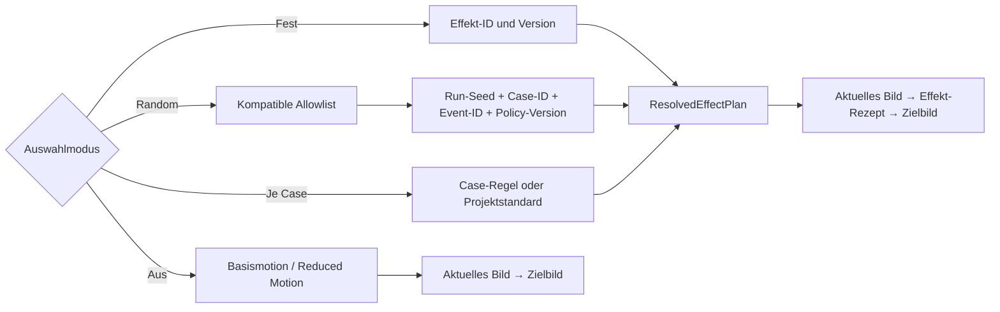

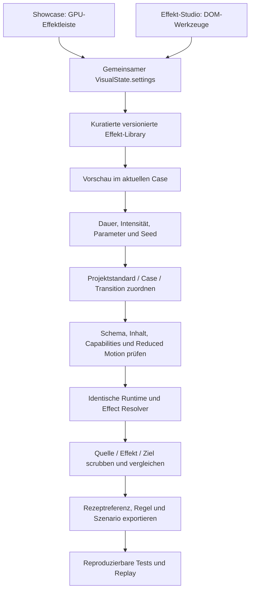

## Verbindliche Details

- Random wählt einmal pro Transition oder Choreografiegruppe. Ein Run-Seed wird
  aufgezeichnet; abgeleitete Transition-Seeds erlauben Variation innerhalb des Runs.
  Der M3-Proof verwendet eine Surface als Gruppe. Separate Choreografiegruppen
  und ihr Gruppenschlüssel bleiben T10/T11.
  „Seed +“ ändert den Ausgangsseed für den nächsten Übergang. Eine bereits
  aufgelöste Auswahl bleibt auch beim Ändern der Einstellungen unverändert.
- Der Pool wird vor Auswahl nach Inhalt, Part-Fähigkeiten, Backend, Motion-Präferenz
  und Ressourcenbudget gefiltert. Für einen leeren Pool ist der Basisübergang definiert.
- Gespeicherte Runs referenzieren Rezept- und Policy-Versionen. Bibliotheksupdates
  ändern alte Aufzeichnungen nicht. Fehlende Versionen erzeugen eine Diagnose.
- Ein Effekt verändert weder Formulardaten noch fachliche Autorität und führt keine
  Käufe, Veröffentlichungen oder anderen externen Aktionen aus.
- Eingabe, Fokus und Content Preservation bleiben an stabilen Komponenten-Parts.
  Effekt-Overlays erhalten keine eigene fachliche Interaktion.
- WebGPU ist Standard. WebGL2 verwendet qualifizierte Renderrezepte; Compute-
  Varianten besitzen einen CPU-/TSL-Pfad oder eine aufgezeichnete Darstellungskürzung.
- CPU/GPU-Tests verwenden begründete numerische Toleranzen. Seeds garantieren
  reproduzierbare Auswahl, keine pauschal bitgleichen Pixel auf jeder Hardware.

## Showcase-Steuerung ohne fachlichen Commit

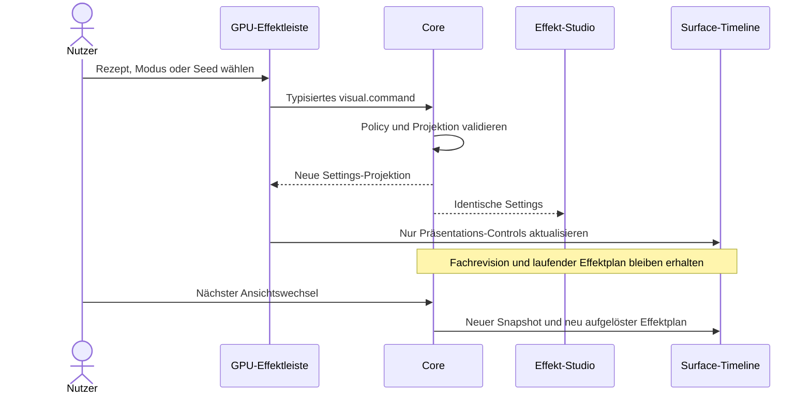

## Finale UI-Abnahme und Aufzeichnungsgröße

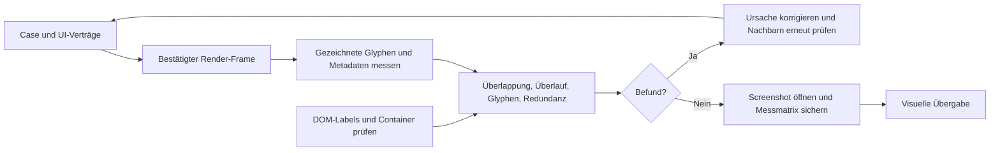

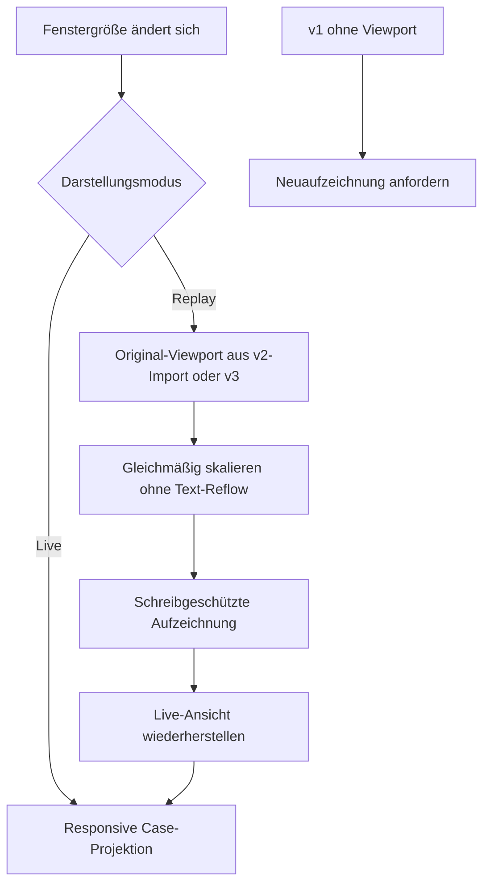

Bewegte Beschriftungen blenden in der Quellphase aus. Die Geometrie bewegt sich
bei unsichtbaren kreuzenden Labels; Zielbeschriftungen erscheinen nach dem
Positionswechsel. Statische Controls und der fachliche Ziel-Snapshot bleiben
sofort verfügbar. Die Ink-Prüfung unterscheidet auch mehrere Zeilen desselben
Texts und wartet auf den zentralen Surface-Scheduler.

## M7: gemeinsame Darstellung und begrenzte Unterbrechung

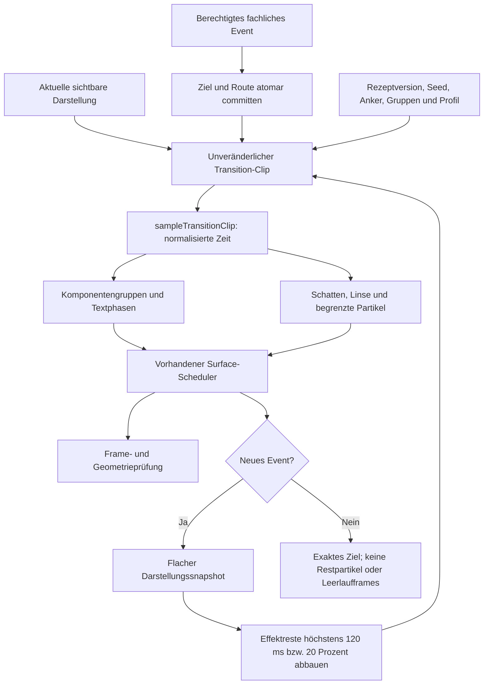

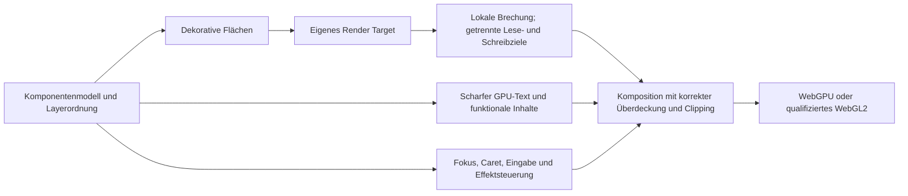

Der Snapshot enthält rekonstruierbare Daten und keine GPU-Objekte oder rekursiv
eingebetteten Vorgängerpläne. Wiederholte Unterbrechungen erfassen dieselben
begrenzten Kanäle. Quell- und Zielbeschreibungen bleiben nach Ende verfügbar,
damit rückwärts gerichtetes Scrubbing denselben Clip wiederherstellen kann.
Die GPU-Surface behält die begrenzte Quell-/Zielobjektmenge des aktuellen Clips;
ausgehende Objekte sind am Ziel unsichtbar. Ein neuer Clip gibt nicht mehr
benötigte IDs frei. Render-Targets und sichtbare Partikel bleiben am Endpunkt
nicht erhalten.

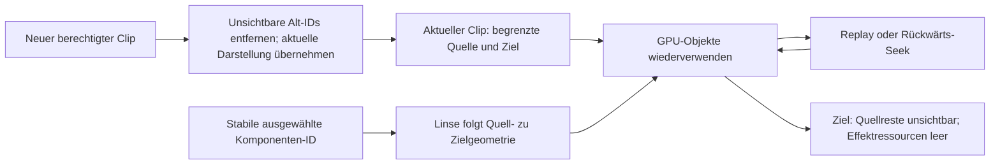

## M7: User-, Daten-, State- und URL-Grenzen

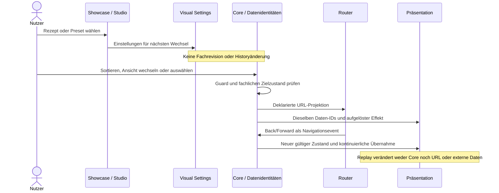

## M7: Abnahme statt bloßer Einzelbilder

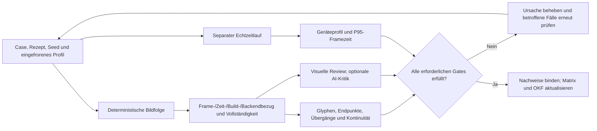

Ein fehlender Frame bleibt `inconclusive`. Ein Kontaktbogen ersetzt keine Prüfung
der erfassten Einzelbilder; langsame Einzelbildaufnahme belegt keine Framerate.
Die vorhandene ausgewählte Frameaufnahme behält ihren eigenen Abdeckungsstatus.
