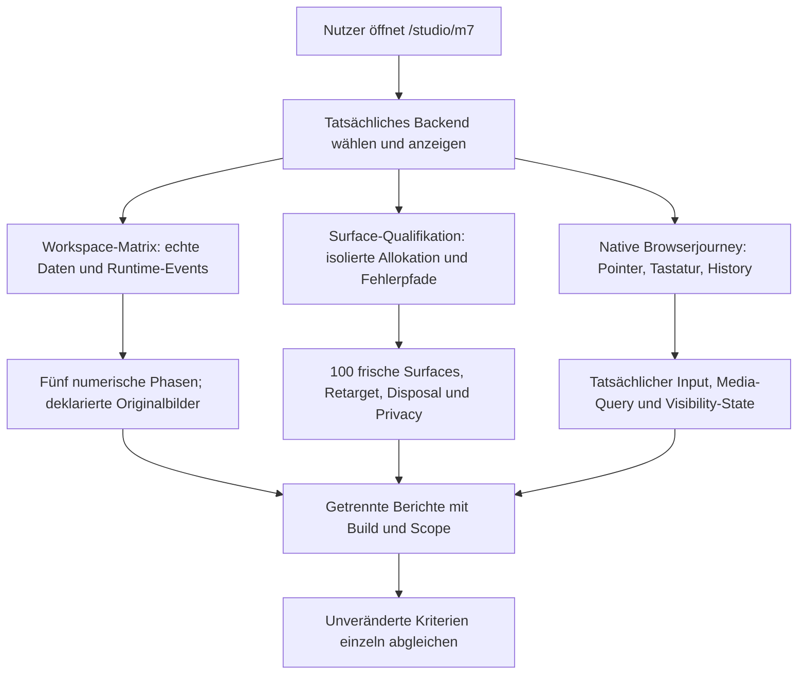
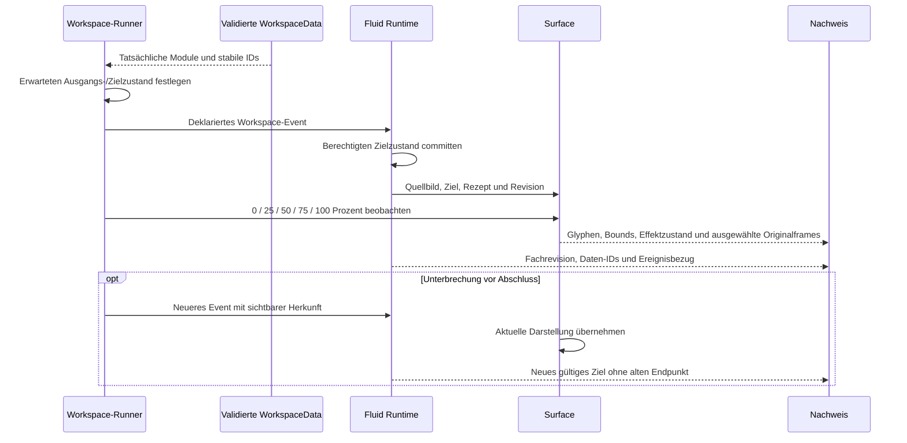
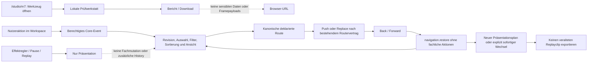
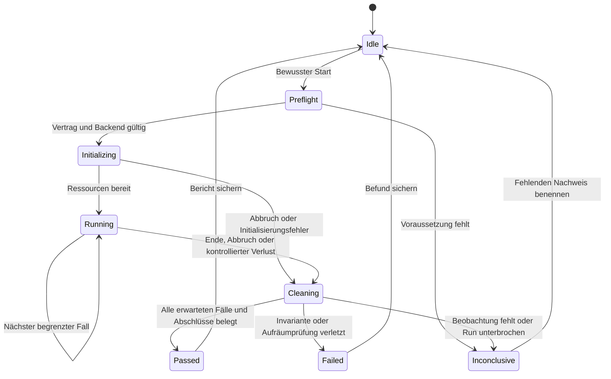
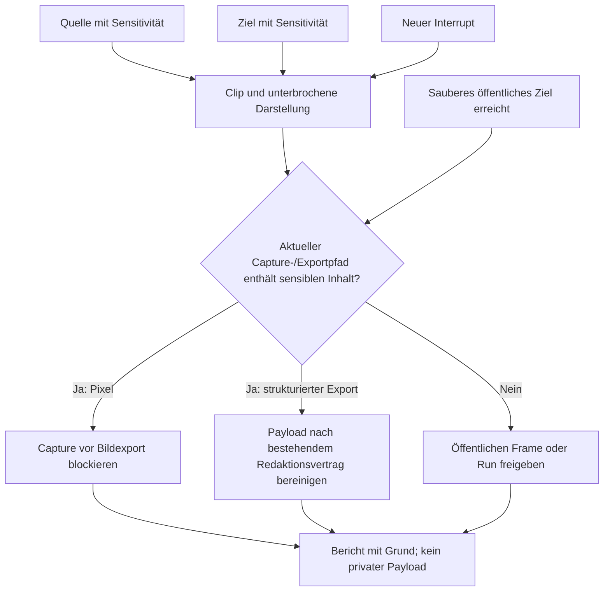

# M7: lokale Nachqualifikation und Nachweisgrenzen

Stand: **4. November 2026**. Diese Flows gehören zum
[Nachprüfplan](../milestones/m7-followup.md). Sie beschreiben die geplanten
Prüfpfade; ausgeführte Ergebnisse werden erst im kanonischen AC-Register gebunden.

## Nutzer und Zuständigkeiten

Programmgesteuerte Anwendungsereignisse sind echte Core-Ereignisse, aber keine
native Pointer- oder IME-Sitzung. Die Surface-Qualifikation hat eigene Instanzen;
ihre 100 Zyklen sind keine neue Behauptung über React-Mounts oder Treiberspeicher.

## Daten und fachlicher Zustand

## Route, History und Replay

Die Route des Werkzeugs erweitert die Produktnavigation. Sie verändert nicht
die bestehenden Workspace-URLs. Fachliche Action-Adapter werden von der visuellen
Prüfung nicht ausgelöst. Ein API-/Provider- oder Checkoutnachweis wird nicht aus
diesem lokalen Workspacefall abgeleitet.

## Ablauf, Abbruch und Fehler

Ein abgebrochener Fall verkleinert nicht nachträglich die Sollmenge. Native
Präferenz-/Visibility-Fälle werden nur bestanden, wenn der tatsächliche Zustand
beobachtet wurde. Kontrollierter Deviceverlust und echte Fehlerbehandlung werden
von einem unkontrollierten Hardware-/Treiberfehler unterschieden.

## Sensitivität vor Capture und Export

Die Prüfung nutzt einen synthetischen Marker, keine realen persönlichen Daten.
Sie untersucht zusätzlich, ob alte Darstellungsreste nach einer Unterbrechung die
Sensitivität korrekt erhalten. Eine spätere öffentliche Positivkontrolle schützt
vor einer Implementierung, die lediglich jeden Export dauerhaft abschaltet.
