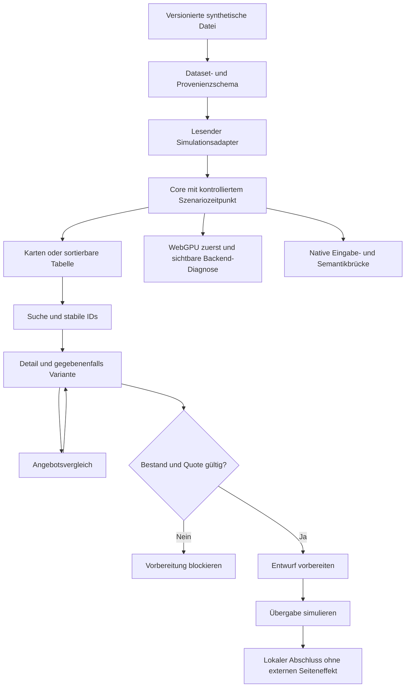
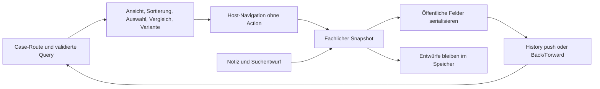
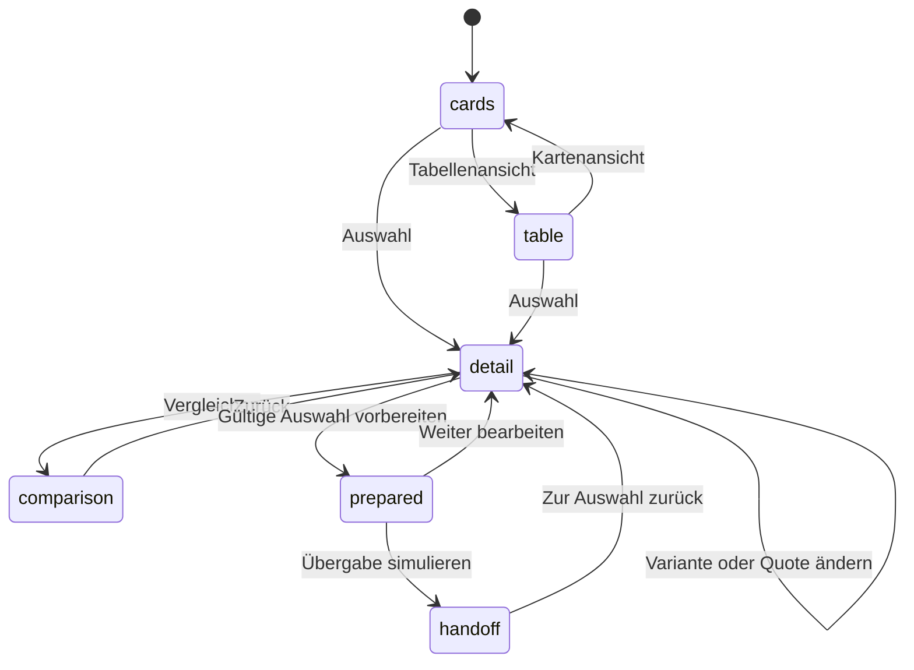

# Simulations-Cases: User, Daten, State und URL

Stand: 1. November 2026. Alle Angebote sind synthetisch. Die fachliche Vorbereitung
ist lokal, ohne Versand, Checkout oder Buchung. Die WebGPU-Runtime und ihre
Semantikbrücke sind dieselben wie im Workspace-Showcase.

URL: `/studio/simulations/:caseId?view=…&selected=…&comparison=…&sort=…&variant=…`.
Notizen, Uhränderungen und laufende Animationen werden nicht in die URL geschrieben.
Ein abgelaufener Quote bleibt blockiert, bis die kontrollierte Szenariozeit
zurückgesetzt wird. Das ist eine Fehlersimulation, keine Live-Preiserneuerung.
Ein Live-Anbieterfehler aktiviert keine synthetischen Daten.
