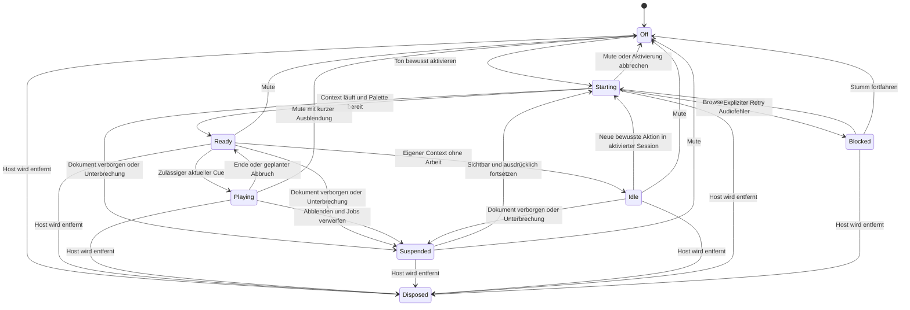
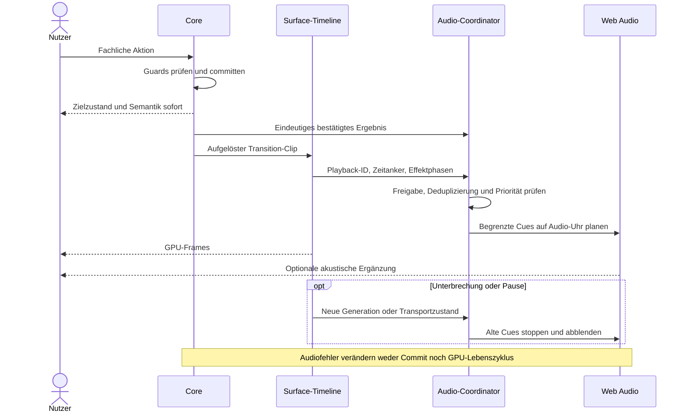
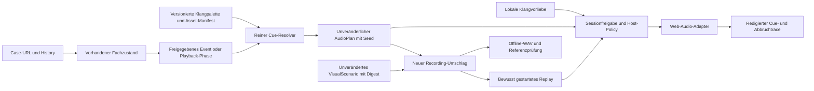
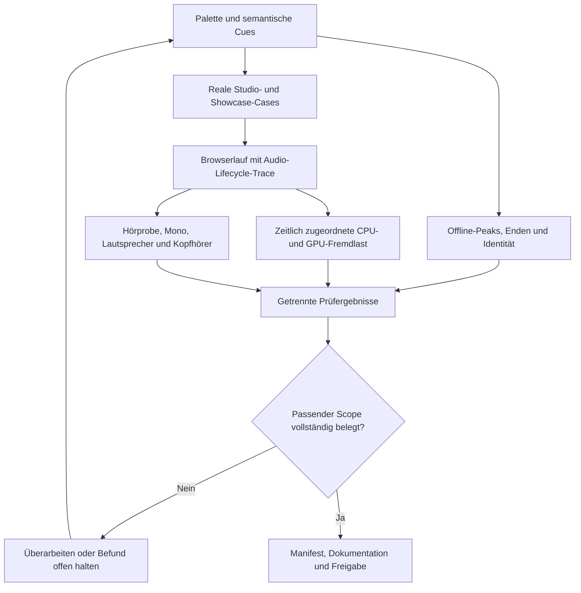

# M10 — vorgeschlagene Audio-Flows

Stand 14. November 2026. **Entwurf, noch nicht implementiert.**
[Plan und AC](../milestones/m10-sound-plan.md) · [Recherche](../research/sound-feedback.md).

## User- und State-Flow

Die Diagrammzustände gehören zur Audio-Session. Browser-Contextzustand,
Nutzereinstellung und Bereitschaft der Assets bleiben getrennte Felder;
`Ready` behauptet nicht, dass ein Lautsprecher tatsächlich hörbar ist.
Nach Mute/Unmount eingetroffene asynchrone Ergebnisse werden über einen
Ownership-Token verworfen. Auch Verbergen während `Starting` invalidiert den
Token. Mute darf nie auf `resume()` warten. `Idle` bezeichnet eigenen Energiespar-
Suspend in einer bereits aktivierten Session; `Suspended` verlangt ausdrücklich
Fortsetzen. Nach jedem Resume wird die Zuordnung beider Uhren erneuert.

## Commit, Präsentation und zwei Uhren

Die Audio-Uhr wird auf den vorhandenen monotonen Präsentationsanker abgebildet.
Es entsteht keine zweite GPU-Renderloop. Audio-Ausgabeschätzungen und beobachtete
Geräte-Onsets werden im Bericht unterschiedlich benannt.

## Daten, Persistenz und URL

Soundpalette, Pegel, Seed, Mute und Wiedergabefortschritt schreiben keine
History-Einträge. Deep Link, Reload und Popstate sind standardmäßig stumm.
Projektregeln sind teilbar; lokale Lautstärke und aktive Tonfreigabe sind es nicht.
Ein Recording darf Ton beschreiben, aber niemals die Zustimmung des Betrachters
zur Wiedergabe mitbringen. Alte Aufzeichnungen bleiben stumm.

## Qualitätsflow

