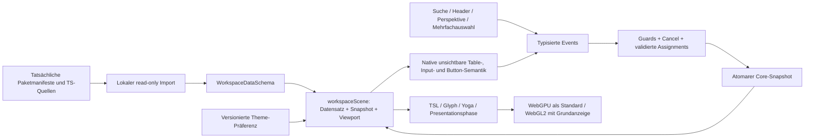
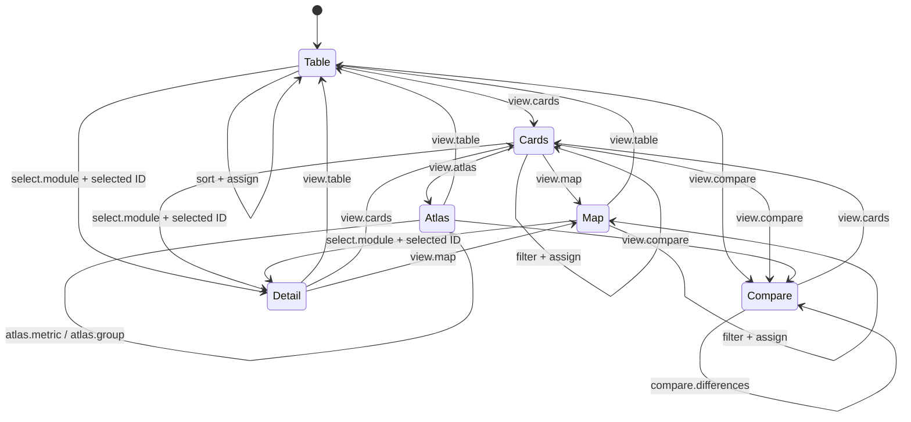
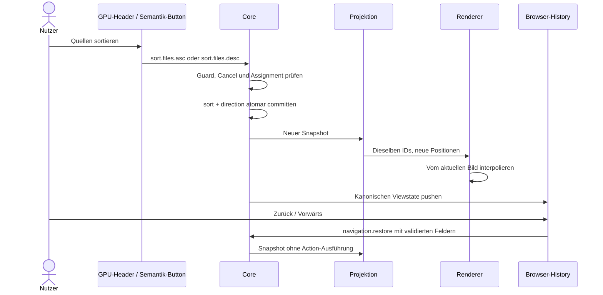
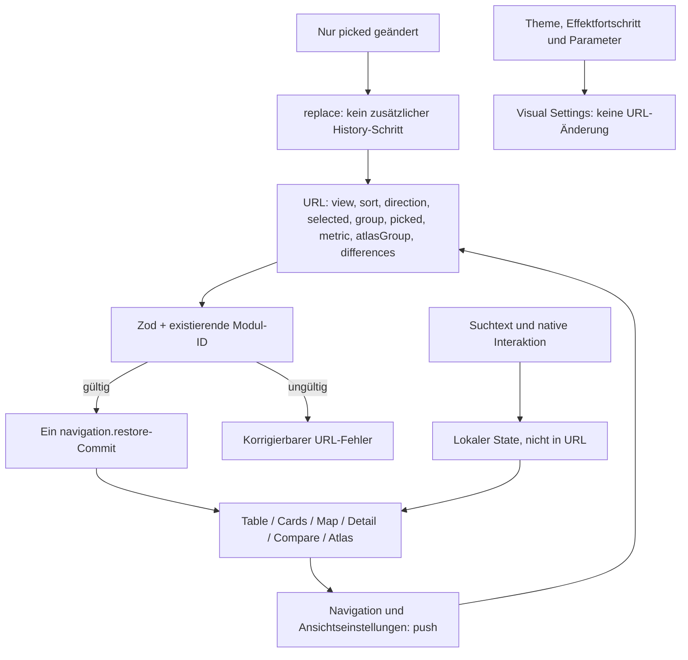
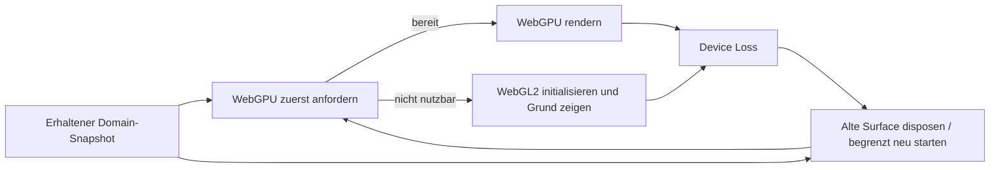

# Workspace: zusammenhängende User-, Daten-, State- und URL-Flows

Stand 2026-11-14. Implementierung: `packages/cases/src/workspace.ts`, Core,
React-Brücke und GPU-Surface. [Vollständiger generierter Stategraph](workspace-state.mmd).

Die Tabelle ist eine Datentabelle mit Header-Buttons, kein Spreadsheet mit
Grid-Tastaturnavigation. Sie verwendet eine native, unsichtbare HTML-Tabelle
als Semantikbrücke; sichtbar zeichnet ausschließlich der GPU-Renderer.
[WAI Sortable Table](https://www.w3.org/WAI/ARIA/apg/patterns/table/examples/sortable-table/).
Die manuelle Screenreader-/IME-Matrix bleibt ein eigenes Release-Gate.

Der vereinfachte Stateflow zeigt typische Wege. Der verlinkte generierte
Stategraph enthält alle tatsächlich registrierten Übergänge, einschließlich
Sortier-, Filter-, Auswahl- und Atlasaktionen. `picked` ist eine wiederholbare
Modulkennung; `metric`, `atlasGroup` und `differences` werden nur bei Abweichung
von ihrer Vorgabe serialisiert. Suchtext und Entwürfe bleiben lokal.

Der eigenständige Flow Explorer unter `/studio/flows?module=<id>` verwendet
denselben realen Modulbestand, aber einen eigenen lokalen Review-Core. Die URL
benennt nur den Modulkontext; sie behauptet keine bereits abgeschlossene
Reviewentscheidung. Der [M9-Vertrag](../milestones/m9-plan.md) und die
[Engineering-Beschreibung](../../knowledge/engineering/perspectives.md) zeigen
den separaten User-/State-/Daten- und Exportflow.
