# FluidKit-Pro: Research, Architekturprüfung und vollständiger Release-Plan

**Recherche-Stichtag: 31. Oktober 2026. Prüfung durchgeführt am 1. November 2026.**

Dieses Dokument verbindet die Recherche mit dem statischen Audit beider Projekte, Feature-Matrizen, bewerteten Lösungsoptionen und einem ausführbaren Plan.

Verbindliche Produktentscheidungen aus unserem Austausch:

- Ein Entwickler-Framework für Intent-Erkennung, prädiktive und fließende Benutzeroberflächen.
- **Sichtbare Framework-Komponenten werden ausschließlich mit WebGPU gerendert. Kein WebGL- oder HTML-Renderer als Ersatz.**
- Unsichtbare Semantik- und Eingabebrücken sind erlaubt.
- Fluid Studio verwendet eine zugängliche DOM-Bedienoberfläche mit echter WebGPU-Vorschau.
- Studio unterstützt visuelles Authoring, Simulation, Replay und Testing.
- Auswählbare Praxisfälle verwenden echte Daten über Adapter, Importe oder gekennzeichnete Aufzeichnungen.
- Neuaufbau ist ausdrücklich erlaubt. Bestehende APIs und Implementierungen müssen nicht erhalten bleiben.
- Umsetzung in Release-Packages und Waves; Marketplace zuletzt.

## 1. Vorangestelltes Research: Methoden und Best Practices

### 1.1 Relevante Erkenntnisse

| Thema | Rechercheergebnis | Konsequenz für FluidKit-Pro |
|---|---|---|
| WebGPU erzwingen | Three.js’ `WebGPURenderer` besitzt einen automatischen WebGL-Backendwechsel. `forceWebGL: false` schaltet diesen nicht ab. | Einen expliziten WebGPU-Renderer aus den öffentlichen Bausteinen `Renderer`, `WebGPUBackend` und `StandardNodeLibrary` zusammensetzen; keinen Fallback registrieren. Quelle: [Three.js r187](https://github.com/mrdoob/three.js/blob/r187/src/renderers/webgpu/WebGPURenderer.js). |
| GPU-Lebenszyklus | Adapterverfügbarkeit, Geräteverlust, Ressourcen und optionale Features müssen explizit behandelt werden. Browsername allein reicht nicht. | Capability-Prüfung, nachvollziehbare Startfehler, Wiederherstellung aus CPU-seitigem Zustand und vollständiges Disposal. Quelle: [WebGPU-Spezifikation](https://www.w3.org/TR/webgpu/). |
| Canvas-Accessibility | Canvas-Pixel ersetzen keine zugängliche Dokumentstruktur. Der HTML-Standard beschreibt die Zuordnung interaktiver Canvas-Regionen zu fokussierbaren Elementen. | Semantikbaum aus demselben Komponentenmodell ableiten; Fokus, Labels, Rollen und Zustände synchron halten. Quelle: [HTML Canvas](https://html.spec.whatwg.org/multipage/canvas.html#the-canvas-element). |
| Texteingabe | `EditContext` adressiert eigene Textoberflächen, ist aber keine ausreichend universelle Produktionsgrundlage. | Native Eingabebrücke für IME, Auswahl, Clipboard und mobile Tastaturen; GPU rendert Text, Auswahl und Caret. EditContext bleibt ein optionaler Adapter. Quelle: [W3C EditContext](https://www.w3.org/TR/edit-context/). |
| GPU-Typografie | Troika/Drei-Text darf nicht als automatisch WebGPU-kompatibel vorausgesetzt werden. `@pmndrs/glyph` bietet eine neuere TSL-/WebGPU-Richtung mit dokumentierten Grenzen. | Eigenes Text-Adapterinterface; Glyph zuerst qualifizieren. Keine ungeprüfte Troika-Übernahme. Quellen: [Drei-Status](https://github.com/pmndrs/drei/issues/2588), [Glyph](https://github.com/pmndrs/glyph). |
| Layout | Yoga berechnet Layout unabhängig vom Renderer; es implementiert einen CSS-/Flexbox-Teilumfang. | Yoga für Boxlayout verwenden und FluidGrid, Virtualisierung, Clipping und Breakpoints ausdrücklich darüber definieren. Kein Versprechen vollständiger CSS-Kompatibilität. Quelle: [Yoga](https://www.yogalayout.dev/docs/about-yoga). |
| Zustandsmodellierung | Statecharts und Actor-Inspection machen erlaubte Übergänge und Laufzeitereignisse nachvollziehbar. | XState 5 hinter einem eigenen deklarativen Flow-Vertrag einsetzen; Studio, Tests und Runtime verwenden denselben Flow. Quelle: [XState Inspection](https://stately.ai/docs/inspection). |
| Modellbasierte Tests | Generierte Ereignisfolgen und unabhängige Invarianten erkennen Fehler, die einzelne Happy-Path-Tests übersehen. | Property-based Tests für Abbruch, Konkurrenz, Navigation, Datenverlust und ungültige Übergänge. Das Testmodell darf keine Kopie der Implementierung sein. Quelle: [fast-check](https://fast-check.dev/docs/advanced/model-based-testing/). |
| Visuelle Tests | Screenshots hängen von Browser, Betriebssystem, Hardware und Renderingbedingungen ab. | Kontrollierte Uhr und Seeds, definierte Render-Checkpoints, Baselines pro Geräteklasse; Pixelvergleich zusätzlich zu State- und Semantikprüfung. Quellen: [Playwright Clock](https://playwright.dev/docs/clock), [Visual Comparisons](https://playwright.dev/docs/test-snapshots). |
| KI-Orchestrierung | AI SDK 7 ist verfügbar. Strukturierte Ausgabe bleibt von Berechtigungs- und Zustandsprüfung getrennt. Die neue Decisions-API ist ausdrücklich experimentell. | Stabile strukturierte Ausgaben für den Produktionspfad; `experimental_decide` höchstens im isolierten Evaluationspaket. Quellen: [AI SDK 7](https://vercel.com/changelog/ai-sdk-7), [Structured Data](https://ai-sdk.dev/docs/ai-sdk-core/generating-structured-data), [Decisions](https://ai-sdk.dev/docs/ai-sdk-core/decisions). |
| KI-Sicherheit | Prompt-Filter und gültiges JSON ersetzen keine Autorisierung. Modellantworten sind untrusted input. | Zulässige Aktionen, Parameter, Zustandsversionen und Berechtigungen außerhalb des Modells prüfen. Quelle: [OWASP](https://cheatsheetseries.owasp.org/cheatsheets/LLM_Prompt_Injection_Prevention_Cheat_Sheet.html). |
| KI-Evaluation | KI-Ausgaben sind variabel; fallbezogene Datensätze und wiederholbare Evaluation sind erforderlich. | Eigenen Evaluationsrunner mit versionierten Datensätzen, Regeln und menschlich bewerteten Grenzfällen bauen. Quelle: [Evaluation Best Practices](https://developers.openai.com/api/docs/guides/evaluation-best-practices). |
| Wirkungsmessung | Conversion-Lift ist eine experimentell zu prüfende Hypothese. Fehlerhafte Gruppenzuteilung kann Ergebnisse umkehren. | Stabile Kontrollgruppen, Exposure-/Outcome-Zuordnung und Sample-Ratio-Mismatch-Prüfung vor jeder Wirkungsbehauptung. Quelle: [Microsoft Research](https://www.microsoft.com/en-us/research/articles/diagnosing-sample-ratio-mismatch-in-a-b-testing/). |
| Predictive Loading | Vorladen kann unbeabsichtigt Seiteneffekte auslösen; Framework-Prefetching besitzt bereits eigene Priorisierung. | Nur lesende, freigegebene Ressourcen vorladen und mit dem Host-Router koordinieren. Quelle: [Next.js Prefetching](https://nextjs.org/docs/app/guides/prefetching). |

**Methodischer Rahmen:** Anforderungs-Traceability, Architekturentscheidungen mit Alternativen, risikobasierte Proofs, explizite Statecharts, unabhängige Invarianten, reproduzierbare Szenarien, Hardwaremessungen und kontrollierte Produktexperimente. „Modern“ bedeutet hier belegte Eignung für das Produkt, nicht maximale Zahl neuer Technologien.

### 1.2 Versions- und Kompatibilitätsmatrix

Die Ist-Versionen stammen aus den Lockfiles, nicht aus den zahlreichen `latest`-Angaben in FluidKit-Pro.

| Technologie | FluidKit-Pro | FluidUI | Zielbasis aus der Recherche |
|---|---:|---:|---|
| Next.js | 15.3.3 | 15.5.3 | 16.4.3 für Studio und Referenzintegration |
| React | 19.1.0 | 19.1.1 | Zunächst 19.2.9 wegen Glyph-Peer-Kompatibilität |
| Three.js | 0.177.0 | — | 0.187.0, einschließlich passender Types |
| AI SDK | 4.3.16 | 5.0.45 | 7.0.159, ausschließlich serverseitige Modellzugriffe |
| TypeScript | 5.8.3 | 5.6.3 | 7.0.2, strict |
| Zod | fehlt | 4.1.9 | 4.6.7 |
| Statecharts | fehlt | fehlt | XState 5.33.3 |
| Text/Layout | unvollständige Ansätze | Browser-DOM | Glyph 0.1.0 + Yoga 3.2.1 |
| Tests | keine Suite | kleine Jest-/Playwright-Suite | Vitest 5.0.5, Playwright 1.64.1, fast-check 4.10.2 |
| Studio | fehlt | einfacher Playground | React Flow 12.12.0, Monaco 0.57.0, Mermaid 12.2.0 |
| Query-Adapter | fehlt | fehlt | TanStack Query 5.105.0 |
| Serverbetrieb | alte Mindestangaben | Edge-Annahme | Node.js 26 LTS |
| Gemeinsame Persistenz | fehlt | flüchtiger Speicher | PostgreSQL 18.6 im optionalen Serverpaket |

Die Versionen wurden anhand offizieller Paketmetadaten und Veröffentlichungen geprüft. Die am 1. November veröffentlichte Query-Version 5.105.1 gehört ausdrücklich **nicht** zur Oktober-Basis.

React 19.3.1 ist neuer, aber Glyph 0.1.0 deklariert React `<19.3`. Der Plan verwendet deshalb zunächst die gepatchte 19.2-Linie; keine erzwungenen Peer-Overrides. Quellen: [React-Versionen](https://react.dev/versions), [Glyph-Paketmetadaten](https://registry.npmjs.org/@pmndrs%2fglyph/0.1.0).

Next.js 16.4 empfiehlt Cache Components für neue Anwendungen. Diese werden für Studio-Daten und Dokumentation gezielt eingesetzt; GPU-Runtime und persönliche Zustände werden dadurch nicht pauschal gecacht. Quellen: [Next.js 16.4](https://nextjs.org/blog/next-16-4), [Oktober-Sicherheitsupdate](https://nextjs.org/blog/nextjs-security-update-october-14-2026).

Node 26 ist zum Stichtag LTS; PostgreSQL 19 noch kein stabiler Produktionsstandard. Quellen: [Node-Releases](https://nodejs.org/en/about/previous-releases), [PostgreSQL-Versionierung](https://www.postgresql.org/support/versioning/).

Alle Zielversionen werden in RP0 reproduzierbar fixiert. Spätere Aktualisierungen benötigen einen dokumentierten Anlass und die betroffenen Kompatibilitätstests.

## 2. Audit der vorhandenen Projekte

### 2.1 Ergebnis

**Die kombinierte Kernvision ist umsetzbar. Die vorhandenen Projekte bilden dafür jedoch keine nachgewiesen produktionsfähige Grundlage.**

FluidKit-Pro und FluidUI sind unterschiedliche, ergänzbare Modelle:

| Ebene | FluidKit-Pro | FluidUI |
|---|---|---|
| Hauptidee | Komponenten verändern ihre visuelle Form | Oberfläche antizipiert Absichten und passt Varianten an |
| Zentrale Abstraktion | Mesh, geometrischer Zustand, Morphing | Intent, Persona, Variante, Zielgewicht |
| Rendering | Three.js plus sichtbare DOM-Overlays | React-/DOM-Komponenten |
| KI-Rolle | Transformationen auslösen | Intent und Varianten unterstützen |
| Größte Lücke | Konsistenter UI-, Eingabe- und Zustandsunterbau | Reale Vorhersage-, Daten- und Lernpipeline |
| Übernahmewert | Produktidee, Komponentenfamilien, Steuerungsmodi | Intent-/Preload-Konzept, Guardrails, Experiment- und Lernvision |

**FluidUI ist kein vollständiger Vorgänger, dessen Funktionen lediglich portiert werden müssen.** Seine prädiktive Ebene fehlt FluidKit-Pro weitgehend; zugleich fehlt FluidUI die angestrebte GPU- und Morphing-Runtime.

### 2.2 Belegte Befunde

| Befund | Beleg und Auswirkung |
|---|---|
| Dokumentation überschätzt den Implementierungsstand | „Live-KI“, „Compute-Morphing“ und Leistungswerte werden behauptet, aber nicht durch Tests oder Benchmarks belegt. Mehrere Architekturdateien sind sogar bytegleich trotz unterschiedlicher Titel. |
| Die Runtime ist aktuell nicht „Zero DOM“ | Button und Card rendern sichtbare HTML-Overlays; deren Positionierung wird separat aus GPU-Positionen berechnet. Es existieren zwei Darstellungsmodelle. |
| KI läuft standardmäßig simuliert | `useSimulation = true`; Live-Zugriff verwendet einen Browser-Client mit `dangerouslyAllowBrowser`. Öffentliche API-Key-Variablen werden in Client-Komponenten gelesen. KI-Service. |
| Morphing ist überwiegend Geometriewechsel | ButtonShape/CardShape tauschen Box-Geometrien unmittelbar. Die Basisklasse skaliert und ersetzt Geometrie. Das ist kein allgemeines flüssiges GPU-Morphing. |
| Zustände können auseinanderlaufen | React-Hook, GPU-Komponente und KI-Service verändern Zustände auf unterschiedlichen Wegen. Unbekannte Morph-Ziele können trotzdem als aktueller Zustand eingetragen werden. FluidSystem. |
| Komponenten und Routen sind teilweise leer | Input-/Progress-Wrapper, entsprechende Shape-Dateien und drei Komponenten-Unterseiten haben null Zeilen. Datei-Existenz ist hier kein Feature-Nachweis. |
| Lebenszyklus ist unvollständig | Kein durchgängiges Unregister-/Dispose-Konzept, ungebremste Animationsschleife, fehlende Geräteverlustbehandlung und problematische Initialisierung über überschreibbare Methoden im Basiskonstruktor. |
| Content Preservation ist kein fertiges System | Mappings sind teilweise deklariert, aber nicht konsistent als typisierte Transformation ausgeführt. |
| FluidUI sagt mehr Vorausberechnung zu, als implementiert ist | Intent-Scoring ist Keyword-/Gewichtslogik für einen Kandidaten. Eine echte Top-k-Prefetch-Pipeline ist nicht vorhanden. |
| FluidUI misst keine dargestellte Produktwirkung | Dashboardwerte sind feste Ausgangswerte beziehungsweise simulierte Anpassungen. Analytics werden aus dem Puffer entfernt, ohne dauerhaft gespeichert zu werden. |
| Lernalgorithmus entspricht nicht dem ADR | Dokumentiert ist LinUCB; vorhanden ist ein flüchtiger ε-greedy-Ansatz. `updateReward` kann durch `ensureArms(..., arm + 1)` Arm-Arrays neu initialisieren und Historie verlieren. Bandit. |
| Schutzmaßnahmen sind überwiegend beschrieben | Der Chat-Endpunkt übernimmt Requestdaten ohne vollständigen Laufzeitvertrag; zentrale Budgetierung, serverseitiges Rate-Limiting und belastbare Deadline-Steuerung sind nicht umgesetzt. |
| URL-Flows fehlen als Architekturvertrag | Es gibt Seitenrouten, aber keine systematische Zuordnung zwischen fachlichem Zustand, Deep Links, Zurück/Vorwärts und laufenden Transformationen. |

Die vorhandenen Tests konnten nicht ausgeführt werden: In FluidKit-Pro fehlen installierte Abhängigkeiten; im FluidUI-Ordner fehlen die benötigten TypeScript-/Jest-Dateien trotz vorhandenem `node_modules`-Verzeichnis. Es wurden **keine erfolgreichen Builds, GPU-Messungen oder Live-KI-Tests nachgewiesen**.

### 2.3 Gegenwärtiger Flow und seine Bruchstellen

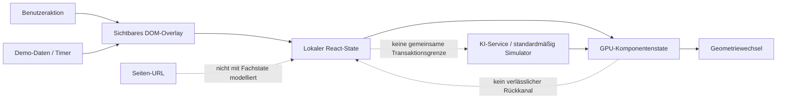

## 3. Feature- und Machbarkeitsmatrizen

Legende: **P** = partieller Code, **D** = dokumentierte Absicht, **—** = fehlt. Keine dieser Einstufungen bedeutet bereits verifizierte Produktionsreife.

### 3.1 Kern und Intelligence

| Feature | Pro | FluidUI | Zielentscheidung | Tasks |
|---|:---:|:---:|---|---|
| Ausschließlich WebGPU | P | — | Expliziter Backendvertrag ohne Rendererwechsel | T03–T04 |
| GPU-Text, Icons, Bilder | P | — | Eigenständige Rendering-Primitives | T05–T06 |
| Fokus, Tastatur, Screenreader, IME | — | P | Abgeleitete Semantik-/Eingabebrücke | T07 |
| Responsive Layout, Scroll, Clipping | P | P | Gemeinsames Layoutmodell und Virtualisierung | T05, T13 |
| Button, Card, Input, Progress | P | P | Funktionsfähige Komponenten statt Formdemos | T13 |
| Form, Wizard, Grid, Table, Nav, Modal | D/P | P | Vollständige Kernbibliothek | T13 |
| Manual, Hybrid, Auto | P | P | Drei explizite Modi mit eindeutiger Autorität | T09, T22 |
| Flüssiges Morphing | P | — | GPU-Morphs für deklarierte kompatible Übergänge | T10 |
| Physics-Presets | D | — | Deterministische Steuerung, GPU-Effekte | T11 |
| Content Preservation | D/P | — | Typisierte Projektionen, stabile Feldidentitäten | T12 |
| Multi-Component Choreography | D | — | Gemeinsame Timeline und Abbruchregeln | T10–T11 |
| Verhalten und Intent | P | P | Ereignisvertrag und erklärbares Top-k-Ranking | T21 |
| Predictive Preload | D | D | Budgetierter, abbrechbarer Scheduler | T23 |
| Personalisierung und Ziele | D/P | P | Freigegebene Varianten und explizite Präferenzen | T24 |
| Cloud-/lokale Modelle | D/P | P | Austauschbare Provider, lokale Modelle optional | T22, T29 |
| Persistente Analytics und Kosten | D | P | Reale Events, Nutzung und Budgetreservierung | T26–T27 |
| A/B-Tests und Lernschleife | D | D/P | Holdout, Offline-Evaluation, kontrollierte Policies | T28 |
| State-/Daten-/URL-Konsistenz | — | — | Explizite Eigentümerschaft und versionierte Events | T09, T14–T15 |

### 3.2 Studio, Ökosystem und langfristige Visionen

| Feature | Pro | FluidUI | Zielentscheidung | Tasks |
|---|:---:|:---:|---|---|
| Visueller Inspector | D | P | Live-Zustand, Events, Entscheidungen, Ressourcen | T16–T18 |
| Flow-/State-/URL-Editor | — | — | Ein Modell mit grafischer und textueller Ansicht | T17 |
| Simulation und Fehlereinspielung | P | P | Kontrollierte Szenarien statt zufälliger Demo-KI | T18 |
| Record/Replay | — | — | Versionierte, redigierte Laufaufzeichnungen | T18–T19 |
| Mermaid-Flows | D | P | Aus Verträgen erzeugte und validierte Diagramme | T01, T17 |
| Visuelle und modellbasierte Tests | — | P | Gemeinsamer Szenariovertrag für Studio und CI | T19 |
| Reale Praxisfälle | P, Mockdaten | P, statische Daten | Case-Pakete mit Daten- und Action-Adaptern | T25 |
| CLI und shadcn-ähnliche DX | D | D | Paketierter Kern plus editierbare Rezepte | T20 |
| Headless/API-Nutzung | D | — | Frameworkunabhängiger Kern von Beginn an | T02, T32 |
| Plugins und weitere Frameworks | D | — | Versionierte Capability-Verträge | T32 |
| Collaboration | D | — | Gemeinsame Dokumente, getrennte Laufzeitsitzungen | T31 |
| Enterprise-Integration | D | D | Host-Auth, Rollen, Audit, Export, Self-Hosting | T34 |
| Voice und Gesten | D | — | Zusätzliche Eingabeadapter für dieselben Events | T33 |
| AR/VR/WebXR | D | — | Optionales Paket für nachgewiesene WebGPU-XR-Kombinationen | T35 |
| Neural Rendering | D | — | Isoliertes Forschungspaket mit messbarem Nutzen-Gate | T36 |
| Marketplace | D | — | Abschließende Registry-/Distributionsstufe | T37 |
| Dokumentation und Community | D | D/P | Nachvollziehbare Beispiele und getestete Rezepte | T38 |

### 3.3 Was an der Vision präzisiert werden muss

| Ursprüngliche Aussage | Belastbare Produktdefinition |
|---|---|
| „Alles kann sich in alles verwandeln“ | Jede **registrierte kompatible** Zustandskombination kann einen definierten Übergang besitzen. Datenverlust und ungültige Semantik sind ausgeschlossen. |
| „100 % WebGPU“ | Alle sichtbaren Runtime-Komponenten werden mit WebGPU gezeichnet. CPU-Logik, Layoutberechnung, Browser-Eingabedienste und Semantikbrücken bleiben erlaubt. |
| „KI entscheidet alles“ | KI entscheidet innerhalb freigegebener Möglichkeiten. Fachliche Invarianten, Rechte und ausdrückliche Nutzeraktionen haben Vorrang. |
| „Unter 100/200 ms KI-Latenz“ | Sofortige lokale Rückmeldung wird budgetiert. Entfernte Modellantworten laufen asynchron und sind keine Voraussetzung für grundlegende Bedienbarkeit. |
| „60 FPS und weniger Speicher“ | Messbare Ziele auf definierten Geräten und Szenarien. Keine pauschale Überlegenheit gegenüber DOM-Oberflächen. |
| „Automatisch +25 % Conversion“ | Zu prüfende Hypothese mit Kontrollgruppe. Kein technisches Abnahmekriterium und keine vorab zugesicherte Wirkung. |
| „WebGPU in jedem Browser“ | Unterstützte Browser-/OS-/GPU-Kombinationen werden veröffentlicht. Nicht unterstützte Systeme erhalten einen verständlichen Startfehler. |
| „XR ist nur ein weiterer Modus“ | Separates Capability- und Integrationspaket. Browser-WebGPU allein beweist keine immersive XR-Unterstützung. |

WebXR bleibt hinsichtlich konkreter Browser-/Geräte-Kombinationen separat zu qualifizieren. Quelle: [W3C WebXR-Veröffentlichungsstand](https://www.w3.org/standards/history/webxr/).

## 4. Scored Optionen und Gewinner

### 4.1 Bewertungsverfahren

Bewertet wird auf einer Skala von 1–5:

- **30 % Zielerfüllung**
- **25 % Korrektheit, Sicherheit und Accessibility**
- **20 % Testbarkeit und Nachvollziehbarkeit**
- **15 % Lieferbarkeit und Wartungsaufwand**
- **10 % Erweiterbarkeit**

Der gewichtete Wert wird auf 100 Punkte normiert. Es handelt sich um **Planungsbewertungen**, nicht um gemessene Performance oder Erfolgswahrscheinlichkeiten.

Harte Anforderungen schlagen den Score: Eine Lösung mit sichtbarem WebGL-/DOM-Ersatzrenderer oder Browser-API-Keys ist unabhängig von ihrem Nutzwert ausgeschlossen.

### 4.2 Strategische Entscheidungen

| Entscheidung | Option A | Option B | Hybrid | Gewinner und Begründung |
|---|---|---|---|---|
| Gesamtarchitektur | Bestehende Prototypen ausbauen — **46** | Alles einschließlich Rendering selbst entwickeln — **74** | Neuer eigener Kern mit gezielt übernommenen Infrastrukturbausteinen — **92** | **Hybrid:** bewahrt Produktideen, vermeidet Altlasten und unnötigen Grafik-Unterbau |
| Zustandsmodell | Reducer plus Konventionen — **71** | Direkt geschriebene Statecharts — **85** | Deklarativer Vertrag, XState-Ausführung, abgeleitete Diagramme — **97** | **Hybrid:** Authoring, Runtime und Tests bleiben verbunden |
| Text und Layout | Canvas-Texturen und feste Koordinaten — **64** | Vollständige eigene Typografie-Engine — **72** | Glyph-/Yoga-Adapter plus eigene UI-Verträge — **88** | **Hybrid:** begrenzte Abhängigkeiten, eigene Kontrolle über Semantik |
| KI | LLM bei jedem Ereignis — **56** | Ausschließlich lokale Regeln — **80** | Lokaler schneller Pfad plus asynchrone Modellvorschläge — **94** | **Hybrid:** reagiert sofort und bleibt nachvollziehbar |
| Studio | Nur Code-Playground — **84** | Komplett eigenes GPU-Editorprodukt — **68** | DOM-Studio mit identischer WebGPU-Runtime in der Vorschau — **97** | **Hybrid:** entspricht der geklärten Produktgrenze |
| Content Mapping | Explizite typisierte Zuordnung — **95** | Freie KI-Konvertierung — **57** | KI erstellt Mapping-Vorschläge zur Prüfung — **85** | **A:** Produktionsübergänge dürfen keine Inhalte erfinden |
| Lernen | Unmittelbare Online-Anpassung — **53** | Nur freigegebene Offline-Updates — **85** | Offline-Qualifikation, Holdout und begrenzte Online-Policies — **94** | **Hybrid:** messbare Verbesserung mit Rücknahmeweg |
| Distribution | Vollständige Copy-Paste-Bibliothek — **59** | Ausschließlich geschlossenes npm-Paket — **80** | Paketierter Kern plus editierbare Rezepte und Case-Pakete — **95** | **Hybrid:** wartbarer Kern und anpassbare Integration |

**Gewähltes Zielmodell:** ein neuer, frameworkunabhängiger Fluid-Kern mit strikt WebGPU-basierter Darstellung, deklarativen Zustands- und Datenverträgen, kontrollierter Intelligence und eigenem Fluid Studio.

Die Detailentscheidungen für sämtliche Umsetzungstasks stehen in Abschnitt 7. Die Feature-Matrizen verweisen auf diese Tasks; dadurch bleibt jede Feature-Entscheidung bis zur Abnahme nachvollziehbar.

## 5. Zielarchitektur und öffentliche Verträge

### 5.1 Paketgrenzen

Ein npm-Workspace mit folgenden Verantwortlichkeiten:

| Paketbereich | Verantwortung |
|---|---|
| Contracts | Zod-Schemas, abgeleitete Types, Versionierung und Validierung |
| Core | Komponentenregister, Statecharts, Events, Policies und Transaktionen |
| WebGPU | Scene-Projektion, Layout, Text, Morphing, Ressourcen und Geräteverwaltung |
| React | Provider, deklarative Komponenten und State-Abonnements |
| Intelligence | Intent, Preload-Planung und Provider-Verträge |
| Server | KI-Endpunkte, Host-Auth, Budgets, Datenadapter und optionale Persistenz |
| Testing | Szenarien, Uhr, Seeds, Replay, Assertions und CI-Runner |
| Cases | Studio-, Immobilien-, Commerce-, Reise- und weitere Praxisfälle |
| Studio | DOM-Editor, Inspector, Vorschau, Vergleiche und Exporte |
| Extensions | Collaboration, zusätzliche Eingaben, XR und spätere Registry |

Der Kern benötigt weder Next.js noch React noch einen KI-Anbieter. Die WebGPU-Runtime benötigt keine Cloudverbindung. Next.js dient Studio, Dokumentation und Referenzintegration.

### 5.2 Öffentliche Schnittstellen

Alle serialisierbaren Modelle erhalten eine Schema-Version. TypeScript-Typen werden daraus abgeleitet.

| Vertrag/API | Festgelegter Inhalt und Verhalten |
|---|---|
| `ComponentDefinition` | Stabile Komponenten-ID, Zustände, erlaubte Events, Transitionen, Content-Schema, Semantik und Renderbeschreibung |
| `FlowDefinition` | Zustandsgraph, Guards, referenzierte Aktionen, URL-Projektion und Invarianten |
| `defineComponent` / `defineFlow` | Typisierte Definition und Validierung dieser Verträge |
| `createFluidRuntime` | Erzeugt eine isolierte Runtime; nimmt Renderer-, Daten-, Router-, Clock-, Policy- und Trace-Adapter entgegen |
| `FluidProvider` / `useFluid` | React-Integration ohne parallelen fachlichen State |
| `RuntimeSnapshot` | Fachzustand, Datenreferenzen, Entwürfe, Auswahl, Modus und Revision; keine GPU-Objekte |
| `RuntimeEvent` | Event-ID, Quelle, Typ, Zeit, Payload und Bezug auf die erwartete Revision |
| `DecisionPlan` | Vorschlags-ID, Snapshot-/Policy-Version, Ablaufzeit, erlaubte Zielaktionen und kurze Erklärung |
| `DataAdapter` | Validierte lesende Abfragen, AbortSignal, Quellenmetadaten, Version und Aktualität |
| `ActionAdapter` | Explizite fachliche Aktionen mit Berechtigung, Idempotenz und überprüfbarem Ergebnis |
| `RouterAdapter` | Parse, Serialize, Navigate, Prefetch und History-Abonnement |
| `ScenarioDefinition` | Ausgangszustand, Datenreferenzen, Ereignisse, Fehlereinspielungen und erwartete Invarianten |
| `CaseManifest` | Daten-/Action-Schemas, Flows, Komponenten, Szenarien und unterstützte Betriebsarten |
| `TraceSink` | Versionierte Events mit Korrelation; Datenredaktion erfolgt vor Export und Persistenz |

Es gibt keine unbeschränkten Zustandsstrings, freien Modell-Code oder direkt aus Modellantworten ausgeführten URLs.

### 5.3 Zustands- und Autoritätsregeln

1. **Eine fachliche Wahrheit:** Der Core besitzt den fachlichen Zustand. React, Semantikbaum und GPU-Szene sind Projektionen.
2. **Autorität:** Invarianten und Berechtigungen → ausdrückliche Nutzeraktion → deklarierter Host-Workflow → KI-Vorschlag.
3. **Manual:** Keine Modellaufrufe; der Host steuert gültige Events.
4. **Hybrid:** KI erstellt Vorschläge; Freigabe erfolgt durch Nutzer oder ausdrücklich konfigurierte Host-Policy.
5. **Auto:** Nur freigegebene, reversible Anpassungen; keine Käufe, Buchungen, Veröffentlichungen oder Rechteänderungen.
6. **Standard:** Runtime startet in Manual. KI-Modi werden bewusst konfiguriert.
7. **Kein State-Sprung durch Animation:** Logische Änderungen werden atomar committed; Animationen visualisieren den Übergang.
8. **Überholte Antworten:** Alte Request-/Snapshot-Versionen dürfen den aktuellen Zustand nicht überschreiben.
9. **Unterbrechung:** Neue berechtigte Aktionen dürfen eine visuelle Animation ersetzen. Externe Transaktionen werden dadurch nicht rückgängig gemacht.
10. **Stabile Eingabe:** Fokus, Auswahl und bearbeitete Felder dürfen nicht durch spontane KI-Anpassungen verloren gehen.

### 5.4 Rendering und Eingabe

- Ein Renderer und ein zentraler Frame-Scheduler pro Surface.
- Explizites WebGPU-Backend; keine Nutzung interner privater Fallback-Felder.
- Orthografisches UI-Koordinatensystem mit Containergröße statt globaler Fensterannahmen.
- Yoga-Boxlayout; Grid, Scrollbereiche und Virtualisierung als definierte Fluid-Abstraktionen.
- GPU-Text über einen Textadapter; Schriftdateien und Glyphenressourcen werden kontrolliert geladen.
- Morphing kombiniert parametrische Flächen/SDFs, Layoutinterpolation und GPU-gezeichnete Content-Übergänge.
- Beliebige Mesh-Topologien benötigen registrierte Morph-Adapter.
- Semantikbrücke verwendet echte zugängliche Elemente; sie wird nicht mit `display:none` oder `aria-hidden` unbrauchbar gemacht.
- Native Texteingabe wird mit GPU-Text, Caret und Auswahl synchronisiert.
- Reduced Motion verändert die Animation, nicht die Funktion.
- Ressourcen besitzen eindeutige Eigentümer und ein überprüfbares Lebensende.
- Geräteverlust pausiert Rendering, erhält den fachlichen Snapshot und versucht begrenzte WebGPU-Wiederherstellung.
- Ohne nutzbares WebGPU wird die Runtime nicht gestartet. Der Host beziehungsweise das Studio zeigt eine Diagnose, keinen Ersatz der Anwendung.

### 5.5 Daten, Speicherung und Sicherheit

**Lokal:** Das Studio arbeitet mit einem explizit geöffneten Projektverzeichnis. Deklarative Projektdateien sind die Quelle; Runs, Aufzeichnungen und Caches liegen getrennt davon. Schreiben erfolgt atomar mit Revisionsprüfung.

**Gemeinsamer Betrieb:** Das optionale Serverpaket verwendet PostgreSQL für Projektversionen, Events, Entscheidungen, Budgets und Collaboration-Metadaten. Große Run-/Bildartefakte liegen hinter einem Object-Storage-Adapter.

**Produktive Integrationen:** Fachliche Daten bleiben beim Host beziehungsweise Anbieter. Fluid speichert nur die für den vereinbarten Betrieb erforderlichen Referenzen und Ereignisse.

Weitere Regeln:

- API-Keys ausschließlich serverseitig; Projektdateien enthalten nur Secret-Referenzen.
- Lokales Studio bindet standardmäßig an Loopback und schützt Schreiboperationen durch Origin-/Sessionprüfung.
- Importpfade dürfen das freigegebene Projektverzeichnis nicht verlassen.
- Server-Proxy-Ziele werden konfiguriert; kein frei nutzbarer URL-Proxy.
- Modellantworten werden auf Schema, Rechte, Zustand, erlaubte Aktionen und Ablaufzeit geprüft.
- Persönliche Eingaben und Rohprompts werden standardmäßig nicht in Telemetrie übernommen.
- Replay darf keine produktiven Seiteneffekte ausführen.
- Community-Templates sind zunächst deklarativ. Ausführbare Plugins werden bewusst als vertrauenswürdige Build-Abhängigkeiten eingebunden.

### 5.6 URL-Vertrag

| Oberfläche | URL-Muster | Persistierter Navigationszustand |
|---|---|---|
| Projektübersicht | `/studio/projects` | Filter und Sortierung |
| Projekt/Case/Flow | `/studio/projects/:projectId/cases/:caseId/flows/:flowId` | Case und Flow |
| Editoransicht | Query: `mode`, `viewport`, `scenario`, `selection` | Validierte Ansichtseinstellungen |
| Run | `/studio/projects/:projectId/runs/:runId` | Unveränderlicher Laufbezug |
| Vergleich | `/studio/projects/:projectId/compare?baseline=…&candidate=…` | Zwei explizite Runs |
| Praxisfall | `/cases/:caseId/...` | Vom Case deklarierte fachliche Route |
| Dokumentation | `/docs/...` | Dokumentationsnavigation |

Verhalten:

- Explizite Navigation erzeugt History-Einträge.
- Reine Editoransichtsänderungen verwenden `replace`.
- Suchfilter werden erst bei bestätigter Suche kanonisch übernommen.
- Formulardaten, Secrets, Prompts, Hoverzustände und Animationsfortschritt gehören nicht in URLs.
- Zurück/Vorwärts stellt den referenzierten fachlichen Zustand wieder her und bricht überholte Ladevorgänge ab.
- Nicht mehr vorhandene IDs erzeugen einen definierten Not-found-Zustand.
- KI darf aus freigegebenen Navigationszielen wählen, aber keine freien URLs erfinden.

## 6. Mermaid-Flows der Zielarchitektur

### 6.1 System- und Verantwortungsgrenzen

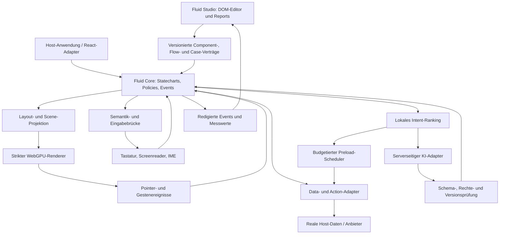

### 6.2 Nutzeraktion, KI und Transformation

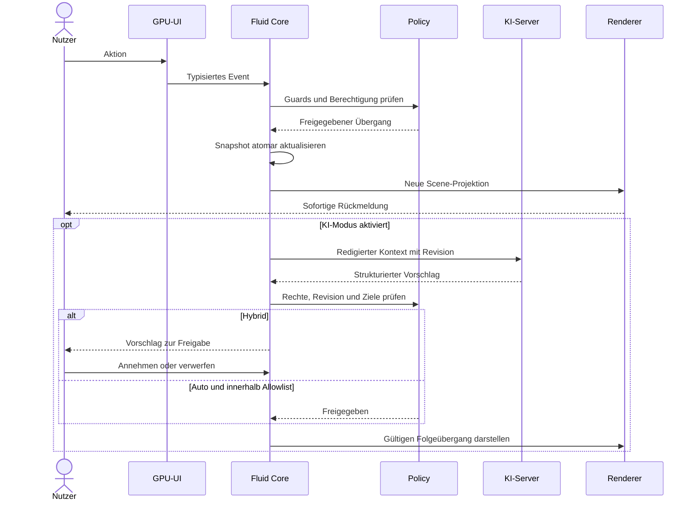

### 6.3 State- und Transition-Lifecycle

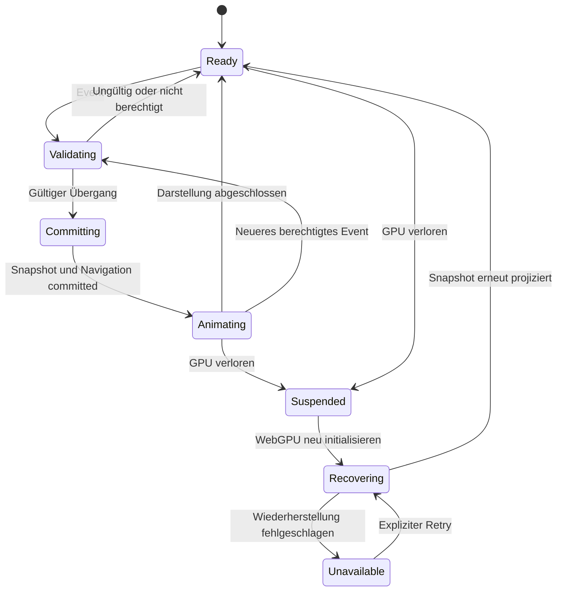

### 6.4 Datenfluss und konkurrierende Requests

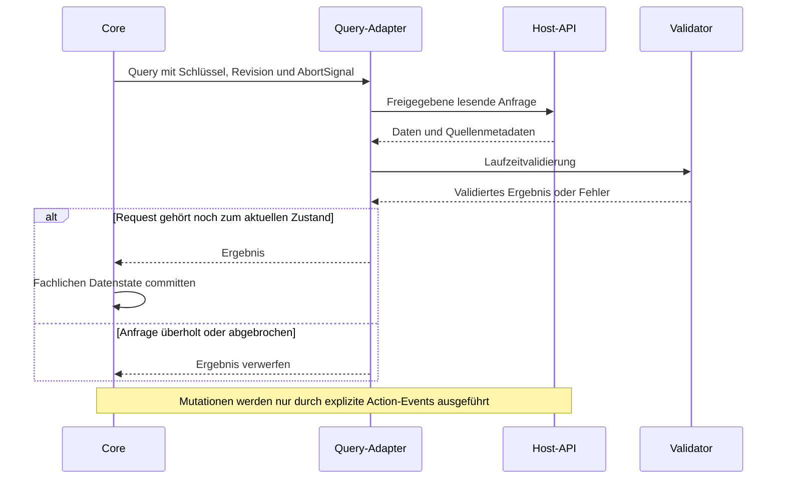

### 6.5 URL- und History-Flow

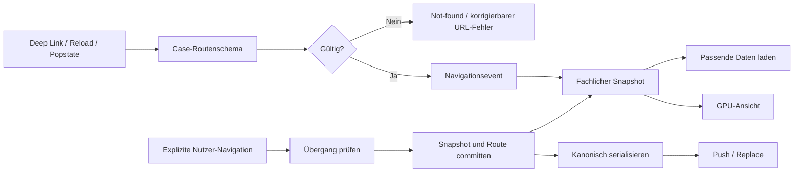

### 6.6 WebGPU-Start und Ressourcen

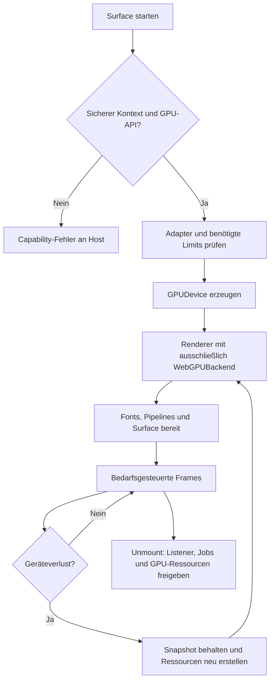

### 6.7 Studio, Simulation und Testexport

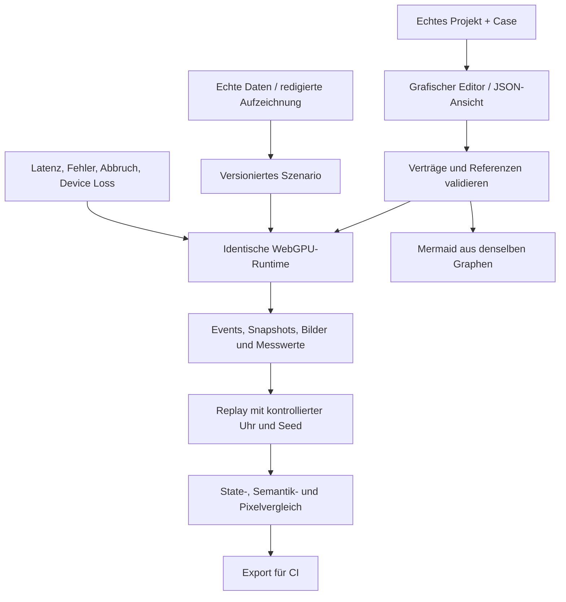

### 6.8 Lern- und Freigabeflow

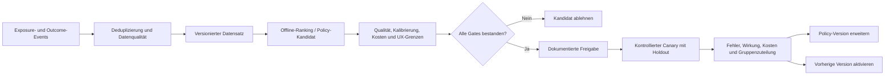

### 6.9 Projekt- und Laufdatenmodell

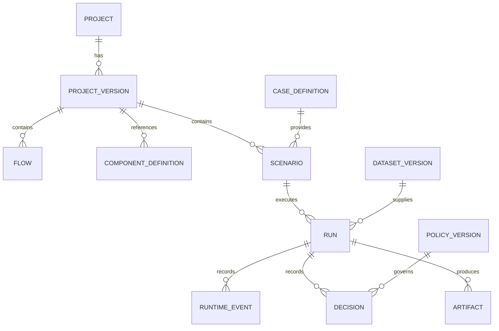

## 7. Umsetzung nach Waves und Release-Packages

Notation: **A/B/H** sind alternative Lösungswege mit Nutzwertscore. Der Gewinner ist ausdrücklich angegeben. Jeder Task wird erst mit seinen Akzeptanzkriterien abgeschlossen.

### Wave 0 — RP0: Verbindliche Grundlage

| Task | Bewertete Optionen | Gewinner und Umsetzung | Acceptance Criteria |
|---|---|---|---|
| **T01 Vision und Nachweisregister** | A bestehende Texte korrigieren **55**; B neues PRD **85**; H normatives PRD plus archivierte Evidenz **95** | **H:** konsolidierte Vision, Feature-IDs, Quellen, Risiken und ADRs | Jede Vision besitzt Status, Entscheidung, Task und Abnahme. Leistungsbehauptungen sind als gemessen, Ziel oder Hypothese markiert. |
| **T02 Neuer Workspace und Toolchain** | A Pro reparieren **60**; B unkritisch alles auf latest **50**; H neuer modularer Workspace mit kompatiblen Pins **95** | **H:** neue Paketgrenzen und eindeutige Server-/Client-Exporte | Reproduzierbarer Clean Install; strict Typecheck, ESLint CLI und Paketbuilds funktionieren; keine Peer-Overrides oder produktiven `any`-Ausnahmen ohne Begründung. |
| **T03 Machbarkeitsnachweis** | A Shape-Demo **45**; B große Komponentenbibliothek vorziehen **55**; H kleiner vollständiger GPU-/Text-/Input-/State-Proof **95** | **H:** eine Surface mit Text, Button, Input, Card und einem vollständigen Flow | WebGPU-only nachgewiesen; IME/Fokus funktionieren auf der Zielmatrix; Mount/Unmount und Device Loss sind geprüft. Keine Freigabe allein anhand eines Screenshots. |

**Gate:** Erst nach T03 wird die Komponentenbreite erweitert. Ein gescheiterter Proof führt zur Ursachenbehebung, nicht zum heimlichen Rendererwechsel.

### Wave 1 — RP1: WebGPU- und Interaktionskern

| Task | Bewertete Optionen | Gewinner und Umsetzung | Acceptance Criteria |
|---|---|---|---|
| **T04 Renderer** | A native WGSL-Engine **80**; B Three mit nachträglicher Backendkontrolle **65**; H explizite Three-WebGPU-Komposition **95** | **H:** eigener kleiner Rendereradapter über öffentliche APIs | Kein `webgl`-/`webgl2`-Kontext wird angefordert; fehlender Adapter liefert definierten Fehler; GPU-Backend wird im Test bestätigt. |
| **T05 Layout und Scene-Modell** | A feste Koordinaten **45**; B eigenes vollständiges CSS-System **60**; H Yoga plus definierte Fluid-Layouts **90** | **H:** ein Layoutmodell für Rendering, Hit-Testing und Semantik | Resize, DPR, Scroll, Clipping, Flex und Grid stimmen überein; 10.000 Datenzeilen werden virtualisiert statt vollständig gezeichnet. |
| **T06 Typografie und Assets** | A Bitmaptexturen **70**; B eigene Shaping-Engine **65**; H Glyph-Adapter mit kontrollierten Fonts **90** | **H:** TSL-Text, Worker-Fontverarbeitung, Atlasverwaltung | DE/EN, kombinierende Zeichen, RTL und definierte CJK-Fälle getestet; fehlende Glyphen sichtbar diagnostiziert; Asset-/Fontfehler blockieren nicht die gesamte Runtime. |
| **T07 Semantik und Eingabe** | A einzelnes Canvas-Label **35**; B manuell gepflegter Parallelbaum **65**; H abgeleitete Semantik plus native Eingabebrücke **95** | **H:** gemeinsame IDs, Rollen, Fokus- und Texteingabeverträge | Tastatur-only und Screenreader-Journeys bestehen; IME, Auswahl, Copy/Paste, Touch und mobile Tastatur geprüft; keine doppelten aktiven Controls. |
| **T08 Ressourcen und Scheduler** | A Schleifen pro Komponente **40**; B zentraler Scheduler mit Resource Ownership **95**; H sofortige vollständige Worker-Auslagerung **70** | **B:** on-demand Frames, Lifecycle-Tokens, Disposal und Wiederherstellung | 100 Mount/Unmount-Zyklen ohne verbleibende Listener/Jobs; keine Frames im ruhenden Zustand außer begründetem Bedarf; Geräteverlust erhält Nutzerdaten. |

### Wave 2 — RP2: Zustände, Morphing und Komponenten

| Task | Bewertete Optionen | Gewinner und Umsetzung | Acceptance Criteria |
|---|---|---|---|
| **T09 Statecharts und Kontrollmodi** | A freie State-Strings **40**; B direkt geschriebene Statecharts **85**; H Schemas plus Statechart-Compiler **95** | **H:** ein Transition-Vertrag für alle Modi | Ungültige Events verändern nichts; Manual ruft keine Modelle auf; Hybrid benötigt Freigabe; Auto überschreitet keine Allowlist. |
| **T10 Morphing und Choreography** | A Geometrieswap **45**; B ausschließlich SDF-Morphs **80**; H parametrische GPU-Morphs plus Layout-/Content-Timeline **95** | **H:** kompatible Übergangsfamilien und registrierte Sonderadapter | Button→Progress→Result, Card→Detail, Grid→List und Form→Summary ohne Inhaltsverlust; Unterbrechungen erzeugen keine Sprünge zu veralteten Zuständen. |
| **T11 Physics und Timing** | A variable CPU-Timesteps **60**; B alles per Compute Shader **70**; H deterministische Steuerung plus GPU-Effekte **90** | **H:** feste Simulationsschritte, Presets, synchronisierte Gruppen | Gleicher Seed erzeugt gleichen logischen Verlauf; Reduced Motion funktioniert; gemeinsame Übergänge bleiben zeitlich synchron. |
| **T12 Content Preservation** | A freie KI-Zuordnung **40**; B explizite typisierte Projektionen **95**; H KI-Mapping mit Prüfung **85** | **B:** stabile Daten-/Feldidentitäten und deklarative Mappings | Dirty Fields, Auswahl und IDs bleiben erhalten; fehlende Mapping-Pflichten scheitern vor Ausführung; keine erfundenen Werte. |
| **T13 Komponentenbibliothek** | A sofort alle Widgets **65**; B nur vier Primitives **75**; H vier Pilotkomponenten, danach vollständige Familien **95** | **H:** Box, Surface, Text, Icon, Image; Button, Input, Progress, Card, Select, Checkbox; Form/Wizard, Table, Nav, Modal; Grid, Flow, Stack | Jede Familie besitzt Stategraph, Semantik, Error-/Loading-/Empty-Zustände, Themes und Szenarien. Typwechsel ändert nicht unbemerkt die fachliche Bedeutung. |
| **T14 URLs und History** | A kompletter State in URLs **40**; B nur interne Navigation **65**; H deklarierte URL-Projektion plus Runtime-State **95** | **H:** Browser- und Next-Routeradapter | Deep Link, Reload, Back/Forward, ungültige Parameter und gelöschte IDs getestet; keine Seiteneffekte beim History-Replay. |
| **T15 Daten- und Action-Adapter** | A eigene universelle Datenplattform **60**; B ausschließlich Hostimplementierung **80**; H kleine Verträge plus Query-/HTTP-/Importadapter **95** | **H:** klare Trennung von Lesen und fachlichen Aktionen | Abort, Stale Results, Revalidation, Schemafehler und Idempotenz getestet; keine Mutation durch Prefetch oder Replay. |

### Wave 3 — RP3: Fluid Studio, Simulation und Testing

| Task | Bewertete Optionen | Gewinner und Umsetzung | Acceptance Criteria |
|---|---|---|---|
| **T16 Studio-Projekte und Inspector** | A Browserstorage allein **65**; B Cloudpflicht **60**; H lokale Projektdateien plus portable Artefakte **95** | **H:** Next.js-Studio, Projektöffnen, Versionen, Live-Inspector | Reale Projekte öffnen/speichern; Konflikte erkennen; beschädigte Dateien überschreiben keinen gültigen Stand; Events und Snapshots korrelieren. |
| **T17 Visueller Builder** | A nur graphisches Authoring **75**; B nur Code **80**; H ein deklaratives Modell mit React Flow und Monaco **95** | **H:** Graph und JSON-Ansicht bearbeiten denselben Vertrag | Roundtrip ohne Informationsverlust; ungültige Kanten werden blockiert; Undo/Redo funktioniert; Mermaid-Ausgabe ist syntaktisch validiert. |
| **T18 Simulation und Replay** | A zufälliger Simulator **35**; B ausschließlich Live-Tests **65**; H echte Aufzeichnungen plus kontrollierte Szenarien **95** | **H:** Uhr, Seed, Eventskripte, Providerantworten und Fault Injection | Replay führt null externe Mutationen aus; gleiche Eingaben liefern denselben logischen Trace; „Live“, „Aufzeichnung“ und „Simulation“ sind sichtbar getrennt. |
| **T19 Testsystem** | A Screenshots allein **45**; B Unit-Tests allein **65**; H Modell-, Property-, Semantik-, Integrations- und GPU-Tests **95** | **H:** Studio und CI führen identische Szenarioverträge aus | Jeder erlaubte Übergang ist abgedeckt; Race-/Abort-Sequenzen getestet; visuelle Fehler und semantische Fehler werden unabhängig erkannt. |
| **T20 CLI und Integration** | A gesamten Enginecode kopieren **60**; B nur npm-API **80**; H npm-Kern plus editierbare Rezepte **95** | **H:** `init`, `add`, `studio`, `test`, `export` | Neues React-/Next-Projekt lässt sich ohne Browser-Secrets integrieren; wiederholtes `add` überschreibt keine Benutzeränderungen; Exporte bauen reproduzierbar. |

**Builder-Grenze:** Kein Versprechen, beliebigen TSX-Code verlustfrei in einen visuellen Graphen und zurück zu übersetzen. Individuelle Logik wird als benannter, typisierter Handler eingebunden; der deklarative Flow bleibt editierbar.

### Wave 4 — RP4: Intent, KI und reale Cases

| Task | Bewertete Optionen | Gewinner und Umsetzung | Acceptance Criteria |
|---|---|---|---|
| **T21 Intent-Runtime** | A LLM für jedes Event **45**; B feste Keywords **70**; H lokales Ranking mit optionaler Modellanreicherung **95** | **H:** normalisierte Signale, Top-k, Quellen und kalibrierte Schwellen | Default Top-3, konfigurierbar bis fünf; Unklarheit wird ausdrücklich dargestellt; Qualitätsmessung auf getrennten Sessions statt Trainingsdaten. |
| **T22 KI-Orchestrierung** | A ungebundene JSON-Prompts **45**; B neue experimentelle Decisions-API als Kern **65**; H stabile strukturierte Ausgabe plus Policy-Prüfung **95** | **H:** serverseitige Provideradapter; experimentelle APIs nur im Labor | Ungültige, verspätete und unberechtigte Pläne werden verworfen; keine Keys im Client; Timeouts lassen die WebGPU-Oberfläche bedienbar. |
| **T23 Predictive Loading** | A alles für Top-3 laden **60**; B nur Hover-Prefetch **80**; H Nutzen-/Kostenranking mit Hostkoordination **95** | **H:** abbrechbare Queue, Cache-Deduplizierung und Ressourcenbudgets | Maximal drei eigene gleichzeitige Preloads; kein Kauf/Submit; überholte Jobs abbrechen; Treffer, verschwendete Bytes und Latenznutzen messen. |
| **T24 Ziele und Personalisierung** | A feste Personas **65**; B freie KI-Umgestaltung **45**; H freigegebene Varianten plus explizite Präferenzen **95** | **H:** Task Completion als Standardziel; Geschäftsziel optional | Nutzer kann Anpassungen stoppen und zurücknehmen; keine Reorganisation während aktiver Eingabe; Präferenzen werden nicht aus sensiblen Vermutungen abgeleitet. |
| **T25 Case-Pakete** | A getrennte Demo-Apps **60**; B ein austauschbares Scheindemo **55**; H gemeinsame Case-Verträge mit echten Datenadaptern **95** | **H:** folgende Case-Matrix umsetzen | Jeder Case hat Datenherkunft, vollständige URL-/State-Flows, Fehlerfälle, Manual/Hybrid/Auto-Vergleich und reproduzierbare Tests. |

#### Verbindliches Case-Set

| Case | Echter Datenbezug | Vollständiger Flow | Transaktionsgrenze |
|---|---|---|---|
| **Studio-Projektworkflow** | Tatsächliche Projektdateien, Szenarien und Runs | Öffnen → bearbeiten → validieren → ausführen → vergleichen → exportieren | Lokale Projektänderungen mit Revisionsprüfung |
| **Immobilien** | Importierter realer Bestand oder Host-API | Suchen → filtern → vergleichen → Detail → Anfrage vorbereiten | Anfrage über Hostadapter; kein erfundener Versandstatus |
| **E-Commerce** | Reeller Katalog mit Varianten, Preisen und Bestand | Suchen → Detail → Variante → Warenkorb → Checkout-Übergabe | Preis/Bestand erneut prüfen; Checkout im Testsystem oder Host |
| **Reisebuchung** | Reale Angebote beziehungsweise gekennzeichnete Provideraufzeichnungen | Ziel/Datum → Angebote → Vergleich → Reisende → Quote → Buchungsübergabe | Ablaufende Angebote erneut validieren; keine behauptete Buchung ohne Anbieterbestätigung |
| **SaaS-Dashboard** | Echte Run-/Produktmetriken | Übersicht → Drilldown → Widget anpassen → speichern → zurücknehmen | Nur freigegebene Layoutänderungen |
| **Content/CMS und Landingpage** | Importierte Inhalte und reale Ressourcen | Lesen → Varianten vergleichen → Vorschlag prüfen → Vorschau → Hostübergabe | Original erhalten; keine automatische Veröffentlichung |
| **Analyse-/Designworkflow** | Reale importierte Datensätze und Projektszenen | Import → validieren → analysieren/layouten → Ergebnis → exportieren | Typisierte Handler; kein universeller Grafikeditor als versteckte Zusatzanforderung |

Ohne angeschlossene Datenquelle zeigt ein Case einen Einrichtungszustand. Testfixtures sind ausschließlich in expliziten Test-/Simulationsläufen zulässig.

### Wave 5 — RP5: Produktionsreife und kontrolliertes Lernen

| Task | Bewertete Optionen | Gewinner und Umsetzung | Acceptance Criteria |
|---|---|---|---|
| **T26 Observability** | A Konsolenlogs **40**; B fester Analyticsanbieter **75**; H eigene Eventverträge plus OTLP-Export **95** | **H:** Trace-Korrelation von Event bis GPU-/KI-Ergebnis | Jede Entscheidung ist einem Snapshot und Ergebnis zuordenbar; keine erfundenen Dashboardwerte; Exportausfälle sind sichtbar. |
| **T27 Kosten und Schutzmaßnahmen** | A Anzeige geschätzter Kosten **45**; B nur Anbieterlimits **70**; H serverseitige Reservierung und tatsächlicher Verbrauch **95** | **H:** Session-/Projektbudgets, Rate-Limits und Deadlines | Parallele Requests umgehen kein Budget; abgebrochene Requests werden konservativ verrechnet; kein Client kann seinen Budgetstand autoritativ setzen. |
| **T28 Lernen und Experimente** | A sofortiger Online-Bandit **60**; B ausschließlich manuelle Updates **80**; H Offline-Qualifikation, Holdout und begrenzte Policies **95** | **H:** versionierter Ranker; später begrenzter kontextueller Bandit für freigegebene Varianten | Exposure/Outcome korrekt zugeordnet; Policy-Zustand über Neustarts erhalten; keine Promotion bei Datenqualitätsfehlern; Rollback stellt exakt die vorherige Policy her. |
| **T29 Performance und Skalierung** | A vorab Worker/Compute überall **55**; B gelegentliches Profiling **75**; H Benchmarks, Budgets und gezielte Optimierung **95** | **H:** Instancing, Atlanten, Culling, Cache und Worker nach belegtem Engpass | Definierte Geräte-/Szenariomatrix besteht; Ressourcenbudget gemessen; lokale Modelle verdrängen nicht unkontrolliert Renderingressourcen. |
| **T30 Release-Härtung** | A Demo veröffentlichen **35**; B Coverage-Gate allein **65**; H reproduzierbare Builds und vollständige Journey-Gates **95** | **H:** Security-, Browser-, Accessibility-, Paket- und Fehlerfallprüfung | Keine offenen Releaseblocker; Installations-/Upgrade-Test besteht; bekannte Einschränkungen dokumentiert; KI- und Policy-Kill-Switch verifiziert. |

Für T28 wird zunächst ein versionierter Offline-Ranker freigegeben. Der kontextuelle Bandit wird erst nach belastbarer Outcome-Zuordnung aktiviert; er darf nur innerhalb derselben fachlich gleichwertigen Variantenmenge explorieren. Unkalibrierte Modell-„Confidence“ ist keine automatische Freigabe.

### Wave 6 — RP6: Collaboration, Plugins und zusätzliche Eingaben

| Task | Bewertete Optionen | Gewinner und Umsetzung | Acceptance Criteria |
|---|---|---|---|
| **T31 Collaboration** | A gesamten Runtime-State als CRDT synchronisieren **55**; B zentraler Editor-Lock **80**; H CRDT für Dokumente, Serverautorität für Aktionen **95** | **H:** Yjs für Authoring; Presence und Runs separat | Parallele Bearbeitung konvergiert; ungültige Zwischenstände werden nicht publiziert; getrennte Nutzer lösen keine doppelten fachlichen Aktionen aus. |
| **T32 Plugins und Headless-Adapter** | A beliebigen Remote-Code laden **40**; B nur feste Komponenten **75**; H versionierte Verträge und bewusst installierte Erweiterungen **95** | **H:** Vanilla-/React-/Next-Adapter; weitere Adapter über Conformance-Suite | Plugin-Inkompatibilität wird vor Start erkannt; Unload räumt Ressourcen auf; kein Zugriff auf Secrets allein durch ein Template. |
| **T33 Voice und Gesten** | A permanente autonome Steuerung **40**; B feste Shortcuts **80**; H aktivierte Eingabeadapter auf typisierte Events **90** | **H:** Push-to-talk, Transkriptvorschau und abbrechbare Gesten | Mehrdeutige Befehle fragen nach; Aufnahme sichtbar; bestehende Guards gelten unverändert; Tastaturbedienung bleibt vollständig. |
| **T34 Enterprise-/Host-Integration** | A eigene Pflicht-SaaS **55**; B alles dem Host überlassen **80**; H Self-Hosting plus austauschbare Auth-/Auditadapter **95** | **H:** Rollen für Lesen, Bearbeiten, Ausführen und Freigeben | Rollen auf Server und Studio geprüft; Projektisolation getestet; Löschung, Retention, Backup und Restore funktionieren. |

### Wave 7 — RP7: XR und Forschung

| Task | Bewertete Optionen | Gewinner und Umsetzung | Acceptance Criteria |
|---|---|---|---|
| **T35 WebXR** | A XR sofort im Kern **60**; B XR vollständig streichen **70**; H separates WebGPU-XR-Paket **85** | **H:** räumliche Projektion und XR-Eingabeadapter auf denselben Core | Konkretes Headset-/Browserprofil nachgewiesen; kein WebGL-Wechsel; Controller/Gesten führen dieselben Events aus; Session-Ende räumt Ressourcen auf. |
| **T36 Neural Rendering** | A neuronale Darstellung aller UI-Inhalte **25**; B Vision streichen **70**; H isoliertes Forschungsmodul für nichtsemantische Effekte **80** | **H:** begrenzter Prototyp mit festem Qualitäts-/Leistungsbenchmark | Text, Hit-Testing und fachliche Information bleiben deterministisch; Modellherkunft dokumentiert; ohne belegten Vorteil wird das Ergebnis archiviert und nicht als Produktionsfeature freigegeben. |

Diese Wave enthält echte Forschungsrisiken. Ein negativer, reproduzierbarer Versuch ist ein gültiges Forschungsergebnis, aber kein implementiertes Produktversprechen.

### Wave 8 — RP8: Marketplace und Ökosystem

| Task | Bewertete Optionen | Gewinner und Umsetzung | Acceptance Criteria |
|---|---|---|---|
| **T37 Marketplace/Registry** | A vollständiger Marktplatz vor Produktreife **45**; B statischer Templateordner **80**; H versionierte Registry aus bewährten Paketen **90** | **H:** private/öffentliche Kataloge, Preview, Kompatibilität, Integritätsprüfung und kontrollierte Installation | Installation reproduzierbar; inkompatible Pakete werden abgewiesen; Updates überschreiben keine Nutzerdaten; unsichere Pakete können gesperrt werden. |
| **T38 Dokumentation und Adoption** | A Marketing vor Nachweisen **35**; B API-Referenz allein **80**; H getestete Rezepte, Praxisfälle und nachvollziehbare Benchmarks **95** | **H:** Tutorials aus tatsächlich ausführbaren Szenarien | Jedes Tutorial besteht als Integrationstest; Leistungsangaben nennen Gerät und Szenario; keine unbelegten Conversion- oder Verbreitungszahlen. |

### Release-Abhängigkeiten

```mermaid
flowchart LR
    R0["RP0: Research und Verträge"] --> R1["RP1: GPU und Eingabe"]
    R1 --> R2["RP2: Runtime und Komponenten"]
    R2 --> R3["RP3: Studio und Tests"]
    R3 --> R4["RP4: Intelligence und Cases"]
    R4 --> R5["RP5: Produktionsreife"]
    R5 --> R6["RP6: Collaboration und Plugins"]
    R6 --> R7["RP7: XR und Forschung"]
    R6 --> R8["RP8: Marketplace zuletzt"]
    R7 -. "Nur qualifizierte Erweiterungen" .-> R8
```

Negative Ergebnisse aus RP7 blockieren nicht die Veröffentlichung des bereits qualifizierten Kernprodukts oder der Registry.

## 8. Übergreifende Abnahme, Messung und Rollout

### 8.1 Verbindliche Testszenarien

| Bereich | Abnahme |
|---|---|
| Zustände | Jeder deklarierte Übergang und seine Ablehnung getestet; zufällige Ereignisfolgen verletzen keine Invarianten |
| Konkurrenz | Doppelklick, schnelle Navigation, parallele Requests, verspätete KI und Unmount während Initialisierung |
| Daten | Leere Ergebnisse, beschädigte Antworten, Teilfehler, veraltete Preise/Angebote, Abbruch und Retry |
| Eingabe | Tastatur, Touch, Pointer Capture, IME, RTL, Auswahl, Clipboard und mobile Tastatur |
| Accessibility | Automatisierte Semantikprüfung plus manuelle Screenreader-Journeys; GPU-Kontrast, Fokus und Zoom separat prüfen |
| URLs | Direkteinstieg, Reload, Back/Forward, ungültige Parameter und nicht mehr vorhandene Ressourcen |
| GPU | Adapter fehlt, Limits fehlen, Geräteverlust, Resize/DPR-Wechsel, lange Sitzung und Ressourcenfreigabe |
| KI | Schemafehler, Prompt Injection, falsche Component-ID, veraltete Revision, Budgetüberschreitung und Anbieterfehler |
| Simulation | Kein produktiver Schreibzugriff; reproduzierbare logische Ergebnisse; kontrollierte visuelle Toleranzen |
| Collaboration | Konkurrenz, Verbindungsabbruch, Wiederverbindung, Rechteentzug und ungültige Entwürfe |
| Packaging | Clean Install, Tree-Shaking, Serverimport ohne Browserglobals und Integration in ein frisches Hostprojekt |

Coverage dient als zusätzlicher Indikator: mindestens 85 % Branch Coverage für Core, Policy, Routing und Budgetlogik; alle sicherheits- und datenrelevanten Invarianten müssen unabhängig davon explizit getestet sein.

### 8.2 Messbare Zielbudgets

Diese Werte sind **gewählte Abnahmeziele**, keine bereits gemessenen Eigenschaften:

- Lokaler Event→Snapshot-Pfad: P95 ≤10 ms im Referenzszenario.
- Wahrnehmbare lokale Aktionsrückmeldung: P95 ≤100 ms.
- Desktop-Referenz: P95 Framezeit ≤16,7 ms bei 1080p, 200 sichtbaren Elementen und 20 parallelen Morphs.
- Mobile Referenz: dieselben funktionalen Szenarien; Framebudget und maximaler Szenenumfang werden getrennt veröffentlicht.
- Leckprüfung: nach Aufwärmen und 100 Wiederholungen kein dauerhaft wachsender Ressourcenbestand; maximal 5 % Abweichung vom stabilen Plateau.
- GPU-Speicherangaben beziehen sich auf selbst verwaltete Allokationen und werden als solche bezeichnet.
- KI: eine laufende Entscheidung pro Session; überholte Requests abbrechen; standardmäßig 3 s Soft- und 6 s Hard-Deadline.
- Initiales Cloud-Kostenlimit: maximal 0,35 USD pro aktiver Session, serverseitig konfigurierbar und durch Reservierung abgesichert.
- Prefetch: maximal drei eigene parallele Jobs; Bytebudgets nur dort hart versprechen, wo Größe und Abbruch tatsächlich kontrollierbar sind.
- Keine garantierte Conversion-Steigerung. Wirkung wird gegenüber dem statischen beziehungsweise manuellen Kontrollpfad gemessen.

GPU-Zeitmessung verwendet optionale Timestamp-Queries, wenn verfügbar. Entwicklerflags sind keine Produktionsvoraussetzung. Quelle: [Chrome WebGPU Developer Features](https://developer.chrome.com/docs/web-platform/webgpu/developer-features).

### 8.3 Freigabestufen

1. **Contract Preview:** Schemas und APIs, noch keine Produktionszusage.
2. **GPU Alpha:** qualifizierter Rendering-/Eingabekern.
3. **Studio Beta:** vollständige Szenarien und reproduzierbare Tests.
4. **Integration Beta:** reale Case-Adapter und Hostintegration.
5. **Core 1.0:** alle RP5-Gates bestanden.
6. **Optionale Erweiterungen:** jeweils eigene Supportmatrix und Versionsfreigabe.

KI-Policies werden getrennt von Bibliotheksversionen ausgerollt: Shadow Mode → begrenzter Canary → größere Kohorte. Jede Stufe benötigt bestandene Qualitäts-, Kosten- und UX-Gates. Bei Fehlern wird eine bekannte Policy-Version wieder aktiviert; das Rendering bleibt WebGPU.

### 8.4 Definition of Done für die Gesamtvision

- Jede Vision ist implementiert, ausdrücklich begrenzt oder durch ein dokumentiertes Forschungsergebnis entschieden.
- Jede produktive Komponente besitzt Daten-, State-, Eingabe-, Semantik- und Renderingvertrag.
- User-, Daten-, State- und URL-Flows sind durchgängig verbunden und als Mermaid nachvollziehbar.
- Studio und Produktionsintegration verwenden denselben Runtime-Kern.
- Praxisfälle funktionieren mit realen Daten; Simulation ist jederzeit erkennbar.
- Architekturentscheidungen, Tests und tatsächliche Messergebnisse sind miteinander verknüpft.
- Kein Release hängt von den bestehenden Prototyp-APIs oder unbelegten Leistungsversprechen ab.
