# FluidKit-Pro v2.5: Komponentenverhalten, Fluid-Darstellung und kontrolliertes UI-Authoring

**Recherche-Stichtag: 31. Oktober 2026. Prüfung durchgeführt am 1. November 2026.**

**Erweiterung vom 23. November 2026.** Der [erste Intent-Anwendungsfall](#erster-intent-anwendungsfall-im-workspace) verbindet echte Modulbesuche mit einer vorgeschlagenen Transformation im Workspace. Der Nutzer kann die Herleitung ansehen und bestimmen, ob er jetzt vergleichen möchte.

**Erweiterung vom 20. November 2026.** [Formübergänge und Studioabläufe R1–R6](milestones/structural-transitions.md) ergänzen den Plan um drei reale Verwandlungen, die UI-SDK-Beta.13, versioniertes Authoring und gebundene Bildnachweise. Die neuen Kriterien sind mit den bestehenden Umsetzungstasks verbunden. Die am 20. November geprüfte Studio-Integration nutzt den Sicherheitspatchstand Next.js 16.4.6. Die Oktobermatrix dokumentiert die damalige Entscheidung. Der Soundplan bleibt ein eigener Entwurf.

Der [Plan für Mehrsprachigkeit M11](milestones/m11-multilingual-plan.md) ergänzt die Roadmap mit einer implementierten ersten Sprachfreigabe. Im frühen Meilenstein sind Deutsch, Englisch und Französisch direkt wählbar. Beim Wechsel lässt sich derselbe Datensatz in Studio, GPU und zugänglicher Bedienoberfläche verfolgen. Acht Tasks verbinden die bewerteten Entscheidungen mit Abnahmen im zentralen Register. Die externe Sprach- und Geräteabnahme wird je Profil geführt.

Version 2.5 führt den freigegebenen Gesamtplan weiter und ergänzt ihn um die Base-UI-Recherche vom 1. November 2026 (stabile Basis bis 31. Oktober 2026). Normativer Plan; v1 liegt unverändert daneben. M1 wurde gezeigt und seine visuelle Richtung vom Nutzer bestätigt. Auf ausdrücklichen Wunsch folgt M2 mit sortierbarer Tabelle, Karten, Dependency Map und Detail; RP1 wird fortgeführt. Auf die anschließende Nutzerpräzisierung hin werden vor weiterer GPU-Ausweitung TypeGPU und ein konfigurierbares Effektmodell qualifiziert (T47–T49). [Umsetzungsstand und Feature-Matrix](feature-status.md).

Nachtrag vom 1. November: [ai-design-check 0.9.0](research/ai-design-check.md)
wurde mit aktuellen Primärquellen und einem isolierten Probelauf bewertet.
Diese erst am 1. November veröffentlichte Version gehört nicht zur Oktober-Basis.
[ADR-0005](decisions/0005-design-quality.md) ergänzt T19/T43 und die Releaseabnahme;
M4 bindet das gepinnte Paket als Dev-Tool in Check/Build ein und verbindet
statische, DOM-, GPU- und Semantiknachweise im Studio. Ein fremder Skill wird
nicht installiert; ein externer CI-Dienst bleibt unkonfiguriert.
[M4-Tasks und Acceptance Criteria](milestones/m4-plan.md), [Abnahme](milestones/m4.md).

Umsetzungsnachtrag vom 2. November: [M6-Ausführung](milestones/m6-execution.md) und [Studio-AI-Review](quality/ai-review.md) führen den nächsten vertikalen Schnitt aus. Die Nutzerentscheidung ist verbindlich: **AI-Funktionen verwenden Vercel AI SDK**. Das Serverpaket verwendet exakt `ai@7.0.159`; es gibt keinen Browser-Modellzugriff. Die ursprünglichen AC bleiben unverändert und werden einzeln belegt.

M7-Nachtrag vom **3. November 2026**: Der Nutzer hat je ein elegantes,
materialbetontes und experimentelles Rezept freigegeben. [M7-Plan mit eigenen AC](milestones/m7-plan.md)
und [aktuelle Recherche](research/effect-extension.md) ergänzen Silk Cascade,
Liquid Lens und Particle Weave. Gemeinsamer Darstellungssampler, begrenzte
Unterbrechungssnapshots, responsive Showcase-/Studio-Steuerung und echte
Sequenz-/Backendnachweise werden gemeinsam umgesetzt. Neue M7-Kriterien beginnen
offen; die ursprünglichen 408 Kriterien und historischen Nachweise bleiben erhalten.

M7-Nachprüfung vom **4. November 2026**: [Acht verbleibende Kriterien](milestones/m7-followup.md) erhalten unveränderte Anforderungen, bewertete Lösungswege und einen endlichen Prüfplan. Die sichtbare Werkstatt `/studio/m7` verbindet 144 Workspace-Fälle mit getrennten nativen Journeys und echten Surface-/Privacy-Prüfungen. [Nachprüfflows](flows/m7-qualification.md) und konkrete Fehlerbefunde (internes Archiv) erhalten die Trennung zwischen historischen, negativen und neuen Nachweisen.

M8-Nachtrag vom **13. November 2026**: Der Nutzer hat den hybriden Refactor aus
[ADR-0007](decisions/0007-ui-sdk.md) und seine vollständige Umsetzung nach dem
frühen sichtbaren Proof freigegeben. [M8](milestones/m8-plan.md) erneuert
Multipart-Verhalten, gemeinsame Layout-/Semantikprojektion, Selection/Typeahead
und Studiovergleich; anschließend folgen begrenzte Agentbridge und prüfbares
Authoring über Vercel AI SDK. Die [aktuelle UI-SDK-Recherche](research/vercel-ui-sdk.md)
ist eine datierte Beta-Qualifikation, keine rückwirkende Änderung der Oktoberbasis.
T59–T65 ergänzen 41 neue Kriterien. Alle vorherigen 435 Kriterien einschließlich
M7 behalten Text, ID, Quellenhash und ihren historischen Nachweisscope.

Verbindliche Produktentscheidungen aus unserem Austausch:

- Ein Entwickler-Framework für Intent-Erkennung, prädiktive und fließende Benutzeroberflächen.
- **WebGPU ist der Standard. WebGL2 ist als Three.js-Fallback erlaubt; aktives Backend und Wechselgrund werden sichtbar angezeigt. Kein sichtbarer HTML-Ersatzrenderer für Runtime-Komponenten.**
- Diese Nutzerentscheidung vom 1. November 2026 ersetzt die frühere strikte WebGPU-only-Vorgabe; v1 und der ursprüngliche M1-Nachweis bleiben historisch nachvollziehbar.
- Unsichtbare Semantik- und Eingabebrücken sind erlaubt.
- Fluid Studio verwendet eine zugängliche DOM-Bedienoberfläche mit echter WebGPU-Vorschau.
- Studio unterstützt visuelles Authoring, Simulation, Replay und Testing.
- Auswählbare Praxisfälle verwenden echte Daten über Adapter, Importe oder gekennzeichnete Aufzeichnungen.
- Neuaufbau ist ausdrücklich erlaubt. Bestehende APIs und Implementierungen müssen nicht erhalten bleiben.
- Umsetzung in Release-Packages und Waves; Marketplace zuletzt.

Direkte OpenAI-Ausführung vom 2. November: Der Nutzer hat den vorhandenen lokalen
Key für Live-Tests freigegeben. [Bewertete Umsetzung und AC-Zuordnung](milestones/openai-review-execution.md)
ergänzen T22/T27/T55/T58. OpenAI wird über den Vercel AI SDK Provider angebunden;
Gateway bleibt optional. Eingaben werden vor der Generierung tatsächlich gezählt,
Befunde menschlich bewertet und exportiert. Die ursprünglichen 408 Einzelkriterien
bleiben unverändert; ein Live-Ergebnis ersetzt die offenen Produktgates nicht.

## 1. Vorangestelltes Research: Methoden und Best Practices

### 1.1 Relevante Erkenntnisse

| Thema | Rechercheergebnis | Konsequenz für FluidKit-Pro |
|---|---|---|
| Backend transparent wählen | Three.js’ `WebGPURenderer` bevorzugt WebGPU und unterstützt WebGL2 als Fallback. | Öffentliche Renderer-/Backend-Bausteine verwenden; WebGPU zuerst versuchen und das tatsächlich aktive Backend nach Initialisierung ausweisen. Fallback und Diagnosemodus sichtbar kennzeichnen. Quelle: [Three.js r187](https://github.com/mrdoob/three.js/blob/r187/src/renderers/webgpu/WebGPURenderer.js). |
| GPU-Lebenszyklus | Adapterverfügbarkeit, Geräteverlust, Ressourcen und optionale Features müssen explizit behandelt werden. Browsername allein reicht nicht. | Capability-Prüfung, nachvollziehbare Startfehler, Wiederherstellung aus CPU-seitigem Zustand und vollständiges Disposal. Quelle: [WebGPU-Spezifikation](https://www.w3.org/TR/webgpu/). |
| Canvas-Accessibility | Canvas-Pixel ersetzen keine zugängliche Dokumentstruktur. Der HTML-Standard beschreibt die Zuordnung interaktiver Canvas-Regionen zu fokussierbaren Elementen. | Semantikbaum aus demselben Komponentenmodell ableiten; Fokus, Labels, Rollen und Zustände synchron halten. Quelle: [HTML Canvas](https://html.spec.whatwg.org/multipage/canvas.html#the-canvas-element). |
| Texteingabe | `EditContext` adressiert eigene Textoberflächen, ist aber keine ausreichend universelle Produktionsgrundlage. | Native Eingabebrücke für IME, Auswahl, Clipboard und mobile Tastaturen; GPU rendert Text, Auswahl und Caret. EditContext bleibt ein optionaler Adapter. Quelle: [W3C EditContext](https://www.w3.org/TR/edit-context/). |
| GPU-Typografie | Troika/Drei-Text darf nicht als automatisch WebGPU-kompatibel vorausgesetzt werden. `@pmndrs/glyph` bietet eine neuere TSL-/WebGPU-Richtung mit dokumentierten Grenzen. | Eigenes Text-Adapterinterface; Glyph zuerst qualifizieren. Keine ungeprüfte Troika-Übernahme. Quellen: [Drei-Status](https://github.com/pmndrs/drei/issues/2588), [Glyph](https://github.com/pmndrs/glyph). |
| Layout | Yoga berechnet Layout unabhängig vom Renderer; es implementiert einen CSS-/Flexbox-Teilumfang. | Yoga für Boxlayout verwenden und FluidGrid, Virtualisierung, Clipping und Breakpoints ausdrücklich darüber definieren. Kein Versprechen vollständiger CSS-Kompatibilität. Quelle: [Yoga](https://www.yogalayout.dev/docs/about-yoga). |
| Zustandsmodellierung | Statecharts und Actor-Inspection machen erlaubte Übergänge und Laufzeitereignisse nachvollziehbar. | XState 5 hinter einem eigenen deklarativen Flow-Vertrag einsetzen; Studio, Tests und Runtime verwenden denselben Flow. Quelle: [XState Inspection](https://stately.ai/docs/inspection). |
| Modellbasierte Tests | Generierte Ereignisfolgen und unabhängige Invarianten erkennen Fehler, die einzelne Happy-Path-Tests übersehen. | Property-based Tests für Abbruch, Konkurrenz, Navigation, Datenverlust und ungültige Übergänge. Das Testmodell darf keine Kopie der Implementierung sein. Quelle: [fast-check](https://fast-check.dev/docs/advanced/model-based-testing/). |
| Visuelle Tests | Screenshots hängen von Browser, Betriebssystem, Hardware und Renderingbedingungen ab. | Kontrollierte Uhr und Seeds, definierte Render-Checkpoints, Baselines pro Geräteklasse; Pixelvergleich zusätzlich zu State- und Semantikprüfung. Quellen: [Playwright Clock](https://playwright.dev/docs/clock), [Visual Comparisons](https://playwright.dev/docs/test-snapshots). |
| KI-Orchestrierung | AI SDK 7 ist verfügbar. Strukturierte Ausgabe bleibt von Berechtigungs- und Zustandsprüfung getrennt. Die neue Decisions-API ist ausdrücklich experimentell. | Stabile strukturierte Ausgaben für den Produktionspfad; `experimental_decide` höchstens im isolierten Evaluationspaket. Quellen: [AI SDK 7](https://vercel.com/changelog/ai-sdk-7), [Structured Data](https://ai-sdk.dev/docs/ai-sdk-core/generating-structured-data), [Decisions](https://ai-sdk.dev/docs/ai-sdk-core/decisions). |
| KI-Sicherheit | Prompt-Filter und gültiges JSON ersetzen keine Autorisierung. Modellantworten sind untrusted input. | Zulässige Aktionen, Parameter, Zustandsversionen und Berechtigungen außerhalb des Modells prüfen. Quelle: [OWASP](https://cheatsheetseries.owasp.org/cheatsheets/LLM_Prompt_Injection_Prevention_Cheat_Sheet.html). |
| KI-Evaluation | KI-Ausgaben sind variabel; fallbezogene Datensätze und wiederholbare Evaluation sind erforderlich. | Eigenen Evaluationsrunner mit versionierten Datensätzen, Regeln und menschlich bewerteten Grenzfällen bauen. Quelle: [Evaluation Best Practices](https://developers.openai.com/api/docs/guides/evaluation-best-practices). |
| Wirkungsmessung | Conversion-Lift ist eine experimentell zu prüfende Hypothese. Fehlerhafte Gruppenzuteilung kann Ergebnisse umkehren. | Stabile Kontrollgruppen, Exposure-/Outcome-Zuordnung und Sample-Ratio-Mismatch-Prüfung vor jeder Wirkungsbehauptung. Quelle: [Microsoft Research](https://www.microsoft.com/en-us/research/articles/diagnosing-sample-ratio-mismatch-in-a-b-testing/). |
| Predictive Loading | Vorladen kann unbeabsichtigt Seiteneffekte auslösen; Framework-Prefetching besitzt bereits eigene Priorisierung. | Nur lesende, freigegebene Ressourcen vorladen und mit dem Host-Router koordinieren. Quelle: [Next.js Prefetching](https://nextjs.org/docs/app/guides/prefetching). |

**Methodischer Rahmen:** Anforderungs-Traceability, Architekturentscheidungen mit Alternativen, risikobasierte Proofs, explizite Statecharts, unabhängige Invarianten, reproduzierbare Szenarien, Hardwaremessungen und kontrollierte Produktexperimente. „Modern“ bedeutet hier belegte Eignung für das Produkt, nicht maximale Zahl neuer Technologien.

### 1.2 Versions- und Kompatibilitätsmatrix

Die Ist-Versionen stammen aus den Lockfiles, nicht aus den zahlreichen `latest`-Angaben in FluidKit-Pro.

| Technologie | FluidKit-Pro | FluidUI | Zielbasis aus der Recherche |
|---|---:|---:|---|
| Next.js | 15.3.3 | 15.5.3 | 16.4.3 für Studio und Referenzintegration |
| React | 19.1.0 | 19.1.1 | Zunächst 19.2.9 wegen Glyph-Peer-Kompatibilität |
| Three.js | 0.177.0 | — | 0.187.0, einschließlich passender Types |
| AI SDK | 4.3.16 | 5.0.45 | 7.0.159, ausschließlich serverseitige Modellzugriffe |
| TypeScript | 5.8.3 | 5.6.3 | 6.0.3, strict; 7.0.2 ist mit typescript-eslint 8.62.0 inkompatibel |
| Zod | fehlt | 4.1.9 | 4.6.7 |
| Statecharts | fehlt | fehlt | XState 5.33.3 |
| Text/Layout | unvollständige Ansätze | Browser-DOM | Glyph 0.1.0 + Yoga 3.2.1 |
| Tests | keine Suite | kleine Jest-/Playwright-Suite | Vitest 5.0.5, Playwright 1.64.1, fast-check 4.10.2 |
| Studio | fehlt | einfacher Playground | React Flow 12.12.0, Monaco 0.57.0, Mermaid 12.2.0 |
| Query-Adapter | fehlt | fehlt | TanStack Query 5.105.0 |
| Serverbetrieb | alte Mindestangaben | Edge-Annahme | Node.js 26 LTS |
| Gemeinsame Persistenz | fehlt | flüchtiger Speicher | PostgreSQL 18.6 im optionalen Serverpaket |

Die Versionen wurden anhand offizieller Paketmetadaten und Veröffentlichungen geprüft. Die am 1. November veröffentlichte Query-Version 5.105.1 gehört ausdrücklich **nicht** zur Oktober-Basis.

React 19.3.1 ist neuer, aber Glyph 0.1.0 deklariert React `<19.3`. Der Plan verwendet deshalb zunächst die gepatchte 19.2-Linie; keine erzwungenen Peer-Overrides. Quellen: [React-Versionen](https://react.dev/versions), [Glyph-Paketmetadaten](https://registry.npmjs.org/@pmndrs%2fglyph/0.1.0).

Next.js 16.4 empfiehlt Cache Components für neue Anwendungen. Diese werden für Studio-Daten und Dokumentation gezielt eingesetzt; GPU-Runtime und persönliche Zustände werden dadurch nicht pauschal gecacht. Quellen: [Next.js 16.4](https://nextjs.org/blog/next-16-4), [Oktober-Sicherheitsupdate](https://nextjs.org/blog/nextjs-security-update-october-14-2026).

Node 26 ist zum Stichtag LTS; PostgreSQL 19 noch kein stabiler Produktionsstandard. Quellen: [Node-Releases](https://nodejs.org/en/about/previous-releases), [PostgreSQL-Versionierung](https://www.postgresql.org/support/versioning/).

Base UI wird als @base-ui/react 1.9.0 (9. Oktober 2026, MIT, React 17/18/19) nur im Studio eingebunden. Core, Contracts und WebGPU erhalten keine Base-UI-Abhängigkeit. Node 26 LTS bleibt die Zielumgebung; der bisherige lokale Proof läuft auf Node 24.18.1 und ist kein Node-26-Kompatibilitätsnachweis. Alle Zielversionen werden in RP0 reproduzierbar fixiert. Spätere Aktualisierungen benötigen einen dokumentierten Anlass und die betroffenen Kompatibilitätstests.

### 1.3 Base UI: verbindliche Übernahmen

Details und Quellen: [Research](research/base-ui.md), [ADR-0002](decisions/0002-base-ui.md).

- Komponenten besitzen eine benannte Anatomy aus Root/Control/Trigger/Label/Description/Indicator/Content. Nicht jede Komponente braucht alle Teile.
- Verhalten, Semantik, visuelle Rezepte und fachlicher Inhalt sind getrennte Verträge. Eine Karte kann eine Darstellung sein, ohne automatisch Button- oder Dialogverhalten zu erhalten.
- Kontrollierte Fachwerte kommen aus dem Host/Core. Lokales Hover/Pressed/Focus/Composition gehört in einen transienten Interaktionsstore, keine zweite Kopie fachlicher Werte.
- Änderungen tragen Quelle und Grund; eine synchrone Cancel-Entscheidung erfolgt vor Commit. Callback und Renderer dürfen keine Guards oder Berechtigungen umgehen.
- UI-Präsentation erhält Presence-/Transition-Metadaten. Fachlicher Commit und Animationsende sind getrennte Ereignisse.
- Studio verwendet echte Base-UI-Komponenten. Der GPU-Adapter übernimmt keine DOM-abhängigen Hooks und beansprucht keine automatisch geerbte Accessibility.
- Das Studio zeigt im ersten Milestone Component-ID, Part, Behavior, Fokus und aktuellen Übergang. Die Oberfläche und der Inspector lesen dieselben Verträge.

### 1.4 TypeGPU und kreative Effektsequenzen

Die ergänzende [TypeGPU-Recherche](research/typegpu.md) vom 1. November 2026
belegt geeignete typisierte Ressourcen, CPU-testbare Shader-Funktionen und eine
Three-/TSL-Brücke. Kandidaten: typegpu 0.12.9, @typegpu/three 0.12.2,
@typegpu/gl 0.12.8, @typegpu/sdf 0.12.2 und unplugin-typegpu 0.12.7. Der M3-Workspace enthält jetzt
einen isoliert gebauten Kernel und drei ausführbare Rezepte. Der genaue
Qualifikationsumfang steht im [M3-Nachweis](milestones/m3.md). Der veröffentlichte
Three-Adapter besitzt bereits GLSL-Unterstützung; die pauschale WebGPU-only-Warnung
in der Dokumentation ist nicht der ganze Versionsstand. Das GL-Subset bleibt
experimentell und unterstützt keine allgemeinen Compute-Aufgaben.

**Gewinner:** TypeGPU schrittweise für neue komplexe GPU-Kernels ergänzen; Three,
Glyph-TSL, Core und Semantik bleiben bestehen. Ein isoliertes Vite-Library-Build-
und Backend-Gate geht der Übernahme voraus. Keine erzwungenen ESLint-Peers und
keine zusätzliche React-Frame-Schleife. [ADR-0004](decisions/0004-typegpu-effects.md).

Die visuelle Sequenz lautet **aktuelles Bild → optionaler Zusatzeffekt → Zielbild**.
Effektwahl ist konfigurierbar: aus, ein festes Rezept, reproduzierbarer Random-Pool
oder Case-Regeln. Übergangsregeln überschreiben ausdrücklich Case-Regeln, diese
den Projektstandard. Auswahl und Herkunft werden einmalig aufgelöst und aufgezeichnet.
Die Darstellung erhält einen eigenständigen Vertrag; der fachliche Core bleibt atomar.

### 1.5 Stageshow: Designprozess, Studio und AI-Kritik

Ergänzende Recherche vom **2. November 2026** auf Basis von Benji Taylors
[Originalartikel](https://benji.org/stageshow) und eingefrorenem Originalcode.
[Recherche und Übertragungsmatrix](research/stageshow.md),
[Quellenregister](research/stageshow-sources.json), [ADR-0006](decisions/0006-stageshow.md).
Diese Ergänzung verändert weder rückwirkend die Oktober-Versionsbasis noch die
bereits ausgeführten M1–M5-Nachweise.

Gewinner ist die Übernahme als eigener Fluid-Design-/Rehearsalprozess **97**, vor
bloßer Regelübernahme **77** und getrenntem DOM-Demokit **77**. Ein unveränderter
DOM-Kit-Renderer **57** ist für die Framework-Surface ausgeschlossen. Scores sind
Planungswerte, keine gemessene Qualitätssteigerung. Kein Fremd-Skill oder
unversioniertes Tool wird installiert, keine Bibliothek wird hierfür aktualisiert.

Vor neuer UI stehen Medium, eigene Tokens, Informationshierarchie, drei bis fünf
Beats, Referenz und kompakte Komposition. Die Bewegung visualisiert reale gültige
Events auf derselben Runtime. Inszenierte Cursor-Klicks und freier Demo-State sind
kein Funktionsnachweis. Reale Tabellen behalten ihre Werte. Dekorative Platzhalter,
Crop und unsichtbarer Reset gelten nur im ausdrücklich erklärten Illustrationsscope.

Der zentrale Studio-Bereich umfasst Design, Layout/Semantik, Motion, Runvergleich
und ausdrücklich gewünschte AI-Kritik. Belegte Befunde springen zu Frame und Part.
AI-Analyse ergänzt die festen Prüfer durch begründete Hinweise zu Hierarchie,
Dichte und Bewegungsverständnis. Sie erhält nur freigegebene redigierte Artefakte,
keine automatische Autorität über Fachstate, Code oder Releasegates. Ein fehlender
Provider ist ein sichtbarer Einrichtungszustand, keine simulierte AI-Analyse.

Die zeitliche Abnahme kombiniert Pixel, dargestellte Scene-/Glyphgeometrie und
Eventkorrelation. Ein Kontaktbogen und die bisherigen Prozent-Checkpoints beweisen
keine Einzelbild-Sprungfreiheit. Unvollständige Captures bleiben inconclusive.
Der nächste visuelle Milestone [M6](milestones/m6-plan.md) zeigt zuerst den echten
Workspace: Tabelle → numerische Sortierung → Karten → Moduldetail → begründeter Reset.
[Normativer Designprozess](quality/fluid-design-workflow.md).

## 2. Audit der vorhandenen Projekte

### 2.1 Ergebnis

**Die kombinierte Kernvision ist umsetzbar. Die vorhandenen Projekte bilden dafür jedoch keine nachgewiesen produktionsfähige Grundlage.**

FluidKit-Pro und FluidUI sind unterschiedliche, ergänzbare Modelle:

| Ebene | FluidKit-Pro | FluidUI |
|---|---|---|
| Hauptidee | Komponenten verändern ihre visuelle Form | Oberfläche antizipiert Absichten und passt Varianten an |
| Zentrale Abstraktion | Mesh, geometrischer Zustand, Morphing | Intent, Persona, Variante, Zielgewicht |
| Rendering | Three.js plus sichtbare DOM-Overlays | React-/DOM-Komponenten |
| KI-Rolle | Transformationen auslösen | Intent und Varianten unterstützen |
| Größte Lücke | Konsistenter UI-, Eingabe- und Zustandsunterbau | Reale Vorhersage-, Daten- und Lernpipeline |
| Übernahmewert | Produktidee, Komponentenfamilien, Steuerungsmodi | Intent-/Preload-Konzept, Guardrails, Experiment- und Lernvision |

**FluidUI ist kein vollständiger Vorgänger, dessen Funktionen lediglich portiert werden müssen.** Seine prädiktive Ebene fehlt FluidKit-Pro weitgehend; zugleich fehlt FluidUI die angestrebte GPU- und Morphing-Runtime.

### 2.2 Belegte Befunde

| Befund | Beleg und Auswirkung |
|---|---|
| Dokumentation überschätzt den Implementierungsstand | „Live-KI“, „Compute-Morphing“ und Leistungswerte werden behauptet, aber nicht durch Tests oder Benchmarks belegt. Mehrere Architekturdateien sind sogar bytegleich trotz unterschiedlicher Titel. |
| Die Runtime ist aktuell nicht „Zero DOM“ | Button und Card rendern sichtbare HTML-Overlays; deren Positionierung wird separat aus GPU-Positionen berechnet. Es existieren zwei Darstellungsmodelle. |
| KI läuft standardmäßig simuliert | `useSimulation = true`; Live-Zugriff verwendet einen Browser-Client mit `dangerouslyAllowBrowser`. Öffentliche API-Key-Variablen werden in Client-Komponenten gelesen. KI-Service. |
| Morphing ist überwiegend Geometriewechsel | ButtonShape/CardShape tauschen Box-Geometrien unmittelbar. Die Basisklasse skaliert und ersetzt Geometrie. Das ist kein allgemeines flüssiges GPU-Morphing. |
| Zustände können auseinanderlaufen | React-Hook, GPU-Komponente und KI-Service verändern Zustände auf unterschiedlichen Wegen. Unbekannte Morph-Ziele können trotzdem als aktueller Zustand eingetragen werden. FluidSystem. |
| Komponenten und Routen sind teilweise leer | Input-/Progress-Wrapper, entsprechende Shape-Dateien und drei Komponenten-Unterseiten haben null Zeilen. Datei-Existenz ist hier kein Feature-Nachweis. |
| Lebenszyklus ist unvollständig | Kein durchgängiges Unregister-/Dispose-Konzept, ungebremste Animationsschleife, fehlende Geräteverlustbehandlung und problematische Initialisierung über überschreibbare Methoden im Basiskonstruktor. |
| Content Preservation ist kein fertiges System | Mappings sind teilweise deklariert, aber nicht konsistent als typisierte Transformation ausgeführt. |
| FluidUI sagt mehr Vorausberechnung zu, als implementiert ist | Intent-Scoring ist Keyword-/Gewichtslogik für einen Kandidaten. Eine echte Top-k-Prefetch-Pipeline ist nicht vorhanden. |
| FluidUI misst keine dargestellte Produktwirkung | Dashboardwerte sind feste Ausgangswerte beziehungsweise simulierte Anpassungen. Analytics werden aus dem Puffer entfernt, ohne dauerhaft gespeichert zu werden. |
| Lernalgorithmus entspricht nicht dem ADR | Dokumentiert ist LinUCB; vorhanden ist ein flüchtiger ε-greedy-Ansatz. `updateReward` kann durch `ensureArms(..., arm + 1)` Arm-Arrays neu initialisieren und Historie verlieren. Bandit. |
| Schutzmaßnahmen sind überwiegend beschrieben | Der Chat-Endpunkt übernimmt Requestdaten ohne vollständigen Laufzeitvertrag; zentrale Budgetierung, serverseitiges Rate-Limiting und belastbare Deadline-Steuerung sind nicht umgesetzt. |
| URL-Flows fehlen als Architekturvertrag | Es gibt Seitenrouten, aber keine systematische Zuordnung zwischen fachlichem Zustand, Deep Links, Zurück/Vorwärts und laufenden Transformationen. |

Beim Audit der ursprünglichen Prototypen konnten deren Tests nicht ausgeführt werden: In FluidKit-Pro fehlten installierte Abhängigkeiten; im FluidUI-Ordner fehlten die benötigten TypeScript-/Jest-Dateien trotz vorhandenem `node_modules`-Verzeichnis. Für diese Ausgangsstände wurden **keine erfolgreichen Builds, GPU-Messungen oder Live-KI-Tests nachgewiesen**. Der neue M1-Workspace besitzt inzwischen bestandene Typecheck-, Lint-, Test- und Build-Prüfungen sowie eine Browserdemonstration; der aktuelle Nachweis steht im [M1-Bericht](milestones/m1.md). Das ersetzt keine vollständige Produktionsabnahme oder GPU-Benchmarkserie.

### 2.3 Gegenwärtiger Flow und seine Bruchstellen

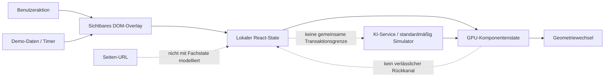

## 3. Feature- und Machbarkeitsmatrizen

Legende: **P** = partieller Code, **D** = dokumentierte Absicht, **—** = fehlt. Keine dieser Einstufungen bedeutet bereits verifizierte Produktionsreife.

### 3.1 Kern und Intelligence

| Feature | Pro | FluidUI | Zielentscheidung | Tasks |
|---|:---:|:---:|---|---|
| WebGPU als Standard | P | — | WebGPU bevorzugt; transparenter WebGL2-Fallback | T03–T04, T46 |
| GPU-Text, Icons, Bilder | P | — | Eigenständige Rendering-Primitives | T05–T06 |
| Fokus, Tastatur, Screenreader, IME | — | P | Abgeleitete Semantik-/Eingabebrücke | T07 |
| Responsive Layout, Scroll, Clipping | P | P | Gemeinsames Layoutmodell und Virtualisierung | T05, T13 |
| Button, Card, Input, Progress | P | P | Funktionsfähige Komponenten statt Formdemos | T13 |
| Form, Wizard, Grid, Table, Nav, Modal | D/P | P | Vollständige Kernbibliothek | T13 |
| Manual, Hybrid, Auto | P | P | Drei explizite Modi mit eindeutiger Autorität | T09, T22 |
| Flüssiges Morphing | P | — | GPU-Morphs für deklarierte kompatible Übergänge | T10 |
| Physics-Presets | D | — | Deterministische Steuerung, optionale TypeGPU-Kernels | T11, T47 |
| Content Preservation | D/P | — | Typisierte Projektionen, stabile Feldidentitäten | T12 |
| Multi-Component Choreography | D | — | Gemeinsame Timeline und Abbruchregeln | T10–T11, T48 |
| Optionale Zusatzeffekte und Library | — | — | Fixed, seeded-random, Case-Regeln und Studio-Vorschau | T47–T49 |
| Verhalten und Intent | P | P | Ereignisvertrag und erklärbares Top-k-Ranking | T21 |
| Predictive Preload | D | D | Budgetierter, abbrechbarer Scheduler | T23 |
| Personalisierung und Ziele | D/P | P | Freigegebene Varianten und explizite Präferenzen | T24 |
| Cloud-/lokale Modelle | D/P | P | Austauschbare Provider, lokale Modelle optional | T22, T29 |
| Persistente Analytics und Kosten | D | P | Reale Events, Nutzung und Budgetreservierung | T26–T27 |
| A/B-Tests und Lernschleife | D | D/P | Holdout, Offline-Evaluation, kontrollierte Policies | T28 |
| State-/Daten-/URL-Konsistenz | — | — | Explizite Eigentümerschaft und versionierte Events | T09, T14–T15 |

### 3.2 Studio, Ökosystem und langfristige Visionen

| Feature | Pro | FluidUI | Zielentscheidung | Tasks |
|---|:---:|:---:|---|---|
| Visueller Inspector | D | P | Live-Zustand, Events, Entscheidungen, Ressourcen | T16–T18 |
| Flow-/State-/URL-Editor | — | — | Ein Modell mit grafischer und textueller Ansicht | T17 |
| Simulation und Fehlereinspielung | P | P | Kontrollierte Szenarien statt zufälliger Demo-KI | T18 |
| Record/Replay | — | — | Versionierte, redigierte Laufaufzeichnungen | T18–T19 |
| Mermaid-Flows | D | P | Aus Verträgen erzeugte und validierte Diagramme | T01, T17 |
| Visuelle und modellbasierte Tests | — | P | Gemeinsamer Szenariovertrag für Studio und CI | T19 |
| Reale Praxisfälle | P, Mockdaten | P, statische Daten | Case-Pakete mit Daten- und Action-Adaptern | T25 |
| CLI und shadcn-ähnliche DX | D | D | Paketierter Kern plus editierbare Rezepte | T20 |
| Headless/API-Nutzung | D | — | Frameworkunabhängiger Kern von Beginn an | T02, T32 |
| Plugins und weitere Frameworks | D | — | Versionierte Capability-Verträge | T32 |
| Collaboration | D | — | Gemeinsame Dokumente, getrennte Laufzeitsitzungen | T31 |
| Enterprise-Integration | D | D | Host-Auth, Rollen, Audit, Export, Self-Hosting | T34 |
| Voice und Gesten | D | — | Zusätzliche Eingabeadapter für dieselben Events | T33 |
| AR/VR/WebXR | D | — | Optionales Paket für nachgewiesene WebGPU-XR-Kombinationen | T35 |
| Neural Rendering | D | — | Isoliertes Forschungspaket mit messbarem Nutzen-Gate | T36 |
| Marketplace | D | — | Abschließende Registry-/Distributionsstufe | T37 |
| Dokumentation und Community | D | D/P | Nachvollziehbare Beispiele und getestete Rezepte | T38 |

### 3.3 Was an der Vision präzisiert werden muss

| Ursprüngliche Aussage | Belastbare Produktdefinition |
|---|---|
| „Alles kann sich in alles verwandeln“ | Jede **registrierte kompatible** Zustandskombination kann einen definierten Übergang besitzen. Datenverlust und ungültige Semantik sind ausgeschlossen. |
| „WebGPU default“ | GPU-Darstellung mit bevorzugtem WebGPU; WebGL2-Fallback sichtbar ausweisen. CPU-Layout und native Semantik-/Eingabebrücken bleiben erlaubt. |
| „KI entscheidet alles“ | KI entscheidet innerhalb freigegebener Möglichkeiten. Fachliche Invarianten, Rechte und ausdrückliche Nutzeraktionen haben Vorrang. |
| „Unter 100/200 ms KI-Latenz“ | Sofortige lokale Rückmeldung wird budgetiert. Entfernte Modellantworten laufen asynchron und sind keine Voraussetzung für grundlegende Bedienbarkeit. |
| „60 FPS und weniger Speicher“ | Messbare Ziele auf definierten Geräten und Szenarien. Keine pauschale Überlegenheit gegenüber DOM-Oberflächen. |
| „Automatisch +25 % Conversion“ | Zu prüfende Hypothese mit Kontrollgruppe. Kein technisches Abnahmekriterium und keine vorab zugesicherte Wirkung. |
| „WebGPU in jedem Browser“ | Unterstützte Browser-/OS-/GPU-Kombinationen werden veröffentlicht. Ohne WebGPU kann ein qualifiziertes WebGL2-Backend übernehmen; ohne nutzbaren GPU-Renderer folgt eine verständliche Diagnose. |
| „XR ist nur ein weiterer Modus“ | Separates Capability- und Integrationspaket. Browser-WebGPU allein beweist keine immersive XR-Unterstützung. |

WebXR bleibt hinsichtlich konkreter Browser-/Geräte-Kombinationen separat zu qualifizieren. Quelle: [W3C WebXR-Veröffentlichungsstand](https://www.w3.org/standards/history/webxr/).

## 4. Scored Optionen und Gewinner

### 4.1 Bewertungsverfahren

Bewertet wird auf einer Skala von 1–5:

- **30 % Zielerfüllung**
- **25 % Korrektheit, Sicherheit und Accessibility**
- **20 % Testbarkeit und Nachvollziehbarkeit**
- **15 % Lieferbarkeit und Wartungsaufwand**
- **10 % Erweiterbarkeit**

Der gewichtete Wert wird auf 100 Punkte normiert. Es handelt sich um **Planungsbewertungen**, nicht um gemessene Performance oder Erfolgswahrscheinlichkeiten.

Harte Anforderungen schlagen den Score: Eine Lösung mit sichtbarem DOM-Ersatzrenderer oder Browser-API-Keys ist unabhängig von ihrem Nutzwert ausgeschlossen.

### 4.2 Strategische Entscheidungen

| Entscheidung | Option A | Option B | Hybrid | Gewinner und Begründung |
|---|---|---|---|---|
| Gesamtarchitektur | Bestehende Prototypen ausbauen — **46** | Alles einschließlich Rendering selbst entwickeln — **74** | Neuer eigener Kern mit gezielt übernommenen Infrastrukturbausteinen — **92** | **Hybrid:** bewahrt Produktideen, vermeidet Altlasten und unnötigen Grafik-Unterbau |
| Zustandsmodell | Reducer plus Konventionen — **71** | Direkt geschriebene Statecharts — **85** | Deklarativer Vertrag, XState-Ausführung, abgeleitete Diagramme — **97** | **Hybrid:** Authoring, Runtime und Tests bleiben verbunden |
| Text und Layout | Canvas-Texturen und feste Koordinaten — **64** | Vollständige eigene Typografie-Engine — **72** | Glyph-/Yoga-Adapter plus eigene UI-Verträge — **88** | **Hybrid:** begrenzte Abhängigkeiten, eigene Kontrolle über Semantik |
| KI | LLM bei jedem Ereignis — **56** | Ausschließlich lokale Regeln — **80** | Lokaler schneller Pfad plus asynchrone Modellvorschläge — **94** | **Hybrid:** reagiert sofort und bleibt nachvollziehbar |
| Studio | Nur Code-Playground — **84** | Komplett eigenes GPU-Editorprodukt — **68** | DOM-Studio mit identischer WebGPU-Runtime in der Vorschau — **97** | **Hybrid:** entspricht der geklärten Produktgrenze |
| Content Mapping | Explizite typisierte Zuordnung — **95** | Freie KI-Konvertierung — **57** | KI erstellt Mapping-Vorschläge zur Prüfung — **85** | **A:** Produktionsübergänge dürfen keine Inhalte erfinden |
| Lernen | Unmittelbare Online-Anpassung — **53** | Nur freigegebene Offline-Updates — **85** | Offline-Qualifikation, Holdout und begrenzte Online-Policies — **94** | **Hybrid:** messbare Verbesserung mit Rücknahmeweg |
| Distribution | Vollständige Copy-Paste-Bibliothek — **59** | Ausschließlich geschlossenes npm-Paket — **80** | Paketierter Kern plus editierbare Rezepte und Case-Pakete — **95** | **Hybrid:** wartbarer Kern und anpassbare Integration |

**Gewähltes Zielmodell:** ein neuer, frameworkunabhängiger Fluid-Kern mit WebGPU als Standard und transparentem WebGL2-Fallback, deklarativen Zustands- und Datenverträgen, kontrollierter Intelligence und eigenem Fluid Studio.

Die Detailentscheidungen für sämtliche Umsetzungstasks stehen in Abschnitt 7. Die Feature-Matrizen verweisen auf diese Tasks; dadurch bleibt jede Feature-Entscheidung bis zur Abnahme nachvollziehbar.

## 5. Zielarchitektur und öffentliche Verträge

### 5.1 Paketgrenzen

Ein npm-Workspace mit folgenden Verantwortlichkeiten:

| Paketbereich | Verantwortung |
|---|---|
| Contracts | Zod-Schemas, abgeleitete Types, Versionierung und Validierung |
| Core | Komponentenregister, Statecharts, Events, Policies und Transaktionen |
| WebGPU | Scene-Projektion, Layout, Text, Morphing, Ressourcen und Geräteverwaltung |
| React | Provider, deklarative Komponenten und State-Abonnements |
| Intelligence | Intent, Preload-Planung und Provider-Verträge |
| Server | KI-Endpunkte, Host-Auth, Budgets, Datenadapter und optionale Persistenz |
| Testing | Szenarien, Uhr, Seeds, Replay, Assertions und CI-Runner |
| Cases | Studio-, Immobilien-, Commerce-, Reise- und weitere Praxisfälle |
| Studio | DOM-Editor, Inspector, Vorschau, Vergleiche und Exporte |
| Extensions | Collaboration, zusätzliche Eingaben, XR und spätere Registry |

Der Kern benötigt weder Next.js noch React noch einen KI-Anbieter. Die WebGPU-Runtime benötigt keine Cloudverbindung. Next.js dient Studio, Dokumentation und Referenzintegration.

### 5.2 Öffentliche Schnittstellen

Alle serialisierbaren Modelle erhalten eine Schema-Version. TypeScript-Typen werden daraus abgeleitet.

| Vertrag/API | Festgelegter Inhalt und Verhalten |
|---|---|
| `ComponentDefinition` | Stabile Komponenten-ID, benannte Parts, kontrollierte Werte, Behavior-/Semantik-Verträge, erlaubte Events und getrennte Renderrezepte |
| `FlowDefinition` | Zustandsgraph, Guards, referenzierte Aktionen, URL-Projektion und Invarianten |
| `defineComponent` / `defineFlow` | Typisierte Definition und Validierung dieser Verträge |
| `createFluidRuntime` | Erzeugt eine isolierte Runtime; nimmt Renderer-, Daten-, Router-, Clock-, Policy- und Trace-Adapter entgegen |
| `FluidProvider` / `useFluid` | React-Integration ohne parallelen fachlichen State |
| `RuntimeSnapshot` | Fachzustand, Datenreferenzen, Entwürfe, fachliche Auswahl, Modus und Domain-Revision; keine GPU-Objekte und keine Hover-/Fokus-Kopie |
| `InteractionSnapshot` | Transienter Fokus, Hover, Pressed und IME-Composition; eigene Benachrichtigung ohne Änderung der Domain-Revision |
| `PartDefinition` | Component-ID, Partname, Behavior, zugänglicher Name/Beziehungen und Renderrezept; Rollen werden nicht aus der Form geraten |
| `ChangeDetails` | Serialisierbare Quelle/Reason plus synchrone Cancel-Möglichkeit für den Host; kein DOM-Event im Core |
| `PresentationState` | Vorherige/aktuelle visuelle Projektion, Übergangsphase, Dauer und Fortschritt; keine fachliche Wahrheit |
| `RuntimeEvent` | Event-ID, Quelle, Typ, Zeit, Payload und Bezug auf die erwartete Revision |
| `DecisionPlan` | Vorschlags-ID, Snapshot-/Policy-Version, Ablaufzeit, erlaubte Zielaktionen und kurze Erklärung |
| `DataAdapter` | Validierte lesende Abfragen, AbortSignal, Quellenmetadaten, Version und Aktualität |
| `ActionAdapter` | Explizite fachliche Aktionen mit Berechtigung, Idempotenz und überprüfbarem Ergebnis |
| `RouterAdapter` | Parse, Serialize, Navigate, Prefetch und History-Abonnement |
| `ScenarioDefinition` | Ausgangszustand, Datenreferenzen, Ereignisse, Fehlereinspielungen und erwartete Invarianten |
| `CaseManifest` | Daten-/Action-Schemas, Flows, Komponenten, Szenarien und unterstützte Betriebsarten |
| `VisualTransitionDefinition` | Quelle/Ziel-Projektion, Basismotion, optionale Effekt-Policy, Timing und Interruption-Regel; keine fachlichen Zwischenzustände |
| `EffectDefinition` | Versioniertes Rezept, Parameter-Schema, kompatible Inhalte/Parts, Backend-/Feature-Anforderungen, Budget und Reduced-Motion-/Fallback-Rezept |
| `EffectPolicy` | Aus, fest, seeded-random oder Case-Mapping; explizite Projekt-/Case-/Transition-Priorität |
| `ResolvedEffectPlan` | Aufgelöste Rezept-ID/Version, Seed, Parameter, Quellen-/Zielrevision, Policy-Version und tatsächliche Capability-Entscheidung |
| `TraceSink` | Versionierte Events mit Korrelation; Datenredaktion erfolgt vor Export und Persistenz |
| `StoryDefinition` | Versionierter Design-Brief, Medium/Modus, Daten-/Flow-/Szenarioreferenzen, Beats und erwartete Ergebnisse ohne parallelen Fachstate |
| `ThemeDefinition` | Kanonische versionierte Gestaltungsrollen, abgeleitete CSS-/GPU-Werte und ausdrücklich unterstützte Importtypen |
| `PresentationProjection` | Gemeinsame dargestellte Layout-/Clip-/Kameratransformation und inverse Zuordnung für Eingabe, Ziele und Semantik |
| `FrameCaptureManifest` | Framefolge mit Versions-/Zeit-/Backend-/DPR-/Event-/Scene-/Rezeptbezug, tatsächlicher Aufnahmeabdeckung und Artefaktreferenzen |
| `RehearsalReport` | Getrennte geometrische, visuelle, semantische und zeitliche Ergebnisse plus Review als versionierter Companion des bestehenden QualityReport |
| `AIReviewBundle` | Freigegebene ausgewählte pixelredigierte Bilder, Brief, begrenzte Metadaten und nachvollziehbarer Provider-/Budget-/Abdeckungsbezug |
| `AIReviewFinding` | Validierter Frame-/Part- oder Bildregionbezug, Kategorie, Begründung, Unsicherheit, Empfehlung und Herkunft ohne eigene Ausführungsrechte |

`StoryDefinition`, ein erster `ThemeDefinition`-Teilumfang sowie `AIReviewBundle` und `AIReviewFinding` werden inzwischen als validierte Paketexports umgesetzt. Der ausführbare Scope und offene Grenzen stehen in der [M6-Ausführung](milestones/m6-execution.md). `CapturedFrame` ist ein selektiver Canvas-Aufnahmevertrag; er erfüllt weder den vollständigen `FrameCaptureManifest` noch den geplanten `RehearsalReport`. Präsentationsprojektion, Importteilumfang, persistente Runs und Vollscan bleiben offen.

Es gibt keine unbeschränkten Zustandsstrings, freien Modell-Code oder direkt aus Modellantworten ausgeführten URLs.

### 5.3 Zustands- und Autoritätsregeln

1. **Eine Autorität pro Zustandsbereich:** Core/Host besitzen Fachzustand und kontrollierte Werte; der Interaktionsstore besitzt Fokus/Hover/Pressed/Composition; die Surface besitzt Animation und Ressourcen. React und Semantik lesen diese Stores, ohne Werte zu duplizieren.
2. **Autorität:** Invarianten und Berechtigungen → ausdrückliche Nutzeraktion → deklarierter Host-Workflow → KI-Vorschlag.
3. **Manual (Anwendungsruntime):** Keine Modellaufrufe aus der Anwendungssteuerung; der Host steuert gültige Events. Eine bewusst angeforderte Studio-AI-Review ist eine getrennt berechtigte Toolaktion ohne Autorität über diese Runtime.
4. **Hybrid:** KI erstellt Vorschläge; Freigabe erfolgt durch Nutzer oder ausdrücklich konfigurierte Host-Policy.
5. **Auto:** Nur freigegebene, reversible Anpassungen; keine Käufe, Buchungen, Veröffentlichungen oder Rechteänderungen.
6. **Standard:** Runtime startet in Manual. KI-Modi werden bewusst konfiguriert.
7. **Kein State-Sprung durch Animation:** Logische Änderungen werden atomar committed; Animationen visualisieren den Übergang. Quelle → Zusatzeffekt → Ziel sind visuelle Phasen, keine zusätzlichen Fachzustände.
8. **Überholte Antworten:** Alte Request-/Snapshot-Versionen dürfen den aktuellen Zustand nicht überschreiben.
9. **Unterbrechung:** Neue berechtigte Aktionen dürfen eine visuelle Animation ersetzen. Externe Transaktionen werden dadurch nicht rückgängig gemacht.
10. **Stabile Eingabe:** Fokus, Auswahl und bearbeitete Felder dürfen nicht durch spontane KI-Anpassungen verloren gehen.

### 5.4 Rendering und Eingabe

- Ein Renderer und ein zentraler Frame-Scheduler pro Surface.
- WebGPU zuerst prüfen; WebGL2-Fallback ist erlaubt. Nur öffentliche Three.js-APIs verwenden. Backend, Grund und Diagnosemodus sind beobachtbar.
- Orthografisches UI-Koordinatensystem mit Containergröße statt globaler Fensterannahmen.
- Yoga-Boxlayout; Grid, Scrollbereiche und Virtualisierung als definierte Fluid-Abstraktionen.
- GPU-Text über einen Textadapter; Schriftdateien und Glyphenressourcen werden kontrolliert geladen.
- Morphing kombiniert parametrische Flächen/SDFs, Layoutinterpolation und GPU-gezeichnete Content-Übergänge.
- Beliebige Mesh-Topologien benötigen registrierte Morph-Adapter.
- Jeder interaktive Part besitzt einen expliziten Behavior-Vertrag; ein Renderrezept legt keine Rolle fest. Die Semantikbrücke verwendet echte zugängliche Elemente; sie wird nicht mit `display:none` oder `aria-hidden` unbrauchbar gemacht.
- Native Texteingabe wird mit GPU-Text, Caret und Auswahl synchronisiert.
- Reduced Motion verändert die Animation, nicht die Funktion.
- Ressourcen besitzen eindeutige Eigentümer und ein überprüfbares Lebensende.
- Geräteverlust pausiert Rendering, erhält den fachlichen Snapshot und versucht begrenzte WebGPU-Wiederherstellung.
- Ohne nutzbares WebGPU wird das freigegebene WebGL2-Backend versucht. Wenn auch dieses nicht verfügbar oder nicht für die verwendeten Primitives qualifiziert ist, folgt ein nachvollziehbarer Startfehler. Es gibt keinen stillen HTML-Ersatz.

### 5.5 Daten, Speicherung und Sicherheit

**Lokal:** Das Studio arbeitet mit einem explizit geöffneten Projektverzeichnis. Deklarative Projektdateien sind die Quelle; Runs, Aufzeichnungen und Caches liegen getrennt davon. Schreiben erfolgt atomar mit Revisionsprüfung.

**Gemeinsamer Betrieb:** Das optionale Serverpaket verwendet PostgreSQL für Projektversionen, Events, Entscheidungen, Budgets und Collaboration-Metadaten. Große Run-/Bildartefakte liegen hinter einem Object-Storage-Adapter.

**Produktive Integrationen:** Fachliche Daten bleiben beim Host beziehungsweise Anbieter. Fluid speichert nur die für den vereinbarten Betrieb erforderlichen Referenzen und Ereignisse.

Weitere Regeln:

- API-Keys ausschließlich serverseitig; Projektdateien enthalten nur Secret-Referenzen.
- Lokales Studio bindet standardmäßig an Loopback und schützt Schreiboperationen durch Origin-/Sessionprüfung.
- Importpfade dürfen das freigegebene Projektverzeichnis nicht verlassen.
- Server-Proxy-Ziele werden konfiguriert; kein frei nutzbarer URL-Proxy.
- Modellantworten werden auf Schema, Rechte, Zustand, erlaubte Aktionen und Ablaufzeit geprüft.
- Persönliche Eingaben und Rohprompts werden standardmäßig nicht in Telemetrie übernommen.
- Replay darf keine produktiven Seiteneffekte ausführen.
- Community-Templates sind zunächst deklarativ. Ausführbare Plugins werden bewusst als vertrauenswürdige Build-Abhängigkeiten eingebunden.

### 5.6 URL-Vertrag

| Oberfläche | URL-Muster | Persistierter Navigationszustand |
|---|---|---|
| Projektübersicht | `/studio/projects` | Filter und Sortierung |
| Projekt/Case/Flow | `/studio/projects/:projectId/cases/:caseId/flows/:flowId` | Case und Flow |
| Editoransicht | Query: `mode`, `viewport`, `scenario`, `selection` | Validierte Ansichtseinstellungen |
| Run | `/studio/projects/:projectId/runs/:runId` | Unveränderlicher Laufbezug |
| Vergleich | `/studio/projects/:projectId/compare?baseline=…&candidate=…` | Zwei explizite Runs |
| Praxisfall | `/cases/:caseId/...` | Vom Case deklarierte fachliche Route |
| Dokumentation | `/docs/...` | Dokumentationsnavigation |

Verhalten:

- Explizite Navigation erzeugt History-Einträge.
- Reine Editoransichtsänderungen verwenden `replace`.
- Suchfilter werden erst bei bestätigter Suche kanonisch übernommen.
- Formulardaten, Secrets, Prompts, Hoverzustände und Animationsfortschritt gehören nicht in URLs.
- Zurück/Vorwärts stellt den referenzierten fachlichen Zustand wieder her und bricht überholte Ladevorgänge ab.
- Nicht mehr vorhandene IDs erzeugen einen definierten Not-found-Zustand.
- KI darf aus freigegebenen Navigationszielen wählen, aber keine freien URLs erfinden.

## 6. Mermaid-Flows der Zielarchitektur

### 6.1 System- und Verantwortungsgrenzen

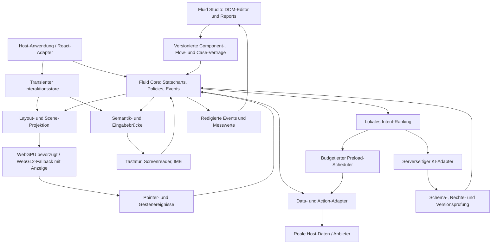

### 6.2 Nutzeraktion, KI und Transformation

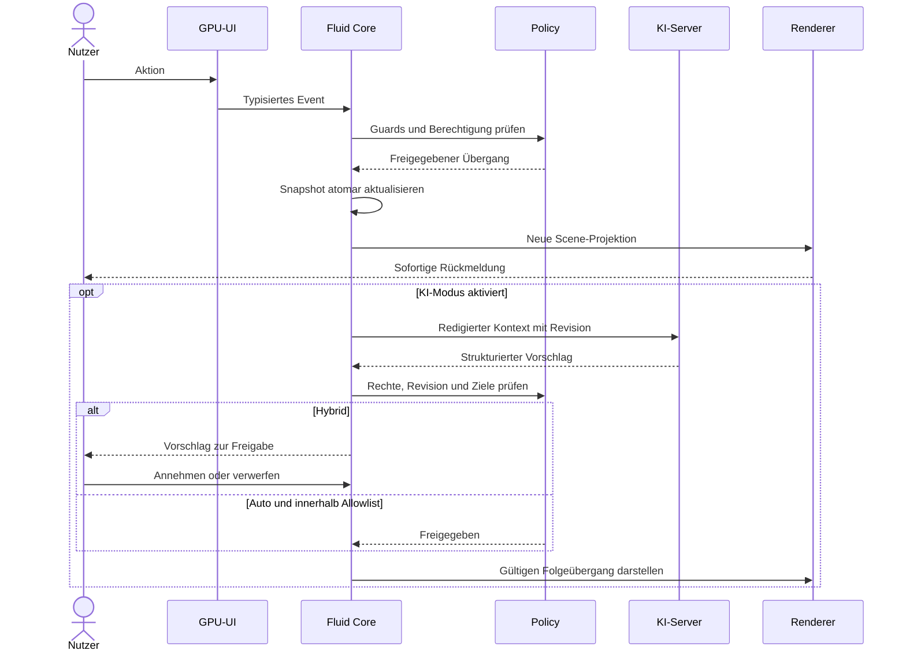

### 6.3 State- und Transition-Lifecycle

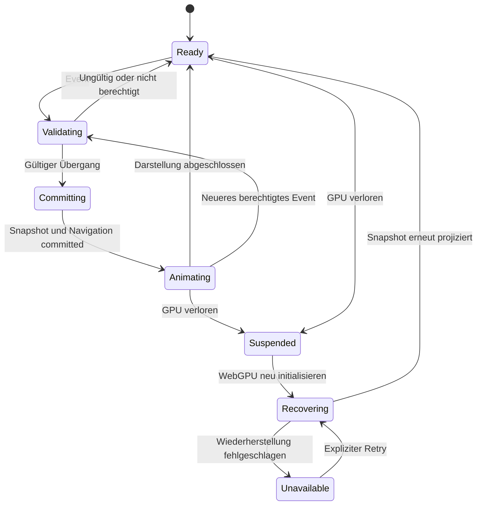

### 6.4 Datenfluss und konkurrierende Requests

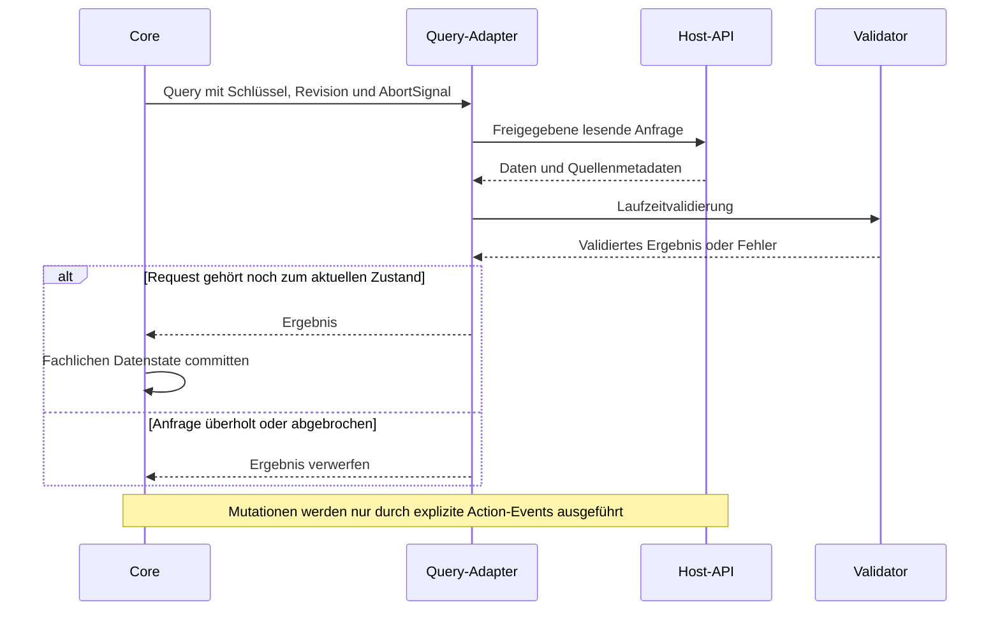

### 6.5 URL- und History-Flow

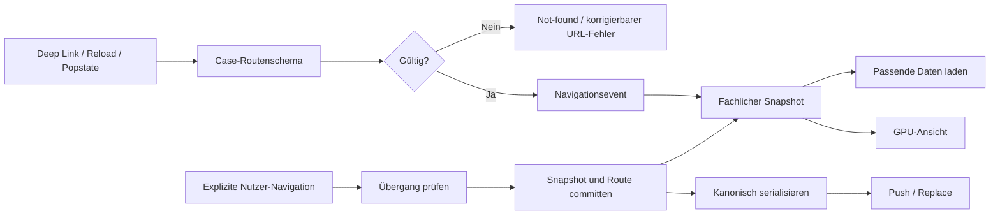

### 6.6 WebGPU-Start und Ressourcen

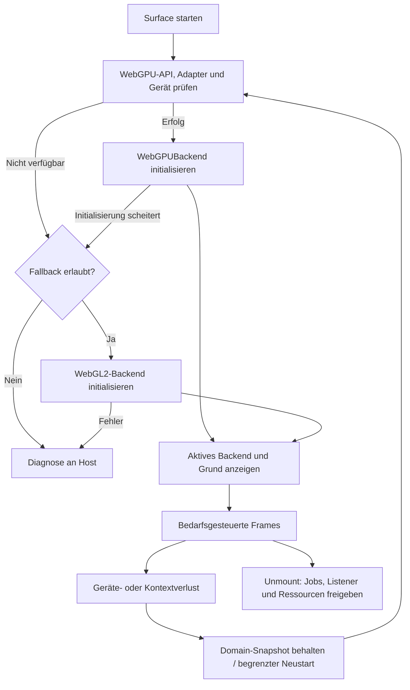

### 6.7 Studio, Simulation und Testexport

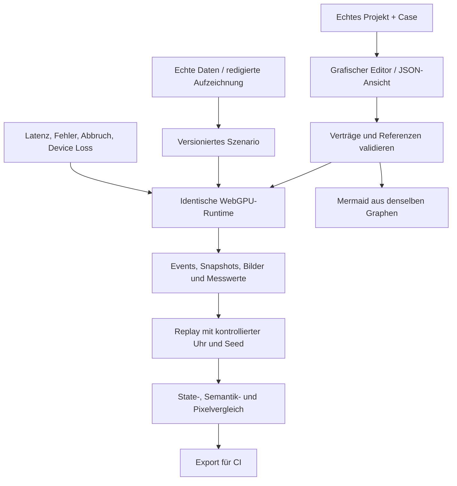

### 6.8 Lern- und Freigabeflow

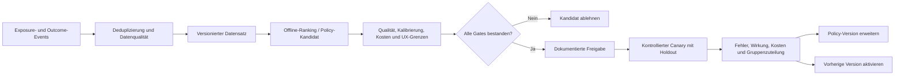

### 6.9 Projekt- und Laufdatenmodell

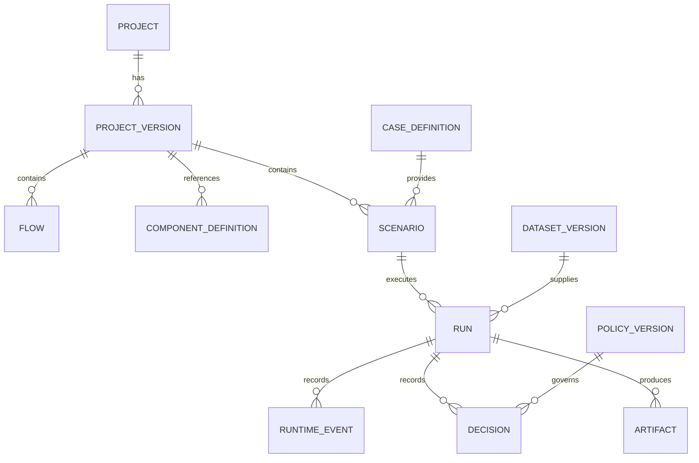

## 7. Umsetzung nach Waves und Release-Packages

Notation: **A/B/H** sind alternative Lösungswege mit Nutzwertscore. Der Gewinner ist ausdrücklich angegeben. Jeder Task wird erst mit seinen Akzeptanzkriterien abgeschlossen.

### Wave 0 — RP0: Verbindliche Grundlage

| Task | Bewertete Optionen | Gewinner und Umsetzung | Acceptance Criteria |
|---|---|---|---|
| **T01 Vision und Nachweisregister** | A bestehende Texte korrigieren **55**; B neues PRD **85**; H normatives PRD plus archivierte Evidenz **95** | **H:** konsolidierte Vision, Feature-IDs, Quellen, Risiken und ADRs | Jede Vision besitzt Status, Entscheidung, Task und Abnahme. Leistungsbehauptungen sind als gemessen, Ziel oder Hypothese markiert. |
| **T02 Neuer Workspace und Toolchain** | A Pro reparieren **60**; B unkritisch alles auf latest **50**; H neuer modularer Workspace mit kompatiblen Pins **95** | **H:** neue Paketgrenzen und eindeutige Server-/Client-Exporte | Reproduzierbarer Clean Install; strict Typecheck, ESLint CLI und Paketbuilds funktionieren; keine Peer-Overrides oder produktiven `any`-Ausnahmen ohne Begründung. |
| **T03 Machbarkeitsnachweis** | A Shape-Demo **45**; B große Komponentenbibliothek vorziehen **55**; H kleiner vollständiger GPU-/Text-/Input-/State-Proof **95** | **H:** eine Surface mit Text, Button, Input, Card und einem vollständigen Flow | WebGPU als Standard und tatsächliches Backend nachgewiesen; IME/Fokus funktionieren auf der Zielmatrix; Mount/Unmount und Device Loss sind geprüft. Keine Freigabe allein anhand eines Screenshots. |

**Erster Milestone M1:** DOM-Studio mit echter WebGPU-Surface; Button → Progress → Ergebnis → Detail; kontrollierte Texteingabe bleibt erhalten; Play/Pause/Step/Reset; Anatomy-, State- und Event-Inspector; Base-UI-Tabs und zugängliche Dialoge im Studio. GPU-Rendering ist real, Nutzerereignisse/Timing sind gekennzeichnete Simulation. Aktueller Case verwendet echte Projektmetadaten. Erst zeigen, dann nächste Wave.

**Gate:** Erst nach T03/M1 wird die Komponentenbreite erweitert. Ein gescheiterter Proof führt zur Ursachenbehebung, nicht zum heimlichen Rendererwechsel.

### Wave 0b — Base-UI-Konsistenz und M1

Alle bisherigen Feature-IDs und Tasks T01–T38 bleiben enthalten. T07/T09/T13/T16–T19 werden um die folgenden verbindlichen Verträge ergänzt; ihre bisherigen Acceptance Criteria gelten zusätzlich.

| Task | A / B / Hybrid | Gewinner | Acceptance Criteria |
|---|---|---|---|
| T39 Anatomy und Behavior-Verträge | Flat-Kind-Modell 63 / komplettes API-Klonen 71 / benannte Parts + eigene GPU-Projektion 97 | Hybrid | Part-IDs eindeutig; Button braucht Aktion; Textbox braucht Textfeld; kein Rollenableiten aus visueller Form; alle Proof-Parts im Inspector |
| T40 State Ownership und Change Requests | Alles global 63 / nur lokale Control-States 70 / Domain + Interaction + Presentation mit getrennten Besitzern 97 | Hybrid | Fokus/Hover ändern Domain-Revision nicht; kontrollierte Werte bleiben erhalten; Cancel verhindert Commit und Seiteneffekte; Gründe sind im Trace |
| T41 Presence und Animation | Fachstate bis Animationsende verzögern 49 / unmittelbarer Austausch 66 / sofortiger Commit + separat beobachtbare GPU-Transition 92 | Hybrid | Dauer kommt aus dem Transition-Vertrag; Unterbrechung startet vom aktuellen Bild; reduzierte Bewegung sofort; kein aktivierbarer veralteter Part |
| T42 Studio mit Base UI | eigene Widgets weiterbauen 60 / komplettes Studio ersetzen 60 / Base-UI-Primitives unter bestehendem Design 97 | Hybrid | Tabs per Pfeiltasten; Dialog mit Label, Escape und Fokusrückgabe; Vorschau rendert mit GPU; aktives Backend ist sichtbar |
| T43 Konsistenz und Conformance | Sichtprüfung 50 / Snapshot allein 68 / Vertragsprüfer + negative Tests + Browsertests 97 | Hybrid | Plan enthält alle Tasks; Quellen/Versionen belegt; keine Base-UI-Abhängigkeit im Core; M1 live demonstriert; nicht geprüfte Kriterien bleiben offen |

### M2 — adaptive Arbeitsfläche und RP1-Fortsetzung

Die M1-Richtungsfreigabe erlaubt die nächste Stufe. Der Nutzer verlangt einen
anspruchsvolleren Showcase einschließlich sortierbarer Tabellen. [M2-Vertrag](milestones/m2-plan.md).

| Task | Bewertete Optionen | Gewinner | Acceptance Criteria |
|---|---|---|---|
| T44 Adaptive Datenoberfläche | isolierte Effekte 58 / universeller Spreadsheet-Editor 61 / echter Workspace mit Table, Cards, Map und Detail 92 | Hybrid | echte Daten; stabile IDs; numerische Sortierung und aria-sort; Filter-/Auswahlerhalt; validierte URL-/History-Flows; Screenshot-Nachweis |
| T45 RP1-Fortsetzung | nur Kosmetik 49 / alle Widgets vorziehen 59 / Scene-Verträge, Presence, responsive Bounds und Recovery 92 | Hybrid | atomare Feldzuweisung; validierte Projektionen; unterbrechbare Präsentation; kein aktiver Exit-Part; GPU-Retry mit erhaltenem Snapshot; unabhängige Tests |
| T46 Backend-Transparenz | WebGPU-only 73 / unbeobachteter automatischer Fallback 47 / WebGPU-first mit Backend- und Grundanzeige 97 | Hybrid | Default bevorzugt WebGPU; WebGL2-Diagnose separat; Badge aus tatsächlich initialisiertem Backend; fehlgeschlagene Qualifikation wird nicht als Erfolg angezeigt |

Diese Ergänzung zieht einen begrenzten Table/Grid/Card-Proof aus T10/T13 vor.
Sie ersetzt nicht die vollständigen RP1-Gates. Der Nachweisstatus jeder betroffenen
Funktion wird in der Feature-Matrix getrennt von der Roadmap geführt.

### TypeGPU- und Effekt-Gate vor weiterer GPU-Ausweitung

Bewertung mit denselben fünf Gewichten; zusätzliche Hybridvariante H2 ist
nachgerechnet in [typegpu-scores.json](decisions/typegpu-scores.json).

| Task | Bewertete Optionen | Gewinner | Acceptance Criteria |
|---|---|---|---|
| T47 TypeGPU-Qualifikation | nur TSL 75 / vollständiger TypeGPU-Neubau 68 / parallele vollständige Renderer 77 / schrittweise Kernel-/Three-Integration 92 | Hybrid | kompatible Pins; isolierter Build; unabhängige CPU/GPU-Invarianten; Three/Glyph-/WebGL2-Prüfung; ein Device und Scheduler; dokumentierte Ressourcenfreigabe; Nutzenvergleich |
| T48 Effekt- und Auswahlvertrag | unaufgezeichnete Zufallseffekte 51 / Effektphasen als Fachstates 65 / manuelle Case-Rezepte 74 / versionierte Policy und ResolvedEffectPlan 97 | Hybrid | fixed/random/case/aus; explizite Priorität; kompatible Pools; Seed und Rezeptversion im Run; Replay würfelt nicht neu; Fokus/Inhalt/Actions unverändert; Abbruch und Reduced Motion geprüft |
| T49 Studio- und Showcase-Effekt-Library | Dropdown allein 60 / universeller Shader-Node-Editor 70 / Code plus einfache Vorschau 77 / kuratierte Library mit Timeline und Regel-Inspector 97 | Hybrid | visuelle Preset-Vorschauen; Intensität/Dauer/Parameter; Projekt-/Case-/Transition-Zuordnung; Seed-/Random-Steuerung; Quelle/Zusatz/Ziel scrubben; Vergleich und Szenarioexport; gleiche Runtime wie Host; GPU-Effektleiste im Showcase synchron zum Studio; Policyänderung startet laufende Animation nicht neu |

T47–T49 bilden den M3-Proof: separat gebauter TypeGPU-Shape-Kernel,
rendererneutraler Resolver und drei ausführbare Rezepte. WebGPU-/WebGL2-
Browsernachweise ersetzen keine vollständige Hardware-, Leistungs- oder
Accessibility-Freigabe. [Abnahme und offene Gates](milestones/m3.md). T49 nutzt zunächst kuratierte Rezepte: parametrisches Morphing,
Spring-Reflow und Ripple-Reveal. Liquid-Glass- und Partikelrezepte erhalten eigene
Capability-/Performance-Nachweise. Eine interne Effekt-Library ist Teil von T49;
Distribution fremder Pakete bleibt T37/Marketplace zuletzt.

Studio und Showcase verwenden dieselbe Effektkonfiguration. Die GPU-Leiste
bietet Rezepte, Aus/Fix/Zufall/Case und Seed; das aufklappbare Effekt-Studio
bietet die weiteren Parameter und Aufzeichnungen. Änderungen gelten für den
nächsten Wechsel. Die aktuelle Auswahl eines Runs bleibt unverändert.

**Abnahme-Details:** Der Quellen-Snapshot bleibt als Visual-Referenz erhalten;
Quellen-Controls werden nach Commit nicht erneut aktiv. Neuere berechtigte Events
retargeten vom aktuell dargestellten Bild. Aktive Eingabe und Fokus bleiben an
stabile Parts gebunden. Effekt-Overlays erzeugen keine externe Mutation.
Capability-Fallbacks ändern Darstellung, nicht fachliche Outcomes. Effekte aus
gespeicherten Runs bleiben an ihre Rezept-/Policy-Version gebunden.

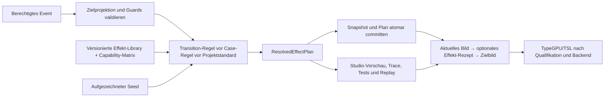

### M6 und folgende Waves — Designqualität im Studio und in der Runtime

Die neuen Tasks ergänzen T01–T49. Vollständige Optionen A/B/H2/H einschließlich
Ratings und Gewichten stehen in [stageshow-scores.json](decisions/stageshow-scores.json).
H bezeichnet den Gewinner. Alle neuen Runtime-/Studio-/AI-Funktionen sind zunächst
**geplant**. Der angenommene Prozess ist kein bestandener visueller M6-Lauf.

| Task | Bewertete Optionen | Gewinner und Umsetzung | Acceptance Criteria |
|---|---|---|---|
| T50 Design-Brief und Storyvertrag | A Prosa-Brief 66 / B Script ohne Storymodell 68 / H2 Brief plus lose Szenarioreferenzen 77 / H versionierter referenzieller Vertrag 97 | H: StoryDefinition mit Medium, Informationshierarchie, Referenz und drei bis fünf Beats | Versionierter Brief benennt Nutzerziel, Medium, Modus, Datenherkunft und drei bis fünf Beats; jeder Beat referenziert gültige Flow-/Szenarioziele und erwartete Invarianten; Illustration, Simulation und bedienbare Runtime sind unterscheidbar; Anfang und Ergebnis besitzen einen verständlichen Poster ohne zweiten Fachstate; fehlende Referenzen und unbelegte Erfolgszustände werden vor dem Lauf abgewiesen. |
| T51 Gemeinsame Theme- und Design-Tokens | A CSS-Werte kopieren 60 / B sofort komplette DTCG-Plattform 80 / H2 manuelle Map plus Tests 78 / H eigene Rollen und generierte DOM-/GPU-Werte 97 | H: bestehende Identität rollenbasiert erweitern, benannter DTCG-Teilumfang | Farbe, Typografie, Abstand, Radien und Motion besitzen eine kanonische versionierte Quelle; CSS und GPU-Werte werden einschließlich Einheiten und Farbraum daraus abgeleitet; verwendete Looks, Fonts und Assets werden am tatsächlich dargestellten Ergebnis qualifiziert; unterstützte Importtypen und Aliasse sind benannt und ungültige oder zyklische Referenzen scheitern sichtbar; Fremd-Defaults unterschreiten keine Produktregeln für Lesbarkeit, Ziele und Kontrast. |
| T52 Kausale Choreografie und gemessene Ziele | A illustrierte Klicks plus freies Setzen 57 / B komplette Physiksimulation 64 / H2 reine Eventfolge 83 / H echte Events plus gemeinsame Präsentationstimeline 97 | H: Beat-Executor auf Core, Part-Geometrie und ResolvedEffectPlan | Ein gezeigter Klick führt den im Ziel deklarierten gültigen Eventvertrag aus und ein Guardfehler erzeugt keinen visuellen Erfolg; Event, Beat, Revision und aufgelöster Effekt bleiben korrelierbar; Cursor, Auswahl und Anker folgen gemessenen dargestellten Parts statt festen Bildschirmkoordinaten; Unterbrechungen retargeten vom aktuellen Bild und Lesepausen verzögern keinen Fachcommit; Nutzerübernahme, Reduced Motion, Pause, offscreen und Disposal sind ohne zweite Renderloop geprüft. |
| T53 Responsive Komposition und Präsentationsprojektion | A ganze Surface skalieren 59 / B vollständige Kameraengine vorziehen 74 / H2 kuratierte statische Rahmen 78 / H kompakte Komposition mit qualifizierten Transformationen 94 | H: Hierarchie und Fokusbereich aus Container und Aufgabe, Kamera nur bei belegtem Nutzen | Anfang und Ergebnis sind im realen Host sowie in eigenständiger kompakter Komposition lesbar; operative Controls, Fokus und Pflichtinhalte bleiben vollständig erreichbar; Layout, Clip, Pointer-Hit-Testing und Semantik verwenden dieselbe qualifizierte Transformation und Inverse; optionale Kamera und illustrative Crops ändern weder Fachstate noch URL oder Datenwahrheit; Reduced-Motion-Poster und Interaktion nach Resize, Scroll und Retargeting sind getrennt geprüft. |
| T54 Zeitliche GPU-Rehearsal | A fünf Screenshotphasen 59 / B DOM-Filmtool unverändert 62 / H2 Pixelvideo allein 72 / H synchronisierte Frames plus Scene, Glyphen und Semantik 94 | H: eigener Captureadapter, vollständige erfasste Folge und separater Echtzeitlauf | Jeder erfasste Frame besitzt Run-, Zeit-, Build-, Daten-, Token-, Asset-, Backend-, Viewport-, Event- und Rezeptbezug; GPU-Arbeitsabschluss und tatsächliche Bildaufnahme werden getrennt bestätigt und der dargestellten Scene zugeordnet; fehlende, verspätete oder nicht zuordenbare Frames und Geräteverlust ergeben inconclusive statt bestanden; alle erfassten Frames einschließlich Ein-/Ausstieg, Retargeting und optional Loop plus nächstem Anfang werden ursachenbezogen auf Sprung, Drift und Textfehler geprüft; deterministische Regression, Echtzeit-Pacing, Kontaktübersicht und manuelle Bildreview sind getrennte Nachweise und bekannte Negativkontrollen schlagen an. |
| T55 Studio-Qualitätswerkstatt und Beat-Inspector | A Effektregler allein 64 / B kompletter Film-Editor 68 / H2 reiner Reportviewer 78 / H verbundene Studio-Prüfbereiche und gemeinsame Verträge 94 | H: Design, Layout/Semantik, Motion, Vergleich und AI-Kritik als Studio-Bereich | Studio zeigt Design-, Layout-/Semantik-, Motion-, Vergleichs- und AI-Reviewbereiche mit getrennten Befundarten und Abdeckungsstatus; jeder belegte Befund navigiert zu gültigem Run, Frame und Part ohne Fachstateänderung; Story, Timeline, Scriptansicht und Showcase verwenden denselben versionierten Vertrag und importieren keinen beliebigen Code; Baseline und Kandidat sowie gespeicherte Artefakte sind unveränderlich versioniert und UI und CI nutzen dieselben Prüfer; Reviewansichten sind zugänglich bedienbar und ihre validierten URLs enthalten nur Navigationsreferenzen mit definierten Not-found-Zuständen. |
| T56 Referenzkorpus und kontrollierter Qualitätsvergleich | A ein Gold-Beispiel anpassen 66 / B subjektiver Einzelvergleich 55 / H2 eigener Korpus ohne Vergleichsprotokoll 78 / H eigene Fälle plus kontrollierte Vergleiche 94 | H: Fluid-Referenzen und belegte Qualitätswirkung | Eigene Referenzfälle decken Tabelle, Karte/Detail und mindestens einen datenabhängigen Workflow mit Daten- und Assetherkunft ab; Baseline und Kandidat verwenden denselben Brief, Datensatz, Seed, Viewport, Font- und Geräte-/Backendstand mit randomisierter Bewertungsreihenfolge und wiederholten Runs; Daten-/Rechte-/Accessibility- und Rendererfehler bleiben harte Gates unabhängig vom Stilscore; Hierarchie, Dichte, Identität, Framing und Motion werden mit versionierter Rubrik und konkreten Bildbelegen bewertet; Umfang, Streuung, Regressionen und nicht belegte Vorteile werden offengelegt statt Qualitäts- oder Conversion-Lift zu behaupten. |
| T57 Design-Regressions- und Review-Lernschleife | A jede Oberfläche lokal nachbessern 60 / B globale Promptänderung automatisch 60 / H2 Checkliste und manuelle Review 78 / H Ursachenregel, Regression und unabhängiger Reviewbezug 97 | H: wiederkehrenden Fehler im kleinsten zuständigen Vertrag schließen | Wiederkehrender Befund besitzt Regel-ID, Ursache und konkreten Frame-/Partbeleg; Änderung erfolgt im zuständigen Token, Rezept, Vertrag oder Prüfer mit gezieltem Fehl- und Gutkontrollfall; Ausnahmen sind eng auf Regel, Node und Beat begrenzt und verbergen keine realen Fehler durch globale Masken; erneute Prüfung umfasst betroffenen Ablauf und Nachbarn mit versioniertem Vorher/Nachher-Nachweis; unabhängige Review erhält ein begrenztes Referenz-/Ergebnisbundle und keine automatische globale Agent- oder Policy-Umschreibung findet statt. |
| T58 Multimodale AI-Designanalyse | A freier Screenshotprompt 61 / B AI als alleiniges Autogate 60, ausgeschlossen / H2 nachträglicher Textreport ohne Framebezug 74 / H begrenztes Review-Bundle plus validierte Empfehlungen 94 | H: AI-Kritik im Studio mit eigener Berechtigung, Evidenz und Budget | Ein explizit freigegebenes Review-Bundle enthält ausgewählte pixelredigierte Frames, Brief und begrenzte Metadaten mit sichtbarem Provider- und Datenumfang; strukturierte Befunde nennen existierende Frame-/Partreferenzen oder gültige Bildregionen, Begründung, Unsicherheit und Herkunft; Modelltext ist untrusted input und Änderungen erfolgen nur mit überprüfbarer Vorschau und erlaubter Projektpolicy oder Reviewfreigabe ohne harte Gates zu überschreiben; versionierte Evaluationen prüfen Gut-/Fehlfälle, Prompt Injection, erfundene Referenzen und getrennte AI-Frameabdeckung; serverseitige Rechte, Budgetreservierung, Usage, Limits, Deadlines und Abort sind geprüft und fehlender Provider blockiert weder lokale Prüfer noch die Manual-Anwendungsruntime. |

Der minimale M6-Schnitt wird vor weiterer Komponentenbreite sichtbar gemacht.
T50/T51 ergänzen RP1/RP2, T52/T53 bauen auf T05–T12 und T47–T49 auf. T54
verbindet T18/T19/T29. Vollständiges T55-Authoring und Persistenz benötigen T16–T18.
T56/T57 begleiten T19/T30/T38 in jeder relevanten Wave. T58 baut auf T22/T27
auf, startet als bewusst angeforderte Studio-Analyse und ist eine eigene
Freigabe neben den deterministischen Gates. Marketplace bleibt zuletzt.
[Erster Story-Brief und M6-AC](milestones/m6-plan.md),
[User-/Daten-/State-/URL-/AI-Flows](flows/design-rehearsal.md).

### M8 — Komponentenverhalten, Layout und kontrolliertes Authoring

Beschluss und bewertete Alternativen: [ADR-0007](decisions/0007-ui-sdk.md),
[M8-Umsetzungsplan](milestones/m8-plan.md), [reproduzierbare Scores](decisions/ui-sdk-scores.json).
Die folgende Tabelle ist die kanonische Quelle der 41 neuen AC. Die ausführlichen
M8-Abschnitte referenzieren dieselben IDs; es wird keine zweite AC-Serie erzeugt.

| Task | Bewertete Optionen | Gewinner und Umsetzung | Acceptance Criteria |
|---|---|---|---|
| T59 Komponentenverträge und Inventar | Inventar ohne neuen Verhaltensvertrag — 3/4/4/5/2 = **73** / SDK-Anatomy vollständig klonen — 4/2/3/2/3 = **58** / Kleines explizites Komponenten-/Pflichtenmodell plus SDK-Mapping — 5/4/5/4/5 = **92** | H: gemäß [M8](milestones/m8-plan.md) | Für Tabelle, Auswahlcontrol, Karte, Map-Knoten und Inspector sind Parts, Rollen, Namen, Fokusregeln, Keyboard-/Pressverhalten und kontrollierte Werte benannt. Ein Tabellenlabel oder dekoratives Element wird nicht implizit zum Button; Fachliche Mehrfachauswahl verwendet stabile Modul-IDs. Fokus, Selection-Anker und sichtbare Reihe besitzen ausdrücklich getrennte Bedeutungen und Besitzer; Ein ausführbarer Fehlfall weist unbekannte Partreferenzen, fehlende Namen, unzulässige Aktionen und doppelte IDs ab. Ein gültiger Vergleichsfall wird akzeptiert; Für jeden vorgeschlagenen SDK-Import sind öffentliche API, Version, Lizenz, transitive Abhängigkeiten und DOM-/Servergrenzen dokumentiert. Ein interner `/renderer`-Import zählt nicht als bestandene öffentliche Integration; Zod-Schemas sind Quelle der serialisierbaren Types. Kein DOM-, GPU- oder Providerobjekt gelangt in gespeicherte Komponenten- oder Fachzustandsdaten. |
| T60 Gemeinsames Layout und dargestellte Interaktionsgeometrie | Bounds je Renderer berechnen — 3/2/2/4/2 = **52** / Sofort universelle Layoutengine bauen — 5/3/3/2/5 = **73** / Gemeinsam aufgelöstes Layout mit begrenzten qualifizierten Projektionen — 5/4/5/3/5 = **89** | H: gemäß [M8](milestones/m8-plan.md) | Stabile Part-IDs, Bounds, Clipbereich, Z-Reihenfolge, Sichtbarkeit und gültige Transformation/Inverse werden einmalig definiert. GPU und Brücke rechnen keine unabhängigen Platzierungen aus Fensterkoordinaten nach; In Tabelle, Karten und Map stimmen sichtbare Ziele und native Ziele bei Resize, Clipgrenzen und DPR-Wechsel innerhalb der vorab benannten Messgenauigkeit überein; Ausgeblendete, austretende oder durch eine höhere Fläche verdeckte Controls besitzen keine unsichtbare aktive Trefferfläche. Ein dekorativer Linsen-/Partikelpart erhält keine Interaktion; Bei M7-Übergängen und Unterbrechungen verwendet die Eingabe qualifizierte dargestellte Bounds. Fokus, Textauswahl und aktive Eingabe werden nicht zusätzlich durch Effektmaterialien verzerrt; Der Proof weist sichere Layer-/Clipregeln und sichtbare Fokusringe nach. Der Messbericht nennt Browser- und tatsächliche Surfacegröße getrennt. |
| T61 Selection-/Typeahead-Pilot und sichtbarer Multipart-GPU-Proof | Ein isoliertes Selection-Demo — 2/3/3/5/2 = **58** / Alle Komponentenfamilien gleichzeitig erneuern — 5/3/3/1/5 = **70** / Reine Logikpiloten und ein vollständiger Table-/Cards-/Map-Flow — 5/4/5/4/5 = **92** | H: gemäß [M8](milestones/m8-plan.md) | Der Pilot verwendet denselben validierten Workspace-Datensatz in allen drei Ansichten. Sortieren und Filtern verändern keine Modulidentitäten oder erfundenen Werte; Mehrfachauswahl, Range-Anker, Auswahlumschaltung und Tastaturbewegung folgen dokumentierten Regeln für sichtbare, gefilterte und deaktivierte Einträge. Die Semantik bildet die gewählte Tabellen-/Composite-Interaktion korrekt ab. Keine Rollenwahl allein wegen des visuellen Rasters; Typeahead besitzt festgelegte Zeit-/Reset-/Wiederholungsregeln und eine bewusste Textnormalisierung. Während Texteingabe oder Composition fängt es keine Zeichen für eine konkurrierende Navigation ab; Auswahl, Sortierung und zugehöriger Inspectorinhalt stimmen nach Tabelle → Karten → Map → Tabelle überein. Fokus behält seine logische Identität oder folgt der dokumentierten Fallback-Regel, ohne auf entfernte Controls zu zeigen; Alle drei neuen M7-Rezepte sind einzeln auslösbar. Gleicher Seed/Zeitpunkt ist reproduzierbar. Unterbrechung, Rückwärts-Seek und Reduced Motion erhalten den gültigen Fachzustand. Alte Buildnachweise werden nicht als neue Regression ausgegeben; Der sichtbare Proof wird bei Desktop- und kompakter Breite mit Pointer und Tastatur vorgeführt. Screenshots, Trace und Geometrie besitzen denselben Build-/Runbezug. |
| T62 UI SDK und Base UI im Studio vergleichen | Studio vollständig auf UI SDK umstellen — 3/3/3/2/4 = **59** / Base UI ohne Vergleich beibehalten — 3/4/3/5/2 = **69** / Öffentliche SDK-Primitives in identischem Studioflow vergleichen — 5/4/5/4/4 = **90** | H: gemäß [M8](milestones/m8-plan.md) | Ein kleiner Vergleichsflow umfasst Tabs, eine Auswahlliste und einen Dialog mit Fokusübergabe/-rückgabe. Nur öffentlich verfügbare Kandidaten werden verwendet. Eine fehlende Komponente wird als Lücke dokumentiert; Namen, Tastaturbedienung, Escape, Disabled-Zustand und kontrollierte Änderungen werden auf beiden Pfaden anhand derselben Ereignisfolgen geprüft; Beide Kandidaten steuern dieselbe Fluid-Vorschau. Keiner besitzt eine separate Kopie von Fachwerten oder umgeht Guards durch UI-Callbacks; Vergleich nennt Importumfang, benötigte eigene Adapter, offene Fehler und wartbare API-Grenzen. Weder Herkunft noch Beta-/Stable-Bezeichnung ersetzen gemessene Bedienbarkeit oder eigene Accessibility-Nachweise; Ergebnis ist pro Baustein Übernehmen, Beibehalten oder Vertagen mit Begründung. Kein vollständiger Studioaustausch allein wegen eines erfolgreichen Einzelimports. |
| T63 Begrenzte Fluid-Agentbridge | Upstream-Agentbridge unverändert öffnen — 4/1/2/5/3 = **58** / Eigenes unabhängiges Aktionssystem bauen — 3/4/4/2/4 = **68** / Kleine Fluid-Bridge auf bestehenden Core-/Action-Verträgen — 5/5/5/3/5 = **94** | H: gemäß [M8](milestones/m8-plan.md) | Ohne Konfiguration ist keine Aktion freigeschaltet. Komponenten, Aktionen und Parameter werden gegen die registrierte Allowlist geprüft. Unbekannte Ziele erzeugen einen nachvollziehbaren Fehler ohne Zustandsänderung; Snapshot- und Query-Aufrufe sind strikt lesend: kein Fokuswechsel, Popupöffnen, History-Eintrag oder fachlicher Commit. Ergebnisse sind an den berechtigten Scope und die gelesene Revision gebunden und vor Ausgabe redigiert. Ein Snapshot darf keine zusätzliche Aktion zur vermeintlichen Vorbereitung auslösen; Jeder Änderungsrequest enthält gültige Versions-/Revisionsbezüge. Veraltete Requests und währenddessen veränderte Berechtigungen können keinen Commit erzwingen; Ein berechtigter Request verwendet denselben Core-/Guard-/Interaktionsschutz wie eine Nutzeraktion. Es gibt keinen direkten SDK-Schreibpfad auf Scene oder Fachstore; Sequenzen unterscheiden atomare lokale Zustandsänderung und externe Aktionen. Teilfehler werden ausdrücklich berichtet. Bereits ausgeführte Hosttransaktionen werden nicht als automatisch zurückgerollt dargestellt; Manual, Hybrid und Auto folgen den bestehenden Autoritätsregeln. Käufe, Veröffentlichungen und andere nicht erlaubte Side Effects werden in Auto abgewiesen; Export/Replay erzeugt keine externe Mutation. Nicht autorisierte Inhalte und sensitive Felder gelangen nicht über die Bridge in Modellkontext oder Diagnose. |
| T64 Entwicklungsagent und deklarativer Studioentwurf | Modellcode unmittelbar zur Laufzeit ausführen — 5/1/2/4/4 = **63** / Ausschließlich manuelles Authoring — 3/5/4/4/3 = **77** / Prüfbare Entwicklungsdiffs und begrenzte deklarative Laufzeitentwürfe — 5/4/5/4/5 = **92** | H: gemäß [M8](milestones/m8-plan.md) | Entwicklungsoutput ist ein Diff mit Herkunft und betroffenen Verträgen. Vor Übernahme werden Typecheck, Referenzprüfung und relevante Conformancefälle ausgeführt. Der Agent erhält durch Generierung keine automatischen Deployrechte; Laufzeitoutput enthält nur den vereinbarten deklarativen Teilumfang. Freies JavaScript, Shader, Imports, Eventhandlercode und unbekannte URLs werden abgewiesen; Streamingoutput bleibt ein isolierter Entwurf. Erst ein vollständig validierter, berechtigter Vorschlag kann atomar übernommen werden. Veraltete oder abgebrochene Generierung überschreibt keine neuere Nutzereingabe; Studio zeigt Daten-/Providerumfang, Entwurf, Änderungsdiff und Übernehmen/Verwerfen. Fokus und Dirty Fields sind gegen unbeabsichtigten Austausch geschützt; Modellzugriffe verwenden serverseitiges Vercel AI SDK mit Berechtigung, Budget, Deadline und Abort. Ohne Provider bleiben manuelle Gestaltung und Runtime bedienbar. Die vorhandene AI-Designreview gilt nicht als Nachweis dieses neuen Pfads; Negative Evaluation umfasst unbekannte Komponenten/Aktionen, falsche Referenzen, Prompt Injection, widersprüchliche Bindings, Teilantworten und verspätete Antworten. Ein generierter Erfolgstext gilt nicht als ausgeführte fachliche Aktion. |
| T65 Conformance, Vergleich und Entscheidung dokumentieren | Demo und Einzelbilder als Freigabe — 3/2/2/5/2 = **55** / Alle denkbaren Plattformkombinationen vor dem Proof fordern — 4/4/4/1/4 = **71** / Endliche Conformance-Matrix, belegter Vergleich und getrennte offene Produktgates — 5/5/5/4/5 = **97** | H: gemäß [M8](milestones/m8-plan.md) | Der sichtbare Runtime-Proof wird auf den vorhandenen Breiten 320/390/768/1280 px und auf tatsächlichem WebGPU beziehungsweise separat gewähltem WebGL2 geprüft. Browser-/Surfacegröße, Hardware, Build, Daten- und Rezeptstand werden aufgezeichnet; Die endliche Matrix umfasst Tabelle ↔ Karten, Karten ↔ Map und Map ↔ Tabelle, mit denselben drei neuen M7-Effekten: **6 Richtungen × 4 Breiten × 2 Backends × 3 Effekte = 144 Übergangsfälle**. Endpunkte und 25/50/75-Prozent-Kontrollpunkte ergeben **720 Kontrollbilder/-samples**. Sie sind keine vollständige zeitliche Filmabnahme. Die frühe sichtbare Lieferung darf vor Abschluss dieser gesamten Freigabematrix erfolgen und zeigt ihre noch offene Prüfdeckung ausdrücklich an; Eigene Journeys prüfen Mehrfachauswahl, Range-Anker, Keyboard/Typeahead, Sortierung/Filter, Fokusfallback, Unterbrechung, Resize, URL-History und read-only Replay. Ein programmgesteuerter Test wird nicht als native Eingabe ausgegeben; Vergleichskandidaten verwenden identischen Datensatz, Seed, Viewport, Theme und Backend. Kriterien sind Verhalten, Erreichbarkeit, visuelle Kontinuität, benötigter Adapterumfang und nachgewiesene Wartungsrisiken. Es gibt keine unbelegte Performance- oder Qualitätssteigerungsbehauptung; Ein separater Echtzeitlauf misst auf dem dokumentierten Referenzgerät Frametiming, Ausreißer und das vorab definierte Budget bei identischem Ablauf. Kontrollierte Einzelbildaufnahme gilt nicht als Echtzeitmessung. Das Bundle- Delta wird mit identischer Buildkonfiguration und denselben Einstiegspunkten bestimmt. Ein Surface-Scheduler bleibt der einzige Taktgeber. Im stabilen Leerlauf entstehen keine zusätzlichen Frames. Upstream-Angaben begründen keine eigene Performancegarantie; Neue Quellen und Nachweise werden unter eigener datierter Provenienz archiviert. M7-AC und historische Builds bleiben unverändert. Breite AT-/IME-/Mobile-/Hardware- und Produktionsgates werden weder automatisch geschlossen noch als unendliche Voraussetzung für den begrenzten Vergleich erfunden; Entscheidung benennt übernommene, selbst implementierte und abgelehnte Teile. Erst bei Übernahme werden kanonische Tasks/AC, Feature-Matrix und Engineering-OKF konsistent erweitert. Public erklärt ausschließlich tatsächlich bedienbare Funktionen. |

**Ausführungsgate:** T59–T61 liefern zuerst einen sichtbaren, bedienbaren Proof
mit echten Workspace-Daten in Table/Cards/Map, Mehrfachauswahl, Keyboard,
Kontextinspector und gemeinsamem Layout. Nach bestandenem M8a-Gate werden die
bereits freigegebenen T62–T65 vollständig umgesetzt. Die gesamte neue Matrix
bleibt bis zu ihren eigenen Nachweisen offen; M7-Ergebnisse werden nicht auf den
Refactor umetikettiert. Bestehende globale Produktgates bleiben zusätzlich maßgeblich.

### Wave 1 — RP1: WebGPU- und Interaktionskern

| Task | Bewertete Optionen | Gewinner und Umsetzung | Acceptance Criteria |
|---|---|---|---|
| **T04 Renderer** | A native WGSL-Engine **80**; B Three mit nachträglicher Backendkontrolle **65**; H explizite Three-WebGPU-Komposition **95** | **H:** eigener kleiner Rendereradapter über öffentliche APIs | WebGPU ist Default; WebGL2-Fallback wird kenntlich gemacht; ohne nutzbares Backend folgt ein definierter Fehler; aktive Backends werden im Test bestätigt. |
| **T05 Layout und Scene-Modell** | A feste Koordinaten **45**; B eigenes vollständiges CSS-System **60**; H Yoga plus definierte Fluid-Layouts **90** | **H:** ein Layoutmodell für Rendering, Hit-Testing und Semantik | Resize, DPR, Scroll, Clipping, Flex und Grid stimmen überein; 10.000 Datenzeilen werden virtualisiert statt vollständig gezeichnet. |
| **T06 Typografie und Assets** | A Bitmaptexturen **70**; B eigene Shaping-Engine **65**; H Glyph-Adapter mit kontrollierten Fonts **90** | **H:** TSL-Text, Worker-Fontverarbeitung, Atlasverwaltung | DE/EN, kombinierende Zeichen, RTL und definierte CJK-Fälle getestet; fehlende Glyphen sichtbar diagnostiziert; Asset-/Fontfehler blockieren nicht die gesamte Runtime. |
| **T07 Semantik und Eingabe** | A einzelnes Canvas-Label **35**; B manuell gepflegter Parallelbaum **65**; H abgeleitete Semantik plus native Eingabebrücke **95** | **H:** gemeinsame IDs, Rollen, Fokus- und Texteingabeverträge | Tastatur-only und Screenreader-Journeys bestehen; IME, Auswahl, Copy/Paste, Touch und mobile Tastatur geprüft; keine doppelten aktiven Controls. |
| **T08 Ressourcen und Scheduler** | A Schleifen pro Komponente **40**; B zentraler Scheduler mit Resource Ownership **95**; H sofortige vollständige Worker-Auslagerung **70** | **B:** on-demand Frames, Lifecycle-Tokens, Disposal und Wiederherstellung | 100 Mount/Unmount-Zyklen ohne verbleibende Listener/Jobs; keine Frames im ruhenden Zustand außer begründetem Bedarf; Geräteverlust erhält Nutzerdaten. |

### Wave 2 — RP2: Zustände, Morphing und Komponenten

| Task | Bewertete Optionen | Gewinner und Umsetzung | Acceptance Criteria |
|---|---|---|---|
| **T09 Statecharts und Kontrollmodi** | A freie State-Strings **40**; B direkt geschriebene Statecharts **85**; H Schemas plus Statechart-Compiler **95** | **H:** ein Transition-Vertrag für alle Modi | Ungültige Events verändern nichts; Manual ruft keine Modelle auf; Hybrid benötigt Freigabe; Auto überschreitet keine Allowlist. |
| **T10 Morphing und Choreography** | A Geometrieswap **45**; B ausschließlich SDF-Morphs **80**; H parametrische GPU-Morphs plus Layout-/Content-Timeline **95** | **H:** kompatible Übergangsfamilien, registrierte Sonderadapter und versionierte Zusatzeffekt-Rezepte aus T48/T49 | Button→Progress→Result, Card→Detail, Grid→List und Form→Summary ohne Inhaltsverlust; Unterbrechungen erzeugen keine Sprünge zu veralteten Zuständen. |
| **T11 Physics und Timing** | A variable CPU-Timesteps **60**; B alles per Compute Shader **70**; H deterministische Steuerung plus GPU-Effekte **90** | **H:** feste Simulationsschritte, Presets, synchronisierte Gruppen; TypeGPU-Compute nur nach T47 und Nutzen-Gate | Gleicher Seed erzeugt gleichen logischen Verlauf; Reduced Motion funktioniert; gemeinsame Übergänge bleiben zeitlich synchron. |
| **T12 Content Preservation** | A freie KI-Zuordnung **40**; B explizite typisierte Projektionen **95**; H KI-Mapping mit Prüfung **85** | **B:** stabile Daten-/Feldidentitäten und deklarative Mappings | Dirty Fields, Auswahl und IDs bleiben erhalten; fehlende Mapping-Pflichten scheitern vor Ausführung; keine erfundenen Werte. |
| **T13 Komponentenbibliothek** | A sofort alle Widgets **65**; B nur vier Primitives **75**; H vier Pilotkomponenten, danach vollständige Familien **95** | **H:** Box, Surface, Text, Icon, Image; Button, Input, Progress, Card, Select, Checkbox; Form/Wizard, Table, Nav, Modal; Grid, Flow, Stack | Jede Familie besitzt Stategraph, Semantik, Error-/Loading-/Empty-Zustände, Themes und Szenarien. Typwechsel ändert nicht unbemerkt die fachliche Bedeutung. |
| **T14 URLs und History** | A kompletter State in URLs **40**; B nur interne Navigation **65**; H deklarierte URL-Projektion plus Runtime-State **95** | **H:** Browser- und Next-Routeradapter | Deep Link, Reload, Back/Forward, ungültige Parameter und gelöschte IDs getestet; keine Seiteneffekte beim History-Replay. |
| **T15 Daten- und Action-Adapter** | A eigene universelle Datenplattform **60**; B ausschließlich Hostimplementierung **80**; H kleine Verträge plus Query-/HTTP-/Importadapter **95** | **H:** klare Trennung von Lesen und fachlichen Aktionen | Abort, Stale Results, Revalidation, Schemafehler und Idempotenz getestet; keine Mutation durch Prefetch oder Replay. |

### Wave 3 — RP3: Fluid Studio, Simulation und Testing

| Task | Bewertete Optionen | Gewinner und Umsetzung | Acceptance Criteria |
|---|---|---|---|
| **T16 Studio-Projekte und Inspector** | A Browserstorage allein **65**; B Cloudpflicht **60**; H lokale Projektdateien plus portable Artefakte **95** | **H:** Next.js-Studio, Projektöffnen, Versionen, Live-Inspector | Reale Projekte öffnen/speichern; Konflikte erkennen; beschädigte Dateien überschreiben keinen gültigen Stand; Events und Snapshots korrelieren. |
| **T17 Visueller Builder** | A nur graphisches Authoring **75**; B nur Code **80**; H ein deklaratives Modell mit React Flow und Monaco **95** | **H:** Graph und JSON-Ansicht bearbeiten denselben Vertrag | Roundtrip ohne Informationsverlust; ungültige Kanten werden blockiert; Undo/Redo funktioniert; Mermaid-Ausgabe ist syntaktisch validiert. |
| **T18 Simulation und Replay** | A zufälliger Simulator **35**; B ausschließlich Live-Tests **65**; H echte Aufzeichnungen plus kontrollierte Szenarien **95** | **H:** Uhr, Seed, Eventskripte, Providerantworten und Fault Injection | Replay führt null externe Mutationen aus; gleiche Eingaben liefern denselben logischen Trace; „Live“, „Aufzeichnung“ und „Simulation“ sind sichtbar getrennt. |
| **T19 Testsystem** | A Screenshots allein **45**; B Unit-Tests allein **65**; H Modell-, Property-, Semantik-, Integrations- und GPU-Tests **95** | **H:** Studio und CI führen identische Szenarioverträge aus | Jeder erlaubte Übergang ist abgedeckt; Race-/Abort-Sequenzen getestet; visuelle Fehler und semantische Fehler werden unabhängig erkannt. |
| **T20 CLI und Integration** | A gesamten Enginecode kopieren **60**; B nur npm-API **80**; H npm-Kern plus editierbare Rezepte **95** | **H:** `init`, `add`, `studio`, `test`, `export` | Neues React-/Next-Projekt lässt sich ohne Browser-Secrets integrieren; wiederholtes `add` überschreibt keine Benutzeränderungen; Exporte bauen reproduzierbar. |

**Builder-Grenze:** Kein Versprechen, beliebigen TSX-Code verlustfrei in einen visuellen Graphen und zurück zu übersetzen. Individuelle Logik wird als benannter, typisierter Handler eingebunden; der deklarative Flow bleibt editierbar.

### Wave 4 — RP4: Intent, KI und reale Cases

| Task | Bewertete Optionen | Gewinner und Umsetzung | Acceptance Criteria |
|---|---|---|---|
| **T21 Intent-Runtime** | A LLM für jedes Event **45**; B feste Keywords **70**; H lokales Ranking mit optionaler Modellanreicherung **95** | **H:** normalisierte Signale, Top-k, Quellen und kalibrierte Schwellen | Default Top-3, konfigurierbar bis fünf; Unklarheit wird ausdrücklich dargestellt; Qualitätsmessung auf getrennten Sessions statt Trainingsdaten. |
| **T22 KI-Orchestrierung** | A ungebundene JSON-Prompts **45**; B neue experimentelle Decisions-API als Kern **65**; H stabile strukturierte Ausgabe plus Policy-Prüfung **95** | **H:** serverseitige Provideradapter; experimentelle APIs nur im Labor | Ungültige, verspätete und unberechtigte Pläne werden verworfen; keine Keys im Client; Timeouts lassen die WebGPU-Oberfläche bedienbar. |
| **T23 Predictive Loading** | A alles für Top-3 laden **60**; B nur Hover-Prefetch **80**; H Nutzen-/Kostenranking mit Hostkoordination **95** | **H:** abbrechbare Queue, Cache-Deduplizierung und Ressourcenbudgets | Maximal drei eigene gleichzeitige Preloads; kein Kauf/Submit; überholte Jobs abbrechen; Treffer, verschwendete Bytes und Latenznutzen messen. |
| **T24 Ziele und Personalisierung** | A feste Personas **65**; B freie KI-Umgestaltung **45**; H freigegebene Varianten plus explizite Präferenzen **95** | **H:** Task Completion als Standardziel; Geschäftsziel optional | Nutzer kann Anpassungen stoppen und zurücknehmen; keine Reorganisation während aktiver Eingabe; Präferenzen werden nicht aus sensiblen Vermutungen abgeleitet. |
| **T25 Case-Pakete** | A getrennte Demo-Apps **60**; B ein austauschbares Scheindemo **55**; H gemeinsame Case-Verträge mit echten Datenadaptern **95** | **H:** folgende Case-Matrix umsetzen | Jeder Case hat Datenherkunft, vollständige URL-/State-Flows, Fehlerfälle, Manual/Hybrid/Auto-Vergleich und reproduzierbare Tests. |

#### Erster Intent-Anwendungsfall im Workspace

Wenn jemand wiederholt dieselben zwei Module öffnet, könnte ein Vergleich die nächste Frage beantworten. Die lokale Assistenz wertet bewusst geöffnete Details aus. Bei einem eindeutigen Paar bietet sie an, die beiden Module nebeneinanderzustellen. Erst die Annahme übergibt beide IDs an den Vergleich. Wer nur nachschlägt, kann weitermachen oder den Vorschlag verwerfen. Der manuelle Workspace ist der Standard.

T21 trennt hierfür drei Nachweise: reproduzierbares Ranking der Kandidatenpaare, Enthaltung bei mehrdeutigen Signalen und Auswertung auf getrennten Sitzungen. Der deklarierte synthetische Prüfsatz umfasst 16 getrennte Sitzungen mit je einem Auswertungszeitpunkt. Bei sieben Vergleichsaufgaben gab es sechs richtige Vorschläge und ein verpasstes Paar. Bei den neun anderen Aufgaben trat ein unerwünschter Vorschlag auf. [Auswertung](qa/2026-11-23-intent/evaluation.json) Ob Besucher eine angebotene Transformation tatsächlich hilfreich finden, erfordert unabhängig erhobene Sitzungen mit einem bekannten Aufgabenziel. Erst danach lässt sich eine Schwelle für weitere Cases begründen. Datenvorbereitung (T23), persönliche Ziele (T24) und Lernen aus Ergebnissen (T28) behalten eigene Abnahmen. [Ablauf und Grenzen](flows/workspace.md#von-modulbesuchen-zum-vergleich)

| Teilprüfung des Workspace-Meilensteins | Beobachtbare Abnahme |
| --- | --- |
| Bedarf erkennen | Nach Aktivierung können vier abwechselnde Detailöffnungen zweier Module ein erklärtes Angebot ergeben. Sortieren und das Bedienen von Auswahlkästchen allein genügen nicht. |
| Kontrolle behalten | Unsichere Evidenz bleibt als solche erkennbar. Ein Vorschlag für sich ändert weder Ansicht noch URL. Während einer Texteingabe bleibt der Fokus erhalten. Eine Ablehnung schaltet weitere Vorschläge vorübergehend stumm. |
| Oberfläche passend verwandeln | Die Annahme öffnet den bestehenden Modulvergleich mit genau den angebotenen zwei Kennungen. Die URL enthält beide Kennungen. Ein erneutes Öffnen des Links stellt den Vergleich ohne den ursprünglichen Sitzungsverlauf wieder her. |
| Folgen der Regel messen | Ein versionierter synthetischer Prüfsatz enthält auch Beobachtungen mit mehr als einer plausiblen Erklärung. Richtige, unerwünschte und verpasste Vorschläge werden getrennt ausgewiesen. Der nächste Wirkungsnachweis benötigt unabhängig erhobene Nutzeraufgaben. |

#### Verbindliches Case-Set

| Case | Echter Datenbezug | Vollständiger Flow | Transaktionsgrenze |
|---|---|---|---|
| **Studio-Projektworkflow** | Tatsächliche Projektdateien, Szenarien und Runs | Öffnen → bearbeiten → validieren → ausführen → vergleichen → exportieren | Lokale Projektänderungen mit Revisionsprüfung |
| **Immobilien** | Importierter realer Bestand oder Host-API | Suchen → filtern → vergleichen → Detail → Anfrage vorbereiten | Anfrage über Hostadapter; kein erfundener Versandstatus |
| **E-Commerce** | Reeller Katalog mit Varianten, Preisen und Bestand | Suchen → Detail → Variante → Warenkorb → Checkout-Übergabe | Preis/Bestand erneut prüfen; Checkout im Testsystem oder Host |
| **Reisebuchung** | Reale Angebote beziehungsweise gekennzeichnete Provideraufzeichnungen | Ziel/Datum → Angebote → Vergleich → Reisende → Quote → Buchungsübergabe | Ablaufende Angebote erneut validieren; keine behauptete Buchung ohne Anbieterbestätigung |
| **SaaS-Dashboard** | Echte Run-/Produktmetriken | Übersicht → Drilldown → Widget anpassen → speichern → zurücknehmen | Nur freigegebene Layoutänderungen |
| **Content/CMS und Landingpage** | Importierte Inhalte und reale Ressourcen | Lesen → Varianten vergleichen → Vorschlag prüfen → Vorschau → Hostübergabe | Original erhalten; keine automatische Veröffentlichung |
| **Analyse-/Designworkflow** | Reale importierte Datensätze und Projektszenen | Import → validieren → analysieren/layouten → Ergebnis → exportieren | Typisierte Handler; kein universeller Grafikeditor als versteckte Zusatzanforderung |

Ohne angeschlossene Datenquelle zeigt der Live-Modus eines Case einen Einrichtungszustand. Auf ausdrücklichen Nutzerwunsch sind zusätzlich realistisch wirkende synthetische Dateien in einem explizit gekennzeichneten Simulationsmodus erlaubt. Sie erhalten versionierte Provenienz und eine kontrollierte Szenariouhr. Kein stiller Mock-Fallback bei Anbieterfehlern. Die produktiven Anbieter- und Transaktionskriterien bleiben separat offen. [Anbieterbewertung, Alternativen und Simulationsabnahme](research/provider-apis.md).

### Wave 5 — RP5: Produktionsreife und kontrolliertes Lernen

| Task | Bewertete Optionen | Gewinner und Umsetzung | Acceptance Criteria |
|---|---|---|---|
| **T26 Observability** | A Konsolenlogs **40**; B fester Analyticsanbieter **75**; H eigene Eventverträge plus OTLP-Export **95** | **H:** Trace-Korrelation von Event bis GPU-/KI-Ergebnis | Jede Entscheidung ist einem Snapshot und Ergebnis zuordenbar; keine erfundenen Dashboardwerte; Exportausfälle sind sichtbar. |
| **T27 Kosten und Schutzmaßnahmen** | A Anzeige geschätzter Kosten **45**; B nur Anbieterlimits **70**; H serverseitige Reservierung und tatsächlicher Verbrauch **95** | **H:** Session-/Projektbudgets, Rate-Limits und Deadlines | Parallele Requests umgehen kein Budget; abgebrochene Requests werden konservativ verrechnet; kein Client kann seinen Budgetstand autoritativ setzen. |
| **T28 Lernen und Experimente** | A sofortiger Online-Bandit **60**; B ausschließlich manuelle Updates **80**; H Offline-Qualifikation, Holdout und begrenzte Policies **95** | **H:** versionierter Ranker; später begrenzter kontextueller Bandit für freigegebene Varianten | Exposure/Outcome korrekt zugeordnet; Policy-Zustand über Neustarts erhalten; keine Promotion bei Datenqualitätsfehlern; Rollback stellt exakt die vorherige Policy her. |
| **T29 Performance und Skalierung** | A vorab Worker/Compute überall **55**; B gelegentliches Profiling **75**; H Benchmarks, Budgets und gezielte Optimierung **95** | **H:** Instancing, Atlanten, Culling, Cache und Worker nach belegtem Engpass | Definierte Geräte-/Szenariomatrix besteht; Ressourcenbudget gemessen; lokale Modelle verdrängen nicht unkontrolliert Renderingressourcen. |
| **T30 Release-Härtung** | A Demo veröffentlichen **35**; B Coverage-Gate allein **65**; H reproduzierbare Builds und vollständige Journey-Gates **95** | **H:** Security-, Browser-, Accessibility-, Paket- und Fehlerfallprüfung | Keine offenen Releaseblocker; Installations-/Upgrade-Test besteht; bekannte Einschränkungen dokumentiert; KI- und Policy-Kill-Switch verifiziert. |

Für T28 wird zunächst ein versionierter Offline-Ranker freigegeben. Der kontextuelle Bandit wird erst nach belastbarer Outcome-Zuordnung aktiviert; er darf nur innerhalb derselben fachlich gleichwertigen Variantenmenge explorieren. Unkalibrierte Modell-„Confidence“ ist keine automatische Freigabe.

### Wave 6 — RP6: Collaboration, Plugins und zusätzliche Eingaben

| Task | Bewertete Optionen | Gewinner und Umsetzung | Acceptance Criteria |
|---|---|---|---|
| **T31 Collaboration** | A gesamten Runtime-State als CRDT synchronisieren **55**; B zentraler Editor-Lock **80**; H CRDT für Dokumente, Serverautorität für Aktionen **95** | **H:** Yjs für Authoring; Presence und Runs separat | Parallele Bearbeitung konvergiert; ungültige Zwischenstände werden nicht publiziert; getrennte Nutzer lösen keine doppelten fachlichen Aktionen aus. |
| **T32 Plugins und Headless-Adapter** | A beliebigen Remote-Code laden **40**; B nur feste Komponenten **75**; H versionierte Verträge und bewusst installierte Erweiterungen **95** | **H:** Vanilla-/React-/Next-Adapter; weitere Adapter über Conformance-Suite | Plugin-Inkompatibilität wird vor Start erkannt; Unload räumt Ressourcen auf; kein Zugriff auf Secrets allein durch ein Template. |
| **T33 Voice und Gesten** | A permanente autonome Steuerung **40**; B feste Shortcuts **80**; H aktivierte Eingabeadapter auf typisierte Events **90** | **H:** Push-to-talk, Transkriptvorschau und abbrechbare Gesten | Mehrdeutige Befehle fragen nach; Aufnahme sichtbar; bestehende Guards gelten unverändert; Tastaturbedienung bleibt vollständig. |
| **T34 Enterprise-/Host-Integration** | A eigene Pflicht-SaaS **55**; B alles dem Host überlassen **80**; H Self-Hosting plus austauschbare Auth-/Auditadapter **95** | **H:** Rollen für Lesen, Bearbeiten, Ausführen und Freigeben | Rollen auf Server und Studio geprüft; Projektisolation getestet; Löschung, Retention, Backup und Restore funktionieren. |

### Wave 7 — RP7: XR und Forschung

| Task | Bewertete Optionen | Gewinner und Umsetzung | Acceptance Criteria |
|---|---|---|---|
| **T35 WebXR** | A XR sofort im Kern **60**; B XR vollständig streichen **70**; H separates WebGPU-XR-Paket **85** | **H:** räumliche Projektion und XR-Eingabeadapter auf denselben Core | Konkretes Headset-/Browserprofil samt Backend nachgewiesen; kein unbemerkter Backendwechsel; Controller/Gesten führen dieselben Events aus; Session-Ende räumt Ressourcen auf. |
| **T36 Neural Rendering** | A neuronale Darstellung aller UI-Inhalte **25**; B Vision streichen **70**; H isoliertes Forschungsmodul für nichtsemantische Effekte **80** | **H:** begrenzter Prototyp mit festem Qualitäts-/Leistungsbenchmark | Text, Hit-Testing und fachliche Information bleiben deterministisch; Modellherkunft dokumentiert; ohne belegten Vorteil wird das Ergebnis archiviert und nicht als Produktionsfeature freigegeben. |

Diese Wave enthält echte Forschungsrisiken. Ein negativer, reproduzierbarer Versuch ist ein gültiges Forschungsergebnis, aber kein implementiertes Produktversprechen.

### Wave 8 — RP8: Marketplace und Ökosystem

| Task | Bewertete Optionen | Gewinner und Umsetzung | Acceptance Criteria |
|---|---|---|---|
| **T37 Marketplace/Registry** | A vollständiger Marktplatz vor Produktreife **45**; B statischer Templateordner **80**; H versionierte Registry aus bewährten Paketen **90** | **H:** private/öffentliche Kataloge, Preview, Kompatibilität, Integritätsprüfung und kontrollierte Installation | Installation reproduzierbar; inkompatible Pakete werden abgewiesen; Updates überschreiben keine Nutzerdaten; unsichere Pakete können gesperrt werden. |
| **T38 Dokumentation und Adoption** | A Marketing vor Nachweisen **35**; B API-Referenz allein **80**; H getestete Rezepte, Praxisfälle und nachvollziehbare Benchmarks **95** | **H:** Tutorials aus tatsächlich ausführbaren Szenarien | Jedes Tutorial besteht als Integrationstest; Leistungsangaben nennen Gerät und Szenario; keine unbelegten Conversion- oder Verbreitungszahlen. |

### M9 — Neue Ansichten und wählbare Farbwelten

Beschlossen am 14. November 2026. [Ausarbeitung und Flows](milestones/m9-plan.md). 21 neue Kriterien ergänzen die bisherigen 476; insgesamt 69 Tasks und 497 Kriterien. Historische Nachweise behalten ihren Build-/Farbbezug.

| Task | Bewertete Optionen | Gewinner und Umsetzung | Acceptance Criteria |
|---|---|---|---|
| T66 Flow Explorer und lokaler Architektur-Review | A: 73 / B: 70 / H: 97 | H: Flow Explorer und lokaler Architektur-Review gemäß M9 | Der Flow Explorer verwendet einen validierten Flow für GPU-Graph, erlaubte Aktionen und Mermaid-Export; Der lokale Architektur-Review enthält einen erreichbaren Rückarbeitspfad und zeigt aktive Zustände sowie tatsächlich beobachtete Ereignisse; Modulkontext stammt aus dem Workspace und lokale Ergebnisse behaupten keine externe Prüfung oder Veröffentlichung; Knoten, Aktionen und Details sind mit Pointer und Tastatur bedienbar und passen in Desktop- und schmale Ansichten; Direkteinstieg, ungültige Modulreferenzen, Rückkehr und Runtime-Disposal sind definiert und geprüft |
| T67 Vergleichsarbeitsfläche mit realen Moduldaten | A: 75 / B: 64 / H: 95 | H: Vergleichsarbeitsfläche mit realen Moduldaten gemäß M9 | Die Vergleichsansicht verwendet zwei bis vier ausdrücklich ausgewählte reale Module und erhält deren stabile Identitäten; Gemeinsame und unterschiedliche Abhängigkeiten sowie Kennzahlen werden aus den Quelldaten korrekt berechnet; Leere, einzelne und übergroße Auswahl sowie gefilterte ausgewählte Elemente werden verständlich behandelt, ohne Auswahlverlust; Desktop und kompakte Darstellung besitzen vollständige lesbare Werte und passende Semantik ohne überlappende Controls; Deep Link, History und Ansichtswechsel erhalten Auswahl und Vergleichseinstellungen und führen keine externe Aktion aus |
| T68 Proportionaler Workspace-Atlas | A: 62 / B: 53 / H: 90 | H: Proportionaler Workspace-Atlas gemäß M9 | Der Atlas stellt reale Dateien oder Codezeilen proportional dar und benennt Metrik und Einheit ausdrücklich; Gruppeneinstieg und Rückkehr sind deterministisch und erhalten Auswahl und Modulidentität; Kleine Flächen, Nullwerte und leere Filterergebnisse bleiben ohne erfundene Größen oder unbedienbare Trefferflächen zugänglich; Flächen bleiben endlich, innerhalb der verfügbaren Bounds und überschneiden sich nicht; Metrik, Gruppenfokus und gültige URL-Zustände werden bei Reload und History wiederhergestellt |
| T69 Wählbare Farbwelten und M9-Qualifikation | A: 64 / B: 70 / H: 97 | H: Wählbare Farbwelten und M9-Qualifikation gemäß M9 | Blau ist Standard und acht benannte Paletten sowie eine validierte eigene Akzentfarbe sind auswählbar; Studio und GPU verwenden gemeinsame abgeleitete Farbrollen mit geprüfter Text- und Fokuslesbarkeit auch für sehr helle und dunkle Eingaben; Farbwechsel verändern weder Fachrevision, Auswahl noch Navigation und werden lokal gespeichert, wobei Speicherfehler sichtbar bleiben; Alle drei neuen Ansichten sind über konkrete Cases erreichbar und mit den bestehenden Effekten sowie Reduced Motion bedienbar; Aktuelle Browserbilder, funktionale Tests, Feature-Matrix, Tasks, Mermaid-Flows und beide OKF-Handbücher werden gemeinsam aktualisiert; Frühere Renderer- und Performance-Nachweise behalten ihre Herkunft und geänderte Quellen werden nicht still als erneut geprüft markiert |

### Release-Abhängigkeiten

```mermaid
flowchart LR
    R0["RP0: Research und Verträge"] --> R1["RP1: GPU und Eingabe"]
    R1 --> R2["RP2: Runtime und Komponenten"]
    R2 --> R3["RP3: Studio und Tests"]
    R3 --> R4["RP4: Intelligence und Cases"]
    R4 --> R5["RP5: Produktionsreife"]
    R5 --> R6["RP6: Collaboration und Plugins"]
    R6 --> R7["RP7: XR und Forschung"]
    R6 --> R8["RP8: Marketplace zuletzt"]
    R7 -. "Nur qualifizierte Erweiterungen" .-> R8
```

Negative Ergebnisse aus RP7 blockieren nicht die Veröffentlichung des bereits qualifizierten Kernprodukts oder der Registry.

Der kriterienscharfe [AC-Abgleich](acceptance-matrix.md) und [M5](milestones/m5-plan.md) führen offene Grundlagen, spätere Waves und externe Nachweise getrennt. Ein Proof ist keine Gesamtabnahme.

## 8. Übergreifende Abnahme, Messung und Rollout

Die [verbindliche UI-Prüfliste](qa/ui-checklist.md) ist Teil von T19/T43/T45.
Vor einer visuellen Übergabe werden tatsächliche Glyphenflächen, angrenzende
Labels, alle Ansichten und Zwischenphasen geprüft. Resize → Replay gehört
verbindlich zur Matrix. Visuelle Aufzeichnungen verwenden Schema v2 mit
Original-Viewport; sie behalten ihr Koordinatensystem, werden proportional
angezeigt und führen keine Aktionen aus. Alte v1-Aufzeichnungen ohne Viewport
erhalten eine Diagnose mit dem Hinweis, neu aufzuzeichnen.

Zusätzlich gilt [ADR-0005 zur kombinierten Designprüfung](decisions/0005-design-quality.md):
passende statische Studio-Regeln ergänzen DOM-, GPU-, Semantik- und Screenshot-
Nachweise. Gewinner Hybrid: **97** gegenüber unverändertem Fremd-Gate **52** und
rein manueller Regelübernahme **77**. Sprach-/Renderer-Scope und begründete Ausnahmen
verhindern falsche Releaseblocker. Kreative Effekte und das freigegebene Design
bleiben Produktentscheidungen. Fehlende Prüfabdeckung ist kein bestandenes Gate.
M4 integriert das qualifizierte Regelprofil und QualityReport v1.
`npm run quality:gate` verbindet die lokalen Check-, Plan-, Flow- und Build-Gates.
DOM-/GPU-Caption-Rollen, sichtbare Schriftgrößen und native Part-Zustände werden
geprüft; vollständige Farb-/Abstands-Tokens, zusammengesetzter Kontrast und
manuelle Accessibility-Abnahmen bleiben offen. Ein Bericht mit offenen Checks
ist keine vollständige Freigabe. [User-/Daten-/State-Flow der Qualitätsprüfung](flows/design-quality.md).

### 8.1 Verbindliche Testszenarien

| Bereich | Abnahme |
|---|---|
| Zustände | Jeder deklarierte Übergang und seine Ablehnung getestet; zufällige Ereignisfolgen verletzen keine Invarianten |
| Konkurrenz | Doppelklick, schnelle Navigation, parallele Requests, verspätete KI und Unmount während Initialisierung |
| Daten | Leere Ergebnisse, beschädigte Antworten, Teilfehler, veraltete Preise/Angebote, Abbruch und Retry |
| Eingabe | Tastatur, Touch, Pointer Capture, IME, RTL, Auswahl, Clipboard und mobile Tastatur |
| Accessibility | Automatisierte Semantikprüfung plus manuelle Screenreader-Journeys; GPU-Kontrast, Fokus und Zoom separat prüfen |
| URLs | Direkteinstieg, Reload, Back/Forward, ungültige Parameter und nicht mehr vorhandene Ressourcen |
| GPU | Adapter fehlt, Limits fehlen, Geräteverlust, Resize/DPR-Wechsel, lange Sitzung und Ressourcenfreigabe |
| KI | Schemafehler, Prompt Injection, falsche Component-ID, veraltete Revision, Budgetüberschreitung und Anbieterfehler |
| Simulation | Kein produktiver Schreibzugriff; reproduzierbare logische Ergebnisse; kontrollierte visuelle Toleranzen |
| Collaboration | Konkurrenz, Verbindungsabbruch, Wiederverbindung, Rechteentzug und ungültige Entwürfe |
| Packaging | Clean Install, Tree-Shaking, Serverimport ohne Browserglobals und Integration in ein frisches Hostprojekt |

Coverage dient als zusätzlicher Indikator: mindestens 85 % Branch Coverage für Core, Policy, Routing und Budgetlogik; alle sicherheits- und datenrelevanten Invarianten müssen unabhängig davon explizit getestet sein.

### 8.2 Messbare Zielbudgets

Diese Werte sind **gewählte Abnahmeziele**, keine bereits gemessenen Eigenschaften:

- Lokaler Event→Snapshot-Pfad: P95 ≤10 ms im Referenzszenario.
- Wahrnehmbare lokale Aktionsrückmeldung: P95 ≤100 ms.
- Desktop-Referenz: P95 Framezeit ≤16,7 ms bei 1080p, 200 sichtbaren Elementen und 20 parallelen Morphs.
- Mobile Referenz: dieselben funktionalen Szenarien; Framebudget und maximaler Szenenumfang werden getrennt veröffentlicht.
- Leckprüfung: nach Aufwärmen und 100 Wiederholungen kein dauerhaft wachsender Ressourcenbestand; maximal 5 % Abweichung vom stabilen Plateau.
- GPU-Speicherangaben beziehen sich auf selbst verwaltete Allokationen und werden als solche bezeichnet.
- KI: eine laufende Entscheidung pro Session; überholte Requests abbrechen; standardmäßig 3 s Soft- und 6 s Hard-Deadline.
- Initiales Cloud-Kostenlimit: maximal 0,35 USD pro aktiver Session, serverseitig konfigurierbar und durch Reservierung abgesichert.
- Prefetch: maximal drei eigene parallele Jobs; Bytebudgets nur dort hart versprechen, wo Größe und Abbruch tatsächlich kontrollierbar sind.
- Keine garantierte Conversion-Steigerung. Wirkung wird gegenüber dem statischen beziehungsweise manuellen Kontrollpfad gemessen.

GPU-Zeitmessung verwendet optionale Timestamp-Queries, wenn verfügbar. Entwicklerflags sind keine Produktionsvoraussetzung. Quelle: [Chrome WebGPU Developer Features](https://developer.chrome.com/docs/web-platform/webgpu/developer-features).

### 8.3 Freigabestufen

1. **Contract Preview:** Schemas und APIs, noch keine Produktionszusage.
2. **GPU Alpha:** qualifizierter Rendering-/Eingabekern.
3. **Studio Beta:** vollständige Szenarien und reproduzierbare Tests.
4. **Integration Beta:** reale Case-Adapter und Hostintegration.
5. **Core 1.0:** alle RP5-Gates bestanden.
6. **Optionale Erweiterungen:** jeweils eigene Supportmatrix und Versionsfreigabe.

KI-Policies werden getrennt von Bibliotheksversionen ausgerollt: Shadow Mode → begrenzter Canary → größere Kohorte. Jede Stufe benötigt bestandene Qualitäts-, Kosten- und UX-Gates. Bei Fehlern wird eine bekannte Policy-Version wieder aktiviert; die Rendering-Policy bleibt WebGPU-first mit sichtbarem Backend.

### 8.4 Definition of Done für die Gesamtvision

- Jede Vision ist implementiert, ausdrücklich begrenzt oder durch ein dokumentiertes Forschungsergebnis entschieden.
- Jede produktive Komponente besitzt Anatomy-, Behavior-, Daten-, State-, Eingabe-, Semantik- und Renderingvertrag mit unabhängigen Zustandsbesitzern.
- User-, Daten-, State- und URL-Flows sind durchgängig verbunden und als Mermaid nachvollziehbar.
- Studio und Produktionsintegration verwenden denselben Runtime-Kern.
- Praxisfälle funktionieren mit realen Daten; Simulation ist jederzeit erkennbar.
- Architekturentscheidungen, Tests und tatsächliche Messergebnisse sind miteinander verknüpft.
- Kein Release hängt von den bestehenden Prototyp-APIs oder unbelegten Leistungsversprechen ab.
