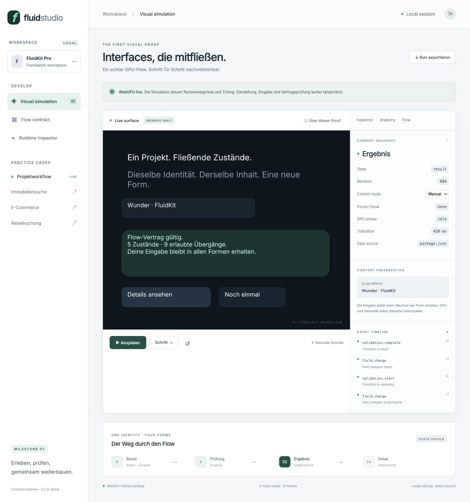

# M1 — visuelle Simulation vor Erweiterung der Bibliothek

Historischer M1-Nachweis. Aktueller Stand: [M2](m2.md) und [Feature-Matrix](../feature-status.md).

Datum: 1. November 2026. Status: Implementiert; visuelle Richtungsentscheidung
steht beim Nutzer. Gesamt-Roadmap: [Plan v2](../implementation-plan.md).

## Enthalten

- Echte WebGPU-Surface mit Text, kontrollierter Eingabe und Morphing.
- Reale Projektidentität aus dem Workspace-Manifest; echte Flow-Schemavalidierung.
- Abspielen, Pause, Schritt, Reset, Ergebnis und Detailansicht.
- Explizite Component-/Part-/Behavior-Verträge im Anatomy-Inspector.
- Fachwerte im Core, Fokus/Hover/Pressed/IME in einem separaten Interaktionsstore,
  Präsentationsphase und Transition-Dauer im Renderer.
- Base UI 1.9.0 für Studio-Buttons, Tabs und Info-Dialog. Keine Base-UI-Abhängigkeit
  in Contracts, Core oder WebGPU.
- Synchron abbrechbare Change Requests; Reason im Trace; Guards bleiben vorrangig.
- Logisches Replay und CLI-Vertragsprüfung als erste Testbausteine.

## Automatisiert geprüft

- `npm run check`: strict Typecheck, ESLint, 19 Tests einschließlich 200 generierter
  Eventfolgen im Property-Test.
- `npm run check:plan`: 43 eindeutige Task-Definitionen, nachrechenbare neue Scores,
  explizites M1-Gate und Dependency-Grenzen.
- `npm run build`: Paketbuilds und Next.js-Produktionsbuild.

Wesentliche negative Tests: unbekannte Parts, fehlende Aktionen, falsche Bindings,
stale/duplizierte Events, illegale KI-Pläne, aktives IME/Pressed, Host-Cancel vor
Seiteneffekt und History-Restore ohne Action-Ausführung.

## Im Produktionsbuild im Browser geprüft

Lokale Vorschau: <http://127.0.0.1:3010/>. Prüfung im integrierten Chromium-Browser
am 1. November 2026; kein Nachweis für die gesamte spätere Supportmatrix.

- WebGPU initialisiert; Text und Formen erscheinen in der GPU-Surface.
- Base-UI-Tabs wechseln per Pfeiltaste einschließlich aktiver Panel-Auswahl.
- Info-Dialog besitzt einen Namen, fokussiert seinen Schließen-Button und gibt
  nach Escape den Fokus an den Trigger zurück.
- Kontrollierte Eingabe „Wunder · FluidKit“ bleibt über Button → Progress →
  Ergebnis → Detail erhalten. Fokuswechsel erzeugen keine neue Fachrevision.
- Die serverseitige Vertragsprüfung meldet tatsächlich fünf Zustände und neun
  erlaubte Übergänge. Manuelle Schritte und automatisches Abspielen funktionieren.
- In diesem geprüften Lauf wurden keine Browser-Warnungen oder -Fehler erfasst.

[Anatomy-Ansicht mit expliziten Parts](m1-anatomy.jpg).

## Nicht als bestanden deklarierte spätere Gates

Die vollständige Branch-Coverage-Grenze von 85 % und die Browser-/Screenreader-/IME-
Matrix sind noch keine abgeschlossene Produktionsabnahme. Komplexe Popup-Presence,
automatische Device-Recovery, Resource-Stresstests, externe Datenanbieter, Cloud-KI,
Editor-Authoring, Collaboration und Marketplace sind spätere Pakete.

M1 trennt echte Ausführung (WebGPU, Eingabe, Schema-Validierung) von simuliertem
Nutzerverhalten und Timing. Die angezeigte Progress-Form ist ein Simulationszustand,
kein gemessener Server-Fortschritt.
