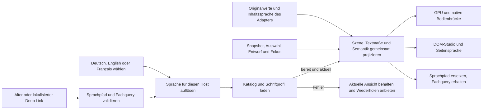
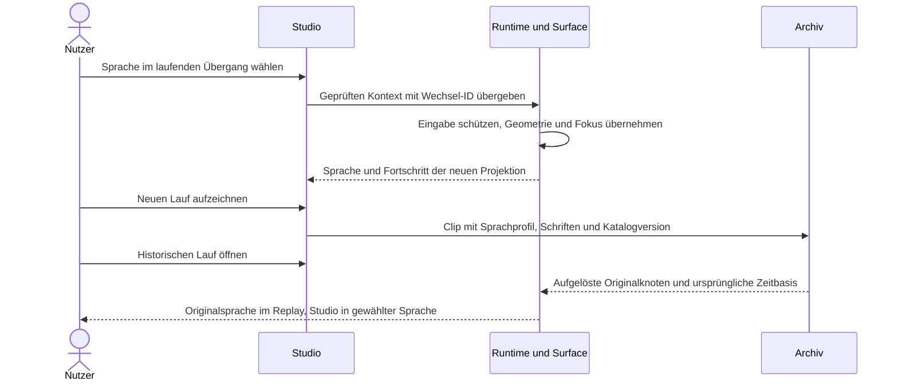

# M11 · Mehrsprachigkeit für FluidKit und Fluid Studio

**Planung vom 20. November 2026, auf Basis von Commit `6b40a702e58a`.** Für den ersten sichtbaren Meilenstein sind **Deutsch, Englisch und Französisch** festgelegt. Der Sprachwechsel erfolgt mitten in der Modulwerkstatt. Ein Nutzer verfolgt dieselbe Tabellenzeile in eine Karte, schaltet die Sprache um und findet dort denselben Dateiwert wieder. Sehende und Screenreader-Nutzer erhalten die Bedienelemente in derselben Sprache.

## Recherche und Iststand

ICU MessageFormat lässt Übersetzern vollständige Sätze, Wortstellung und Pluralformen. FormatJS kann solche Nachrichten auch aus einem vorab geparsten Syntaxbaum verarbeiten. ECMA-402 liefert Regeln für Zahlen, Zeit, Plural und sprachabhängige Vergleiche. Damit können die GPU-Szene, der DOM-Editor und ein eingebetteter Host denselben Satz aus denselben Werten bilden. [ICU-Nachrichten](https://unicode-org.github.io/icu/userguide/format_parse/messages/) · [FormatJS](https://formatjs.github.io/docs/intl-messageformat/) · [ECMA-402, Ausgabe 2026](https://tc39.es/ecma402/2026/)

Der Next.js App Router unterstützt validierte Sprachsegmente und das serverseitige Laden passender Wörterbücher. Eine Browsersprache ist als Vorschlag beim ersten Einstieg geeignet. Region, Zeitzone und Währung haben eigene Bedeutungen. Die Seitensprache und die Schreibrichtung müssen ausdrücklich am Dokument stehen. [Next.js Internationalisierung](https://nextjs.org/docs/app/guides/internationalization) · [W3C zur Sprachverhandlung](https://www.w3.org/International/questions/qa-accept-lang-locales) · [W3C zur Seitensprache](https://www.w3.org/WAI/WCAG22/Understanding/language-of-page.html) · [W3C zur Schreibrichtung](https://www.w3.org/International/questions/qa-html-dir)

Das Lockfile enthält Next.js 16.4.6, React 19.2.9, Glyph 0.1.0, Yoga 3.2.1 und Vercel AI SDK 7.0.159. Für den Vergleich wurden `intl-messageformat` 12.2.0, `next-intl` 4.15.3 und Lingui 6.12.0 betrachtet. Der Next-Kandidat deklariert passende Next-/React-Peers und bietet mit `use-intl/core` auch einen Einstieg für Vanilla JS. Lingui bietet eine integrierte Extraktions- und PO-Übersetzungsstrecke. Die Integration mit dem bestehenden GPU-Host ist ein eigener Nachweis in M11-02. [FormatJS-Paket](https://registry.npmjs.org/intl-messageformat/12.2.0) · [next-intl-Paket](https://registry.npmjs.org/next-intl/4.15.3) · [use-intl/core](https://next-intl.dev/docs/environments/core-library) · [Lingui](https://lingui.dev/introduction)

| Ebene | Befund im Projekt | Konsequenz |
|---|---|---|
| Studio und Navigation | Das Root-Layout setzt `lang="de"`. Navigationsgruppen verwenden deutsche Namen. Die Workspace-Navigation rekonstruiert URLs aus Fachparametern und erwartet feste Pfade. [Layout](../../apps/studio/app/layout.tsx) · [Navigation](../../apps/studio/lib/workspace-navigation.ts) | Lesbaren Text von stabilen Routen-IDs trennen. Alte Links, Query, Fragment und Rücksprung aus dem Studio prüfen. |
| Daten und Bedienung | Im Workspace stehen deutsche Suchregeln neben englischer Namenssortierung. Simulation und Flow berechnen ähnliche Filter getrennt. Die vorhandenen Preisdaten haben die Vertragswährung EUR. [Workspace](../../packages/cases/src/workspace.ts) · [Simulation](../../packages/cases/src/simulation.ts) · [Simulationsflow](../../packages/cases/src/simulation-flow.ts) | Visuelle Reihenfolge und Tastaturfolge gemeinsam berechnen. Vergleichsauswahl, Preis, Währung und Inventarwerte am Original belassen. |
| Szene und Eingabe | Cache-Schlüssel hängen von Revision und Viewport ab. Yoga verwendet LTR und physische Koordinaten. Die Eingabebrücke hält Auswahl und Kompositionsereignisse. [Core](../../packages/core/src/index.ts) · [Layout](../../packages/core/src/layout.ts) · [Eingabebrücke](../../packages/react/src/index.tsx) | Sprachkontext pro Runtime/Surface, atomare Neuprojektion und gemeinsamer Geometrienachweis. |
| Schrift | Inter ist als begrenzter Atlas gebacken. Japanisch hat einen ausdrücklich begrenzten Testkorpus. Glyph bietet `style.language`, `style.direction` und logische Textausrichtung. [Fontprofile](../../font-bake.config.json) · [Renderer](../../packages/webgpu/src/index.ts) · [Eingabeproben](../../tests/unit/text-input.test.ts) | Benötigte Zeichen aus Nachrichten **und formatierten Werten** gewinnen. Im lokalen Node 24.18.1 mit ICU 78.3 ergibt EUR 1234,56 auf Französisch `1 234,56 €`. Das schmale geschützte Leerzeichen U+202F fehlt im aktuellen Inter-Profil. |
| AI und Aufzeichnungen | Der Review-Prompt verlangt Deutsch, Authoring deutsche Titel. v2–v4-Aufzeichnungen enthalten aufgelöste Szenenknoten. [Review](../../packages/server/src/ai-review.ts) · [Authoring](../../packages/server/src/ai-authoring.ts) · [Replay](../../packages/effects/src/presentation.ts) | UI-Sprache, Inhaltssprache und Herkunft einer Aufnahme getrennt behandeln. |
| Wissen | Die Offline-Ausgaben setzen deutsches HTML, die Suche verwendet deutsches Lowercasing. Kapitel-IDs hängen von ihren logischen Pfaden ab. [Build](../../scripts/knowledge/build.ts) · [Leser](../../scripts/knowledge/reader.ts) | Ausgabe pro Zielgruppe und freigegebener Sprache, mit stabilen Ankern und eigenen Suchregeln. |

## Optionen, Bewertungen und Gewinner

Die Gewichtung folgt dem Gesamtplan. Zielerfüllung zählt 30 %, Korrektheit und Zugänglichkeit 25 %, Testbarkeit 20 %, Lieferbarkeit und Pflege 15 %, Erweiterbarkeit 10 %. Je Dimension werden 1–5 Punkte vergeben. Die Tabelle zeigt gewichtete Entwurfsbewertungen von 100. Einzelwerte und Rechenregel stehen im [Score-Register](../decisions/m11-language-scores.json).

| Entscheidung | A | B | Hybrid H | Gewinner und Grund |
|---|---|---|---|---|
| Architektur | Lingui mit PO und Compiler **83** | next-intl im Studio und use-intl/core im Host **89** | Host-Vertrag mit FormatJS, nativem Intl und kleinem Studio-Adapter **97** | **H**. Die Kernfunktion läuft direkt im Vanilla-Host und die Renderer teilen ihre Formatierung. Eigene Arbeit fällt für Extraktion und Routing an. Bei einem künftigen PO-Redaktionsbetrieb gewinnt Linguis Werkzeugkette an Gewicht. |
| M11-01 · Erstes Erlebnis | Alle Zielsprachen gleichzeitig **65** | Zuerst das vollständige DOM-Studio **66** | Einen echten Ablauf über DOM, GPU und Semantik lokalisieren **97** | **H**. Der sichtbare Test zeigt früh, ob Auswahl, Bewegung, Zahlen und Sprache zusammenpassen. |
| M11-02 · Nachrichten | Explizite Schlüssel, vollständige ICU-Sätze und Review **97** | Schlüssel aus Quellsätzen erzeugen **81** | Standardschlüssel im Kern, Extraktionsschlüssel im Studio **82** | **A**. Dieselbe Produktaktion behält ihre Identität bei einer Textkorrektur. Kurze GPU-Beschriftung und sprechender zugänglicher Name dürfen eigene Einträge haben. |
| M11-03 · Navigation | Präferenz im Cookie, gemeinsame URLs **71** | Sprachpfad an jedem Einstieg voraussetzen **82** | Sprachpfad, Aushandlung für alte Links und einbettbarer Host-Kontext **97** | **H**. Ein geteilter Link bezeichnet Sprache und Arbeitszustand, frühere Links bleiben nutzbar. |
| M11-04 · GPU und Eingabe | Surface beim Wechsel neu aufbauen **65** | Eigene Text- und Layoutengine **75** | Vorhandene Glyph-/Yoga-Funktionen mit gemeinsamer Geometrie und Schriftabnahme **94** | **H**. Der Renderer behält seine Ressourcen und Projektionsgrenzen. Komplexe Schrift benötigt eigene Messungen. |
| M11-05 · Daten | Sprachkopien des Datenbestands **64** | Alle Formate und Ordnungen an Hosts delegieren **73** | Originalwerte, gemeinsame Anzeigeformate, sprachbezogene Anbieterabfrage nach Bedarf **97** | **H**. Ein Preis oder eine stabile Modul-ID behält seine Bedeutung in jeder Ansicht. |
| M11-06 · Replay | Historische Szenen bei Wiedergabe neu übersetzen **54** | Bilder je Sprache archivieren **71** | Originalclip und Metadaten erhalten, lokalisierte Neuinszenierung separat aufzeichnen **97** | **H**. Originale bleiben überprüfbar und neue Varianten vergleichbar. |
| M11-07 · AI und Inhalte | Beim Umschalten automatisch übersetzen **51** | Antworten immer auf Deutsch **73** | Antwortsprache an den ausdrücklich gestarteten Auftrag binden **97** | **H**. Der Nutzer steuert Sprache, Übernahme und Kosten. |
| M11-08 · OKF und QA | Vollständige Handbücher je Sprache manuell kopieren **69** | Übersetzung beim Lesen **57** | Gemeinsame Kapitel-IDs, redigierte Sprachfassungen und geprüfte Offline-Ausgaben **94** | **H**. Jede Sprachfassung verweist auf dasselbe Kapitel und dokumentiert die Herkunft ihrer Bilder. |

## Zielvertrag

- **Sprachen.** Der erste sichtbare Schnitt umfasst Deutsch (`de`), Englisch (`en`) und Französisch (`fr`). Die geplanten Referenzprofile für Zahlen und Daten sind `de-DE`, `en-GB` und `fr-FR`. Das Register führt BCP-47-Tag, verfügbare Nachrichten, Schriftprofil, Grundrichtung und Freigabestatus. Weitere regionale Formate können dieselben Texte verwenden. Pseudolokalisierung, arabische Mischschrift und japanische Eingabe erhalten getrennte Prüfprofile.
- **Eigentümerschaft.** Der Host übergibt einen validierten `LocaleContext` pro Runtime oder Vorschau. Vorgesehen sind Nachrichtensprache, Format-Locale, explizite Zeitzone, Richtung und versionierte Katalogreferenz. Framework, Case und Host bekommen getrennte Namensräume. `contentLocale` kommt bei Bedarf vom konkreten Datensatz. Zwei parallel montierte Surfaces dürfen unterschiedliche Sprachen haben.
- **Nachrichten.** Der Beispielschlüssel `workspace.files.count` erwartet `count`. Der deutsche Eintrag lautet `{count, plural, one {# Datei} other {# Dateien}}`, der englische `{count, plural, one {# file} other {# files}}` und der französische `{count, plural, one {# fichier} other {# fichiers}}`. Mit diesem Katalog und französischen Kardinalregeln ergeben sich für 0, 1 und 2 die Texte „0 fichier“, „1 fichier“ und „2 fichiers“. Renderer erhalten aufgelösten Klartext. Katalogschlüssel und Parametertypen werden aus der Quellbeschreibung abgeleitet. Validierung prüft ICU-Syntax, Parameter und `other`. Ganze Sätze erhalten Kontext für Redaktion und Übersetzung.
- **Laden.** Erst Zielkatalog und Schriftprofil prüfen, dann Szene, Semantik und DOM in einem Schritt umstellen. Fehlgeschlagener Sprachdownload lässt die letzte vollständige Sprache bedienbar und bietet Wiederholen. Für freigegebene Produktoberflächen verlangt CI vollständige Kataloge. Bei einem absichtlich lückenhaften Hostpaket gilt regionaler Katalog → Basissprache → deklarierte Ausgangssprache mit Diagnose. Schnelle Wechsel akzeptieren nur die jüngste Anforderung. SSR und erste Hydrierung verwenden denselben Kontext.
- **Routen und Präferenz.** Ein expliziter Pfad gewinnt, danach folgen eine vom Nutzer gespeicherte Sprachwahl, die beim neutralen Einstieg verhandelte Browsersprache und Deutsch. Ein Sprachwechsel im Studio verwendet `replace`, eine fachliche Navigation behält ihre bisherige History-Regel. Der französische Direktlink lautet beispielsweise `/fr/?view=compare&picked=core&picked=webgpu`. Die übrigen Parameter werden weiterhin vom vorhandenen Codec kanonisiert. Neutrale Altpfade erhalten einen temporären Redirect mit Query. Fragmente bleiben im Browser erhalten. Unbekannte explizite Sprachpräfixe ergeben einen definierten Fehler mit Sprachwahl. API-Pfade, Downloads und Assets bleiben adressierbar. Nur der bewusst gewählte Tag wird gespeichert. Neutrale Einstiege mit Cookie-/Header-Aushandlung dürfen keinen sprachfremden gemeinsamen Cachetreffer liefern.
- **Zustand und Bewegung.** Sprache gehört zur Darstellung und zu deren Cache-Schlüssel. Beim Wechsel bleiben Snapshotrevision, Modul-IDs, Auswahl, Query, Scrollanker, Entwurf und Fokus erhalten. Ein überdauernder Provider im gemeinsamen Shell-Layout hält die Sitzung beim Wechsel des Sprachsegments. Am aktiven Clip wird die zuletzt dargestellte Geometrie zum selben Fortschritt übernommen und in die neue Textgeometrie überführt. Bei aktiver IME-Komposition bleibt der Wechsel bis zum Abschluss oder bewussten Abbruch ausstehend. Importierte Aufnahmen behalten ihre eigene Darstellungssprache.
- **Daten und Beträge.** Für Nutzertexte die sichtbare Sortierung mit `Intl.Collator` und stabilem ID-Tiebreak ausführen. Zahlen numerisch sortieren. Semantik, Tastatur und Szene verwenden dieselbe Ergebnisliste. Für technische Ordnungen wie Cache-Schlüssel, Hashes, Seed und Ereignis-IDs eine localeunabhängige Vergleichsfunktion verwenden. Suchtext, Notizen und fremde Titel bleiben im Original. Sprache, ISO-Währung, Minor Units und Zeitzone haben eigene Herkunft. Für lokalisierte Anbieterantworten die angefragte Inhaltssprache in Query und Cache aufnehmen und überholte Ergebnisse verwerfen.
- **RTL und Schrift.** Semantisches `lang`/`dir`, logische Start-/Endkanten, Glyph-Grundrichtung und geeignete Fonts gemeinsam anwenden. Bei fremden Namen oder IDs in bidirektionalen Sätzen Text isolieren. Native Auswahlindizes bleiben auf den Originaltext bezogen. Tabellen und Fokusbewegung folgen ihrer Lesereihenfolge. Geografische Koordinaten und gerichtete Datenkanten behalten ihre fachliche Richtung. Ein Sprachprofil mit komplexer Schrift wird nach bestandenem Shaping-, Caret-, Fokus- und Plattformnachweis veröffentlicht. [Unicode Bidirectional Algorithm](https://www.unicode.org/reports/tr9/)

## Erster sichtbarer Meilenstein

Öffne die echte Modulwerkstatt bei 390 oder 1280 Pixeln, wähle zwei vorhandene Module und sortiere numerisch nach Dateien. Der Sprachwähler bietet **Deutsch**, **English** und **Français**. Wechsle mitten in **Zeile → Karte** die Sprache. Dieselben Karten bleiben ausgewählt. Beschriftung, Dateizahl, zugänglicher Name und Status wechseln gemeinsam. Öffne den Vergleich, gehe ins Studio und wieder zurück. Ein direkter Link stellt dieselbe Auswahl in der angegebenen Sprache wieder her. Auf der schmalen Ansicht bleiben Umschalter und Hauptaktion erreichbar.

Für die gemeinsame Sichtprüfung werden Start, 50 % und Ende in allen drei Sprachen, die native Bedienfolge, ein echter Wechsel im laufenden Clip und das aktive Backend archiviert. Die sichtbare Lieferung umfasst genau diesen Weg. Die weiteren Ansichten, AI und Handbücher haben eigene Abnahmen.

## Feature-Matrix · vom Ausgangsstand zur Freigabe

| Produktfläche | Ausgangsstand vor M11 | Früher Proof | Vollständige Freigabe | Zuordnung |
|---|---|---|---|---|
| Showcase, Studio, Host | Fest eingebaute deutsche und einzelne englische Texte | Sprachwähler DE/EN/FR, Zeile, Karten, Vergleich, Rücksprung und zugängliche Namen | Sämtliche Nutzerrouten, Fehler-, Leer- und Ladezustände, unabhängiger Host | M11-01/02/03 · T14/T16/T32 |
| GPU, Schrift und Eingabe | Inter und begrenzter japanischer Korpus | Französische Akzente und geschützte Abstände in Zahlen, echter Wechsel im laufenden Clip | Pro Schriftprofil bestätigte Glyphen, Semantik, Eingabe und passende Bewegungsgeometrie | M11-04 · T05/T06/T07/T10 |
| Suche, Sortierung und Cases | Feste Sprachregeln und EUR-Simulation | Numerische Sortierung und sichtbare Kennzahl im Workspace | Kollation, sichtbare Providertexte und Originalwerte aller angebotenen Cases | M11-05 · T15/T25 |
| Replay, Studio-KI und Belege | Originalclips und deutsche Modellvorgaben | Aufnahmen aller drei Sprachversionen zum visuellen Vergleich | Sprachgebundene neue Runs, Originalarchiv und bewusst gestartete KI-Aufträge | M11-06/07 · T18/T22/T54/T65 |
| Public- und Engineering-OKF | Zwei deutsche Offline-Handbücher | Beschreibung der geplanten Bedienung | Bei Freigabe aller Pilotsprachen sechs redigierte Offline-Ausgaben mit passenden Screenshots und Suche | M11-08 · T19/T38 |

## User-, Daten-, State- und URL-Flows

## Lieferreihenfolge, Tasks und Akzeptanzkriterien

Alle acht Tasks sind **geplant**. Die Kennungen `M11-xx` gelten für diesen Vorschlag. Bei Übernahme werden die einzelnen Abnahmen ins kanonische Register eingetragen. Der vorhandene Stand von 510 Kriterien bleibt die geprüfte Ausgangsbasis.

| Task | Umfang und Abhängigkeit | Überprüfbare Abnahme |
|---|---|---|
| **M11-02** | Zuerst kleiner horizontaler Vertrag mit einem Studio- und einem GPU-Namensraum. FormatJS und nächstplatzierten Adapter mit denselben Nachrichten prüfen. | Plural 0/1/2, Parameterreihenfolge, Apostroph, fehlender Schlüssel und kaputtes Paket getestet. SSR, Browser und eigenständiger Host liefern bei identischem Kontext dieselben Beispieltexte. Bundlevergleich nennt gzip-Delta, Importgraph und Buildplattform. Der Testhost kann die Nachrichten ohne Next.js oder DOM initialisieren. |
| **M11-01** | Frühe Vorführung mit M11-02 und dem für diese Journey nötigen Teil von M11-03/04/05. | Tabelle → Karten → Vergleich in DE, EN und FR bei 390 und 1280 px. Jede der sechs gerichteten Sprachkombinationen wird bei 50 % geprüft. IDs, Werte, Auswahl und Fokus bleiben erhalten. Der französische Text „Dépendances“ und der mit `Intl.NumberFormat` formatierte Testwert „1 234“ erscheinen vollständig und mit korrektem geschütztem Gruppenabstand auf der GPU. Der Testwert wird isoliert geprüft, die Vorführung verwendet echte Modulwerte. Kein unübersetzter Schlüssel, keine kollidierenden sichtbaren Texte und keine verwaisten Pointer-Ziele an den Prüfpositionen. Nutzer können die Bewegung anhalten. |
| **M11-03** | Studio, Links, Sprachwähler und Host-Kontext vervollständigen. | Erste Serverantwort hat korrekte Sprache/Richtung und passende Metadaten. Einstieg über `/de/`, `/en/` und `/fr/`, Reload, Back/Forward, Rückkehr aus Studio, Altlink mit Query/Fragment, ungültiger Tag, zwei parallele Hosts und fehlgeschlagener Download geprüft. Ein ungespeicherter Entwurf, mehrfache Auswahl und IME-Inhalt bleiben erhalten. Beim schnellen Wechsel DE → EN → FR bleibt Französisch aktiv, auch wenn der englische Katalog zuletzt eintrifft. |
| **M11-04** | Responsive GPU-Projektion, Fontprofile, native Eingabe und Semantik. Danach alle sechs Akzente, Flow Explorer, Atlas, Detail und Vergleich. | 320/390/768/1280 px, beide Backends und Reduced Motion. Die drei Formübergänge vorwärts und rückwärts an 5-%-Punkten auf Textkollisionen prüfen, einschließlich echter Glyphenmaße, Fokus-/Hit-Regionen und Cursor. Pseudosprache mit mindestens 30 % Verlängerung. RTL-Pilot mit arabischem Text, lateinischer Modul-ID, Klammern, Zahl und bidirektionaler Auswahl. CJK separat mit Fontkorpus, mobiler IME und dokumentierter Lückendiagnose. |
| **M11-05** | Cases und Host-Adapter. Workspace und Import-/Simulationsdaten getrennt prüfen. | Numerische Sortierung, Umlaute, gleiche Anzeigenamen mit stabiler ID, Suche und Tastaturreihenfolge getestet. Gleicher EUR-Betrag in allen drei Formatprofilen. Für `fr-FR` prüfen, dass „1 234,56 €“ in diesem Referenzprofil U+202F als Gruppentrenner und U+00A0 vor dem Eurozeichen enthält. Testdatum um Mitternacht in expliziter Zeitzone. Sprachneutrale Daten laden beim Wechsel kein zweites Mal. Zwei unterschiedlich lokalisierte Anbieterantworten überschreiben einander nicht. |
| **M11-06** | Versionierter Replay-/Nachweisvertrag nach M11-02/04. | Neue Aufnahme bindet aufgelöste Texte, Tag, Richtung, Katalog-/Font-Fingerprints, Zeitkontext und Build. Für v2/v3/v4 werden ursprüngliche Knoten und Hashes beibehalten, eine fehlende Sprache erscheint als „unbekannt“. DE-Clip im FR-Studio und FR-Clip im EN-Studio rückwärts abspielen und Originalpixel-/Zustandsbezug prüfen. Aktuelle Übersetzung als eigener neuer Run mit Herkunft. |
| **M11-07** | Kontrollierte Authoring-/Review-Antworten über das vorhandene Vercel AI SDK sowie lokale Fehlertexte. | Antwortsprache per Allowlist an den einzelnen Auftrag binden. Umschalten erzeugt null Modellaufrufe und null neue Budgetreservierungen. Späte Antwort, Ablehnung, Entwurf und Preflight behalten Sprache, Revision und Datensatzbezug. Originaltext/Quellbild bleibt erhalten. Providerfehler wird über stabilen Fehlercode in der UI-Sprache angezeigt. Releaseprobe pro freigegebener Antwortsprache fachlich und sprachlich prüfen. |
| **M11-08** | Public und Engineering OKF, Übersetzungsworkflow und Freigabe pro Sprachprofil. | Je freigegebener Sprache sind beide Bücher offline öffnbar. Kapitelanker, Suche, Sprache, Alttexte und lokale Querverweise prüfen. Sprachumschalter hält das gelesene Kapitel. Bestehende URLs bleiben gültig. Neue Bedienbilder stammen aus der betreffenden UI-Sprache mit Buildbezug. Historische Originalbelege tragen Herkunft und Sprache. Sprachkundige Personen prüfen Glossar und die Kernjourney je Sprache, AT-/Geräteprüfung bleibt je Profil einzeln sichtbar. |

**Reihenfolge nach dem sichtbaren Proof:** Routing und Projektion vervollständigen → Case-/Datenverhalten absichern → Replay und AI parallel qualifizieren → je Sprache Studio, Showcase und beide Bücher freigeben. Arabische und japanische Profile haben eigene Schrift- und Eingabegates. Änderungen an Katalog, Schrift oder Layout ziehen die betroffenen Bild-, Semantik- und Replayprüfungen nach sich. Der Plan setzt keine statistische Usabilityverbesserung oder höhere Framerate voraus.

## Umsetzung und Nachweis am 20. November

Der Sprachwähler ist im Showcase und im Studio verfügbar. Beim Wechsel übernimmt derselbe GPU-Host Fokus, Auswahl und Abspielposition. Alle drei Studio-Kataloge sind im Build enthalten. Für nachladbare Host-Kataloge gibt es eine isolierte Transaktion mit regionalem Fallback, Abbruch und Wiederholbarkeit. Ein Übersetzungsfehler lässt die letzte erfolgreiche Projektion bestehen.

Der Vanilla-Vergleich mit `use-intl/core` 4.15.1 erfasst beide Bundles auf derselben Node-/Vite-Plattform. Der Fluid-Adapter validiert seine Kataloge und läuft ohne React-Import. Den Größenunterschied und die exakten Buildbedingungen zeigt der [Messlauf](../qa/2026-11-20-m11/adapter-comparison.json).

| Fläche | Implementiert | Nachweis und Freigabegrenze |
|---|---|---|
| Studio und Showcase | DE, EN und FR in der Modulwerkstatt, sprachgebundene URLs, gesicherte Entwürfe | Browserwechsel am 50-%-Punkt, Reload, History und IME-Aufschub |
| GPU und Semantik | Eigener Sprachkontext je Host, gebakene französische Zwischenräume, isolierte RTL-/CJK-Proben | Desktop-WebGPU und WebGL2. Mobile IME und AT benötigen reale Geräte und Nutzende |
| Cases und Daten | Stabile Auswahl, lokalisierte Kollation, Formate und getrennte Adapterabfragen | Identische IDs und Geldwerte, zeitlich unterschiedliche Kalenderdaten am selben Instant |
| Replay und KI | Originalclips mit Fingerprints, neue lokalisierte Aufzeichnung mit Originalbezug, an den Auftrag gebundene Antwortsprache | Browser-/SDK-Prüfungen sowie drei [Live-Reviews](../qa/2026-11-20-m11/live-review.json) |
| Knowledge und Distribution | Zwei Bücher in je drei Sprachen, Originalquellen in Deutsch, MIT-Quellpaket | Offline-Kapitel, Quelle und Aufnahmesprache. Eigenständige sprachliche Freigabe bleibt offen |

Die [Abgleichsmatrix](../acceptance-matrix.md) enthält jeden der acht Tasks. Die [Veröffentlichungsanleitung](../release/public-source.md) beschreibt den bereinigten Kandidaten und den Build aus einem leeren Checkout.
