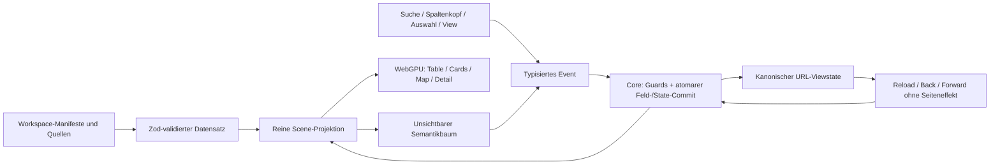
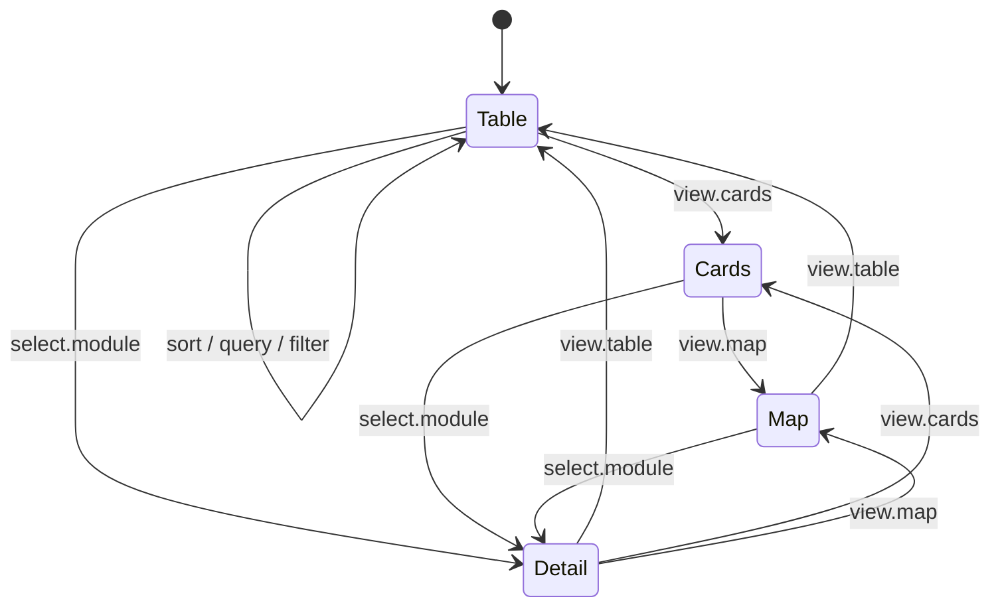

# M2 — adaptive Arbeitsfläche und Beginn RP1

Datum: 2026-11-01. M1-Richtung wurde vom Nutzer bestätigt. Ergänzung: ein Showcase
mit sortierbaren Tabellen und außergewöhnlicheren, zusammenhängenden UI-Formen.

## Entscheidung vor Implementierung

Gewichte wie im Gesamtplan: Ziel 30, Korrektheit/Accessibility 25, Testbarkeit 20,
Lieferbarkeit 15, Erweiterbarkeit 10. Ratings 1–5; Score = gewichtete Summe / 5.

| Task | A | B | Hybrid | Gewinner |
|---|---|---|---|---|
| T44 Adaptive Datenoberfläche | weitere isolierte Effekte [2,3,3,5,2] = 58 | sofortiger universeller GPU-Spreadsheet-Editor [5,2,2,1,5] = 61 | echte Workspace-Daten, Tabelle/Karten/Dependency-Map/Detail auf einem Core [5,4,5,4,5] = 92 | H |
| T45 RP1-Fortsetzung | kosmetische Demo ohne Runtime-Arbeit [2,2,2,5,2] = 49 | alle späteren Widgets vorziehen [5,2,2,1,4] = 59 | Scene-Verträge, unterbrechbare Presence, responsive Bounds, Recovery und risikobasierte Tests [5,4,5,4,5] = 92 | H |

T44 zieht einen begrenzten Table/Grid/Card-Proof aus T10/T13 vor. Die spätere Nutzerkorrektur erlaubt WebGL2-Fallback bei WebGPU als Standard; T46 und ADR-0003 haben Vorrang vor der ursprünglichen WebGPU-only-Grenze.

T45 setzt RP1
(T04–T08) fort. Vollständige Typografie-/IME-/Screenreader-Supportmatrix und die
restliche Komponentenbibliothek werden dadurch nicht als abgeschlossen erklärt.

## Features und Acceptance Criteria

| ID | Feature | Akzeptanzkriterium |
|---|---|---|
| M2-01 | Echte Daten | Nur Paketmanifeste und TypeScript-Quellen des aktuellen Workspace lesen; Herkunft und Zeitpunkt anzeigen; keine erfundenen Leistungszahlen |
| M2-02 | Sortierbare Tabelle | Name, Quelldateien und Dependencies auf-/absteigend; stabile IDs und deterministischer Tie-Break; aria-sort nur auf aktiver Spalte |
| M2-03 | Suche und Filter | Kontrollierter Suchwert; leere Ergebnisse mit Reset; Filter-/Sortierzustand bleibt beim Viewwechsel erhalten |
| M2-04 | Choreografie | Dieselben Module bewegen sich zwischen Tabelle, Karten und Dependency-Map; ausgewähltes Modul entfaltet sich zum Detail; Unterbrechung vom aktuellen Bild |
| M2-05 | Semantik | Table → Row → Header/Cell als echte unsichtbare Semantik; Header-Buttons per Tastatur; keine implizite Rolle aus Renderform |
| M2-06 | Zustand | Deklarative Feldzuweisungen gemeinsam mit Transition committen; Projektionen validieren Events, Bindings, IDs und Semantikreferenzen |
| M2-07 | URLs | View, Sortierung und Modul-ID validiert; Reload/Back/Forward; Suchtext bleibt lokal; keine Action beim Restore |
| M2-08 | RP1 | Responsive Scene- und Brücken-Bounds; deterministische Interpolation; getrennte Presence; WebGPU-Retry aus erhaltenem Domain-Snapshot |
| M2-09 | Nachweis | Typecheck/Lint/Unit-/Property-Tests/Build; Browserprüfung von Sortierung, Suche, drei Views, Detail und History; Screenshots nach Verbesserung |

## User-, Daten-, State- und URL-Flows

## Vorherige visuelle Befunde

1. M1-Start: klare Richtung und nachvollziehbare Eingabe, aber nur fünf Scene-Nodes;
   keine Datendichte und kein Arbeitskontext. [Aufnahme](m2-before.jpg).
2. M1-Transformation: beweist einen einfachen Zustandswechsel, aber noch keine
   Choreografie mehrerer identischer Inhalte. M2 muss diese Lücke sichtbar schließen.
3. Accessibility: aus Bildern allein nicht belegbar. Keyboard, Rollen und Fokus
   werden zusätzlich geprüft; die vollständige Assistive-Technology-Matrix bleibt offen.
