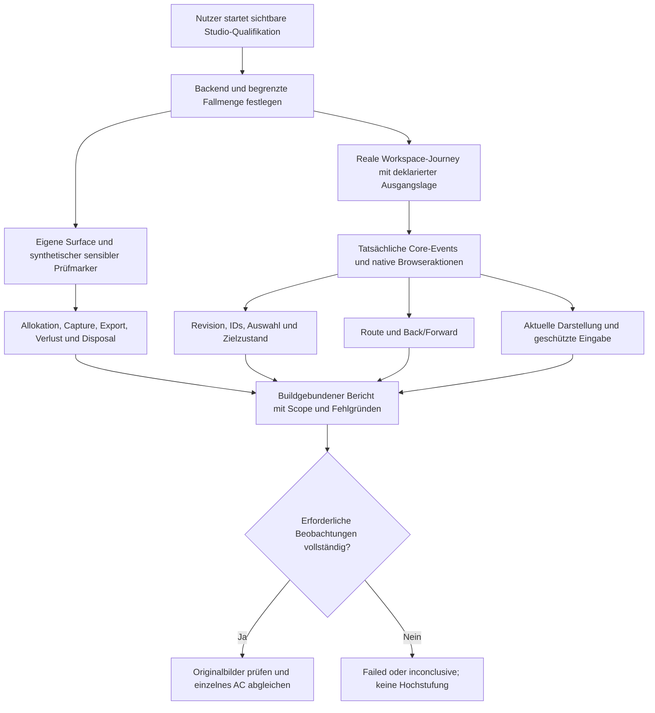
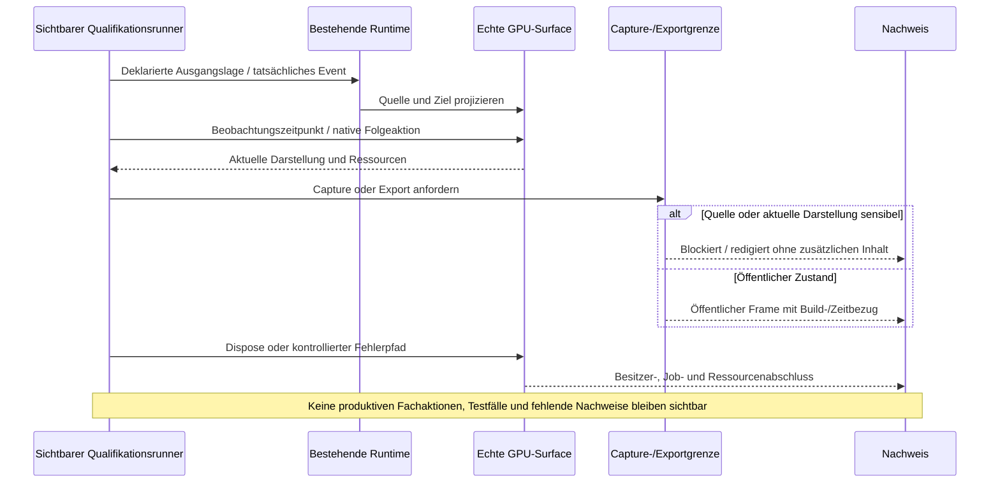

# M7-Nachprüfung: acht verbleibende Kriterien

Planungs- und Recherchestand: **4. November 2026**. Status: **umgesetzt und im dokumentierten lokalen Scope qualifiziert**.

Diese Nachprüfung bearbeitet M7-AC08, 12, 14, 15, 16, 19, 21 und 26. Die
27 kanonischen Kriterien des [freigegebenen M7-Plans](m7-plan.md) bleiben
wortgleich. Es entstehen weder neue Produktversprechen noch stillschweigend
abgeschwächte Anforderungen. Die 19 bisherigen Nachweise behalten ihren
ursprünglichen Build- und Gerätescope. Insbesondere wird `fluid-d9f34d61a94c9d556b63`
nicht nachträglich als neuer Quellstand ausgegeben.

Ziel ist eine tatsächlich ausgeführte, begrenzte Studio-Qualifikation mit
ergänzenden Browserjourneys. Ein sichtbarer erfolgreicher Test gilt nur für die
gemessenen Eingaben, Backends, Größen und Pfade. Weitere native
Eingabemethoden bleiben in ihren eigenständigen Gesamtplangates offen.

## Vorangestellte Recherche und Konsequenzen

Die [gezielte Quellenprüfung](../research/m7-followup-qualification.md) betrifft
Kompositionseingabe, Bewegungspräferenzen, Dokument-Sichtbarkeit und Ressourcen.
Es gibt für diesen Prüfumfang keinen begründeten Dependency-Upgradeauftrag.
Die installierten Versionen und die bisherigen Renderer-/Importverträge bleiben
maßgeblich.

- Eine tatsächliche IME-Sitzung umfasst Beginn, Aktualisierung und Abschluss
  einer nativen Komposition. Direktes Setzen des Werts, Einfügen eines CJK-Strings
  und synthetische CompositionEvents belegen unterschiedliche, begrenztere Pfade.
- Die native Sichtbarkeit des Dokuments und der tatsächliche Media-Query-Wert
  werden protokolliert. Ein simulierter Callback ist kein Nachweis eines echten
  Tabwechsels oder einer Betriebssystempräferenz.
- Motion kann deaktiviert werden, ohne den gültigen fachlichen Zielzustand zu
  verlieren. Pause, Nutzerübernahme und Hintergrundwechsel brauchen getrennte
  Prüfungen, weil sie unterschiedliche Laufzeitpfade auslösen.
- Ein absichtlich zerstörtes Device kann die echte Verlustbehandlung prüfen.
  Das ist kein unkontrollierter Treiberabsturz. Verwaltete Allokationen, Listener
  und Jobs sind belastbar messbar; Prozess-/Treiberspeicher wird nicht daraus
  hochgerechnet.

## Scored Optionen und Entscheidung

Gewichte wie im Hauptplan: Zielerfüllung 30 %, Korrektheit/Accessibility 25 %,
Testbarkeit 20 %, Lieferbarkeit 15 %, Erweiterbarkeit 10 %. Bewertungen 1–5,
gewichteter Nutzwert 0–100; reine Planungsbewertungen. Eine Lösung, die notwendige
Nachweise nur simuliert und als nativ ausgibt, ist unabhängig vom Score ausgeschlossen.
Die Zahlen werden in [m7-followup-scores.json](../decisions/m7-followup-scores.json)
mit Ratings und Rechnung festgehalten.

| Task | Option A | Option B | Hybrid H / Gewinner |
|---|---|---|---|
| M7-Q01 Eingabe und scharfe Ebenen |Nur bekannte Zeichen ergänzen — **68** |Universellen Font-/IME-Unterbau neu bauen — **73** |**Kontrollierte Schriftversorgung, echte Glyph-Geometrie, gezielte native Eingabejourney und getrennte IME-Freigabe** — **95** |
| M7-Q02 Unterbrechung |Nur Sampler-/Importtests — **74** |Ausschließlich manuelle Zeitpunkte — **67** |**Reale Core-Events an kontrollierten Zeitpunkten plus native Nutzerübernahme** — **95** |
| M7-Q03 State/Daten/URLs |Nur URL-Endpunkte vergleichen — **66** |Alle denkbaren Host-/Providerflüsse einbeziehen — **80** |**Begrenzte echte Workspace-Journey, Revisionen/IDs/History und Action-Grenzen prüfen** — **95** |
| M7-Q04 Motion |Nur Konfigurationswert testen — **66** |Vollständiges OS-/Gerätelabor voraussetzen — **80** |**Vorhandene native Präferenz-/Sichtbarkeitspfade plus deterministische Grenzfälle** — **95** |
| M7-Q05 Lifecycle |Nur eine Surface wiederverwenden — **70** |Prozessspeicher als einzigen Maßstab nehmen — **57** |**Frische echte Surfaces, Replay/Retarget/Disposal, konkrete Fehlerpfade und Ressourcenbesitzer** — **92** |
| M7-Q06 Visuelle Matrix |Einzelne gute Screenshots — **62** |Unbegrenzte Browser-/Gerätematrix — **80** |**Vier vereinbarte Breiten, zwei vorhandene Backends, sechs Richtungen und gezielte Live-Resize-Journeys** — **92** |
| M7-Q07 Datenschutz |Nur JSON-Strings kontrollieren — **70** |Freie AI-Klassifikation sämtlicher Bilder — **45** |**Deklarierte Sensitivität, synthetischer Prüfmarker, echte Capture-/Exportgrenzen und öffentliche Positivkontrolle** — **95** |
| M7-Q08 Nachweise |Texte manuell überschreiben — **63** |Gesamten Plan pauschal abschließen — **32** |**Neue buildgebundene Belege, unveränderte historische Archive, kanonische Matrix und beide OKF-Bundles** — **97** |

Gewinner ist jeweils **H**. Das begrenzt den Untersuchungsraum ausdrücklich,
ohne einen vorgeschriebenen Eingabe- oder Fehlerpfad durch einen leichteren
Test zu ersetzen. Die Bewertungstabelle mit berechneten Scores wird aus den
beigefügten Ratings geprüft; sie ist kein Ergebnis der späteren Qualifikation.

## Traceability: konkrete Tasks und erforderliche Nachweise

| Task / Zuordnung | Umsetzung und Prüfschritte | Voraussetzung für eine lokale Abnahme |
|---|---|---|
| **M7-Q01 → AC08, AC14**, T06/T07 | Bekannten Fall `M7 — Grüße 東京` reproduzieren; fehlende Glyphen an der Schriftversorgung beheben. Lens mit fokussiertem Textfeld, Auswahl/Caret, geschützten Controls, Cliprand und einem verdeckten Ziel prüfen. Lange aktive Eingabe horizontal am Caret ausrichten und clippen; eine Ellipse darf das Bearbeitungsziel nicht verdecken. Tab/Shift+Tab, Home/End, Enter, Auswahl, Einfügen und Komposition als getrennte Pfade erfassen. | Corewert, native Eingabe und GPU-Ausgabe stimmen für die deklarierten Proben überein. Keine Verzerrung/Überdeckung der geschützten Teile; Caret und Auswahl bleiben auch bei überlangem Text im sichtbaren Eingabebereich nachvollziehbar. Verdeckte und dekorative Elemente erhalten keine versteckten Ziele. **AC14 enthält IME ausdrücklich:** ein synthetischer Wert allein genügt nicht. Der tatsächlich benutzte native Eingabemethodenpfad, sein Funktionsergebnis und die beobachtete Ereignisvertrauensgrenze werden zusammen dokumentiert; eine lokale Abnahme ist keine universelle IME-Freigabe. |
| **M7-Q02 → AC12**, T10/T11 | Drei neue Effekte über echte Runtime/Core-Events bei 25/50/75 % ersetzen; erneut während des maximal 120-ms-/20-%-Abbaus unterbrechen. Den tatsächlichen Darstellungssnapshot vor und nach dem Event vergleichen. Native Pointer-, Keyboard- und Historyübernahme ergänzen. | Fortsetzung beginnt kontinuierlich aus der aktuellen Darstellung; keine Geistertexte, alten Endpunkte oder wachsenden Kanäle. Event-/Revisionstrace beweist einen Anwendungsübergang statt eines alleinigen V3-Imports. Herkunft der Ereignisse bleibt sichtbar. |
| **M7-Q03 → AC15**, T09/T14/T15 | Mit realen Workspace-IDs sortieren, suchen, auswählen, View wechseln, Back/Forward und Deep Link/Reload prüfen. Während eines Übergangs ein neueres Ereignis senden. Effektwahl und Replay zusätzlich ausführen. | Erwartete Reihenfolge, Filter, Auswahl, IDs, Revision und kanonische Route stimmen überein; überholte Ergebnisse überschreiben nichts. Effektparameter und Replay erzeugen keine neue fachliche Navigation oder Action. Der Test behauptet keine produktiven Anbietertransaktionen. |
| **M7-Q04 → AC16**, T11/T24 | Tatsächlichen Browserwert für Reduced Motion erfassen; alle drei neuen Rezepte auf Quelle→Ziel prüfen. Pause/Resume, Tourübernahme und echtes Hidden→Visible beobachten. Frühere Timer/Jobs nach Stop kontrollieren. | Bei Reduced Motion vollständiges Ziel ohne Zusatzeffekt. Pause hält die Darstellung; Nutzerübernahme und Hintergrundwechsel starten keine unkontrollierte Fortsetzung. Browser-eigene Media-Emulation darf den normalen Query-/Listenerpfad prüfen, wird aber nicht als OS-Einstellung ausgegeben. Ein injizierter Callback allein genügt nicht. |
| **M7-Q05 → AC19**, T08 | Sichtbare Studio-Qualifikation erzeugt pro Backend 100 frische Surfaces. Jede übt alle drei Effekte; der im laufenden Effekt entsorgte Abschluss rotiert. Zusätzlich Initialisierungsabbruch, tatsächlicher Fontladefehler und kontrollierter Device-/Contextverlust mit neuer Surface. | Besitzer, DOM-Kinder, Listener, Jobs, Frames, Targets, Buffer und Glyph-Ressourcen haben überprüfte Lebensenden. Nach Warmup kein wachsender verwalteter Bestand; End-/Dispose-Zustände geprüft. Fehlerfälle führen durch die reale Fehlerbehandlung. Kein Treiberspeicher- oder React-Mountnachweis wird erfunden. |
| **M7-Q06 → AC21**, T10/T13/T29 | Festgelegte 144-Fall-Matrix mit fünf Phasen; unten definierte Live-Resize- und Alt-Rezeptregressionen ergänzen. Echte Raster und Glyph-Geometrie prüfen und Originalbilder visuell öffnen. | Kein Textüberlauf, keine Überschneidung, kein Ghostlabel und keine abgeschnittene Steuerung im geprüften Umfang. Ausgelassene Fälle und fehlende Bilder sind nicht bestanden. DPR und tatsächliche Surfacegröße dokumentieren. |
| **M7-Q07 → AC26**, T18/T19/T26 | Synthetischen, ausdrücklich sensiblen Prüfmarker in einer echten Surface rendern. Quelle sensibel→Ziel öffentlich, Ziel sensibel, erneuter Interrupt und später sauberer öffentlicher Endpunkt. Capture, Sequenz und Szenarioexport über die produktiven Methoden auslösen; sichtbaren UI-Bericht/Download prüfen. | Vertrauliche Darstellung wird weder als Bild noch über Checkpoint-/Tracepayload zusätzlich exportiert. Redaktion bzw. Blockierung erfolgt vor der jeweiligen Exportgrenze. Nach sauberem öffentlichem Ziel ist eine öffentliche Positivkontrolle wieder möglich. Keine echten persönlichen Daten nötig. |
| **M7-Q08 → alle acht**, T38/T54/T57 | Neues Datum/Build, Prüfmethoden, Artefakthashes, Quellen, Ergebnisse und Restgrenzen sichern. Nur tatsächlich erfüllte Kriterien hochstufen; Fakten, README, Flows und OKF synchronisieren. | Kanonische 435 AC bleiben unverändert erfasst; historische Nachweise bleiben lesbar. Source-Fingerprint des neuen Builds und reine spätere Dokuänderungen sind unterscheidbar. |

## Begrenzte visuelle und interaktive Matrix

Die Matrix ist endlich und nutzt die bereits vereinbarten Dimensionen:

| Dimension | Festgelegter Umfang |
|---|---|
| Rezepte | Silk Cascade, Liquid Lens, Particle Weave |
| Richtungen | Tabelle→Karten, Karten→Tabelle, Karten→Map, Map→Karten, Karten→Detail, Detail→Karten |
| Browserbreite | 320, 390, 768, 1280 CSS-Pixel; tatsächliche Surfacebreite zusätzlich messen |
| Backend | tatsächliches WebGPU und ausdrücklich erzwungenes WebGL2 |
| Phasen | 0 / 25 / 50 / 75 / 100 %; **144 Fälle und 720 Checkpoints** |
| Parameter | Rezept/Version, Dauer/Intensität/Frequenz, Seed, Profil und Datenrevision pro Fall speichern; keine Presetbehauptung bei anderen Werten |
| Live-Resize | Je neuem Rezept und Backend mindestens ein Wechsel 1280→390→768 während des laufenden Übergangs; jeweils aktuellen fachlichen Zielzustand und Hit-Geometrie prüfen |
| Bestehende Rezepte | Fluid Morph, Spring Reflow, Ripple Reveal auf beiden Backends; betroffene Layout-/Inputproben ergänzen. Historische unveränderte Nachweise bleiben separat referenzierbar. |

Die fünf Phasen sind eine gezielte Matrixprüfung und werden **nicht** als
vollständige 60-Hz-Bildfolgen bezeichnet. Die vollständigen drei Vorführungen
behalten ihre separate Sequenzqualifikation. Die vier Browserbreiten sind
responsive Desktopansichten, keine physischen Mobilgeräte.

Die neue sichtbare Werkstatt liegt unter **`/studio/m7`**. Ihr Matrixrunner
verwendet echte `WorkspaceData` und dieselbe Runtime/Surface. Je tatsächlicher
Browserbreite und gewähltem Backend prüft er die sechs Richtungen mit allen drei
neuen Effekten an fünf Zeitpunkten; die Browsersteuerung variiert die vier
Fensterbreiten. Numerische Glyphen-/Geometrie-/Endpunktchecks erfassen alle fünf
Phasen. Die finalen Archive erhalten die Original-PNGs dieser fünf Kontrollphasen;
identische Bilder werden anhand ihres Inhaltshashes nur einmal gespeichert und
von den jeweiligen Frames referenziert. Das hält die Archive begrenzt, ohne die
Bildabdeckung still zu verringern. Die exakte Bild- und visuelle Reviewabdeckung
steht im Manifest. Fünf Kontrollbilder sind weiterhin keine vollständige
60-Hz-Bildfolge. Ein Befund führt zur zusätzlichen Prüfung der Nachbarphasen.

Dieselbe Route integriert die getrennte Lifecycle-/Privacy-Qualifikation. Deren
synthetische Sensitivitätsprobe enthält keine realen privaten Daten. Die normale
Workspace-Journey und native History-/Tastatur-/Unterbrechungsprüfungen erhalten
eigene Berichte; die isolierten Surfacezyklen behaupten keine Domain-/Core-Journey.

Pro kontrolliertem Anwendungsfall wird vor der Aktion ein erwarteter Zustand
festgelegt. Geprüft werden Core-Revision, stabile IDs und URL unabhängig von
GPU-Bild und Semantik. Direkte Browserinteraktion ergänzt den Runner; ein
programmgesteuerter Core-Dispatch darf nicht als physischer Pointer oder native
IME-Eingabe ausgewiesen werden.

## Was lokal abschließbar ist und was extern bleibt

| Kriterium | Lokaler Desktop genügt für den begrenzten M7-Vertrag, wenn … | Davon unabhängige offene Gesamtplangates |
|---|---|---|
| AC08 | alle geschützten Ebenen/Clipränder und deklarierten Schriftproben im vorhandenen Input-Proof mit Lens sichtbar korrekt sind | T06-AC01 bleibt für weitere Sprach-/Schriftfälle; T07/GLOBAL-TEST-04/05 für AT/Touch/Mobile. Diese Zusatzgates werden nicht als nachträglich hinzugefügte Bedingung in AC08 versteckt. |
| AC12 | tatsächliche Anwendungsereignisse einschließlich Folgeunterbrechungen und native Übernahme die vorgeschriebenen Zeitpunkte abdecken | Weitere Hostanwendungen und sämtliche Browser-/Treiberkombinationen werden nicht automatisch freigegeben. |
| AC14 | Fokus/Auswahl/Text und der tatsächlich verwendete **native Eingabemethodenpfad** im vorhandenen Proof funktional bestehen; Ereignisse, Schutz, Ergebnis und Vertrauensgrenzen desselben Laufs belegt sind | Synthetische CompositionEvents oder CJK-Paste allein erfüllen den IME-Teil nicht. Ein untrusted Endereignis wird ausdrücklich so geführt und zählt nicht als vollständig trusted Zyklus. Japanische Kandidatenwahl, andere IMEs, physischer Touch, mobile Tastatur und Screenreader bleiben eigene T07-/GLOBAL-Gates. |
| AC15 | die festgelegte echte Workspace-Journey mit History, Datenidentitäten, Konkurrenz und Aktionsfreiheit vollständig besteht | Produktive Datenadapter, Checkout/Buchungen und alle Hostrouter gehören eigenen Tasks. |
| AC16 | tatsächlicher Media-Query-Wert und Dokument-Sichtbarkeit beobachtet werden und die kontrollierten Pfade bestehen | Browser-eigene Präferenzemulation darf den lokalen Runtimepfad belegen; sie beweist keine OS-Einstellung. Der kanonische M7-Text fordert keine zusätzliche OS-Matrix. Überschriebene Getter oder künstlich ausgelöste Visibility-Callbacks belegen den Browserpfad nicht. |
| AC19 | die neuen Effekte echte Allokations-/Disposal-/Fehlerpfade auf beiden Backends durchlaufen | GLOBAL-TEST-07 und T29 decken weiterhin Langzeitsitzung, weitere Geräte/Treiber und allgemeine Supportmatrix ab. |
| AC21 | die vereinbarte Vierbreiten-/Zweibackendmatrix, Richtungen, Resize und Alt-Rezeptregressionen bestehen | Weitere physische Geräte sind T29/GLOBAL-BUDGET-04; die ältere UI-MATRIX-01 hat eigene Größen und wird nicht stillschweigend als mitgeprüft behandelt. |
| AC26 | die produktiven Capture-/Exportpfade mit sensibler Quelle/Ziel/Unterbrechung und öffentlicher Positivkontrolle geprüft sind | Allgemeine Server-/Rollen-/Aufbewahrungsfragen gehören T26/T34, nicht dieser neuen Darstellungsgrenze. |

Die Abgrenzung korrigiert zu pauschale frühere Restnotizen, **nicht** die
kanonischen Anforderungen. Insbesondere bleiben der explizite IME-Anteil von
AC14 und tatsächlich nicht ausgeführte Fehler-/Sichtbarkeitspfade offen.

## Methodische Präzisierung nach der manuellen Eingabeprobe

Der tatsächliche Nutzerlauf am 4. November lieferte `â` nach `^` und `a`,
vertrauenswürdigen Kompositionsbeginn und komponierende Eingabe mit aktivem
Core-Schutz. Das Ende wurde jedoch als `isTrusted: false` beobachtet. Der
konservative Studiozähler bleibt deshalb bei null vollständig vertrauenswürdigen
Kompositionen. Die anfängliche Forderung nach einem durchgehend trusted
Start-/Endpaar war eine strenge **Nachweismethode**, keine zusätzliche Formulierung
des kanonischen AC14.

Das lokale Funktionsgate bewertet den tatsächlich manuell bedienten
OS-Eingabemethodenpfad und den richtigen Wert-/Fokus-/Schutzzustand. Es darf
dessen Erfolg mit der sichtbaren Einschränkung qualifizieren. Es darf weder
einen vollständig trusted Browserzyklus noch eine japanische Kandidatenwahl
behaupten. Die [Quellenpräzisierung](../research/m7-followup-qualification.md)
und der unveränderte Rohbericht halten diese Unterscheidung nachvollziehbar;
verschiedene Sitzungen werden nicht zu einem vermeintlich vollständigen Lauf
zusammengesetzt.

## Ausführungsreihenfolge und Nachweisformat

1. Bekannte Fehler reproduzieren und konkrete Regressionen hinzufügen; Priorität
   haben Datenabfluss, nicht freigegebene Ressourcen und die fehlende CJK-Ausgabe.
2. Sichtbare begrenzte Qualifikation im vorhandenen Studio ergänzen. Sie benutzt
   dieselben Runtime-/Surfaceverträge, erhält einen eigenen Bericht und verändert
   den gerade bearbeiteten Nutzer-Run nicht.
3. Reine Tests und native Browserjourneys getrennt durchführen. Erst danach die
   vollständige visuelle Matrix und Nachbarfälle des eingefrorenen Builds prüfen.
4. Originale Artefakte lesen, Fehler korrigieren, betroffene Fälle wiederholen.
   Ein grüner numerischer Check überschreibt keinen sichtbaren Bildfehler.
5. Den AC-Abgleich aus den tatsächlichen Ergebnissen ableiten; restliche native
   Eingabefälle ausdrücklich benennen. Handbücher und Exporte zuletzt erzeugen.

Jeder neue Bericht enthält mindestens Datum, Build/Quellhash, Backend,
Browser-/Geräteprofil, Browser- und Surfacegröße/DPR, Rezeptversion/Parameter,
Ereignisherkunft, getestete Fälle, Ergebnis und Abbruch-/Fehlgründe. Sensible
Prüfmarker werden in öffentlichen Berichten durch konstante Identifikatoren oder
Hashes ersetzt. Originale historische Artefakte werden nicht überschrieben.

Ein opt-in Eingabebeobachter darf dafür Ereignisart, `isTrusted`, `isComposing`,
`inputType`, Zeit und Auswahlpositionen aufnehmen. Rohtext und
`CompositionEvent.data` sind für diesen Nachweis nicht erforderlich. Ein
`isTrusted`-Wert allein nennt noch nicht die Eingabemethode: tatsächlicher
OS-/Browserpfad, aktivierte Eingabequelle und Bestätigung beziehungsweise Abbruch
werden im manuellen Bericht ergänzt. Nur die ausgeführte lokale Kompositionsprobe
wird freigegeben, keine unbekannte IME-/Sprachmatrix.

Ergebniswerte sind `passed`, `failed` oder `inconclusive`. Ein gemeldeter Erfolg
muss die erforderlichen Beobachtungen enthalten; ein abgebrochener oder nicht
verfügbarer Fall darf nicht durch Reduzieren der erwarteten Fallzahl verschwinden.

## User-, Daten-, State- und URL-Flows der Nachprüfung

## Ausgeführter lokaler Abschluss

Die acht Nachprüfkriterien sind am 4. November im jeweils benannten Scope
qualifiziert. Die ursprünglichen 27 M7-Kriterien bleiben wortgleich. Der finale
Build `fluid-81e03df218772a9d1bef` besitzt 267 erfolgreiche Tests in 33 Dateien.
144 Matrixfälle/720 Kontrollbilder, 200 frische Surfacezyklen, native Journeys,
Resize, alte Rezepte sowie tatsächliche Media-/Visibilitypfade sind getrennt
belegt. Die manuelle OS-Dead-Key-Probe ist funktional bestanden; ihr beobachtetes
Ende bleibt untrusted. Die Rasterabweichungen zweier nativer Wiederholungen
werden als solche erhalten und nicht als Bytegleichheit ausgegeben.

Abschlussindex mit Originalnachweisen (internes Archiv) ·
[Unveränderte Einzelkriterien und tatsächliche Scopes](../acceptance/ledger.json).
