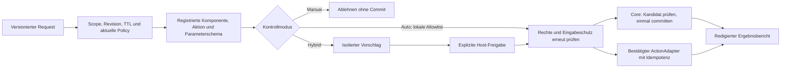
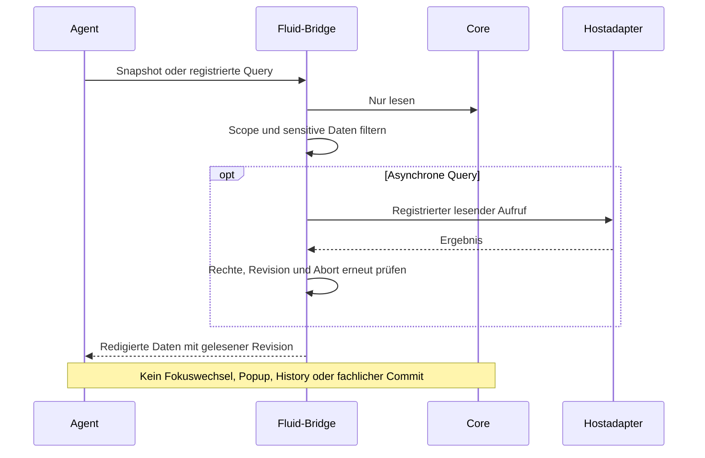
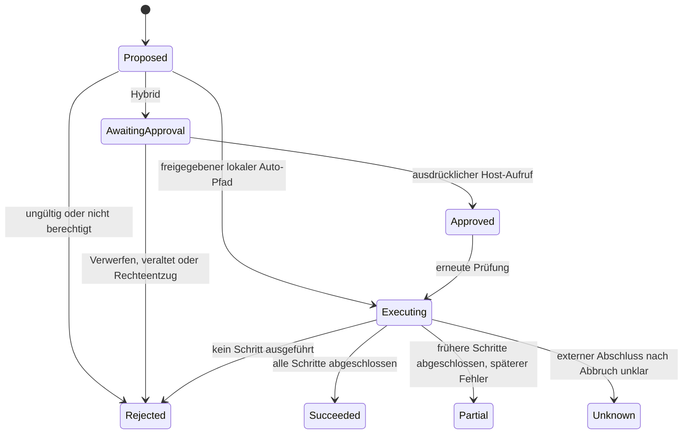

# T63: Begrenzte Fluid-Agentbridge

Stand: 13. November 2026. Umsetzung nach bestandenem lokalem M8a-Proof freigegeben.
Dieser Nachtrag konkretisiert T63-AC01–07; er ersetzt keine historischen M7-Nachweise.
Die Recherche aus ADR-0007 und `research/vercel-ui-sdk.md` bleibt maßgeblich.
Es gibt hier keinen Modellaufruf und keine neue SDK-Version. T64 bleibt getrennt.

## Problem und gewählte Grenze

Core besitzt Revision, Guards, Cancel, Projektion und atomaren Einzelcommit. Der
bisherige DecisionPlan beschreibt nur einen Eventnamen. `activatePart` ist ein
Nutzereingabepfad und darf keine Modellantwort als Nutzeraktion ausgeben. Externe
Transition-Actions laufen nach dem Commit; ihre Annahme beweist keinen Abschluss.

Gewählt wird die in M8 bewertete kleine Fluid-Bridge: explizite Registrierung,
standardmäßig geschlossene Rechte, redigierte lesende Projektion, begrenzte lokale
Transaktionen im Core und getrennte, ausdrücklich bestätigte Hostaktionen.
Eine geänderte Policy wird bei jeder Grenze erneut ausgewertet. Eine Modellantwort
kann weder Principal noch Freigabe oder Ausführungsquelle wählen.
Hostcallbacks sind ebenfalls eine Reentranzgrenze: nach Autorisierung,
Parameterprüfung und lesender Projektion werden aktuelle Rechte und Revisionen
erneut geprüft. Ein wahrer Callback-Rückgabewert überschreibt kein neueres
Nutzerevent und umgeht keinen zwischenzeitlich aktiven Eingabeschutz.

## APIs und Eigentümer

- `contracts/agent.ts`: versionierte Request-, Policy-, Read- und Resultschemas;
  höchstens 16 Schritte, stabile Scope-/Komponenten-/Aktions-IDs, erwartete Revision,
  Policy-Version und Ablaufzeit. `atomic-local` und `ordered` sind explizit getrennt.
- `core/index.ts`: `transact` wertet lokale Event-, Feld- und Collectionbefehle
  gegen einen Kandidaten aus. Guards, `beforeChange`, Eingabeschutz und Projektion
  müssen vor einem einzigen Commit bestehen. Keine externe Action in diesem Pfad.
- `core/agent.ts`: `snapshot`, registrierte `query`, `propose`, hostseitiges
  `approve`/`executeApproved`, `reject` und redigierter Export. Die Bridge erhält
  Runtime, festen Scope, vertrauenswürdigen Principal, aktuellen Policy-Leser und
  explizite Action-/Queryregistrierung; keine Introspektion beliebiger API-Methoden.
- `core/data.ts`: vorhandene schema-validierte ActionAdapter und lokale Idempotenz
  werden wiederverwendet. Aktuelle Rechte werden nach asynchroner Autorisierung
  unmittelbar vor dem Hostaufruf erneut geprüft. Persistente Idempotenz bleibt ein
  Host-/Produktionsgate, keine Eigenschaft des lokalen Piloten.

Read-Policy und Action-Policy sind getrennt. Nicht freigegebene Felder und Parts
werden ausgelassen. Sensitive Felder/gebundene Inhalte werden unabhängig von der
Read-Allowlist nicht ausgegeben. Query-/Actionausgaben benötigen eine ausdrücklich
registrierte öffentliche Projektion. Fehlermeldungen enthalten begrenzte Codes und
keine beliebigen Host-/Providertexte, Requestparameter oder Rohsnapshots.

## Ausführungsregeln

Manual erlaubt lesende Operationen, aber keine Agentvorschläge oder Ausführung.
Hybrid speichert einen geprüften Vorschlag; nur der separate Host-Aufruf erteilt
die Freigabe. Auto akzeptiert ausschließlich zusätzlich freigegebene reversible
lokale Aktionen. Externe Mutationen sind in Auto und Replay verboten.

Ein `atomic-local`-Request veröffentlicht genau einen Snapshot oder keinen. Ein
`ordered`-Request kann mehrere lokale Commits und explizite externe Schritte
enthalten; jeder Schritt berichtet sein Ergebnis. Nach einem Teilfehler laufen
keine späteren Schritte. Bereits abgeschlossene Hostaktionen bleiben abgeschlossen.
Nach Abbruch oder unklarem Hostfehler kann der externe Abschluss unbekannt sein;
dies ist keine Behauptung eines Rollbacks. Doppelte Ausführung desselben freigegebenen
Requests darf keine zweite Hostmutation starten.

Der Commit-Receipt bezieht sich auf den tatsächlich veröffentlichten Snapshot.
Observer- oder Routerfehler nach der Veröffentlichung machen diesen Commit nicht
rückwirkend zur Ablehnung. Core zeichnet dazu eine begrenzte, redigierte Diagnose
auf, ohne denselben fehlerhaften Callback zur Fehlermeldung erneut aufzurufen.
Ein neueres Nutzerevent aus einem Observer bleibt erhalten und stoppt weitere
Agent-Schritte über die Revisionsprüfung; die alte Transaktion navigiert dann
nicht mehr nachträglich.

## Flows

Die Bridge erfindet keine URL. Nur registrierte lokale Events dürfen eine bereits
im Flow deklarierte finale Route auslösen. Query, Vorschlag, Freigabe und Export
erzeugen keine History-Einträge. Intermediäre Routen einer atomaren Gruppe werden
nicht veröffentlicht.

## Tasks und Abnahme

| Arbeit | Konkrete Abnahme | T63 |
|---|---|---|
| Schemas und Registry | Unbekannte Komponenten, Aktionen, Parameter und Scope abgewiesen; leere Konfiguration bleibt geschlossen | AC01 |
| Read-Projektion | Snapshot/Query verändern weder Snapshot, Fokus, History noch Trace; sensitive und nicht freigegebene Werte fehlen | AC02, AC07 |
| Aktuelle Autorität | Stale Revision, Policywechsel, Rechteentzug während Await und Ablauf verhindern weitere Commits | AC03 |
| Core-Transaktion | Guards, Cancel, aktive Eingabe und gültige Projektion gelten; Fehler in Schritt zwei veröffentlicht Schritt eins nicht | AC04, AC05 |
| Externe Schritte | Explizite Freigabe, echte Rückgaben, idempotente Wiederholung und ehrlicher Teil-/Unbekanntstatus | AC05 |
| Modi und Replay | Manual mutiert nicht; Hybrid benötigt Hostfreigabe; Auto und Replay führen keine externe Mutation aus | AC06, AC07 |
| Export | Bericht enthält Scope, IDs, Revisionen und Status, aber keine sensitiven Werte, freien Fehlertexte oder ausführbaren Commands | AC07 |

Tests: neue `agent-bridge.test.ts` und `runtime-transactions.test.ts`, bestehende
Core-/Data-/Collection-/M7-Regressionssuiten sowie Typecheck und Lint. UI-Bedienung
und Live-Authoring werden separat durch Studio/T64 ergänzt; Unit-Tests werden nicht
als native Browser- oder Live-Modellprüfung ausgegeben.

Der gezielte Callback-Nachtest liegt in `agent-callback-boundaries.test.ts`:
Rechteentzug im Validator, veraltete Revision aus einem Policycallback und kein
Queryaufruf nach entzogener Berechtigung. Externe Authorisierung darf auch bei
unaufgelöstem Host-Promise sofort abbrechen; eine spätere Auflösung startet keine
Mutation. Die `authoring-controller.test.ts` prüft zusätzlich die separat
freigegebene T64-Preview: isolierte Runtime, unveränderte aktive Revision und
Felder, verworfene veraltete Kandidaten und atomare Übernahme nach erfolgreicher
Vorbereitung.
