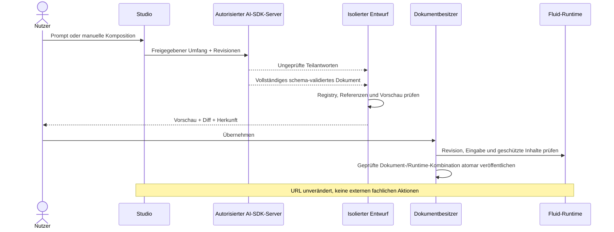

# T64: Begrenztes, prüfbares UI-Authoring

Stand: 13. November 2026. Umsetzung nach dem lokal geprüften sichtbaren M8a-Proof.
Die sechs T64-AC bleiben die kanonischen Kriterien in `m8-plan.md`.

## Produktumfang und Grenzen

Das Studio erhält eine Authoring-Arbeitsfläche mit zwei ausdrücklich getrennten
Ausgaben: ein deklarativer Laufzeitentwurf und ein exportierbarer Entwicklungsdiff.
Die erste registrierte Palette enthält den realen Modul-Explorer, eine Kennzahlgruppe
und eine native/GPU-Notiz. Der Agent komponiert diese Teile, wählt deren zugelassene
Varianten und Reihenfolge und formuliert eine kurze Überschrift. Der Explorer behält
seine geprüften Parts, Commands und Datenidentitäten. Beliebiger Modellcode wird nicht
zur Laufzeit interpretiert. Neue Bausteine werden als überprüfte Entwicklungsänderung
registriert, nicht durch erfundene Modell-Imports.

| Entscheidung | A | B | H / gewählt |
|---|---|---|---|
| Laufzeitkomposition | TSX direkt ausführen 30 | Nur Ansicht umschalten 68 | Registrierte Komposition + isolierte Vorschau 94 |
| Übernahme | Live-Streaming in Fachstate 25 | Nie übernehmen 55 | Vollständiger Entwurf, Versionsprüfung, atomarer Host-Swap 94 |
| Entwicklung | Unkontrollierter Dateischreiber 25 | Nur JSON anzeigen 73 | Deterministischer Diff mit Herkunft und unabhängigen Prüfungen 93 |

Dies sind aufgabenspezifische Planungsurteile, keine Leistungswerte. Die Gewichte des
M8-Plans gelten; harte Vertrags-/Rechtegrenzen haben Vorrang.

## Verträge, Besitzer und AC

- Ein striktes Zod-Dokument beschreibt ausschließlich registrierte Komponenten,
  Varianten, Datenbindings und Commands. Genau ein Explorer ist erforderlich;
  IDs sind eindeutig, Bindings und Referenzen werden vor Vorschau geprüft.
- Der Host besitzt die angewandte Dokumentversion. Die Fluid-Runtime besitzt Auswahl,
  Sortierung, Filter und Notizwerte. Eine isolierte Vorschau besitzt eigene Runtime-
  Ressourcen und führt keine externen Aktionen aus.
- Generierungsauftrag enthält Dokumentrevision, Runtime-Revision und Request-ID.
  Streaming liefert ausschließlich ungeprüfte Draft-Daten. Vollständiges Ergebnis
  wird gegen Schema und Registry geprüft. Änderungen am Ausgangsdokument, Abbruch
  und spätere Requests machen ältere Ergebnisse unbrauchbar.
- Übernahme ist eine ausdrücklich bestätigte Host-Aktion: gültiges vollständiges
  Dokument, unveränderte Revisionen und keine laufende Komposition/aktive Eingabe.
  Kandidatenruntime wird vollständig aufgebaut und geprüft, bevor Host Dokument und
  Runtime zusammen veröffentlicht. Auswahl, Query und Notiz werden übernommen;
  ein entfernter Notizbaustein darf keinen nichtleeren Entwurf verschwinden lassen.
- Entwicklungsoutput enthält deterministischen Textdiff, Dokument-/Sourcehashes,
  Herkunft und betroffene Verträge. Vor Übernahme werden Referenz-, Type- und
  Conformancetests ausgeführt. Download/Generierung schreibt keine Projektdateien
  und verleiht keine Deployrechte.
- Die URL benennt die Authoring-Arbeitsfläche. Prompt, Notiz, API-Key und gestreamte
  Fragmente gelangen nicht in History oder URL.

## AI-Transport

Installiert: `ai@7.0.159`, `@ai-sdk/openai@4.0.106`. Kein Upgrade.
Die gebündelte Primärdokumentation bestätigt `streamText` + `Output.object` und warnt,
dass `partialOutputStream` noch nicht schema-validierte Objekte liefert. Dieser
Einzelauftrag benötigt keine autonome Tool-Schleife. Er erzeugt ausschließlich ein
Dokument, keine ausgeführten Aktionen.

OpenAI direkt bleibt die vom Nutzer gewählte Anbindung. Der vorhandene Key ist zur
Verwendung freigegeben; er wird serverseitig aus der ignorierten `.env.local` gelesen.
Das bereits qualifizierte Modell `gpt-6.1-terra` ist am 13.11. im öffentlichen Katalog
vorhanden. Für den neuen Stream wird ein eigenes Input-/Outputbudget qualifiziert.
Standard-Tarif, keine Tools, `store:false`, begrenzter Input, Deadline, Abort und
konservative Reservierung bei fehlender Usage. Wiederverwendete Zugangskontrolle
bekommt einen eigenen Cookiepfad und Token-Namen; Review und Authoring teilen keine
versehentlich gültigen Berechtigungen.

An den Provider gehen ausschließlich Prompt, öffentliche Registry-Verträge,
vorheriges Designdokument und redigierte Schema-/Aggregatdaten. Notizen, Secrets,
Arbeitsdateiinhalte und unfreigegebene Felder werden nicht übertragen.

Primärquellen, geprüft 13.11.2026:
- [AI SDK: Structured Data](https://ai-sdk.dev/docs/ai-sdk-core/generating-structured-data)
- [OpenAI: GPT-6.1 Terra](https://developers.openai.com/api/docs/models/gpt-6.1-terra)
- [OpenAI: Pricing](https://developers.openai.com/api/docs/pricing)
- [Öffentlicher Modellkatalog](https://ai-gateway.vercel.sh/v1/models)

## User-, Daten-, State- und URL-Flow

## Negative Evaluation

Unbekannte Komponenten/Varianten/Bindings/Commands; doppelte IDs; Code, Imports,
Shader oder URLs als Zusatzfelder; Prompt-Injection ohne neue Rechte; unvollständige
Streams; Abbruch, Timeout und spätes Ergebnis; Rechteentzug; zweite Generierung;
veränderte Revision; Notiz-/Composition-Verlust; parallele Budgetreservierung;
fehlende Usage und redigierte Fehler. Live-Authoring erhält eigene Provenienz und
wird nicht durch den früheren Designreview-Lauf ersetzt.

## GPU-Komposition: Datei- und Layoutplan

`packages/cases/src/authoring.ts` besitzt die drei registrierten Projektionen und
einen gemeinsamen Größenvertrag. `createAuthoredWorkspaceFlow(document, data)`
verwendet den vorhandenen Workspace-Flow, setzt dessen initiale Exploreransicht
und ergänzt das sensible Feld `workspaceNote` (maximal 2.000 UTF-16-Codeunits).
`authoredWorkspaceScene(document, data, snapshot, viewport, effects?)` komponiert
die Abschnitte in Dokumentreihenfolge. `authoredWorkspaceHeight(document, width,
moduleCount, inspectorOpen = false)` verwendet dieselbe Layoutberechnung wie
die Scene und ist die alleinige Hosthöhenquelle.

Der Explorer ist das vorhandene `workspaceScene`-Bauteil mit unveränderten
`module-*`-IDs, Auswahlparts und Commands. Seine bisherige Heroüberschrift und
sein eigenes Effektdock entfallen in dieser Einbettung; der äußere Studioeditor
besitzt die Effektsteuerung. Die Navigation, Suche, Sortierung, Auswahl und der
nichtmodale Inspector bleiben Bestandteil des Explorers. Es gibt keine zweite
Selection-Implementierung. Neue Nodes erhalten einen vom Workspace getrennten,
abschnittsgebundenen Namensraum.

Die Kennzahlgruppe zeigt ausschließlich Aggregationen des tatsächlich gelieferten
Bestands: Modulanzahl, Summe der Quelldateien und eindeutige Paketabhängigkeiten.
Forest, Indigo und Amber bestimmen Akzentflächen und ausgewählte Controls; die
fachlichen Gruppenfarben bleiben unterscheidbar. Die Notiz ist ein registrierter
Multipart-Textbox-Baustein mit nativer Eingabe und GPU-Text. Ihr Inhalt wird weder
Teil des Authoring-Dokuments noch des Providerkontexts. Der sensible Feldvertrag
blockiert Pixelcapture mit Notizparts; ein leerer Wert ist keine automatische
Freigabe. Entfernen eines nichtleeren Notizbausteins wird zusätzlich durch den
Host-Kandidatenvergleich geschützt.

Tests verwenden den echten `readWorkspace`-Import und die ausgelieferten Fonts.
Sie prüfen alle Reihenfolgen/Ansichten, gemeinsame Höhe, eindeutige und stabile
IDs, Auswahl-/Command-Erhalt, Notizschutz sowie geformten Text bei schmalen und
breiten Flächen. Das sind CPU-/Font-/Vertragsnachweise; echte GPU- und native
Eingabequalifikation folgt getrennt im Browser.

Die reale Fontprüfung fand einen konkreten Grenzfall: Glyphs Wortumbruch kürzte
80 zusammenhängende W-Zeichen, und Inter besitzt für W einen Vorschub leicht
oberhalb von 1 em. Die registrierte Titel-/Labelprojektion setzt deshalb
konservative explizite Umbrüche mit gemessenem Fontspielraum. Sie trennt keine
Graphemcluster; zugänglicher Name und Dokument behalten den Originaltext.
`Intl.Segmenter` wird mit `granularity: 'grapheme'` verwendet; überprüfte
Primärdefinition: [ECMA-402 Segmenter Objects](https://tc39.es/ecma402/#segmenter-objects)
(13. November 2026). Lange Einzelwörter und kombinierende Zeichen haben eigene
Regressionen. Dies qualifiziert die deklarierten Fontfälle, keine beliebige Schrift.

### Live-Qualifikation am 13. November

Der erste echte Provideraufruf deckte einen Schemaexport-Unterschied auf: Zod
4.6.7 exportiert `discriminatedUnion` hier als `oneOf`. Der OpenAI-Endpunkt wies
bereits die Inputzählung mit `400 invalid_json_schema` zurück. Die drei anhand
fester `type`-Literale disjunkten Varianten verwenden deshalb `z.union`: Der
Provider erhält das unterstützte `anyOf`, die kanonische Runtimevalidierung bleibt
dieselbe Quelle. Die tatsächliche SDK-Serialisierung besitzt einen Regressionstest.
[Offizielle Structured-Outputs-Grenzen](https://developers.openai.com/api/docs/guides/structured-outputs).

Der anschließende Live-Nachweis (internes Archiv) bestätigt
Generierung über OpenAI/AI SDK, isolierte WebGPU-Vorschau, echte Preflightprüfung,
Diffdownload und explizite Übernahme mit erhaltener Auswahl und Notiz.
Protokollfehler geben ausschließlich sichere Status-/Code-/Parameterkennungen aus.
Der neue Export „Prüfbericht herunterladen“ enthält Vertrags-/Sourcehashes und
Herkunft, keine Feldwerte oder Sessiontokens. Browser-, GPU- und Accessibilityprüfungen
sind unabhängig vom TypeScript-/Runtime-Preflight.
