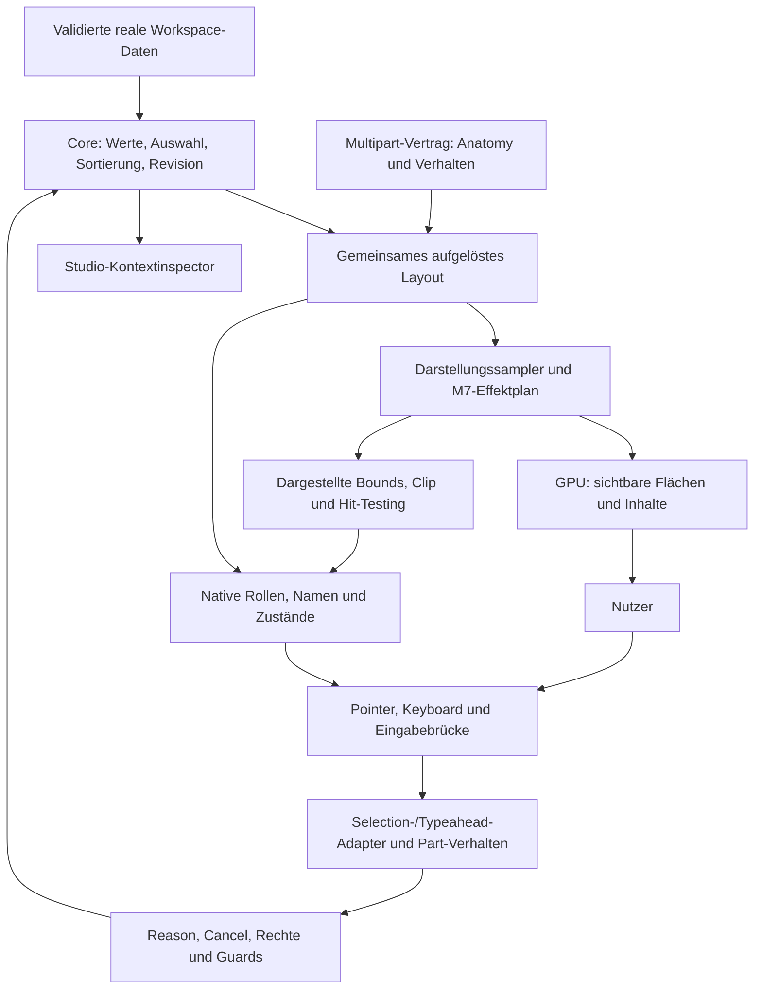
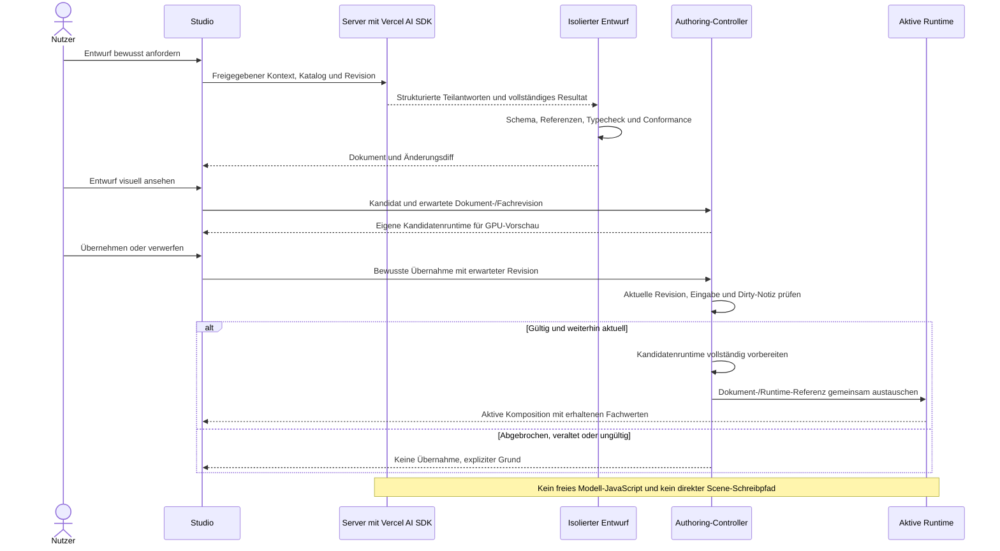
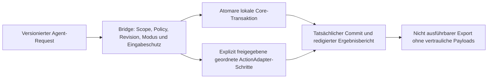
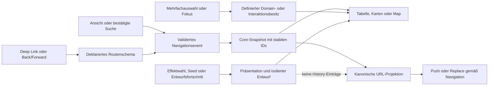
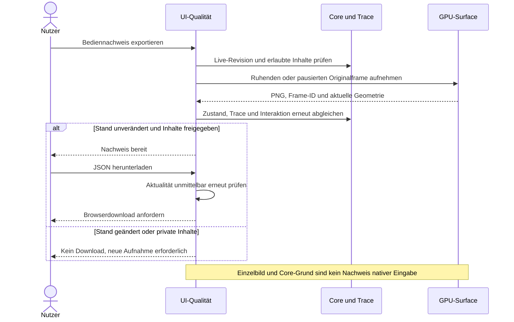

# M8: Komponentenverhalten, gemeinsames Layout und kontrolliertes UI-Authoring

**Stand: 13. November 2026. Status: beschlossener Umfang implementiert und lokal anhand aller 41 Kriterien qualifiziert; Leistungsziel und globale Produktionsgates bleiben separat offen.**

Grundlage sind die [UI-SDK-Recherche](../research/vercel-ui-sdk.md) und
[beschlossenes ADR-0007](../decisions/0007-ui-sdk.md).
Geprüfter Kandidat: **UI SDK 0.1.0-beta.1**, Repository-Stand
`c53df2f45c7502bebf0f52619dfe75007a309eb6` vom 12. November 2026.

Die frühere Evaluation wird mit der Nutzerentscheidung vom 13. November 2026 zum
Umsetzungsplan **M8**. Die sieben Aufgaben heißen jetzt **T59 bis T65**; ihre
bisherigen UIR-Aliasse dienen nur der Nachvollziehbarkeit. Ein vollständiger
Refactor ist freigegeben. Zuerst wird der sichtbare Proof qualifiziert, danach
werden die weiteren Aufgaben ohne erneute Grundsatzfreigabe konsistent umgesetzt.

Die bisherigen **58 Tasks, 435 Kriterien und 27 lokal qualifizierten M7-Kriterien**
bleiben unverändert. M8 ergänzt sieben Tasks mit **41 neuen Einzelkriterien**:
insgesamt 65 Tasks und 476 Kriterien. Die kanonischen Texte stehen in den
Taskzeilen des [Gesamtplans](../implementation-plan.md); die folgenden Details
benennen dieselben AC-IDs. Es gibt keine doppelte zusätzliche M8-AC-Serie.

| Frühere Entwurfs-ID | Kanonische Aufgabe | Einzelkriterien |
|---|---|---|
| UIR-01 | T59 | T59-AC01 bis T59-AC05 |
| UIR-02 | T60 | T60-AC01 bis T60-AC05 |
| UIR-03 | T61 | T61-AC01 bis T61-AC06 |
| UIR-04 | T62 | T62-AC01 bis T62-AC05 |
| UIR-05 | T63 | T63-AC01 bis T63-AC07 |
| UIR-06 | T64 | T64-AC01 bis T64-AC06 |
| UIR-07 | T65 | T65-AC01 bis T65-AC07 |

## Ziel und Entscheidung

Fluid soll Komponenten durch ihre Teile und ihr Verhalten definieren können:
kontrollierte Werte, Rollen, Fokus, Tastatur, Aktivierung und Lebenszyklus gehören
zu einem gemeinsamen Vertrag. Daraus entstehen die GPU-Darstellung, die native
Semantik-/Eingabebrücke und die im Studio prüfbare Oberfläche.

Die beschlossene Richtung ist ein **hybrider Refactor vom Verhalten her**. Reine
Selection-/Typeahead-Logik wird als kleiner Adapterpilot geprüft; öffentliche
UI-SDK-DOM-Primitives werden im Studio mit Base UI verglichen. Die eigene
GPU-Projektion hängt nicht an internen SDK-Rendererpfaden oder DOM-Objekten.
Die zuvor bewerteten Alternativen bleiben als Entscheidungsherkunft dokumentiert.

Der Proof richtet Komponentenverträge, Komposition und gemeinsame Layoutauflösung
gründlich auf dieses Modell aus. Alte APIs müssen nicht erhalten bleiben;
geeignete qualifizierte Teilsysteme werden aufgrund ihrer tatsächlichen Eignung
übernommen. Der begrenzte Umfang betrifft die zuerst geprüften Komponenten und
Journeys, nicht die Sorgfalt des Architekturumbaus.

Die Priorität liegt auf einem sichtbaren, bedienbaren Proof. Ein universeller
Codegenerator, eine neue vollständige Shaderengine oder alle Widgetfamilien sind
keine Voraussetzung für diesen ersten Vergleich.

## Erster sichtbarer Milestone

**Eine echte Datenoberfläche in drei Formen:** Der vorhandene Workspace-Import
liefert dieselben Datensätze für Tabelle, Karten und Dependency Map.

Der Nutzer kann numerisch sortieren, suchen, mehrere Module auswählen, den Fokus
per Tastatur bewegen und die ausgewählten Module im Kontextinspector prüfen.
Beim Ansichtswechsel bleiben Auswahl und Identitäten erhalten. Der logische Fokus
folgt einem vorhandenen Part derselben Identität; ist das Ziel nicht mehr sichtbar,
gilt eine vorher definierte, im Trace nachvollziehbare Fallback-Regel.

Die Oberfläche zeigt den tatsächlichen Backendstatus. Silk Cascade, Liquid Lens
und Particle Weave können bewusst gewählt und reproduziert werden. Ein Effekt
ändert weder fachliche Auswahl noch Reihenfolge, Filter oder Aktionsrechte.

**Sichtbare Abnahme vor Ausweitung:** Desktop und kompakte Ansicht im echten
Workspace zeigen, Inspector und Tastatur prüfen, einen unterbrochenen Übergang
und Reduced Motion demonstrieren. Erst nach dieser Beurteilung werden weitere
Komponenten und produktive Agentenfunktionen ausgebaut. Die frühe Lieferung wird
als Proof gekennzeichnet, nicht als vollständige Releaseabnahme.

## Bewertungsmethode und Aufgabenoptionen

Ratings 1–5: **Zielerfüllung / Korrektheit, Sicherheit, Accessibility / Testbarkeit /
Lieferbarkeit, Wartung / Erweiterbarkeit**. Gewichte **30/25/20/15/10**;
Score = Summe aus Rating × Gewicht / 5. Die Zahlen sind Planungsurteile.
Harte Rechte-, Daten-, Semantik- und Rendereranforderungen bleiben unabhängig vom
Score verbindlich. Die Ratings sind aufgeführt, damit die Rechnung prüfbar bleibt.

| Task | Option A | Option B | Hybrid H | Empfohlen |
|---|---|---|---|---|
| T59 | Inventar ohne neuen Verhaltensvertrag — 3/4/4/5/2 = **73** | SDK-Anatomy vollständig klonen — 4/2/3/2/3 = **58** | Kleines explizites Komponenten-/Pflichtenmodell plus SDK-Mapping — 5/4/5/4/5 = **92** | H |
| T60 | Bounds je Renderer berechnen — 3/2/2/4/2 = **52** | Sofort universelle Layoutengine bauen — 5/3/3/2/5 = **73** | Gemeinsam aufgelöstes Layout mit begrenzten qualifizierten Projektionen — 5/4/5/3/5 = **89** | H |
| T61 | Ein isoliertes Selection-Demo — 2/3/3/5/2 = **58** | Alle Komponentenfamilien gleichzeitig erneuern — 5/3/3/1/5 = **70** | Reine Logikpiloten und ein vollständiger Table-/Cards-/Map-Flow — 5/4/5/4/5 = **92** | H |
| T62 | Studio vollständig auf UI SDK umstellen — 3/3/3/2/4 = **59** | Base UI ohne Vergleich beibehalten — 3/4/3/5/2 = **69** | Öffentliche SDK-Primitives in identischem Studioflow vergleichen — 5/4/5/4/4 = **90** | H |
| T63 | Upstream-Agentbridge unverändert öffnen — 4/1/2/5/3 = **58** | Eigenes unabhängiges Aktionssystem bauen — 3/4/4/2/4 = **68** | Kleine Fluid-Bridge auf bestehenden Core-/Action-Verträgen — 5/5/5/3/5 = **94** | H |
| T64 | Modellcode unmittelbar zur Laufzeit ausführen — 5/1/2/4/4 = **63** | Ausschließlich manuelles Authoring — 3/5/4/4/3 = **77** | Prüfbare Entwicklungsdiffs und begrenzte deklarative Laufzeitentwürfe — 5/4/5/4/5 = **92** | H |
| T65 | Demo und Einzelbilder als Freigabe — 3/2/2/5/2 = **55** | Alle denkbaren Plattformkombinationen vor dem Proof fordern — 4/4/4/1/4 = **71** | Endliche Conformance-Matrix, belegter Vergleich und getrennte offene Produktgates — 5/5/5/4/5 = **97** | H |

T63/A und T64/A verletzen in der beschriebenen Form die Fluid-Autoritätsgrenze
und sind unabhängig von ihrem Score ausgeschlossen. Die detaillierte strategische
Bewertung A/B/C/D steht in [ADR-0007](../decisions/0007-ui-sdk.md).

## Tasks und Acceptance Criteria

Alle folgenden Kriterien sind **verbindlich; ihr anfänglicher Status war offen**. Der aktuelle Einzelstatus steht im AC-Register. Implementierung,
reine Tests und lokale Browsernachweise erhalten jeweils ihren tatsächlich
geprüften Scope; ein freigegebener Plan ist kein Ausführungsnachweis.

### T59 — Komponentenverträge und Inventar

**Zuordnung:** T13, T39, T40, T43. Vorarbeit für T60 bis T64.

Inventar der tatsächlich verwendeten Parts, Werte, Ereignisse und Rollen erstellen.
Das beschlossene Modell beschreibt gemeinsame Fähigkeiten und komponentenspezifische
Pflichten. Schema, Runtime-Referenzprüfung und API-Grenzen bleiben getrennt.

- **T59-AC01:** Für Tabelle, Auswahlcontrol, Karte, Map-Knoten und Inspector sind Parts, Rollen, Namen, Fokusregeln, Keyboard-/Pressverhalten und kontrollierte Werte benannt. Ein Tabellenlabel oder dekoratives Element wird nicht implizit zum Button.

- **T59-AC02:** Fachliche Mehrfachauswahl verwendet stabile Modul-IDs. Fokus, Selection-Anker und sichtbare Reihe besitzen ausdrücklich getrennte Bedeutungen und Besitzer.

- **T59-AC03:** Ein ausführbarer Fehlfall weist unbekannte Partreferenzen, fehlende Namen, unzulässige Aktionen und doppelte IDs ab. Ein gültiger Vergleichsfall wird akzeptiert.

- **T59-AC04:** Für jeden vorgeschlagenen SDK-Import sind öffentliche API, Version, Lizenz, transitive Abhängigkeiten und DOM-/Servergrenzen dokumentiert. Ein interner `/renderer`-Import zählt nicht als bestandene öffentliche Integration.

- **T59-AC05:** Zod-Schemas sind Quelle der serialisierbaren Types. Kein DOM-, GPU- oder Providerobjekt gelangt in gespeicherte Komponenten- oder Fachzustandsdaten.

### T60 — Gemeinsames Layout und dargestellte Interaktionsgeometrie

**Zuordnung:** T05, T07, T10, T53. Abhängig von T59.

Eine gemeinsame Auflösung liefert Layout und Clipping vor GPU- und Semantikprojektion.
Der Übergangssampler ergänzt die zeitabhängige Darstellung, aus der Hit-Testing,
Fokusrahmen und zugängliche Geometrie konsistent abgeleitet werden.

- **T60-AC01:** Stabile Part-IDs, Bounds, Clipbereich, Z-Reihenfolge, Sichtbarkeit und gültige Transformation/Inverse werden einmalig definiert. GPU und Brücke rechnen keine unabhängigen Platzierungen aus Fensterkoordinaten nach.

- **T60-AC02:** In Tabelle, Karten und Map stimmen sichtbare Ziele und native Ziele bei Resize, Clipgrenzen und DPR-Wechsel innerhalb der vorab benannten Messgenauigkeit überein.

- **T60-AC03:** Ausgeblendete, austretende oder durch eine höhere Fläche verdeckte Controls besitzen keine unsichtbare aktive Trefferfläche. Ein dekorativer Linsen-/Partikelpart erhält keine Interaktion.

- **T60-AC04:** Bei M7-Übergängen und Unterbrechungen verwendet die Eingabe qualifizierte dargestellte Bounds. Fokus, Textauswahl und aktive Eingabe werden nicht zusätzlich durch Effektmaterialien verzerrt.

- **T60-AC05:** Der Proof weist sichere Layer-/Clipregeln und sichtbare Fokusringe nach. Der Messbericht nennt Browser- und tatsächliche Surfacegröße getrennt.

### T61 — Selection-/Typeahead-Pilot und sichtbarer Multipart-GPU-Proof

**Zuordnung:** T12, T13, T39–T41, T44, T49. Abhängig von T59 und T60.

Reine Selection-/Typeahead-Funktionen zunächst ohne Browserglobals und danach in
einem realen Workspaceflow qualifizieren. Anpassung über einen kleinen Adapter;
keine Kopie eines vollständigen SDK-internen Komponentenframeworks.

- **T61-AC01:** Der Pilot verwendet denselben validierten Workspace-Datensatz in allen drei Ansichten. Sortieren und Filtern verändern keine Modulidentitäten oder erfundenen Werte.

- **T61-AC02:** Mehrfachauswahl, Range-Anker, Auswahlumschaltung und Tastaturbewegung folgen dokumentierten Regeln für sichtbare, gefilterte und deaktivierte Einträge. Die Semantik bildet die gewählte Tabellen-/Composite-Interaktion korrekt ab. Keine Rollenwahl allein wegen des visuellen Rasters.

- **T61-AC03:** Typeahead besitzt festgelegte Zeit-/Reset-/Wiederholungsregeln und eine bewusste Textnormalisierung. Während Texteingabe oder Composition fängt es keine Zeichen für eine konkurrierende Navigation ab.

- **T61-AC04:** Auswahl, Sortierung und zugehöriger Inspectorinhalt stimmen nach Tabelle → Karten → Map → Tabelle überein. Fokus behält seine logische Identität oder folgt der dokumentierten Fallback-Regel, ohne auf entfernte Controls zu zeigen.

- **T61-AC05:** Alle drei neuen M7-Rezepte sind einzeln auslösbar. Gleicher Seed/Zeitpunkt ist reproduzierbar. Unterbrechung, Rückwärts-Seek und Reduced Motion erhalten den gültigen Fachzustand. Alte Buildnachweise werden nicht als neue Regression ausgegeben.

- **T61-AC06:** Der sichtbare Proof wird bei Desktop- und kompakter Breite mit Pointer und Tastatur vorgeführt. Screenshots, Trace und Geometrie besitzen denselben Build-/Runbezug.

### T62 — UI SDK und Base UI im Studio vergleichen

**Zuordnung:** T16, T17, T42, T55. Nach T59 parallel zu T60/03 möglich.

Öffentliche SDK-DOM-Bausteine in einer abgegrenzten Studioansicht mit demselben
Inhalt, Design und kontrollierten Werten wie der Base-UI-Referenz vergleichen.

Die lokale Teileentscheidung ist in [ADR-0007](../decisions/0007-ui-sdk.md#qualifizierte-teileentscheidung-vom-13-november)
belegt: öffentliche SDK-Selection übernehmen, Typeahead zeitpunktgesteuert selbst
führen, Base UI für Studio-Tabs/Select/Dialog beibehalten. Die öffentlichen
SDK-DOM-Bausteine bleiben im Vergleichslabor verfügbar. Native Funktionsgleichheit
im geprüften Scope, getrennte Bundlewerte und Grenzen tragen diese Entscheidung;
eine pauschale Qualitätsüberlegenheit oder ein kompletter Frameworkwechsel folgen
daraus nicht. Die folgenden Abnahmekriterien bleiben unverändert.

- **T62-AC01:** Ein kleiner Vergleichsflow umfasst Tabs, eine Auswahlliste und einen Dialog mit Fokusübergabe/-rückgabe. Nur öffentlich verfügbare Kandidaten werden verwendet. Eine fehlende Komponente wird als Lücke dokumentiert.

- **T62-AC02:** Namen, Tastaturbedienung, Escape, Disabled-Zustand und kontrollierte Änderungen werden auf beiden Pfaden anhand derselben Ereignisfolgen geprüft.

- **T62-AC03:** Beide Kandidaten steuern dieselbe Fluid-Vorschau. Keiner besitzt eine separate Kopie von Fachwerten oder umgeht Guards durch UI-Callbacks.

- **T62-AC04:** Vergleich nennt Importumfang, benötigte eigene Adapter, offene Fehler und wartbare API-Grenzen. Weder Herkunft noch Beta-/Stable-Bezeichnung ersetzen gemessene Bedienbarkeit oder eigene Accessibility-Nachweise.

- **T62-AC05:** Ergebnis ist pro Baustein Übernehmen, Beibehalten oder Vertagen mit Begründung. Kein vollständiger Studioaustausch allein wegen eines erfolgreichen Einzelimports.

### T63 — Begrenzte Fluid-Agentbridge

**Zuordnung:** T09, T15, T22, T24, T27, T32. Nach dem sichtbaren Proof.

Eine explizite Fluid-Bridge übersetzt erlaubte Absichten in validierte Core-Events.
Upstream unterstützte Aktionen sind keine automatisch erteilten Produktrechte.

- **T63-AC01:** Ohne Konfiguration ist keine Aktion freigeschaltet. Komponenten, Aktionen und Parameter werden gegen die registrierte Allowlist geprüft. Unbekannte Ziele erzeugen einen nachvollziehbaren Fehler ohne Zustandsänderung.

- **T63-AC02:** Snapshot- und Query-Aufrufe sind strikt lesend: kein Fokuswechsel, Popupöffnen, History-Eintrag oder fachlicher Commit. Ergebnisse sind an den berechtigten Scope und die gelesene Revision gebunden und vor Ausgabe redigiert. Ein Snapshot darf keine zusätzliche Aktion zur vermeintlichen Vorbereitung auslösen.

- **T63-AC03:** Jeder Änderungsrequest enthält gültige Versions-/Revisionsbezüge. Veraltete Requests und währenddessen veränderte Berechtigungen können keinen Commit erzwingen.

- **T63-AC04:** Ein berechtigter Request verwendet denselben Core-/Guard-/Interaktionsschutz wie eine Nutzeraktion. Es gibt keinen direkten SDK-Schreibpfad auf Scene oder Fachstore.

- **T63-AC05:** Sequenzen unterscheiden atomare lokale Zustandsänderung und externe Aktionen. Teilfehler werden ausdrücklich berichtet. Bereits ausgeführte Hosttransaktionen werden nicht als automatisch zurückgerollt dargestellt.

- **T63-AC06:** Manual, Hybrid und Auto folgen den bestehenden Autoritätsregeln. Käufe, Veröffentlichungen und andere nicht erlaubte Side Effects werden in Auto abgewiesen.

- **T63-AC07:** Export/Replay erzeugt keine externe Mutation. Nicht autorisierte Inhalte und sensitive Felder gelangen nicht über die Bridge in Modellkontext oder Diagnose.

### T64 — Entwicklungsagent und deklarativer Studioentwurf

**Zuordnung:** T17, T20, T22, T55, T58. Nach T59; Laufzeitpfad nach T63.

Zwei Ausführungsgrenzen sichtbar trennen: Ein Entwicklungsagent erzeugt einen
reviewbaren Codevorschlag; ein Laufzeitagent schlägt eine begrenzte Komposition
bekannter Komponenten mit registrierten Bindings und Aktionen vor.

- **T64-AC01:** Entwicklungsoutput ist ein Diff mit Herkunft und betroffenen Verträgen. Vor Übernahme werden Typecheck, Referenzprüfung und relevante Conformancefälle ausgeführt. Der Agent erhält durch Generierung keine automatischen Deployrechte.

- **T64-AC02:** Laufzeitoutput enthält nur den vereinbarten deklarativen Teilumfang. Freies JavaScript, Shader, Imports, Eventhandlercode und unbekannte URLs werden abgewiesen.

- **T64-AC03:** Streamingoutput bleibt ein isolierter Entwurf. Erst ein vollständig validierter, berechtigter Vorschlag kann atomar übernommen werden. Veraltete oder abgebrochene Generierung überschreibt keine neuere Nutzereingabe.

- **T64-AC04:** Studio zeigt Daten-/Providerumfang, Entwurf, Änderungsdiff und Übernehmen/Verwerfen. Fokus und Dirty Fields sind gegen unbeabsichtigten Austausch geschützt.

- **T64-AC05:** Modellzugriffe verwenden serverseitiges Vercel AI SDK mit Berechtigung, Budget, Deadline und Abort. Ohne Provider bleiben manuelle Gestaltung und Runtime bedienbar. Die vorhandene AI-Designreview gilt nicht als Nachweis dieses neuen Pfads.

- **T64-AC06:** Negative Evaluation umfasst unbekannte Komponenten/Aktionen, falsche Referenzen, Prompt Injection, widersprüchliche Bindings, Teilantworten und verspätete Antworten. Ein generierter Erfolgstext gilt nicht als ausgeführte fachliche Aktion.

### T65 — Conformance, Vergleich und Entscheidung dokumentieren

**Zuordnung:** T19, T30, T38, T43, T54–T57. Begleitend; Entscheidung nach T61/04.

- **T65-AC01:** Der sichtbare Runtime-Proof wird auf den vorhandenen Breiten 320/390/768/1280 px und auf tatsächlichem WebGPU beziehungsweise separat gewähltem WebGL2 geprüft. Browser-/Surfacegröße, Hardware, Build, Daten- und Rezeptstand werden aufgezeichnet.

- **T65-AC02:** Die endliche Matrix umfasst Tabelle ↔ Karten, Karten ↔ Map und Map ↔ Tabelle, mit denselben drei neuen M7-Effekten: **6 Richtungen × 4 Breiten × 2 Backends × 3 Effekte = 144 Übergangsfälle**. Endpunkte und 25/50/75-Prozent-Kontrollpunkte ergeben **720 Kontrollbilder/-samples**. Sie sind keine vollständige zeitliche Filmabnahme. Die frühe sichtbare Lieferung darf vor Abschluss dieser gesamten Freigabematrix erfolgen und zeigt ihre noch offene Prüfdeckung ausdrücklich an.

- **T65-AC03:** Eigene Journeys prüfen Mehrfachauswahl, Range-Anker, Keyboard/Typeahead, Sortierung/Filter, Fokusfallback, Unterbrechung, Resize, URL-History und read-only Replay. Ein programmgesteuerter Test wird nicht als native Eingabe ausgegeben.

- **T65-AC04:** Vergleichskandidaten verwenden identischen Datensatz, Seed, Viewport, Theme und Backend. Kriterien sind Verhalten, Erreichbarkeit, visuelle Kontinuität, benötigter Adapterumfang und nachgewiesene Wartungsrisiken. Es gibt keine unbelegte Performance- oder Qualitätssteigerungsbehauptung.

- **T65-AC05:** Ein separater Echtzeitlauf misst auf dem dokumentierten Referenzgerät Frametiming, Ausreißer und das vorab definierte Budget bei identischem Ablauf. Kontrollierte Einzelbildaufnahme gilt nicht als Echtzeitmessung. Das Bundle- Delta wird mit identischer Buildkonfiguration und denselben Einstiegspunkten bestimmt. Ein Surface-Scheduler bleibt der einzige Taktgeber. Im stabilen Leerlauf entstehen keine zusätzlichen Frames. Upstream-Angaben begründen keine eigene Performancegarantie.

- **T65-AC06:** Neue Quellen und Nachweise werden unter eigener datierter Provenienz archiviert. M7-AC und historische Builds bleiben unverändert. Breite AT-/IME-/Mobile-/Hardware- und Produktionsgates werden weder automatisch geschlossen noch als unendliche Voraussetzung für den begrenzten Vergleich erfunden.

- **T65-AC07:** Entscheidung benennt übernommene, selbst implementierte und abgelehnte Teile. Erst bei Übernahme werden kanonische Tasks/AC, Feature-Matrix und Engineering-OKF konsistent erweitert. Public erklärt ausschließlich tatsächlich bedienbare Funktionen.

## Verbindliche Flows — implementierte und lokal qualifizierte Verträge

### Gemeinsame Komponenten-, Daten- und Interaktionsprojektion

### Generierung, Entwurf und Agentenautorität

Dieser Authoring-Host ist kein Aufruf von `createFluidAgentBridge`. Er besitzt das
Kompositionsdokument und wechselt nach Prüfung die Runtime. Die gesonderte T63-Bridge
übersetzt registrierte Aktionen in bestehende Core-Transaktionen:

### User-, State- und URL-Flow

Welche Auswahlwerte in einer URL stehen, wird im Proof ausdrücklich deklariert.
Neue Mehrfachauswahl wird nicht ungeprüft in den vorhandenen Einzel-`selected`-
Parameter gepresst. Fokus, Animation, Seed und generierter Entwurf bleiben außerhalb
der URL. Historische Routen erhalten bei einer späteren Änderung einen bewussten
Parse-/Migrationsvertrag; ihre Beibehaltung ist kein Grund gegen einen besseren Aufbau.

## Reihenfolge und Gate für die frühe sichtbare Lieferung

1. **Definition:** T59 setzt Research und beschlossenes ADR in überprüfbare
   Komponenten-/Verhaltensverträge um.
2. **M8a zuerst sichtbar:** T60 und T61 liefern den bedienbaren Table-/Cards-/Map-
   Proof mit Mehrfachauswahl, Keyboard und Kontextinspector. T62 darf parallel
   vorbereiten, soweit derselbe Vertrag feststeht. T65 prüft von Beginn an.
3. **M8a-Gate:** Desktop und kompakte Ansicht, reale Daten und stabile Auswahl/IDs,
   sichtbarer Fokus/Inspector, numerische Sortierung, ein unterbrochener Übergang,
   Reduced Motion sowie nachvollziehbare Build-/Runbezüge bestehen. Fehler werden
   vor der Ausweitung behoben. Die ganze 144-Fälle-Matrix ist für diese erste
   sichtbare Lieferung noch nicht erforderlich und bleibt als vollständiges Gate offen.
4. **Danach vollständige Umsetzung:** T62 bis T64 werden auf dem qualifizierten
   Unterbau fortgeführt. Die Nutzerfreigabe liegt vor; die gewählten SDK-Teile
   werden weiterhin anhand ihrer tatsächlichen Eignung übernommen oder durch den
   eigenen begrenzten Verhaltensvertrag ersetzt. Freies Modell-JavaScript bleibt ausgeschlossen.
5. **M8-Abnahme:** T65 schließt die endliche Conformance-Matrix, den unabhängigen
   Vergleich, eigenen Echtzeit-/Bundlebezug und aktualisierte Dokumentation.
   Alte Nachweise bleiben historische Nachweise ihres Builds.

Die sieben Taskzeilen im Gesamtplan bilden die einzige neue kanonische AC-Quelle.
Der Parser benötigt deshalb keine zusätzliche M8-Milestone-Registrierung. Der
Planchecker kontrolliert die Übereinstimmung der 41 hier bezeichneten AC mit den
Taskzeilen. Die 435 vor M8 bestehenden Texte, IDs und Quellenhashes werden bei der
Adoption ausdrücklich auf Unverändertheit geprüft.

Engineering-OKF erhält bei der abschließenden Dokumentpflege die betroffenen
Architektur-, Komponenten-, State-, Daten-, URL- und Agentenverträge. Public
verwendet echte UI-Bezeichnungen und neue, datierte Aufnahmen bereits bedienbarer
Funktionen. Bis zur geprüften Regenerierung bleiben die bestehenden OKF-Bundles
als datierte vorherige Edition erkennbar; sie werden nicht still als M8-Nachweis ausgegeben.

## Lokaler Abschluss und verbleibende Produktgrenzen

Alle **41 M8-Kriterien** sind im ausdrücklich dokumentierten lokalen Scope nachgewiesen. Der native Desktop-/Kompaktproof verbindet Originalbilder, Trace und Geometrie desselben Runs. Der Messauftrag ist einschließlich seines negativen Ergebnisses abgeschlossen: Framebudget **failed**, Last **contaminated**, Performancevalidität **not-qualified**. T29 und breite Produktions-/Geräte-/Accessibility-Gates bleiben offen.

Die native Archivierung (internes Archiv),
Operator-/Bildreview (internes Archiv),
Messumfangsentscheidung (internes Archiv) und der
unabhängige Umfangsabgleich (internes Archiv)
trennen Funktion, Bediennachweis, Messauftrag und Leistung. Die früheren
39/41-Dokumentationseditionen bleiben historisch erhalten.

### Abschließender Bediennachweis und Dateiübergabe

Der Showcase erzeugt einen ausdrücklich vorbereiteten Live-Capture mit PNG,
Trace, Revision, Datasetdigest und nativen Zielbounds desselben Frames.
Die gesonderte Browserbedienung belegt Pointer/Tastatur. „Nachweis bereit“ ist
kein gespeicherter Download; erst „JSON herunterladen“ fordert die Datei an.

