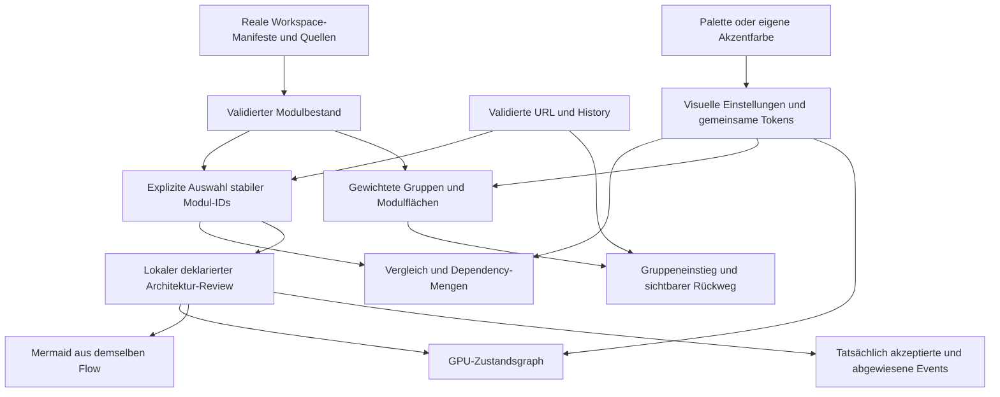

# M9 — Abläufe, Vergleich, Atlas und wählbare Farbwelten

Stand und Recherche: **14. November 2026**. Vom Nutzer zur Umsetzung freigegeben.
Blau ist die Voreinstellung; acht Paletten und eine eigene Akzentfarbe sind auswählbar.
Historische M7/M8-Bilder und Messungen bleiben unverändert und werden nicht als M9-Abnahme bezeichnet.

## Produkt und Cases

1. **Architektur-Review / Flow Explorer:** Ein bewusst gestarteter lokaler Review eines echten Workspace-Moduls. Ein deklarierter Zustandsgraph, zulässige Aktionen, Rückarbeit und die tatsächliche Ereignisspur erklären den Ablauf. Eine lokale Freigabe ist keine Veröffentlichung oder behauptete externe Prüfung. Zustandsknoten sind eigene Entitäten, keine umbenannten Module.
2. **Abhängigkeiten vergleichen:** Zwei bis vier gewählte Module entfalten sich in eine Vergleichsarbeitsfläche. Kennzahlen, gemeinsame und unterschiedliche Dependencies kommen aus den tatsächlichen Manifesten. Die Auswahl bleibt bei Ansichtwechseln erhalten. Fehlende oder zu große Auswahl wird erklärt statt heimlich ersetzt.
3. **Workspace erkunden / Atlas:** Proportionale Flächen nach Dateien oder Codezeilen, gruppiert nach Kernel, Adapter und Tooling. Gruppen lassen sich öffnen und über sichtbare Breadcrumbs verlassen. Kleine und gewichtlose Elemente bleiben zugänglich. Codeumfang ist kein Qualitätsscore.
4. **Eigene Farbwelt:** Blau, Indigo, Violett, Cyan, Türkis, Rosé, Bernstein und Graphit sowie eine eigene Farbe. Gemeinsame semantische Tokens steuern Studio, GPU-Flächen, Auswahl und Fokus. Lokale Speicherung ist optional verfügbar und meldet Fehler; Farben verändern keinen Fachzustand und keine History.

## Recherche und Technikentscheidung

- [Mermaid State Diagrams](https://mermaid.js.org/syntax/stateDiagram.html): Graph und Export aus demselben deklarativen Flow. Der GPU-Graph wird nicht aus einem gerasterten Diagrammbild abgeleitet.
- [D3 Treemap](https://d3js.org/d3-hierarchy/treemap): Hierarchische, flächenproportionale Darstellung. Ein begrenzter deterministischer Layoutalgorithmus genügt für den vorhandenen Modulbestand; keine neue Datenvisualisierungsplattform erforderlich.
- [WAI-ARIA Table](https://www.w3.org/WAI/ARIA/apg/patterns/table/): Datenzellen sind keine interaktiven Widgets. Eigene Controls behalten getrennte Rollen und Fokusziele. Mobile Vergleichsgruppen dürfen anders angeordnet sein, ohne Inhalte zu verlieren.
- Installiert: Three 0.187.0, Next 16.4.3, React 19.2.9, Mermaid 12.2.0. Mermaid-Dokumentation nennt inzwischen 12.3.0; diese Arbeit erfordert kein Upgrade. Keine neue Renderer- oder Diagrammabhängigkeit vorgesehen.
- Die installierten Next-Dokumente zur Client-Grenze und die Design-/Composition-Skills wurden gelesen. Bestehendes Inter-Fontsystem bleibt erhalten. Unbelegte Conversion- und Performanceaussagen aus generischen Designvorschlägen werden nicht übernommen.

## Bewertete Optionen

Ratings 1–5: Zielerfüllung/Korrektheit/Testbarkeit/Lieferbarkeit/Erweiterbarkeit,
Gewichte 30/25/20/15/10. Scores sind Planungsurteile.

| Aufgabe | A | B | Hybrid / Gewinner |
|---|---|---|---|
| Flow | Statisches Mermaid-Bild: 3/4/4/5/2 = 73 | Eigener universeller Diagrammeditor: 5/3/3/1/5 = 70 | Deklarierter GPU-Flow plus reale Ablaufspur und Mermaid-Export: 5/5/5/4/5 = **97** |
| Vergleich | Weitere Detailkarten: 3/4/4/5/3 = 75 | Neue generische Analyticsplattform: 4/3/3/1/5 = 64 | Auswahlbasierter Vergleich mit echten Manifestdaten: 5/5/5/4/4 = **95** |
| Atlas | Dekorative gleich große Kacheln: 2/3/4/5/2 = 62 | Freie 3D-Welt: 4/2/2/1/4 = 53 | Proportionale Flächen, Gruppenzoom, zugängliche Details: 5/4/5/4/4 = **90** |
| Farbe | Einzelne Hexwerte ersetzen: 3/3/3/5/2 = 64 | Vollständiger Theme-Editor: 5/3/3/1/5 = 70 | Acht geprüfte Akzente plus sichere eigene Farbe und gemeinsame Tokens: 5/5/5/4/5 = **97** |

## Akzeptanz und Tasks

Die kanonischen Tasks T66–T69 ergänzen den Gesamtplan. Nachweise werden nach tatsächlichem Prüfumfang eingetragen.

- **T66-AC01:** Der Flow Explorer verwendet einen validierten Flow für GPU-Graph, erlaubte Aktionen und Mermaid-Export.
- **T66-AC02:** Der lokale Architektur-Review enthält einen erreichbaren Rückarbeitspfad und zeigt aktive Zustände sowie tatsächlich beobachtete Ereignisse.
- **T66-AC03:** Modulkontext stammt aus dem Workspace und lokale Ergebnisse behaupten keine externe Prüfung oder Veröffentlichung.
- **T66-AC04:** Knoten, Aktionen und Details sind mit Pointer und Tastatur bedienbar und passen in Desktop- und schmale Ansichten.
- **T66-AC05:** Direkteinstieg, ungültige Modulreferenzen, Rückkehr und Runtime-Disposal sind definiert und geprüft.
- **T67-AC01:** Die Vergleichsansicht verwendet zwei bis vier ausdrücklich ausgewählte reale Module und erhält deren stabile Identitäten.
- **T67-AC02:** Gemeinsame und unterschiedliche Abhängigkeiten sowie Kennzahlen werden aus den Quelldaten korrekt berechnet.
- **T67-AC03:** Leere, einzelne und übergroße Auswahl sowie gefilterte ausgewählte Elemente werden verständlich behandelt, ohne Auswahlverlust.
- **T67-AC04:** Desktop und kompakte Darstellung besitzen vollständige lesbare Werte und passende Semantik ohne überlappende Controls.
- **T67-AC05:** Deep Link, History und Ansichtswechsel erhalten Auswahl und Vergleichseinstellungen und führen keine externe Aktion aus.
- **T68-AC01:** Der Atlas stellt reale Dateien oder Codezeilen proportional dar und benennt Metrik und Einheit ausdrücklich.
- **T68-AC02:** Gruppeneinstieg und Rückkehr sind deterministisch und erhalten Auswahl und Modulidentität.
- **T68-AC03:** Kleine Flächen, Nullwerte und leere Filterergebnisse bleiben ohne erfundene Größen oder unbedienbare Trefferflächen zugänglich.
- **T68-AC04:** Flächen bleiben endlich, innerhalb der verfügbaren Bounds und überschneiden sich nicht.
- **T68-AC05:** Metrik, Gruppenfokus und gültige URL-Zustände werden bei Reload und History wiederhergestellt.
- **T69-AC01:** Blau ist Standard und acht benannte Paletten sowie eine validierte eigene Akzentfarbe sind auswählbar.
- **T69-AC02:** Studio und GPU verwenden gemeinsame abgeleitete Farbrollen mit geprüfter Text- und Fokuslesbarkeit auch für sehr helle und dunkle Eingaben.
- **T69-AC03:** Farbwechsel verändern weder Fachrevision, Auswahl noch Navigation und werden lokal gespeichert, wobei Speicherfehler sichtbar bleiben.
- **T69-AC04:** Alle drei neuen Ansichten sind über konkrete Cases erreichbar und mit den bestehenden Effekten sowie Reduced Motion bedienbar.
- **T69-AC05:** Aktuelle Browserbilder, funktionale Tests, Feature-Matrix, Tasks, Mermaid-Flows und beide OKF-Handbücher werden gemeinsam aktualisiert.
- **T69-AC06:** Frühere Renderer- und Performance-Nachweise behalten ihre Herkunft und geänderte Quellen werden nicht still als erneut geprüft markiert.

## User-, Daten-, State- und URL-Flow

Die Ansichten Vergleich und Atlas gehören zur Workspace-Runtime. Der Flow Explorer
hat einen eigenen deklarativen Prozess und eine eigene Runtime unter `/studio/flows`.
Ein klarer Einstieg und Rückweg verbinden beide ohne die fachlich verschiedenen
Graphknoten in künstlich gemeinsame Modul-IDs zu zwingen. Theme-Präferenzen sind
Darstellungszustand, keine URL-Parameter oder fachlichen Reviewaktionen.

## Prüfstrategie

Erst reine Daten-/Layout-/Kontrasttests, dann Browserprüfung bei 1280 und 390 Pixeln
sowie gezielte Bounds-Prüfungen bei 320/768. Eingabe, Back/Forward, Theme-Erhalt und
Fehlerzustände separat prüfen. Screenshots sind funktionale/visuelle Nachweise,
keine Frametimingmessung. Während paralleler Builds und Tests erfolgen keine
Performancefreigaben. T29 und der belastete M8-Timinglauf bleiben offen.
