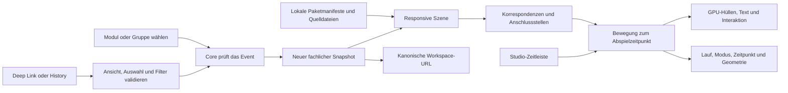
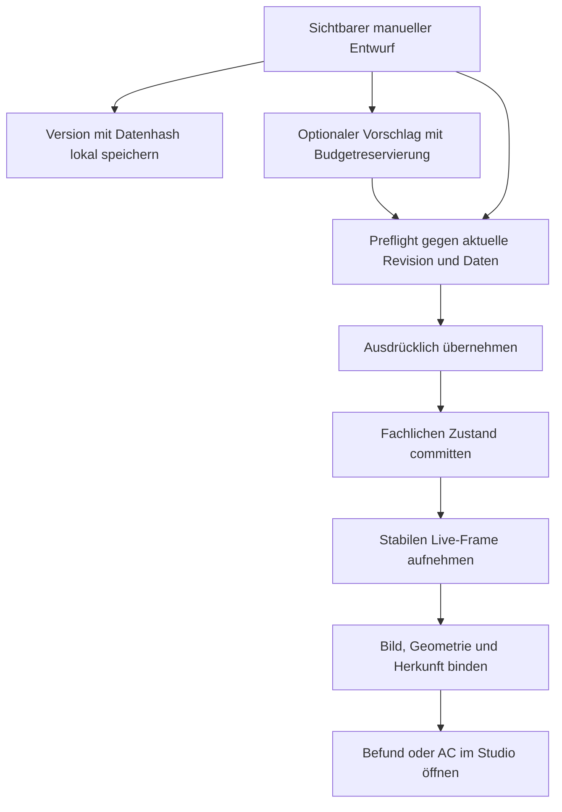

# Formübergänge, Komponentenverhalten und prüfbare Studioabläufe

**Entscheidungsstand 20. November 2026.** Der erste Milestone führt an derselben Datenquelle drei Formen des Wechsels vor. In der Modulwerkstatt lässt sich dieselbe Zeile als Karte verfolgen, eine Gruppe bis zu ihren tatsächlichen Mitgliedern öffnen und eine Auswahl in eine gemeinsame Vergleichsfläche überführen. Studio zeigt zum Vergleich die ursprüngliche Interpolation am selben Datenstand.

## Recherche und Übernahme

Das **Vercel UI SDK** kapselt Verhalten für Auswahl, Tastatur und kontrollierte UI-Komponenten. Fluid verwendet dessen Core-Primitiven im Collection-Adapter und dessen React-Komponenten im DOM-Vergleich. Der GPU-Renderer zeichnet weiterhin die Szene. Der spätere Modellaufruf für einen Authoring-Vorschlag oder eine Bildkritik läuft über das separate **Vercel AI SDK**. Die gepinnte UI-SDK-Version dieses Schritts ist 0.1.0-beta.13. Beta.1 ist die historische Vergleichsbasis. [UI SDK im Quellcode](https://github.com/vercel-labs/ui) · [AI SDK Core](https://ai-sdk.dev/docs/ai-sdk-core/overview)

Heer und Robertson haben in kontrollierten Studien untersucht, unter welchen Bedingungen animierte Übergänge in Datengrafiken das Verfolgen von Werten erleichtern. Gemini2 beschreibt Staging und die Aufteilung komplexer Übergänge in nachvollziehbare Zwischenschritte. Für Fluid leiten wir daraus stabile Objektidentitäten, eine erkennbare Herkunft bei Teilungen und eine ausdrücklich deklarierte Mitgliedschaft beim Zusammenführen ab. Ob diese konkrete Gestaltung Nutzern hilft, wird mit einer eigenen Aufgabe geprüft. [Heer und Robertson](https://www.microsoft.com/en-us/research/publication/animated-transitions-in-statistical-data-graphics/) · [Gemini²](https://arxiv.org/abs/2108.04385)

Normierte Anschlussstellen an sichtbaren Flächen halten Verbindungslinien während der Bewegung am Objekt. Für eine kurze, lokal begrenzte Verbindung zweier Hüllen verwenden wir ein Distanzfeld. Seine Parameter lassen sich aus dem Abspielzeitpunkt bestimmen. Texte und Eingabeflächen behalten eigene Geometrien. [TypeGPU und Three.js](https://docs.swmansion.com/TypeGPU/ecosystem/typegpu-three/) · [Animation from Interactions](https://www.w3.org/WAI/WCAG22/Understanding/animation-from-interactions.html)

## Optionen und Entscheidungen

Die Bewertungen gewichten Zielerfüllung, Korrektheit und Zugänglichkeit, Testbarkeit, Lieferbarkeit und Erweiterbarkeit mit 30/25/20/15/10 Prozent. Die Zahlen sind Entwurfsentscheidungen. [Einzelbewertungen](../decisions/structural-scores.json)

| ID | Entscheidung | A | B | Gewählter Hybrid |
|---|---|---|---|---|
| R1 | Einstieg | Bestehende Kartenfolge (66) | Einzelnes Demoobjekt (73) | Echte Daten zuerst, Werkzeuge bei Bedarf (93) |
| R2 | Formbewegung | Partikel und Layouttweens (60) | Universelle Fluid-Simulation (59) | Deklarierte Beziehungen, kontinuierliche Geometrie und lokale SDF-Kopplung (94) |
| R3 | Komponentenverhalten | Alle Primitiven selbst pflegen (63) | Kompletten Studio- und GPU-Vertrag vom SDK ableiten (60) | Versionierter Verhaltensadapter, Base-UI-Referenz und eigener Core (97) |
| R4 | Authoring | Nur flüchtiger Entwurf (58) | Pflicht-Cloudspeicher (65) | Lokale Versionen, optionaler Modellvorschlag und explizite Übernahme (95) |
| R5 | Nachweis | Screenshot mit Dateiname (49) | Vollständige Videoarchivierung (63) | Gebundener Originalframe mit Geometrie, Herkunft und AC-Verweis (95) |
| R6 | Qualifikation | Ein Desktop-Screenshot (49) | Nur synthetischer Benchmark (67) | Host- und Browserjourneys, Lastqualifikation und menschliche Erkennungsprobe (94) |

## Flows

## Abnahmevertrag

Die IDs werden direkt aus dieser Tabelle in das gemeinsame Register eingelesen. Der Geltungsbereich und die tatsächlich ausgeführten Nachweise stehen in der [AC-Matrix](../acceptance-matrix.md).

| Kriterium | Task | Überprüfbare Abnahme |
|---|---|---|
| R1-AC01 | T16 | Bei 1280 × 720 und 390 × 844 sind ein echtes Modul und ein bedienbarer Übergang beim Einstieg sichtbar. Bei 320 Pixeln bleiben beide Handbücher erreichbar. |
| R1-AC02 | T14 | Ein Besuch des Studios und die Rückkehr stellen die kanonische Workspace-Ansicht samt Auswahl wieder her. Back und Forward erzeugen keine Mutationen. |
| R2-AC01 | T10 | Zeilen und Karten behalten ihre Modulidentität. Der Atlas entfaltet genau die Mitglieder seiner Gruppe. Zwei bis vier ausgewählte Karten bilden genau einen Vergleich und lassen sich wieder trennen. |
| R2-AC02 | T11 | Retargeting übernimmt die aktuelle Geometrie und begrenzte Geschwindigkeiten. Ports und sichtbare Kanten stimmen an Prüfzeitpunkten bis auf einen CSS-Pixel überein. |
| R2-AC03 | T18 | Derselbe Clip ist vorwärts und rückwärts abtastbar. Neue Aufzeichnungen enthalten den Bewegungsplan. Vorhandene v2/v3-Formate behalten ihren historischen Sampler. |
| R2-AC04 | T09 | Ein wiedereintretender Guard überschreibt kein neueres Event. Disposal durch Beobachter verhindert verspätete Aktionen. Responsive Fokusziele werden pro Surface mit deren Viewport geprüft. |
| R3-AC01 | T60 | Der gepinnte UI-SDK-Adapter besteht Collection-Vertragsprüfungen. Im Browser funktionieren kontrollierte Tabs, Dialogrückkehr und ein Bibliothekswechsel mit unverändertem Fachzustand. |
| R4-AC01 | T16 | Speichern, Neuladen und gezieltes Laden stellen eine lokale Entwurfsversion wieder her. Eine konkurrierende Revision wird abgewiesen und der geladene Entwurf durchläuft erneut den Preflight. |
| R4-AC02 | T65 | Authoring verwendet den sichtbaren Entwurf. Vorschläge, Preflight und Übernahme bleiben an Dataset und Revision gebunden. Review und Authoring reservieren ihr lokales Budget atomar und dauerhaft. |
| R5-AC01 | T54 | Capture bindet Bild und Geometrie an denselben Lauf, Modus und Zeitpunkt. Replay sowie zwischenzeitliche Änderungen werden bei Live-Nachweisen abgewiesen. AC-Nachweise sind nach ID auffindbar und ihr Download prüft den Inhaltshash. |
| R6-AC01 | T32 | Ein separater React-Host baut die öffentlichen Pakete ohne Next.js. Modulwechsel und benannte Backenddiagnose werden im Host im Browser geprüft. |
| R6-AC02 | T29 | Referenzläufe qualifizieren Timing nur bei dokumentierter hinreichend ruhiger CPU- und GPU-Last. Verunreinigte und unvollständig beobachtete Läufe bleiben als solche sichtbar. |
| R6-AC03 | T19 | Unabhängige Teilnehmende können nach Match, Split und Merge die Identität oder Mitgliedschaft korrekt nennen. Erfahrungen mit Screenreader, echter mobiler Eingabe und Reduced Motion sind je Profil dokumentiert. |

## Betrieb des lokalen Studios

Die Vorprüfung mit Next.js 16.4.3 stoppte wegen des Sicherheitshinweises beim Produktionsbuild. Das Studio pinnt Next.js und den zugehörigen Env-Loader auf 16.4.6. Die neue Edition prüft die lokalen API-Routen, Sitzungen und Exporte auf diesem Patchstand. Der Build meldet außerdem Dateitracing für den lokalen Projektspeicher. Gemeinsames Cloud-Hosting benötigt eine separate Prüfung des ausgelieferten Dateibestands. [Next.js-Sicherheitsrelease](https://github.com/vercel/next.js/releases/tag/v16.4.5)

## Wiederholbare Prüfung

Die Unit-Suite prüft die Verträge. `npm run test:e2e` startet das Studio auf Port 3011 oder verwendet den laufenden lokalen Entwicklungsserver. `FLUID_STUDIO_URL` richtet die Browserprüfung auf einen bereits gebauten Stand. Die Qualitätsentscheidung trennt visuelle Beispiele, erfolgreiche Eingaben, gemessene Frametimes und Rückmeldungen von Personen. Für die Wiedererkennungsprobe werden alter und neuer Sampler in wechselnder Reihenfolge bei gleichem Seed, Viewport und Zeitpunkt gezeigt. Pro Aufgabe werden genannte Module, benötigte Zeit und Beobachtungen erfasst.

### Einordnung der Hardwaremessung

Der separate React-Host wurde auf einem Apple M5 Max mit 18 logischen CPUs und 64 GiB RAM geprüft. Pro Backend wurden sechs Richtungen aufgewärmt und anschließend in Echtzeit gemessen. Jeder Lauf behielt seinen eigenen Zeitstempel, Build, gewählten Effekt und seine Rohintervalle. Die Studioaufnahmen bei festgelegten Abspielpositionen entstanden in einem separaten Lauf. In allen zwölf gemessenen Ruhefenstern blieb der Framezähler konstant.

Im Hostlauf lagen die P95-Frameintervalle je Richtung bei 17,6–516,4 ms auf WebGPU und 66,6–100,0 ms auf WebGL2. Beide Messfenster überschritten das Ziel und wurden wegen Fremd- und Beobachterlast als belastet eingestuft. Die minimale CPU-Leerlaufquote im Vorlauf betrug 8,98 % bzw. 24,23 %. Die verfügbaren GPU-Zähler erlaubten keine verlässliche Zuordnung zu allen Browserprozessen. Für eine Leistungsfreigabe bleibt ein isolierter Referenzlauf mit derselben Auflösung, demselben Effekt und zuordenbarer Systemlast offen. WebGPU-Messung (internes Archiv) · WebGL2-Messung (internes Archiv)

### Erkennungsprobe mit Personen

Die Versuchsleitung wählt vor jedem Durchgang ein Modul, eine Gruppe oder zwei bis vier Karten aus dem tatsächlichen Projektbestand. Sie protokolliert die erwarteten IDs vor der Aufgabe. Die Person sieht den Übergang in einer einzelnen Fläche bei normaler Geschwindigkeit. Hinweistext, Zeugenliste und Namen der Bewegungsvarianten bleiben für die Erhebung abgedeckt. Alter und neuer Sampler erscheinen in ausbalancierter Reihenfolge bei vergleichbar schwierigen Aufgaben. Jede Person sieht eine Aufgabe nur einmal je Datenbeispiel.

| Aufgabe | Frage unmittelbar nach der Bewegung | Erfasstes Ergebnis |
|---|---|---|
| Zeile → Karte | Wo ist die vorher markierte Zeile jetzt? Welcher Dateiwert ist mitgewandert? | Gewählte ID, Wert, Suchzeit, etwaige Verwechslung |
| Gruppe → Module | Welche sichtbaren Module gehörten zur geöffneten Gruppe? | Richtig genannte, fehlende und zusätzlich genannte Mitglieder |
| Karten → Vergleich | Welche Karten wurden in diesem Vergleich zusammengeführt? | Exakte Mengenübereinstimmung und Zeitpunkt der Antwort |

Berichte nennen Teilnehmerzahl, Gerät, Eingabemodus, Reihenfolge und Zahl vollständig gelöster Aufgaben pro Variante. Für Screenreader- und Mobilprofile werden Aufgaben mit der üblichen Eingabe der Person wiederholt. Aufzeichnungen und personenbezogene Angaben benötigen deren Einverständnis. Bis zu diesen Erhebungen bleibt R6-AC03 offen.

## Lokaler Prüfstand am 20. November 2026

Der Studio-Build `fluid-0f80b42806fab50ea044` bestand 695 Tests in 79 Dateien und alle 10 Browserwege. Die Browserprüfung umfasst schnelle History-Wechsel zwischen Vergleich und ausgewählten Karten, die Rückkehr aus dem Studio, Tastaturbedienung und den bytegenauen Download von Bild- und Abnahmenachweisen. Der schnelle History-Wechsel bestand zusätzlich fünf eigenständige Wiederholungen. Prüfergebnisse und Buildbezüge (internes Archiv)

Von 13 Kriterien sind elf im beschriebenen lokalen Umfang belegt. R6-AC02 bleibt bis zu einem aussagekräftigen Referenzlauf teilweise belegt. R6-AC03 benötigt die Erkennungsprobe mit unabhängigen Personen und die Prüfung mit ihren üblichen Eingabehilfen. [AC-Matrix](../acceptance-matrix.md) · [Originalbilder der Teilung](../qa/2026-11-20-structural/captures/atlas-split-sequence.png)
