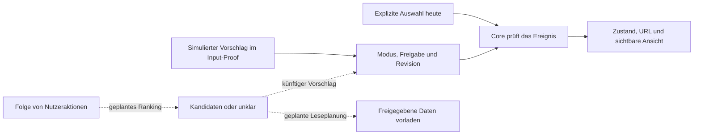

# FluidKit Pro im Abgleich mit der ursprünglichen Produktvision

**Stand 20. November 2026 · Öffentliche Source-Alpha `v0.2.0-alpha.0`**

**Fortschreibung vom 23. November für den Arbeitsstand nach diesem Release.** Der Workspace kann jetzt nach wiederholten Detailbesuchen einen Vergleich zweier Module anbieten. Die Aktivierung, die Herleitung aus den Besuchen und die Annahme sind im [aktuellen Workspace-Flow](../flows/workspace.md#von-modulbesuchen-zum-vergleich) beschrieben. Die folgenden Tabellen und Zahlen dokumentieren weiterhin die veröffentlichte Alpha vom 20. November. Den aktuellen Stand der drei T21-Abnahmen führt das [Register](../acceptance-matrix.md#t21).

FluidKit kann heute eine Oberfläche sinnvoll verwandeln, sobald Nutzer oder Host einen gültigen nächsten Schritt auslösen. Es kann einen vorgeschlagenen Schritt auf Berechtigung, Aktualität und Verträglichkeit mit einer laufenden Eingabe prüfen. **Die Alpha leitet diesen Schritt noch nicht selbst aus dem Verhalten eines Nutzers ab.** Damit ist die visuelle Hälfte der Vision in konkreten Abläufen erlebbar. Der prädiktive Teil ist die größte offene Produktaufgabe. [Ursprünglicher Plan](../implementation-plan-v1.md) · [Öffentliche README](https://github.com/rotorstar/FluidKit/blob/v0.2.0-alpha.0/README.md#from-explicit-actions-to-inferred-intent)

## Was passiert, wenn jemand zwischen zwei Objekten wechselt?

Wer in der Modulwerkstatt wiederholt `core` und `webgpu` öffnet, könnte Abhängigkeiten vergleichen wollen. Genauso gut könnte die Person nur den Namen einer Abhängigkeit nachschlagen. Genau diese Mehrdeutigkeit sollte die Intenterkennung im ursprünglichen Plan abbilden.

| Stufe | Was die Alpha in diesem Beispiel tut | Was die Vision zusätzlich verlangt |
| --- | --- | --- |
| Eingabe beobachten | Explizite Auswahl, Navigation und Zustandswechsel erreichen den Core. Interaktionszustand schützt unter anderem Fokus und Texteingabe. | Für die freigegebenen Absichten relevante Ereignisse in einer Sitzung zu einer auswertbaren Folge verbinden. |
| Absicht erkennen (T21) | „Vorschlag auswählen“ bietet im Paketvergleich eine fest priorisierte Modulauswahl an. Der `DecisionProvider` beschreibt eine Schnittstelle. Es gibt keinen angeschlossenen Verhaltens-Ranker. | Mehrere mögliche Absichten mit Herkunft und begründetem Score liefern, standardmäßig die besten drei, konfigurierbar bis fünf. Bei unklaren Signalen auf den Vorschlag verzichten. |
| Vorschlag prüfen (T09/T22) | Im Input-Proof erzeugt ein Klick den vorgegebenen Vorschlag `detail.open`. Der Core prüft Revision, Ablauf, Berechtigung, Reversibilität und Eingabe. Manual lehnt den Modellplan ab, Hybrid wartet auf Freigabe, Auto lässt ausdrücklich erlaubte reversible Wechsel zu. | Einen tatsächlich abgeleiteten Vorschlag durch denselben Pfad führen. Die vollständige serverseitige Anwendungsorchestrierung samt Deadline und Providerfehlern ist offen. |
| Daten vorbereiten (T15/T23) | Der Query-Client beherrscht Cache, Deduplizierung, Abbruch und Prüfung auf überholte Ergebnisse. Der Action-Adapter beschränkt Schreibvorgänge auf Nutzer oder Host. | Passende erlaubte Lesezugriffe aus den Absichten auswählen, mit dem Hostrouter abstimmen, überholte Jobs abbrechen und ihren Nutzen messen. |
| Oberfläche verwandeln (T10–T14) | Wer zwei Pakete auswählt und den Vergleich öffnet, sieht beide Karten in eine gemeinsame Vergleichsansicht übergehen. Die Auswahl bleibt beim Rückweg erhalten. | Genau diesen vorhandenen Wechsel gezielt anbieten, wenn der Kontext dafür spricht. |
| Aus dem Ergebnis lernen (T24/T26/T28) | Traces und Replays erklären einzelne Abläufe. Sprache und Farbschema sind explizite Präferenzen. | Erheben, welchen Vorschlag jemand tatsächlich gesehen hat, ihn dem Aufgabenergebnis zuordnen und mit einem manuellen Kontrollpfad vergleichen. |

Belege für den Unterschied zwischen festem Vorschlag, Schutzregeln und Erkennung liefern die jeweiligen Einstiegspunkte. [Vorschlagsauswahl](../../packages/cases/src/workspace-compare.ts) · [Provider-Vertrag](../../packages/intelligence/src/index.ts) · [Studio-Simulation](../../apps/studio/components/studio-proof.tsx) · [Core](../../packages/core/src/index.ts) · [Query- und Action-Adapter](../../packages/core/src/data.ts)

Die **echte Studio-KI** beantwortet andere Fragen. Sie kann ausgewählte Frames beurteilen oder einen deklarativen Entwurf vorschlagen. Die Agent-Anbindung kann freigegebene Anfragen und Vorschläge verarbeiten. Weder ein erfolgreicher Modellaufruf noch eine bestandene Berechtigungsprüfung misst, ob FluidKit den Wunsch nach einem Vergleich erkannt hat. [KI-Review](../../packages/server/src/ai-review.ts) · [Authoring](../../packages/server/src/ai-authoring.ts) · [Agent-Anbindung](../milestones/m8-agent-bridge.md)

### Was aus dem alten FluidUI zu übernehmen ist

Im separaten Vorgänger ruft die Chatroute tatsächlich `scoreIntent` auf. Sie übergibt Chattext. Der erste passende Schlüsselbegriff bestimmt eine von vier Kategorien, ohne Treffer greift `trial_signup`. Das war ein ausführbarer früher Versuch der **Textklassifikation**. Für eine Person, die ohne Chat durch Ansichten navigiert, fehlt ihm das entscheidende Signal. Auch die damalige Variantenwahl hält ihren Lernzustand nur im Prozess. Die dokumentierte Lern- und Preload-Pipeline war ein Ziel. Fundstellen im Vorgänger sind `app/api/chat/route.ts`, `lib/intent/predict.ts` und `lib/intent/bandit.ts`. [Ursprünglicher Architekturvergleich](../implementation-plan-v1.md#2-audit-der-vorhandenen-projekte)

**Behalten:** Ein kleines Vokabular fachlicher Absichten pro Case, erklärbare lokale Regeln und die Trennung zwischen Vorhersage und Aktion. **Als Vergleichsbasis verwenden:** das alte Keyword-Verfahren für Text. **Verwerfen:** einen erzwungenen Standardtreffer als erkannte Absicht auszugeben oder simulierte Kennzahlen als Lernerfolg zu werten.

## Abgleich aller ursprünglichen Release-Packages

| Wave und Tasks | Belegbarer Stand | Was heute sinnvoll ist |
| --- | --- | --- |
| RP0 · T01–T03 · Grundlage | Modularer TypeScript-Workspace, Register und bedienbarer GPU-Proof. Ein eingegebener Projektname bleibt über Button, Fortschritt, Ergebnis und Detail erhalten. | Als Referenzfall behalten. Geräte-, Texteingabe- und Screenreader-Abnahmen für die unterstützten Profile abschließen. [M1](../milestones/m1.md) |
| RP1 · T04–T08 · Darstellung und Eingabe | WebGPU ist Standard. Three.js kann sichtbar auf WebGL2 ausweichen. GPU-Text, Layout, Semantikbrücke, Gerätelebenszyklus und Freigabe von Ressourcen haben lokale Nachweise. | Backendanzeige, Eingabe und bedarfsgesteuertes Zeichnen beibehalten. Die browser- und geräteübergreifende Qualifikation bleibt nötig. [Rendererentscheidung](../decisions/0003-renderer-policy.md) · [Eingabe und Layout](../../knowledge/engineering/layout-text-input.md) |
| RP2 · T09–T15 · Zustand, Komponenten, Daten und URLs | Im Workspace sind Zeile → Karte, Gruppe → Mitglieder und Auswahl → Vergleich ausführbar. Sechs optionale Effekte, reduzierte Bewegung, versionierte Events sowie Back/Forward ergänzen den Ablauf. | Stabile Identitäten und getrennte Lese-/Schreibadapter tragen auch die prädiktive Vision. Weitere Widgets und typisierte Inhaltsabbildungen anhand konkreter Hosts ergänzen. [Formübergänge](../milestones/structural-transitions.md) |
| RP3 · T16–T20 · Studio und Tests | Studio bietet Inspector, Flow Explorer, lokales versioniertes Authoring, GPU-Vorschau, Simulation, Replay und Qualitätsprüfung. Die CLI führt `validate` und `test` aus. Der allgemeine visuelle Builder und der komplette Integrationsweg über `init`/`add`/`export` bleiben offen. | Studio auch zum Prüfen künftiger Fehlvorschläge verwenden. Die vorhandenen Modelle und Szenarien können dieselbe Eingabefolge wiederholen. [Authoring](../milestones/m8-authoring.md) · [CLI](../../packages/cli/src/index.ts) |
| RP4 · T21–T25 · Intelligence und Praxisfälle | Der Workspace nutzt echte Paketdaten. Immobilien, Handel und Reise sind gekennzeichnete Simulationen. Die Live-KI unterstützt Autoren. Intent-Ranking, prädiktive Leseplanung, adaptive Varianten und reale Anbieterübergaben sind offen. | Einen vertikalen Intent-Pilot am echten Workspace priorisieren. Der ursprüngliche Siebener-Katalog ist breiter als die vier beschriebenen Workflows. Für SaaS-Dashboard, CMS und Analyse/Design fehlen die vollständigen vorgesehenen Case-Journeys. [Case-Umfang](../implementation-plan-v1.md#verbindliches-case-set) · [Adapter und Datenherkunft](provider-apis.md) |
| RP5 · T26–T30 · Betrieb und Wirkung | Diagnose-Traces und lokale Budgetierung für Studio-KI existieren. Es gibt Lastmessungen und ein MIT-Quellrelease. In den dokumentierten R6-Messfenstern wurde das Frameziel bei Fremdlast überschritten. Ein qualifizierter Referenzwert und ein Nutzennachweis mit unabhängigen Personen stehen aus. | Fehler, Laufzeit, Kosten und Aufgabenerfolg getrennt prüfen. Die Source-Alpha ist veröffentlicht, die Produktionsfreigabe und kontrollierte Lernpipeline bleiben offen. [Messungen und Erkennungsprobe](../milestones/structural-transitions.md#einordnung-der-hardwaremessung) |
| RP6 · T31–T34 · Erweiterungen | Ein separater React-/Vite-Host nutzt die gemeinsamen Pakete. Plugin-Lebenszyklus, gemeinsames Authoring, Voice/Gesten und Enterprise-Betrieb haben offene Produktabnahmen. | Den unabhängigen Host weiter als Integrationstest verwenden. Weitere Plattform- oder Enterprise-Arbeit an einen benannten Anwender und dessen Anforderungen binden. [Feature-Matrix](../feature-status.md) |
| RP7 · T35–T36 · XR und Neural Rendering | Beide sind Forschungsziele ohne nachgewiesenes Produktfeature. | Parken, bis ein konkreter räumlicher Workflow bzw. ein reproduzierbarer Vorteil eines neuronalen Effekts vorliegt. Für den ersten Intent-Nachweis braucht es beides nicht. [Forschungsumfang](../implementation-plan-v1.md#wave-7--rp7-xr-und-forschung) |
| RP8 · T37–T38 · Distribution und Dokumentation | Öffentliches MIT-Repository, Source-Prerelease und zwei offline nutzbare OKF-Handbücher in DE/EN/FR. Ein installierbarer Marketplace mit Integritäts- und Kompatibilitätsprüfung steht aus. | Handbücher und ausführbare Rezepte weiterpflegen. Eine Registry wird sinnvoll, wenn mehrere reale Projekte Erweiterungen austauschen wollen. [Release](https://github.com/rotorstar/FluidKit/releases/tag/v0.2.0-alpha.0) · [Handbücher](../../README.md#guides-checks-and-license) |

### Geändert, erweitert oder aufgeschoben?

- **Ausdrücklich ersetzt** wurde das absolute WebGPU-only-Gebot. WebGPU-first mit erkennbarem WebGL2-Fallback ist die spätere Produktentscheidung. Die strikte Vorgabe bleibt ein historischer Prüfbezug. [Aktueller Plan](../implementation-plan.md#5-zielarchitektur-und-öffentliche-verträge)
- **Erweitert** wurde die zulässige Datenbasis um gekennzeichnete synthetische Simulationen. Für einen Produktiv-Case gelten weiter echte Herkunft, aktuelle Werte und eine bestätigte fachliche Übergabe. Base-UI-/UI-SDK-Verhalten, TypeGPU, strukturierte Formwechsel, mehrsprachige Oberflächen und Rehearsal vertiefen das ursprüngliche Angebot. [Feature-Matrix und spätere Meilensteine](../feature-status.md)
- **Historisch** sind die konkreten Oktober-Pins als Beschreibung des heutigen Builds. Beispielsweise nennt v1 Next.js 16.4.3 und TypeScript 7.0.2 als Ziel. Der Workspace deklariert Next.js 16.4.6, TypeScript 6.0.3 und Node ≥24. Die damaligen Versionen erklären die Entscheidung, das Lockfile beschreibt die installierbare Alpha. [Studio-Manifest](../../apps/studio/package.json) · [Workspace-Manifest](../../package.json) · [Lockfile](../../package-lock.json)
- **Sinnvoll, aber nachgeordnet** sind adaptive Personalisierung, kontrollierte Experimente und optional begrenztes Online-Lernen. Zuerst brauchen sie korrekt zugeordnete, ausreichend häufige Ergebnisse. Das alte Versprechen eines festen Conversion-Lifts war bereits in v1 zur Hypothese korrigiert. Dieselbe Unterscheidung gilt für garantierte Bildraten und freie Transformationen beliebiger Komponenten. [Präzisierungen in v1](../implementation-plan-v1.md#33-was-an-der-vision-präzisiert-werden-muss)

## Wo die README die Vision beschreibt

Die veröffentlichte README eröffnet mit dem **Finanzierungsrechner als Entwurfsidee**. Danach zeigt sie mit dem Input-Proof und dem Paketvergleich zwei ausführbare Gegenstücke. Im Abschnitt **From explicit actions to inferred intent** erläutert sie den denkbaren Laptopvergleich nach wiederholten Produktbesuchen, die drei Kontrollmodi sowie den Unterschied zwischen verfügbarer Studio-KI und geplantem Ranking/Vorladen. Die öffentliche Darstellung ist an dieser Stelle zutreffend. Technische Abnahmedetails wie Top-k, Enthaltung bei Unsicherheit und Evaluation mit getrennten Sitzungen stehen im verlinkten Plan. [README am Release-Tag](https://github.com/rotorstar/FluidKit/blob/v0.2.0-alpha.0/README.md#from-explicit-actions-to-inferred-intent) · [Ursprüngliche T21–T25](../implementation-plan-v1.md#wave-4--rp4-intent-ki-und-reale-cases)

## Empfehlung für den nächsten sichtbaren Meilenstein

**Im echten Modul-Workspace einen Vergleich anbieten, bevor der Nutzer auf „Vergleichen“ klickt.** Dafür braucht der erste Pilot weder Modellzugang noch einen externen Datenanbieter. Die Bewertungen folgen den fünf Gewichten aus v1 (Zielerfüllung 30 %, Korrektheit und Zugänglichkeit 25 %, Testbarkeit 20 %, Lieferbarkeit 15 %, Erweiterbarkeit 10 %). Einzelnoten von 1–5 und daraus abgeleitete Punkte sind Planungsurteile.

| Option | Einzelnoten in der Reihenfolge oben | Punkte | Begründung |
| --- | --- | ---: | --- |
| A · Feste Wenn-dann-Regel im Showcase | 3 / 5 / 5 / 5 / 2 | 82 | Schnell sichtbar und eine gute Vergleichsbasis. Ein einzelner Trigger liefert wenig Aufschluss über konkurrierende Absichten. |
| B · Modell für jede Interaktion | 4 / 2 / 2 / 2 / 4 | 56 | Kann Kontext verarbeiten, erhöht aber für diesen kleinen Anwendungsfall Laufzeit, Datenbedarf und Evaluationsaufwand. |
| **Hybrid · Lokale Regeln bewerten mehrere Kandidaten, der Core prüft, der Nutzer entscheidet** | **5 / 5 / 5 / 3 / 4** | **92** | Verwendet echte Ereignisse und vorhandene Schutzregeln. Dieselben Sitzungen lassen sich wiederholen und gegen A prüfen. Ein Modell wäre später ein separat bewertbarer Zusatz. |

**Vorgeschlagene Abnahme für diesen Pilot:**

1. Für „vergleichen“, „Detail untersuchen“ und „weiter erkunden“ protokolliert Studio die Kandidaten, beitragenden Ereignisse und die Entscheidung, gegebenenfalls keinen Vorschlag zu zeigen. Der Scope umfasst aufgezeichnete oder freigegebene Sitzungsereignisse mit Modul-IDs. Rohtexte aus Eingabefeldern sind dafür entbehrlich.
2. Nach wiederholtem Wechsel zwischen zwei Modulen kann Hybrid einen Vergleich genau dieser IDs anbieten. Annehmen öffnet den vorhandenen Vergleich. Ablehnen lässt Auswahl, URL und Ansicht bestehen. In Manual bleibt die Oberfläche unter ausdrücklicher Steuerung. Aktive Texteingabe, ein überholter Vorschlag und bloßes Replay lösen keine Anpassung aus.
3. Ein unabhängiger Testsatz enthält auch Nachschlagen, zufällige Wechsel und Zurücknavigation. Trennung nach ganzen Sitzungen verhindert, dass Ereignisse derselben Personensitzung zugleich zur Abstimmung und Bewertung dienen. Berichtet werden korrekte Top-1-/Top-k-Treffer, Fehlvorschläge und der Anteil der Sitzungen ohne Vorschlag. Schwellen und Mindestqualität vor der Auswertung festlegen.
4. Erst nach überprüfter Erkennung einen erlaubten Lesezugriff anschließen. Der Host kann abbrechen. Im Quelltrace sieht man Treffer, ungenutzte Bytes und Zeitgewinn. Kein Kauf, Submit oder Versand darf durch Vorladen oder Replay ausgelöst werden. Einen Nutzen für Menschen beurteilt ein Vergleich mit dem manuellen Ablauf anhand von Aufgabenabschluss und unnötigen Rückwegen.

## Prüfgrundlage und Reichweite der Zahlen

- Der eingereichte Text und die lokale archivierte v1 sind bytegleich (SHA-256 `6ebf278147cdd549134ec5872bfe354f68c2cbe7f1307b6a91672e8a9ec26cac`). Die am öffentlichen Release-Tag abgerufene README stimmt byteweise mit der lokalen README überein.
- Für die **38 ursprünglichen Task-IDs** führt das heutige interne Register 124 Kriterien. Davon sind 30 im dokumentierten Scope verifiziert, 53 teilweise erfüllt, 40 offen und eines extern. Diese Zählung gewichtet weder Aufwand noch Produktwert und schließt spätere Meilenstein-IDs aus. Im veröffentlichten Register lauten die Werte für dieselben 124 Kriterien **0 / 83 / 40 / 1**. Beim Export wurden private Belege entfernt und betroffene Einstufungen auf „teilweise“ zurückgenommen. [Internes Abnahmeregister](../acceptance-matrix.md) · [Öffentliches Abnahmeregister](https://github.com/rotorstar/FluidKit/blob/v0.2.0-alpha.0/docs/acceptance-matrix.md)
- **T21, T23, T24 und T28 haben in beiden Registern zusammen 14 offene Kriterien** (3 + 4 + 3 + 4). Bei T22 ist intern eines von drei verifiziert, das Kriterium für serverseitige Schlüssel. Das lässt sich nicht als Nachweis gelungener Absichtserkennung anrechnen. [T21 im Register](../acceptance-matrix.md#t21) · [T28 im Register](../acceptance-matrix.md#t28)
- Beim Abgleich liefen 90 Tests in sieben bestehenden Dateien erfolgreich. Geprüft wurden Core-Runtime, Agent-Anbindung, Datenadapter, Workspace, Simulation, KI-Authoring und KI-Review. Die Tests sichern implementiertes Verhalten ab. Modellgüte, neue Live-Provider-Ergebnisse, zusätzliche Gerätetests oder die Wirkung einer prädiktiven UI wurden in diesem Abgleich nicht gemessen.
