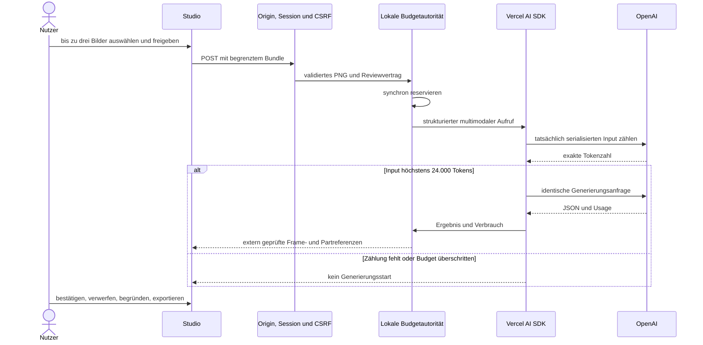

# Separater Reviewpfad

Die Anwendungsruntime startet Manual. Die optionale Designanalyse verwendet
serverseitig `ai@7.0.159`, `@ai-sdk/openai@4.0.106`, `generateText` und `Output.object`.
Das qualifizierte Defaultprofil ist `gpt-6.1-terra`; Gateway ist eine ausdrücklich
konfigurierbare Alternative, kein stiller Fallback.[^implementation]

Der Root-Key `OPENAI_API_KEY` liegt in der ignorierten `.env.local` und wird nur
beim Studio-Serverstart geladen. Der offizielle Next-Environmentloader muss die
separate Workspacewurzel nach dem bereits geladenen App-Verzeichnis neu einlesen.
Der Key gehört weder in `NEXT_PUBLIC_*` noch in Projekt-/Run-/Reviewexports.

## Grenzen des qualifizierten Profils

| Kontrolle | Aktueller Wert |
|---|---|
| tatsächlicher Inputdeckel | 24.000 Tokens einschließlich Bilder und Ausgabeschema |
| Outputdeckel | 2.000 Tokens insgesamt |
| Gesamtabbruch | 20 s, null automatische Retries |
| Parallelität | eine Analyse pro Session |
| Session | 0,35 USD, höchstens fünf Aufrufe |
| Serverprozess | 5 USD |
| Reservierung im direkten Profil | bis 0,07 USD pro Aufruf |

Der Transport akzeptiert nur den qualifizierten Modellpfad, Standard-Tier,
`store:false`, festgelegte Reasoning-/Cacheoptionen und keinen Tool-/Conversation-
Pfad. Die Preisversion ist `openai-standard-2026-11-02`. Konservative Raten decken
höhere Inputcache-Schreibpreise ab. Angezeigte Kosten sind obere Usage-Schätzungen,
keine Anbieterrechnung. Fehlende Usage hält die volle Reservierung.

Modelltext ist untrusted input. Schema, existierende Frames/Parts und normierte
Bildregionen werden unabhängig geprüft. Storyziele sind keine Pflichten jedes
Anfangsbilds. Quellen-/Budgetfehler geben nur eigene sichere Diagnosen aus;
beliebige SDK-Fehlertexte werden nicht zum Client durchgereicht.

Drei erfolgreiche Baseline-Live-Generierungen, darunter ein adversarieller Brief,
sind datiert belegt. Sie ersetzen keinen breiten, unabhängigen oder visuellen
Injection-Korpus. Persistente/verteilte Budgets, Projektrollen, Pixelmaskierung und
prüfbare automatische Änderungsdiffs bleiben offen. Bestätigte Hinweise lösen
aktuell keine Projektänderung aus.

[^implementation]: Implementierung und SHA-256-Dateibindung im Quellinventar.
