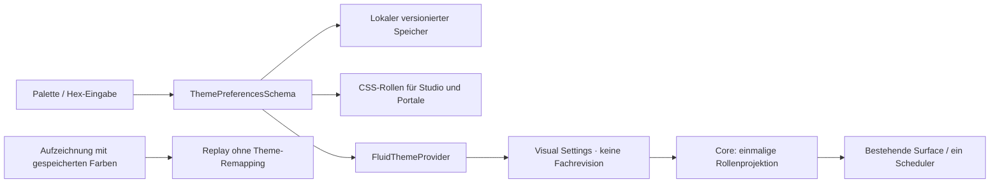

# Ein Präferenzvertrag für Studio und GPU

`ThemePreferencesSchema` definiert `schemaVersion: 1`, eine der acht `preset`-IDs
und einen optionalen `customAccent` als sechsstelligen Hex-Wert. Die Types werden
aus dem Schema abgeleitet. `EffectSettingsSchema.theme` besitzt eine validierte
blaue Vorgabe; bestehende Einstellungen ohne dieses Feld bleiben einlesbar.
`ThemeDefinitionSchema` behält seinen bisherigen serialisierbaren Vertrag, damit
historische Theme-Aufzeichnungen weiter lesbar sind.[^implementation]

## Rollen und Kontrast

`resolveAppearance(preferences)` erzeugt eine Theme-Definition, CSS-Variablen und
die GPU-Palette. `GPU_PALETTE` veröffentlicht die kanonischen blauen Rollen:
`background`, `surface`, `surfaceRaised`, `selected`, `hover`, `border`, `accent`,
`foreground`, `muted`, `focus`, `kernel`, `adapter`, `tooling`.

Neue deklarative Szenen verwenden diese Rollen. Im Core löst die Projektion die
aktive Palette **einmal pro Szene** auf und übergibt sie an `projectThemePaint`.
Nur exakt bekannte kanonische Farben werden ersetzt; individuelle nicht
verwaltete Farben bleiben unverändert. Layout, IDs, Daten, Semantik und
Hit-Testing-Geometrie werden dadurch nicht geändert.

Die Ableitung prüft sRGB-Relativluminanz. GPU-Textrollen erreichen mindestens
4,5:1 auf den fünf definierten dunklen Flächen, die Fokusrolle mindestens 3:1.
Für helle Studio-Flächen existieren getrennte `accent-text`- und
`on-accent`-Rollen. Die originale Akzentfarbe selbst wird nicht stillschweigend
verändert. Tests umfassen alle acht Paletten sowie adversariale Weiß-, Schwarz-,
Gelb- und Grünwerte. Diese Rollenprüfung ist keine vollständige WCAG-Freigabe
aller bestehenden Komponenten.

## Host, React und Persistenz

`AppearanceProvider` verwaltet die lokale Präferenz. Er generiert mit
`appearanceCSS` ein von React verwaltetes `:root`-Stylesheet; DOM-Portale erhalten
somit dieselben Variablen. `FluidThemeProvider` übermittelt die kontrollierte
Präferenz an untergeordnete `FluidProvider`. Diese rufen nur bei einer tatsächlichen
Änderung `runtime.configureEffects({...settings, theme})` auf. Runtimes außerhalb
dieses Providers behalten ihre eigenen Einstellungen.

Der lokale Schlüssel lautet `fluid.appearance.v1`. Das Format wird beim Lesen
und Schreiben validiert. Ungültige Daten, Storage-Sperren und Quota-Fehler
führen zu sichtbaren Hinweisen. Es gibt einen aufgeräumten `storage`-Listener
für andere Tabs, keinen Polling- oder zusätzlichen Frame-Loop. Die DOM-Steuerung
verwendet die vorhandenen `StudioSelect`, `StudioInput` und Base-UI-Button-Grenzen.

## State, URL und Replay

Ein Themewechsel verändert nur die Visual-Revision. Fachlicher Snapshot,
Auswahl, Fokus und Router bleiben unverändert. Die React-Surface stellt eine
geänderte Live-Palette sofort am gültigen Ziel dar, ohne den vorherigen
Replay-Clip zu ersetzen (`setScene(..., record=false)`). Importierte Replay-Szenen
bleiben unangetastet. Deren bereits gespeicherte Farben bilden die Provenienz;
es findet kein nachträgliches Remapping im Renderer statt.

Die Standardkomposition des Authorings verwendet unter dem historischen
Dokumentschlüssel `forest` jetzt verwaltete Rollen. Explizite Indigo-/Amber-
Dokumentvarianten behalten ihre eigenen Farben. Alte gespeicherte Szenen und
QA-Screenshots werden nicht verändert.

## Forschung und Nachweisgrenze

Die Rollenaufteilung orientiert sich an [Radix Colors: Understanding the
scale](https://www.radix-ui.com/colors/docs/palette-composition/understanding-the-scale)
und der [Tailwind-Farbdokumentation](https://tailwindcss.com/docs/colors), geprüft
am 14. November 2026. Das führt zu keinem Dependency-Upgrade. Farben und
Kontrastregeln werden lokal abgeleitet; es wird keine externe Palette als
pauschal zugänglich ausgegeben. Browser-, GPU- und visuelle Nachweise müssen
zusätzlich zum Unit- und React/Core-Test erfolgen.

[^implementation]: [Geprüfter Implementierungsstand](assets/source-inventory.json)
