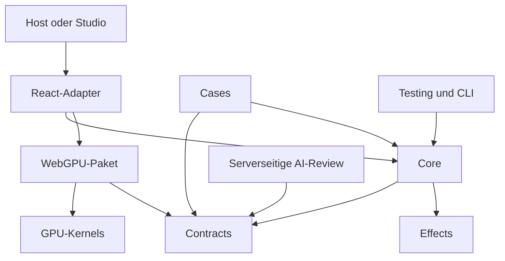
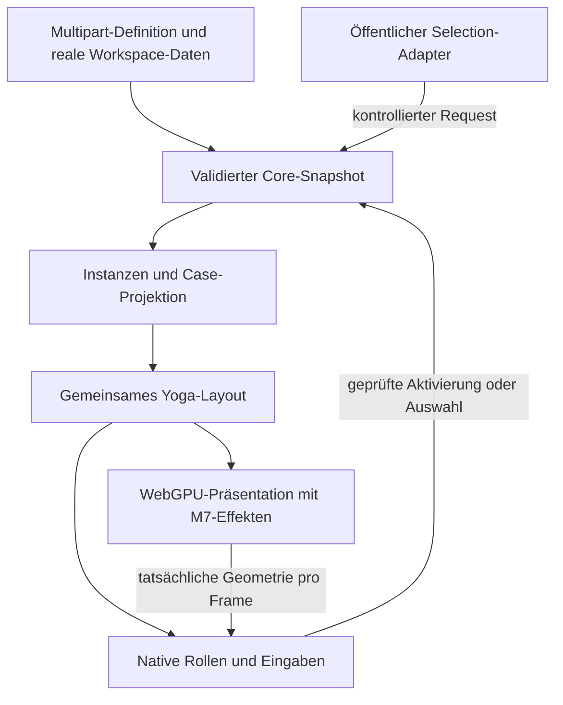

# Architektur

Der npm-Workspace hat elf Framework-Pakete und eine Next.js-Studio-Anwendung.
`contracts` besitzt die serialisierbaren Zod-Modelle; `core` besitzt Fachstate und
Transitionen. Framework- und GPU-Objekte gehören nicht in einen RuntimeSnapshot.[^implementation]

| Paket | Verantwortung | Wesentliche Grenze |
|---|---|---|
| contracts | Schema, Type Inference, Validierung, Semantik, Qualität | keine Rendererobjekte |
| core | XState, atomarer Commit, Collections, gemeinsames Layout, Daten-/Action-Clients | keine React-/Next-Abhängigkeit |
| effects | versionierte Rezepte und Policy-Auflösung | keine Modellaufrufe |
| gpu-kernels | TypeGPU-Shader und Compute-Readback-Proof | Compute-Nachweis getrennt von UI-Rendering |
| webgpu | Three-Backend, Glyph, Präsentation, Ressourcen | kein fachlicher Statebesitz |
| react | Provider, Abonnements, Surface und native Brücke | keine zweite fachliche Wahrheit |
| cases | Workspace- und synthetische Praxisprojektionen | Quellenmodus ausdrücklich deklarieren |
| testing | Szenarien, Storyrunner, DOM-/GPU-/Semantikreports | Prüfscope nicht mit Release gleichsetzen |
| intelligence | lokaler Ranker für mögliche Vergleichspaare und DecisionProvider-Vertrag | nur laufende Sitzung, ein fachliches Ziel, Vorschlag benötigt Bestätigung |
| server | AI-Review, lokale Autorisierung, Budget, Validierung | API-Key ausschließlich serverseitig |
| cli | Projektvalidierung und Szenarien | keine fertigen init/add/studio-Kommandos |

Next.js ist der Host des Studios und der beiden Route Handler. Der Core kann
unabhängig von Next.js verwendet werden. Aktuelle Paket-Exports zeigen auf
Workspace-Quelldateien; die Pakete sind `private`. Ein erfolgreicher lokaler Build
beweist weder npm-Publishing noch eine installierbare unabhängige Distribution.
Die [Exportreferenz](api-reference.md) führt die tatsächlichen Einstiegspunkte auf.

## M8: Verhalten und gemeinsame Geometrie

Der am 13. November angenommene Aufbau definiert Komponenten aus mehreren
benannten Parts mit Rollen, Fokus-, Tasten- und Press-Pflichten. Der Workspace
setzt diesen Vertrag in Tabelle, Karten und Map bereits ein. Ein Part behält
seine Komponentenidentität, auch wenn seine Geometrie zwischen Ansichten wechselt.
[Komponentenverträge](contracts.md) beschreiben Definition und Instanz.

Der Core führt die kontrollierte Auswahl als validiertes Schlüsselfeld. Ein
begrenzter Adapter nutzt das öffentliche `createSelection` aus
`@ui-sdk/core` 0.1.0-beta.13. Der isolierte Vergleich mit Beta.1 ist im Verhaltensnachweis archiviert. Weder dessen Store noch React erhalten einen zweiten
autoritativen Auswahlzustand. UI SDK liefert hier Auswahloperationen, keinen
GPU-Renderer. Seine DOM-Primitives werden getrennt im [Studiovergleich](studio.md)
qualifiziert. Interne SDK-Rendererpfade und DOM-Parts werden nicht zu einer
behaupteten WebGPU-Schnittstelle umgedeutet.

`resolveSceneLayout` berechnet mit Yoga die tatsächlich verwendeten Boxen vor der
Aufteilung in GPU-Szene und native Semantik. Der aktuelle gemeinsame Resolver
behandelt die absoluten Case-Boxen und Viewportgrenzen; er ist keine vollständige
CSS-, Grid- oder Virtualisierungsengine. Die native Brücke folgt anschließend
auch den präsentierten Animationsgeometrien aus dem einzigen Surface-Scheduler.

Dieser implementierte M8-Unterbau ist im begrenzten lokalen Umfang qualifiziert.
Das ist keine Freigabe aller ursprünglichen Produktvisionen oder Leistungsziele.
T63 ergänzt inzwischen eine eigene, standardmäßig geschlossene Fluid-Agent-Bridge.
T64 ergänzt registrierte Komposition, Entwicklungsdiff und eine neue serverseitige
Authoring-Route. Implementierung und lokale Tests werden von Browser- und
Live-Modellnachweisen getrennt. Der frühere Designreview-Lauf ist kein Nachweis
für dieses neue Authoring.

Die Grenzen bleiben ausdrücklich verschieden: Die [Agent-Bridge](core-runtime.md)
übersetzt erlaubte Aktionen in bestehende Core-Transaktionen; der
[Authoring-Host](studio.md) übernimmt ein geprüftes Kompositionsdokument durch
einen kontrollierten Dokument-/Runtime-Wechsel. Keiner führt frei generiertes
JavaScript oder Shader aus. Vercel AI SDK bleibt der serverseitige Modelltransport.
Die übrigen produktiven Intent-/Personalisierungsaufgaben von T22 werden dadurch
nicht pauschal abgeschlossen.

[^implementation]: Implementierung und SHA-256-Dateibindung im Quellinventar.
