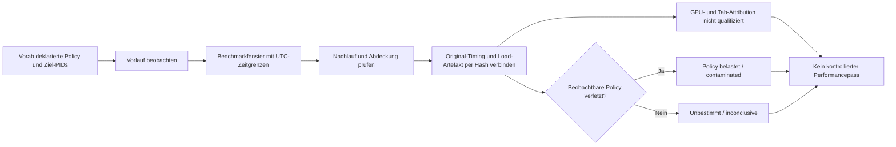

# M8: konkurrierende Systemlast vor und während Benchmarks prüfen

Recherche und Plan: **13. November 2026**. Ergänzung aufgrund der ausdrücklichen
Anforderung, mögliche CPU-/GPU-Konkurrenz durch andere Aufgaben zu beobachten.
Bestehende Messungen bleiben unverändert archiviert. Ohne diese Beobachtung sind
sie beschreibende Messwerte, keine kontrollierten Performance-Nachweise.

## Quellen und lokale Eignung

- Das installierte Apple-Handbuch `ps(1)` bezeichnet `%cpu` als abklingenden
  Durchschnitt über bis zu einer Minute. Der Collector verwendet diesen Wert
  nicht als Momentanlast. `time` ist kumulative User-/System-CPU-Zeit; `ucomm`
  bezeichnet den kurzen Accountingnamen. Argumente und Umgebung werden weder
  angefordert noch gespeichert.
- `top(1)` dokumentiert Intervall-/Delta-CPU-Werte und erklärt die erste
  Prozess-CPU-Probe ausdrücklich für ungültig. Framework-/Memory-Map-Auswertung
  wird deaktiviert, um den Beobachteraufwand zu begrenzen.
- Das installierte `vm_stat(1)` empfiehlt unter diesem macOS `meminfo(1)` für
  physischen Speicher. `meminfo` bietet begrenztes Sampling und CSV-Zeitstempel.
  `vm_stat` bleibt für kumulative Swap-I/O-Zähler relevant: Swap-I/O umfasst auch
  Swapfile-Wartung, also nicht ausschließlich Anwendungsdruck.
- `powermetrics(1)` dokumentiert globale Sampler und `--show-process-gpu`, letzteres
  nur auf unterstützter Hardware. Energieschätzungen sind keine exakte Auslastung
  und kein Gerätevergleich. Tatsächliche Verfügbarkeit/Berechtigung muss auf dem
  lokalen Gerät nachgewiesen werden; kein automatisches `sudo`.
- Apples [CPU-Erklärung](https://support.apple.com/en-au/guide/activity-monitor/actmntr43452/mac)
  trennt User, System und Idle. Der gesamte Idle-Anteil allein identifiziert
  keinen störenden Prozess.
- Apples [Speicher-Erklärung](https://support.apple.com/en-au/guide/activity-monitor/-actmntr1004/mac)
  berücksichtigt mehrere Einflussgrößen für Memory Pressure. Freier Speicher
  allein darf nicht als Druckstufe ausgegeben werden.

Lokale Manpages wurden auf dem aktuellen System gelesen. Private IORegistry-
Eigenschaften werden höchstens als gekennzeichnete Gerätediagnostik übernommen;
vor einem qualifizierten Messadapter werden tatsächlich vorhandene Felder,
Einheiten und Aktualisierung geprüft. Ein erfolgreiches `ioreg` beweist keine
unterstützte per-Prozess-GPU-Zuordnung.

## Begrenzter Ablauf



- Ein begrenzter lokaler CLI-Collector, keine Browserautomatisierung und keine
  automatische Beendigung fremder Prozesse.
- UTC und monotone Zeit je Probe; maximal festgelegte Laufzeit, Stichprobenzahl,
  Ausgabemenge und externe Befehlsdeadline. Kein unbegrenztes Streaming.
- Vorlauf, ganzes Benchmarkfenster und Nachlauf müssen tatsächlich abgedeckt sein.
  Ein späterer Momentzustand kann frühere RAF-Messungen nicht rückwirkend reinigen.
- CPU: Gesamtlast/Idle sowie Prozessanteile. Bei kumulativen CPU-Zeiten werden
  Intervall, Kernnormalisierung und PID-/Startzeitwechsel berücksichtigt.
- Speicher: verfügbare bestätigte Druckstufe sowie Speicher-/Swapwerte und Deltas.
  Fehlende Druckmetrik wird `unknown`, nicht künstlich aus freiem RAM abgeleitet.
- GPU: globale Aktivität und per-Prozess-Attribution nur über einen tatsächlich
  unterstützten lokalen Adapter. Fehlende Attribution bedeutet `inconclusive`.
- Ziel-/Collector-PIDs werden ausdrücklich konfiguriert. PPID-Abstammung ist
  beobachtete Prozesszuordnung, keine Herkunftsgarantie. `node`/Build-/Testnamen
  allein bleiben mutmaßliches Tooling. Ein gemeinsamer Browser-GPU-Prozess kann
  mehrere Tabs bedienen und beweist keine isolierte Benchmark-Tablast.
- Export enthält nur PIDs, kurze Accountingnamen und Messwerte. Keine Command-
  Arguments, Umgebungsvariablen, Secrets, Fenstertitel oder Browserinhalte.

## Vorab festgelegte Schwellen

Der Klassifikator erhält eine versionierte, vor Messbeginn gehashte Policy.
Grenzen sind konservative Projektentscheidungen, keine von Apple zugesicherte
Profilerpräzision. Die konkrete Erstpolicy wird zusammen mit den tatsächlich
verfügbaren Quellen festgelegt, bevor ein neuer qualifizierter Benchmark startet.
Sie benennt mindestens:

- Mindestdauer des Vor-/Nachlaufs und maximal erlaubte Messlücke;
- Mindest-Idle im Vorlauf, maximal nicht zugeordnete CPU-Kernäquivalente beziehungsweise
  Maschinenanteile im Messfenster, gesonderte Collectorlast;
- maximale GPU-Fremdlast und erforderliche Attribution;
- erlaubte Druckstufe und Swap-I/O-/Swapbelegungs-Deltas.

Belegte Grenzüberschreitung ist eine Belastungsfeststellung, noch kein kausaler
Beweis für einen bestimmten Frameausreißer. Fehlende Daten können nicht mit
niedriger CPU-Last überstimmt werden. `valid` bedeutet ausschließlich innerhalb
der deklarierten und beobachtbaren Lastpolitik, niemals automatisch bestandenes
Framebudget.

## Aufgaben und Abnahme

| Aufgabe | Überprüfbare Abnahme |
|---|---|
| L01 Lokale Quellen qualifizieren | Tatsächliche Interfaces, Einheiten und Rechte dokumentiert; nicht verfügbare Werte bleiben leer/unknown. |
| L02 Versionierter Bericht/Policy | Types aus Zod; UTC-/Monotonie-/Abdeckungsbezüge validiert; keine Args/Env-Felder erlaubt. |
| L03 Begrenzter Collector | Nur lesende Befehle; Laufzeit/Bytes/Timeout/Abort begrenzt; alle gestarteten eigenen Kinder werden beendet. |
| L04 Reiner Klassifikator | Tests für fremde Last, PID-Wiederverwendung, unvollständige GPU-Zuordnung, Messlücken, Swapdelta und Observerlast; kein falsches valid. |
| L05 Neuer kontrollierter Lauf | Vorlauf und gesamte Laufzeit archiviert; Timing-/Loadhash verbunden; ältere Messungen unverändert; Performancebudget getrennt bewertet. |

Die Umsetzung des konkreten GPU-/Druckadapters beginnt nach dem lokalen
Interfacebefund. Bis dahin wird keine vorhandene T65-Performancebeobachtung als
kontrolliert gültig promoted.

## Implementierter lokaler Adapter und Erstpolicy

Der neue Collector verwendet einen einzigen fortlaufenden `top`-Prozess mit
`-l <begrenzt> -s 1 -n 0 -F -R -c d`. Ein eigener Wall-Clock-Timer beendet ihn
nach der konfigurierten Beobachtungsdauer. `-l` begrenzt die Probenzahl, nicht die
Laufzeit; Probenarbeit kommt zur Wartezeit `-s` hinzu. Ein separater Watchdog
beendet ausschließlich eigene Kinder, falls der geplante Abschluss ausbleibt.
Bereits laufende Proben besitzen ihre eigenen kurzen Deadlines. Die erste
CPU-Probe wird verworfen.
Je Folgeprobe werden `/bin/ps` mit ausschließlich `pid,ppid,lstart,time,ucomm`,
`meminfo --quiet --csv`, `vm_stat`, die lesende Druck-Sysctl und der begrenzte
IOAccelerator-Ausschnitt abgefragt. Die Kindprozesse erhalten eine minimale feste
Umgebung; Secrets werden nicht aus der aufrufenden Umgebung weitergereicht.

Die erste Registrykonvertierung mit `plutil` scheiterte reproduzierbar an nicht
JSON-fähigen Plistwerten. Der korrigierte Adapter verwendet das installierte
Python-`plistlib` und eine feste Whitelist vor der JSON-Ausgabe. Es werden nur
Registry-ID, PID, drei vom Treiber als Prozent benannte globale Felder sowie
API-Name und `accumulatedGPUTime` ausgewählt. Die kumulativen Werte und ihre Deltas
bleiben exakte Dezimalstrings mit **unbekannter Einheit**. Andere Registryfelder,
Eigentümernamen und undurchsichtige Datenblöcke verlassen den Parser nicht.

Der Druckwert der Sysctl ist eine **Userspace-Bitmaske**, nicht der interne
Kernel-Enumwert. Apples [XNU-Implementierung](https://github.com/apple-oss-distributions/xnu/blob/main/bsd/kern/kern_memorystatus_notify.c)
konvertiert ihn explizit vor der Ausgabe; das installierte
`dispatch/source.h` benennt 1/2/4 als Normal/Warnung/Kritisch. Ein anderer Wert
bleibt `unknown`. Dies ersetzt keine Ableitung aus der bloßen RAM-Belegung.

Die vorab gehashte Projektpolicy verlangt standardmäßig:

| Bedingung | Grenze / Behandlung |
|---|---|
| Vor-/Nachlauf im tatsächlichen Benchmarkbetrieb | 30 s /10 s; ausdrücklich konfigurierte Werte im Bericht |
| Größte Beobachtungslücke | 2500 ms |
| Sammlungsdauer je Probe | höchstens 1500 ms |
| CPU-Idle im Vorlauf | mindestens 90 % |
| Nicht als Ziel deklarierte CPU | höchstens 5 % der gesamten logischen Kernkapazität und höchstens 50 % eines Kerns je Prozess |
| Deklariertes oder namensbasiert vermutetes Tooling | höchstens 10 % eines Kerns; Vermutung bleibt gekennzeichnet |
| Collector samt beobachtbaren Kindern | höchstens 10 % eines Kerns |
| Swapbelegungswachstum oder Swap-I/O | 0 zusätzliche Bytes; ein Verstoß beweist noch keine Ursache eines Frameausreißers |
| GPU-Attribution | in diesem Adapter **nicht qualifiziert**; deshalb kein `valid`-Ergebnis möglich |

CPU-Zeiten unterscheiden eine Kern-Prozentzahl von der auf alle logischen Kerne
normalisierten Maschinenlast. Neue beziehungsweise wiederverwendete PIDs erhalten
keinen erfundenen kontinuierlichen CPU-Wert. Sehr kurzlebige Prozesse zwischen
Snapshots können unzugeordnet bleiben; diese Genauigkeitsgrenze ist ausdrücklich
Teil des Berichts. Ein Prozessname wie `node` beweist keine Zugehörigkeit zu
unserem Build, einem anderen Chat oder einem Benchmark.

### Ausführen und korrelieren

```sh
node --import tsx scripts/collect-load.ts collect \
  --out /tmp/fluid-load-observation.json \
  --seconds 180 --baseline-ms 30000 --after-ms 10000 \
  --target-pid 59011
```

Die PID ist ein **Beispiel des beobachteten Produktionsservers**, kein dauerhaft
richtiger Wert. Vor dem Lauf die tatsächliche PID bestätigen. Der gemeinsame
Codex-/Browserhost wird nicht pauschal samt aller Kinder freigestellt, weil dort
auch andere Tabs und Aufgaben laufen. Der Collector kann benötigte Leserechte
nicht selbst erhöhen; verweigerte Quellen bleiben sichtbar unvollständig.

Während der Sammlung keine Builds, Tests, Bundles oder anderen eigenen
rechenintensiven Aufgaben starten. Die tatsächlichen UTC-Grenzen vor dem
Startklick und nach dem Fertigstatus in einem separaten `LoadWindow` festhalten:

```json
{
  "schemaVersion": 1,
  "startedAt": "2026-11-13T12:30:00.000Z",
  "endedAt": "2026-11-13T12:31:30.000Z",
  "source": "observed-benchmark-boundary",
  "timingSha256": "<SHA-256 der unveränderten Timingdatei>",
  "buildId": "<tatsächlich exportierte Build-ID>"
}
```

Die Werte oben sind eine **Formatvorlage**, keine Messung. Auswertung:

```sh
node --import tsx scripts/collect-load.ts assess \
  --load /tmp/fluid-load-observation.json \
  --window /tmp/fluid-load-window.json \
  --timing /tmp/original-timing.json \
  --out /tmp/fluid-load-assessment.json
```

Der Prüfer bindet SHA-256, Build und tatsächlichen Fertigzeitpunkt des
Timingexports, überprüft die volle Beobachtungsabdeckung und lässt das
Performancebudget als getrennten Wert stehen. Ein optionales
`--powermetrics <datei>` bindet zunächst nur deren Hash; ohne lokal qualifizierten
Format-/Einheitenadapter wird daraus keine nachträgliche Gültigkeit abgeleitet.

### Bisherige Verifikation

- 17 gezielte Tests zu Lastklassen, Beobachtungslücken, PID-Wiederverwendung,
  Druckmasken, zeitweiligem Swapwachstum, unbekannten GPU-Einheiten und fehlender
  Attribution bestanden; Typecheck und Scoped ESLint bestanden.
- Letzter tatsächlicher Diagnose-Probelauf nach Parserkorrektur: sechs Samples,
  26 eindeutige Registry-Client/PID/API-Aggregate, keine Parserfehler und rund
  93–100 ms Sammlungsdauer. Dies ist nur eine Verfügbarkeits-/Parserprobe, kein
  kontrollierter Benchmarknachweis. Ein früherer kurzer Lauf zeigte lediglich
  44–73 % CPU-Idle; eine ruhige Referenzumgebung ist damit nicht belegt.
- Der erste erfolglose Registry-Adapter und der korrigierte Probelauf werden
  nicht zu einer angeblich vollständigen kontrollierten Messung zusammengefügt.

### Korrigierte Mehrfachzähler

Die lokale Registry enthält mehrfach `API=Metal` innerhalb desselben Clients.
Der erste Parser verglich solche Einträge über einen überschriebenen Mapwert.
Vor dem langen Benchmarklauf wurde dies korrigiert: alle rohen Zähler werden
pro Registry-Client-ID/PID/API mit `BigInt` summiert, danach werden die Aggregate
verglichen. Umordnung erzeugt keine Aktivität, Rückgang liefert `deltaRaw=null`.
Gezielte Tests prüfen Mehrfacheinträge, Umordnung, Fortschritt und Reset. Frühere
kurze Diagnose-Exporte bleiben unverändert, ihre ursprünglichen Aktivitätsdeltas
sind kein qualifizierter Lastbeleg. Auch korrekte Summen besitzen weiterhin keine
bestätigte Zeiteinheit und keine vollständige Browser-Tab-Attribution.
