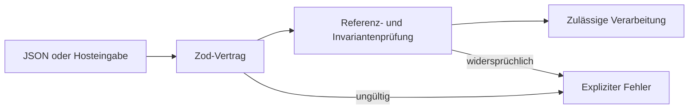

# Verträge

Zod-Schemas bilden die Quelle für die TypeScript-Typen. `defineComponent` und
`defineFlow` validieren Definitionen. Die [Schema-Referenz](schema-reference.md)
enthält die vollständigen exportierten Schemadeklarationen des aktuellen Codes;
diese Seite erläutert ihre Bedeutung.[^implementation]

| Modellfamilie | Zweck | Wichtige Invariante |
|---|---|---|
| Component/Flow/Scene | Zustände, Nodes, Events, Anatomy, Semantik | gültige Zielzustände, Feldtypen und Referenzen |
| RuntimeEvent/Snapshot | Eingang, Fachzustand, Revision | duplizierte oder veraltete Events werden abgewiesen |
| InteractionSnapshot | Fokus, Hover, Press, Composition | keine unnötige Fachrevision durch Hover/Fokus |
| DecisionPlan | begrenzter KI-Vorschlag | Flow, Revision, Policy, Ablauf und Allowlist passen |
| EffectSettings/ResolvedEffectPlan | Projektregeln und eingefrorene Auswahl | Rezept-ID plus Version, Seed, Fähigkeiten und aufgelöstes Qualitätsprofil nachvollziehbar |
| TransitionClip/VisualScenario | zeitabhängige Darstellung und Replay | v2-Import normalisiert, v3 speichert den Unterbrechungssnapshot, v4 zusätzlich den validierten MotionPlan |
| Sequenzmanifest | vollständige erfasste Bildfolge | Samples vollständig zugeordnet; fehlende Aufnahme bleibt inconclusive |
| DataSource/ActionContext | Herkunft und Aktionsautorität | synthetische Daten müssen Simulation heißen |
| QualityReport/TextAudit | getrennte Prüfer und Abdeckung | ungeprüfte Bereiche bleiben sichtbar offen |
| Story/AIReviewFrame/Bundle | kausale Führung und freigegebene Pixel | Build, Frame, Revision, Part und Bildgeometrie konsistent |
| AcceptanceLedger | kanonische AC und Nachweise | Text-/Quellhash und Evidenzhash dürfen nicht still driften |

Schemas mit `strictObject` erlauben keine unbekannten Payloadfelder. Das ist ein
Produktvertrag und darf nicht auf OKF übertragen werden: OKF erlaubt unbekannte
Konzepttypen und Metadaten. Die Knowledge-Prüfung trennt deshalb allgemeine
OKF-Konformität und FluidKit-eigene Qualitätsregeln.

Fachstate darf nur JSON-kompatible Werte enthalten. GPUDevice, Mesh, DOM-Elemente,
Providerclients und AbortController sind Adapter-/Lebenszyklusobjekte. Persistente
Projektversionierung und allgemeine Schemamigration sind noch kein fertiges Produkt.

## Kanonische Multipart-Komponenten

Seit M8 ist `ComponentDefinitionSchema` der kanonische Alias von
`MultipartComponentDefinitionSchema`; `defineComponent` validiert denselben
Vertrag. Es existieren keine voneinander unabhängigen alten und neuen
Komponentendefinitionen. `defineMultipartComponent`,
`instantiateMultipartComponent` und `projectMultipartComponent` beschreiben
Definition, konkrete Bindung und abgeleitete Scene.

Eine Definition benennt Layoutreferenzen, Commands, Wertbindungen und Parts.
Jeder Part besitzt eine stabile ID, ein Verhalten und deklarierte Fähigkeiten.
Interaktive Parts benötigen einen zugänglichen Namen und Fokusfähigkeit. Buttons
benötigen Press sowie Enter/Space und einen deklarierten Command; Checkboxen
benötigen kontrollierten Checked-Zustand, eine Collection und Space; Textboxen
benötigen eine deklarierte Wertbindung und native Eingabe. Rollen und Elternteile
werden auf gültige Referenzen, passende Tabellenhierarchie und Zyklen geprüft.
Nichtinteraktive Parts dürfen keine Eingabefähigkeiten erwerben.

Die Instanz bindet jeden deklarierten Slot ausdrücklich. Unbekannte oder fehlende
Layouts, Commands, Bindungen und doppelte Part-IDs werden abgewiesen. Ein Command
bindet genau einen fachlichen Event-, Visual- oder Collection-Pfad. Die
Renderbeschreibung kann diese Aktivierungsautorität nicht überschreiben.

## Kontrollierte Schlüssel und Collections

`FlowDefinition.collections` verbindet bekannte Item-IDs und Labels mit einem
Feld vom Typ `keys`. Der Snapshot enthält ein Array von Schlüsseln, keine
SDK-Selection-Instanz. Doppelte, unbekannte oder unzulässig deaktivierte Einträge
werden vor dem Commit geprüft. Sichtbarer Checkboxzustand wird aus diesem
Fachfeld abgeleitet. Fokus und Range-Anker sind davon getrennte Interaktionsdaten.

Die aktuelle Workspace-Collection heißt `modules`, ihr Feld `selection`.
`selected` bezeichnet weiterhin das einzelne Modul der Detailansicht. Diese
beiden Bedeutungen werden weder im Schema noch in der URL zusammengelegt.

Die neuen Verträge erlauben keinen frei ausführbaren Modellcode, keinen Shader
in einer Aufzeichnung und keinen direkten Agentenzugriff auf die Scene.
Die Agent-Bridge in T63 prüft zusätzlich Revision, Scope, Allowlist und aktuelle
Rechte. Ihr Schema ist nicht mit dem separaten Authoring-Host gleichzusetzen.

## Agenten- und Authoringverträge

Agent-Requests enthalten Scope, Komponenten-/Aktionsreferenzen, Parameterschemas,
erwartete Snapshotrevision, Policyversion und Ablaufzeit. Höchstens 16 Schritte
werden als `atomic-local` oder `ordered` ausgeführt. Lesende Snapshot-/Query-
Antworten führen nur die freigegebene, redigierte Projektion; ein Export enthält
Ergebnisse und ist ausdrücklich nicht ausführbar. Host-Principal und Freigabe
werden nicht aus Modellfeldern übernommen.

`AuthoringDocument` Version 1 gehört zur Registry `workspace-authoring-1`.
Genau ein `module-explorer` ist erforderlich. Optional sind ein `metric-grid`
und eine `project-note`; jeder Typ kommt höchstens einmal vor. IDs sind eindeutig,
die Reihenfolge ist fachlich beabsichtigt, Akzente sind `forest`, `indigo` oder
`amber`. Bekannte Bindings und alle fünf Explorer-Commands werden strikt geprüft.
Ein Notizwert gehört nicht in dieses Dokument.

`AuthoringRequest` bindet den Auftrag an Request-ID, Dokumentrevision und
Runtime-Revision. `partial`-Streamereignisse sind JSON-Entwürfe, keine validierten
Kompositionen. Erst `complete` trägt ein vollständiges Dokument und
Provider-/Usage-/Budgetprovenienz. Veraltete Resultate werden vom Host abgewiesen.

`DevelopmentProposal` enthält Dokument- und Sourcehashes, den deterministischen
Diff, Herkunft sowie Ergebnisse von Referenz-, TypeScript- und begrenzter
Runtime-Konformitätsprüfung. Der erzeugte Source besteht aus einem festen
TypeScript-Template mit einem JSON-Dokument und `satisfies AuthoringDocument`.
Er erzeugt keine neuen Primitives, Handler oder frei wählbaren Imports. Der
einzige feste Import verweist auf den vorhandenen Authoring-Vertrag. Prüfen und Download
schreiben keine Projektdatei und erteilen keine Deployrechte.

## Gebundener Exportvertrag

`NativeProofSchema` beschreibt einen einzelnen Live-Canvasnachweis mit Dataset-
und Bild-SHA256, Build-/Run-ID, tatsächlichem Frame, erlaubten Snapshotfeldern,
redigiertem Trace, Geometrie und nativen Zielbeobachtungen. Querverweise prüfen
Framezähler, Backend, Progress, Maße, Partidentitäten und Auswahl. `scope` bleibt
`single-bound-canvas-frame`, `inputProvenance` ausdrücklich
`not-observed-by-exporter`. PNG-Bytes werden geprüft und unverändert exportiert;
eine beobachtete native Bedienfolge ist ein zusätzlicher Nachweis.

[^implementation]: Implementierung und SHA-256-Dateibindung im Quellinventar.
