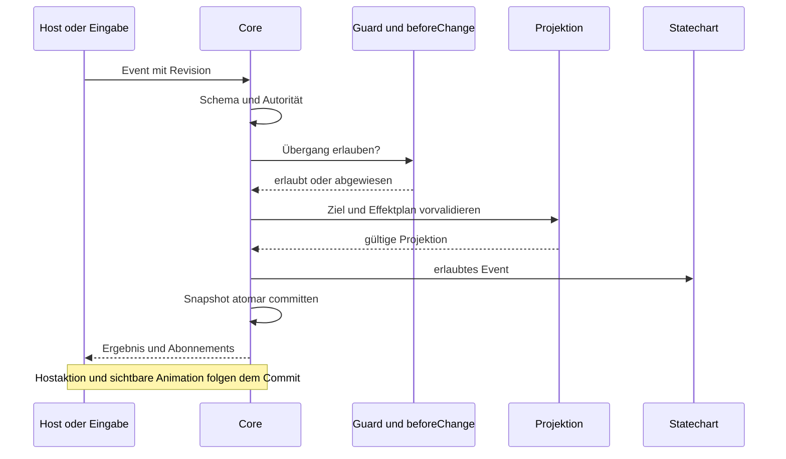
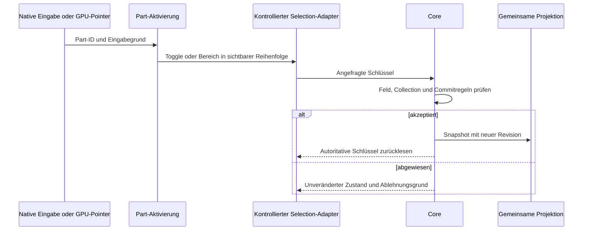
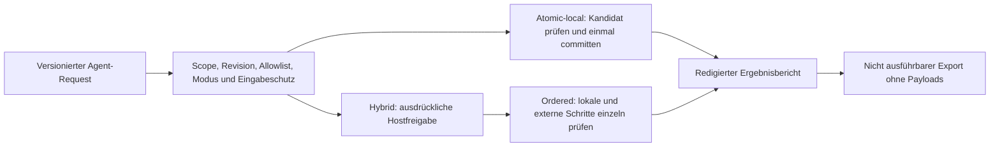

# Runtime

`createFluidRuntime` validiert den Flow, referenzierte Guards/Aktionen und benannte
Projektionen vor dem Start. Die interne XState-Maschine verwendet normalisierte
Zustandsschlüssel. Öffentliche Snapshots behalten die fachlichen IDs.[^implementation]

Ein Event durchläuft Schema, Disposal-/Duplikat-/Revisionsprüfung, Quellautorität,
Guard und `beforeChange`. `cancel()` verhindert den Commit. Neue Felder, Scene und
Effektplan werden vorbereitet und validiert, bevor der Actor verändert wird.
Ein ungültiges Ziel darf keine halbe Mutation hinterlassen.

## Öffentliche Steuerung

`send` erzeugt Event-ID, Zeit und erwartete Revision; `dispatch` nimmt einen
vollständigen RuntimeEvent entgegen. Lesefunktionen sind `getSnapshot`, `getScene`,
`getInteraction`, `getVisualState`, `getTrace`, `getTraceSnapshot`,
`getTransitionDuration`, `getDiagnostics`, `getSuggestion`. Abonnements sind nach
Fachlichkeit, Interaktion, Trace und Visual-State getrennt.

`field.change`, `focus.set`, `mode.set`, `visual.command` und
`navigation.restore` haben definierte Spezialpfade. Navigation benötigt Hostautorität
und führt keine Transition-Aktionen aus. Direkte Events mit Quelle `ai` werden
verweigert; KI muss den DecisionPlan-Pfad nutzen.

Manual akzeptiert keine KI-Pläne. Hybrid hält einen Vorschlag bis
`acceptSuggestion`/`rejectSuggestion`. Auto führt nur freigegebene reversible
Transitionen ohne externe Aktion aus. Aktiver Fokus, Press oder IME-Composition
blockiert eine Adaption. Ein erfolgreicher Vorschlag darf nicht aus veralteter
Revision, falscher Policy oder abgelaufener Zeit stammen.

Hostaktionen starten nach dem logischen Commit. Fehler landen im Trace; eine
fehlgeschlagene externe Aktion macht den bereits erfolgten Fachcommit nicht
magisch rückgängig. `dispose` stoppt Actor, Jobs, Caches und Abonnements.

## Collections und Aktivierung im M8-Proof

`runtime.collection(id)` liefert den an eine deklarierte Collection gebundenen
Adapter. `select`, `toggle`, `range` und `selectAll` verwenden das öffentliche
`createSelection` von UI SDK. Getters lesen die aktuelle Core-Auswahl und die
vom Host gelieferte sichtbare Reihenfolge. Ein Setter beantragt einen validierten
Core-Commit; eine Ablehnung wird nicht als optimistischer SDK-Zustand behalten.
Ein abgewiesener erster Bereich darf auch keinen neuen Range-Anker hinterlassen.
`dispose` entsorgt die zugehörigen SDK-Primitives.

Der Workspace-Host liefert `collectionOrder` aus `workspaceRows`, damit Filter,
numerische Sortierung und Bereichsauswahl dieselbe Reihenfolge verwenden.
`activatePart` entscheidet anhand des validierten aktuellen Parts zwischen
fachlichem Command, Visual-Command und Collection-Operation. Es gibt keinen
zusätzlichen direkten Schreibweg aus GPU- oder DOM-Controls.

Typeahead liefert nur einen Fokuskandidaten. Es verwendet eine explizite Uhr,
einen 500-ms-Eingabeabstand und eine begrenzte Suchfolge; wiederholte Buchstaben
können passende Einträge durchlaufen. Es startet keinen Timer. Der öffentliche
Upstream-Typeahead-Helfer setzt dagegen einen globalen Timeout ohne passende
Clock-Injektion; deshalb wird für deterministische Tests und Replay ein kleiner
eigener Adapter verwendet. Die aktuelle Präfixnormalisierung ist begrenzt und
kein allgemeiner sprachabhängiger Suchalgorithmus. Editieren und Composition
unterdrücken die Collection-Suche.

Der M8-Unterbau erweitert die vorhandene DecisionPlan-Policy um eine getrennte
Agent-Bridge. T22 bleibt nach seinem bisherigen Scope zu beurteilen; die neue
Bridge enthält selbst keinen Modellaufruf.

## Begrenzte Fluid-Agent-Bridge

`createFluidAgentBridge` erhält eine Runtime, einen festen Scope, einen
vertrauenswürdigen Principal, den aktuellen Policy-Leser und ausdrücklich
registrierte Queries beziehungsweise lokale/externe Aktionen. Ohne passende
Policy ist keine Aktion freigegeben. `snapshot` und `query` öffnen keine UI,
verschieben keinen Fokus und committen keinen Fachzustand. Nicht freigegebene
Felder und Komponenten sowie sensible Inhalte bleiben außerhalb ihrer Ausgabe.
Asynchrone Queries prüfen Revision, Policy und Abort nach dem Await erneut.

`propose` prüft Ziel, Parameter, Revision, Ablauf und Modus. Manual bleibt lesend.
Hybrid benötigt die gesonderten Host-Aufrufe `approve` und `executeApproved`.
Auto erlaubt nur zusätzlich freigegebene lokale Aktionen. Aktive Eingabe, Press
oder Composition blockiert die Änderung. Eine Modellantwort besitzt keinen
Zugriff auf die Host-Freigabe.

Der Core führt `transact` auf einem vorvalidierten Kandidaten aus. Guards,
`beforeChange`, Autorität und Projektion müssen vor einem einzigen Commit
bestehen. Ein lokaler Fehler in Schritt zwei veröffentlicht Schritt eins nicht.
Ein `ordered`-Ablauf meldet dagegen abgeschlossene Schritte, Teilfehler und einen
gegebenenfalls unbekannten externen Abschluss ausdrücklich. Nach einem Fehler
folgen keine weiteren Schritte; eine ausgeführte Hostaktion wird nicht als
zurückgerollt ausgegeben. Externe Schritte verwenden den bestehenden ActionAdapter
und lokale Idempotenz. Dauerhafte Idempotenz und organisationsweite Rechte sind
weiterhin Host-/Produktionsarbeit.

Ein Receipt beschreibt den tatsächlich veröffentlichten Snapshot. Ein Observer-
oder Routerfehler nach dem Commit ändert diesen nicht rückwirkend in „abgewiesen“.
Die Diagnose bleibt begrenzt und redigiert; ihr Export ruft nicht erneut denselben
fehlerhaften Callback auf. Ein reentrantes neueres Nutzerevent bleibt erhalten,
verhindert die nachträgliche Navigation der alten Transaktion und stoppt weitere
Agent-Schritte über die Revisionsprüfung. Diese Callbackgrenzen haben eigene
Regressionsfälle; sie sind keine extern ausgeführten Hosttransaktionen.

Die vorhandenen Unit-Tests prüfen unter anderem Default-Deny, rein lesenden
Kontext, Policywechsel während Await, spätes Ergebnis, Abbruch, Teilfehler und
Wiederholung. Das sind lokale API-Nachweise, keine ausgeführten produktiven
Buchungen oder allgemeine Freigabe aller Agent-/Providerintegrationen.

[^implementation]: Implementierung und SHA-256-Dateibindung im Quellinventar.
