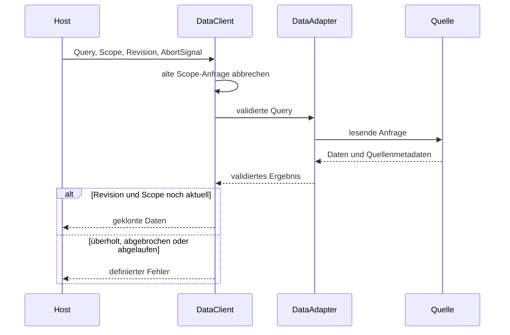

# Daten lesen

`defineDataAdapter` validiert Query, JSON-Kompatibilität, Datenschema und
DataSource. Die Quelle deklariert Modus, Anbieter, Beobachtungszeit, Version und
gegebenenfalls Ablauf. Synthetische Daten und Provider-Sandboxes müssen als
Simulation gekennzeichnet sein.[^implementation]

`createDataClient` gehört zu einem Host-/Sessionkontext. Ein Scope ersetzt seine
vorherige Anfrage durch Abbruch. Cachekeys sind kanonisch aus Adapter-ID, Version
und validierter Query gebildet. Der Standardcache ist auf 100 Einträge begrenzt;
TTL und Quellenablauf begrenzen die Wiederverwendung.

Der aktuelle Client macht keine universelle laufende Request-Deduplizierung und
ist kein TanStack-Query-Adapter. Er bietet begrenzten Cache, Scope-Supersession und
Stale-Result-Schutz. Das vollständige Query-/HTTP-/Import-Ökosystem bleibt offen.

# Fachliche Aktionen

`defineActionAdapter` trennt Autorisierung und Ausführung. `createActionClient`
erlaubt nur ausdrückliche User-/Host-Ursprünge, niemals AI, Prefetch oder Replay.
Nach gültigem Input und Autorisierung bindet Idempotenz Principal, Projekt,
Adapter/Version und Key an genau dieselbe Payload. Eine abweichende Payload mit
demselben Key wird verweigert.

Das In-Memory-Register hält bis zu 1.000 Ergebnisse, einschließlich laufender
Promises. Caller-Abbruch beendet das Warten; eine gestartete externe Aktion kann
weiterlaufen. Ein Retry beobachtet dasselbe Ergebnis. Dauerhafte Idempotenz,
mehrere Serverinstanzen und echte Käufe/Buchungen benötigen einen Hoststore und
eigene Transaktionsabnahme. Die derzeitigen Simulationen führen diese Aktionen nicht aus.

[^implementation]: Implementierung und SHA-256-Dateibindung im Quellinventar.
