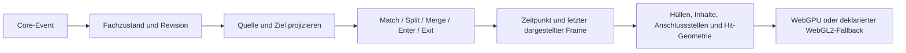
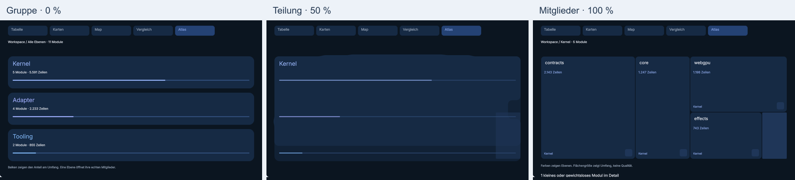
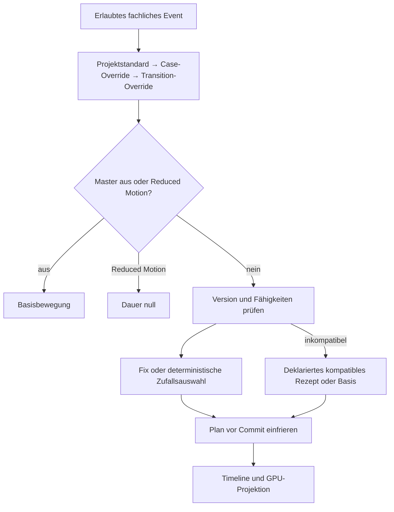
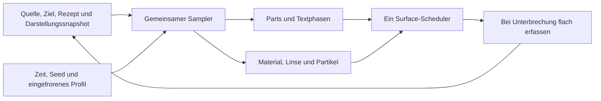

# Quelle → optionale Brücke → Ziel

Ein Effekt ist eine versionierte Präsentationsentscheidung. Er verändert weder
fachliche Daten noch Berechtigung oder Bedeutung eines Übergangs. Der Core
committet atomar; der ResolvedEffectPlan bindet Quelle/Ziel, Revisionen, Event,
Rezeptversion, Seed, Parameter und tatsächliche Fähigkeiten.[^implementation]

## Strukturelle Bewegung

Ein Scene-Part kann Ports, seine Hülle und eine bedingte Beziehung zu Quellen deklarieren. Für neue Aufzeichnungen kompiliert die Runtime jede sichtbare Quelle und jedes Ziel in einen eindeutigen MotionPlan. Match erhält eine Identität, Split verteilt eine Hülle auf ihre Mitglieder, Merge führt mehrere Hüllen zusammen. Der Sampler berechnet scharfe Inhalte, begrenzte lokale SDF-Verbindungen und Positionsdaten aus demselben Zeitpunkt. Der Core committet Fachwerte einmal. Seek verändert ausschließlich die Präsentation. Studio kann den bisherigen Sampler und den neuen Sampler am selben Snapshot und Abspielpunkt zeigen.[^implementation]

Die drei Aufnahmen stammen aus einem gemeinsamen Run. Ihr Fortschritt beträgt 0, 50 und 100 Prozent. [Build und Originalbildhashes](assets/atlas-split-sequence.json)

| Rezept 1.0.0 | Engine | Bedeutung | Budget |
|---|---|---|---|
| Fluid Morph | TypeGPU | parametrischer Formübergang | bis 2.000 Nodes |
| Spring Reflow | CPU-Timing | deterministischer Federimpuls | bis 10.000 Nodes |
| Ripple Reveal | TypeGPU | GPU-Lichtwelle | bis 2.000 Nodes |
| Silk Cascade | CPU-Sampling und GPU-Material | ruhige Staffelung zusammengehöriger Parts | pro Run eingefrorenes Qualitätsprofil |
| Liquid Lens | GPU-Textur-/Materialpass | lokale Hintergrundbrechung bei scharfem Inhalt | höchstens zwei Effekt-Render-Targets |
| Particle Weave | CPU-Sampling und GPU-Instancing | geordnete Fragmente zwischen stabilen IDs | höchstens 2.048 bzw. 512 Partikel |

„Aus“ deaktiviert die zusätzliche Rezeptbrücke; die Basisbewegung kann weiterlaufen.
„Fix“ nimmt das gewählte Rezept. „Zufall“ wählt aus kompatiblen Rezepten anhand
abgeleiteten Seeds. „Case“ verwendet eine definierte Caseregel. Ein neuer Seed
beeinflusst die nächste Auflösung, nicht den bereits gespeicherten Run.

Transitionregeln haben Vorrang vor Caseregeln, Caseregeln vor dem Projektstandard;
der Master-Schalter und Reduced Motion bleiben übergeordnet. Intensität 0–1,
Frequenz 0,2–8 und eine konfigurierbare Rezeptdauer bis 3.000 ms werden validiert.
Der aufgelöste Plan kann die erlaubte Basisdauer bis 10.000 ms tragen.

Replay verwendet die gespeicherte Auswahl. Es würfelt nicht erneut und lehnt eine
fehlende Rezeptversion oder inkompatible Fähigkeiten ausdrücklich ab. Die GPU-
Showcaseleiste und der ausführliche Studioeditor schreiben denselben Visual-State.
Typisiertes `visual.command` ändert dafür keine fachliche Snapshotrevision.

## M7: Sampler, Unterbrechung und Aufzeichnung

Die drei neuen Rezepte sind ein eigener M7-Umfang. Ihre Abnahme wird in der
[AC-Matrix](acceptance-reference.md) getrennt von den historischen M3- und M6-Nachweisen
geführt. Sechs auswählbare Rezepte bedeuten keine pauschale Hardwarefreigabe.

Ein unveränderlicher Transition-Clip hält Quelle, Ziel, eingefrorenen Plan,
Viewport und optionalen Darstellungssnapshot. `sampleTransitionClip` berechnet
Geometrie, Textphasen und Effektdaten aus dem Zeitpunkt. Wiedergabe, direktes
Scrubbing und Prüfung verwenden dieselbe Quelle; eine zweite Renderloop wird
nicht eingeführt.

Bei einer Unterbrechung bleiben tatsächliche Panel-/Textwerte, verbleibende
Materialparameter, höchstens eine rekonstruierbare Linse und eine begrenzte
Partikelmenge erhalten. Die alten Effektreste werden in höchstens 120 ms bzw.
20 % der neuen Dauer abgebaut. Wiederholte Unterbrechungen erzeugen keine
rekursiven Clipketten oder wachsenden Overlay-Stapel. Reduced Motion zeigt direkt
das Ziel. Die normalen Fach- und URL-Commits warten nicht auf Effekte.

Zwei History-Ereignisse können vor dem nächsten GPU-Frame eintreffen. Jede
Unterbrechung übernimmt deshalb die zuletzt gezeichnete Szene. Eine noch
unsichtbare Hülle bleibt im Snapshot, solange eine sichtbare Beschriftung oder
eine Verbindung ihre Position von dieser Hülle ableitet. Das gilt auch für
mehrstufige Bezüge. Beim schnellen Wechsel zwischen Karten und Vergleich
behält so jedes sichtbare Element seine Bezugsfläche.

Im Tabellen-/Kartenwechsel bleiben Modulname und Dateizahl auf eigenen
Bewegungsbahnen sichtbar. Wechselt ein Text seine Bedeutung, blendet er auf
seiner ursprünglichen Position aus. Der Sampler wechselt erst während der
unsichtbaren Phase zur neuen Textposition und blendet dort die neue
Beschriftung ein. Vorwärts- und Rückwärtsweg werden mit den tatsächlichen
Schriftkonturen in Abständen von fünf Prozent geprüft.

Liquid Lens rendert dekorative Inhalte in ein eigenes Target und liest diese
Textur in einem separaten Brechungsschritt. Text, Fokus, Caret und Eingabe bleiben
scharf und respektieren weiter die Layer-/Clipordnung. Ein gleichzeitig
beschriebenes Target ist nie Quelle seiner eigenen Brechung. Partikel sind
Dekoration und erhalten keine fachliche Interaktion.
Die Linse verfolgt die ausgewählte Komponentenidentität auf ihrem Weg von der
Quell- zur Zielgeometrie. Der gespeicherte Anker identifiziert den Bezug; eine
unveränderte Bildschirmposition würde bei großem Layoutwechsel die leere Fläche
statt des ausgewählten Inhalts verzerren.

Standard begrenzt die Fragmente auf 2.048 und zwei Targets auf je 2.048 Pixel pro
Kante; Kompakt auf 512 und 1.024 Pixel. Die normale GPU-Textauflösung bleibt davon
unabhängig. Das Profil ist während des Runs unveränderlich; seine gemessene
Eignung gehört zum Nachweis, nicht zur Rezeptbezeichnung.
Eine Unterbrechung mit noch sichtbaren Standard-Partikeln behält das passende
Standardbudget auch in einem inzwischen schmaleren Viewport bis zum Ende dieses
Clips. So werden sichtbare Fragmente nicht abrupt entfernt, um ein kleineres
Profil zu erzwingen; spätere unabhängige Übergänge können wieder Kompakt wählen.

VisualScenario v3 ergänzt den Darstellungssnapshot. v2 wird ausdrücklich
normalisiert; alte Rezeptversionen und Zufallspools ändern ihre Bedeutung nicht.
Quellbeschreibungen bleiben für rückwärts gerichtetes Scrubbing erhalten. Neue
Aufzeichnungen enthalten weder GPU-Objekte noch ausführbaren Shadercode und
übernehmen die bestehende Redaktionsgrenze.

Die Surface hält GPU-Objekte für die begrenzte Quell-/Zielmenge des aktuellen
Clips vor. Ausgehende Parts werden am Ziel unsichtbar; beim Replay werden diese
Objekte wiederverwendet. Das vermeidet den vollständigen Material-/Glyphenaufbau
vor jeder Wiederholung. Erst ein neuer Clip entfernt nicht mehr benötigte IDs.
Pruning des unterbrochenen Quellzustands verhindert, dass unsichtbare Altobjekte
über viele Clips angesammelt werden. Dieser Cache ist keine Aufzeichnungshistorie;
Disposal gibt weiterhin alle Ressourcen frei. Linsen-Targets und Partikel werden
am Endpunkt freigegeben und nicht als sichtbare Effektreste mitgeführt.

Auswahl und Caret folgen zusätzlich einer gemeinsamen Sichtbarkeitsregel:
Ein nur für Replay gehaltenes ausgehendes Eingabefeld darf am Ziel keine Marker
behalten. Glyph-Style- und Layoutänderungen erzeugen eine ausstehende Revision;
ein expliziter `shape()`-Commit vor beiden Overlays stellt aktuelle Auswahl- und
Caret-Geometrie bereit. Ein Regressionstest benutzt dafür den tatsächlichen
Glyph-Adapter mit dem Projektfont. Das ersetzt keine vollständige IME-/CJK-Abnahme.

## Bedienung und Qualitätsgrenze

Der GPU-Dock berechnet Zeilen, Höhe und Folgepositionen aus der verfügbaren
Surfacebreite und Librarygröße. Studio und Showcase besitzen keine getrennten
Effektkopien. „Empfohlenes Preset übernehmen“ setzt Parameter ausdrücklich;
allein die Wahl eines Rezepts erhält individuelle Werte. Der dritte Parameter
trägt einen rezeptbezogenen Namen.

Die neue Vorführung „Neue Effekte erleben“ gehört zum Showcase. Sie benutzt echte
Workspace-Events, bleibt jederzeit übernehmbar und ist von der ursprünglichen
fünfteiligen [Rehearsal-Story](rehearsal.md) getrennt. [Qualität und Tests](quality-testing.md)
unterscheiden Sampler-Invarianten, Glyphen, Pixel, Backend und Echtzeit-Pacing.

[^implementation]: Implementierung und SHA-256-Dateibindung im Quellinventar.
