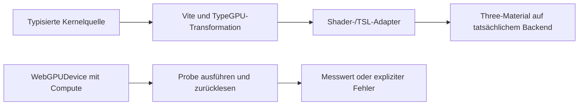

# TypeGPU im tatsächlichen Produkt

Das Kernelpaket kapselt TypeGPU 0.12.9 hinter einer rendererneutralen Übergabe.
Vite mit dem TypeGPU-Plugin transformiert den Shader vor Dev, Typecheck, Tests und
Build. Three/TSL bleibt für Szene, Materialien und Integration zuständig.[^implementation]

Der sichtbare Panel-SDF verwendet typisierte GPU-Funktionen. CPU-seitige
Effektauflösung bleibt deterministisch und unabhängig von der Shaderkompilierung.
Der Renderer meldet getrennt, ob TypeGPU und Compute verfügbar sind.

`verifyPanelKernel` ist ein echter, begrenzter Readback-Proof. Sein Ergebnis darf
nicht als Nachweis ausgegeben werden, dass Layout, allgemeines Morphing oder die
gesamte Anwendung auf Compute Shadern laufen. Im WebGL2-Diagnosepfad ist der
WebGPU-Compute-Proof nicht verfügbar; ein geeigneter Renderpfad kann dennoch
bestehen. Die UI muss diese Fähigkeiten getrennt ausweisen.

M7 ergänzt lokale Brechung und begrenzte instanzierte Fragmente. Die bisherige
achtpunktige SDF-Prüfung belegt diese neuen Shader nicht automatisch. Neue
Materialfunktionen, tatsächliche Texturzugriffe und Backendkompilation erhalten
eigene Nachweise; [Effekte](effects.md) beschreibt ihre Ressourcenprofile und
scharfen Inhaltsebenen.

Die reale M7-WebGL2-Prüfung entdeckte Übersetzungsfehler neuer TypeGPU-Funktionen,
die ein erfolgreicher TypeScript-/Vite-Build nicht ausschloss. Explizite
Funktionstypen und die tatsächlich erzeugte GLSL-Variante müssen deshalb separat
qualifiziert werden. Auch die Texturkoordinaten des Backdrops sind im Originalbild
zu prüfen: lesbarer, aber vertikal falscher Inhalt kann numerische Bounds- und
Glyphentests bestehen.

Shaderkompilierungs- und Device-Validierungsfehler sind harte Laufzeitfehler. Die
Surface beendet betroffene Aufnahmen; gleichzeitig sichtbare Glyphen belegen
keinen erfolgreichen Panel-/Effektrenderer. Fehlgeschlagene Builds behalten ihre
negativen Nachweise, während korrigierte Builds neu geprüft werden.
Der lokale Build `fluid-2006dfa3f94ae832a214` korrigiert diese Übersetzungs- und
Orientierungsfehler. Die neuen Bildfolgen und Backendvergleiche bleiben genau
diesem Stand zugeordnet; sie erweitern keine unbekannte Treiber-/Gerätematrix.

Bei Rezeptinkompatibilität greift die deklarierte [Effektpolicy](effects.md).
Unbekannte Versionen oder Ressourcenüberschreitungen werden begründet. Ein
fehlerfreier Screenshot ersetzt keine numerische Kernelprüfung; ein bestandener
Readback ersetzt keine visuelle Abnahme.

[^implementation]: Implementierung und SHA-256-Dateibindung im Quellinventar.
