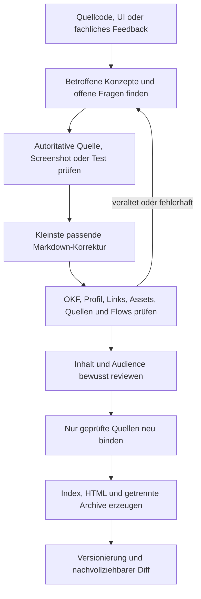

# Zwei portable Kontexte

Engineering und Public sind unabhängige OKF-v0.2-Bundles. Dateipfade ohne `.md`
sind Konzeptidentitäten. Rootindexe erschließen den Inhalt, `log.md` dokumentiert
Änderungen. Konzeptlinks bilden den Kontextgraphen. Die öffentliche Anleitung hat
eigene Bilder und Fakten; sie benötigt keine Engineering-Dateien.[^implementation]

Die angefragte Google-Spezifikation und ihre heutige kanonische Kopie wurden am
2. November 2026 identisch gehasht. Die genauen Revisionen stehen in
`assets/okf-reference.json`. OKF-Konformität bleibt minimal; Titel, Quellenbindung,
Bildabdeckung und Audiencegrenzen sind zusätzliche FluidKit-Qualitätsregeln.

## Pflegeverfahren

1. Geänderte Source-Fingerprints und betroffene Konzepte lesen. Kein pauschales
   Aktualisieren von Hashes, ohne die inhaltliche Abweichung zu prüfen.
2. Implementierungsfakt, Zielentscheidung und Hypothese getrennt aktualisieren.
   Die maschinelle API-/Schema-Referenz wird aus dem Code erzeugt.
3. Nutzeranleitungen gegen tatsächliche UI-Bezeichnungen prüfen; bei visuellen
   Änderungen neue Bilder mit Route, Build, Zeitpunkt und Viewport aufnehmen.
4. `knowledge:check` ausführen. Link-/Bild-/Quellenfehler sind FluidKit-Qualitäts-
   fehler, nicht automatisch allgemeine OKF-Formatfehler.
5. Nach bewusster Quellenreview `knowledge:sync`, prüfen, bauen und exportieren.
   Human-Verifikation wird nur nach tatsächlicher menschlicher Freigabe eingetragen.

`generated` bezeichnet Autor und Änderungszeit; `verified` bezeichnet Bestätigung.
Eine Strukturprüfung darf nicht zur erfundenen fachlichen Human-Freigabe werden.
Die Inhalte sind als noch menschlich zu prüfende Entwürfe gekennzeichnet; fehlende
Human-Verifikation bedeutet nicht, dass die Markdown-Dateien unlesbar sind.
`stale_after` ist ein Zeitpunkt mit expliziter Zeitzone, kein relativer TTL-Wert.

Der Knowledge-Catalog-Artikel dient als methodische Referenz für Gap-Erkennung,
zielgruppengerechten Kontext und prüfbare Änderungsvorschläge. FluidKit hat dadurch
weder Google-Cloud-Katalogdienste noch ein selbstlernendes Knowledge-Publishing
implementiert. Ein solches AI-Enrichment würde weiterhin Vercel AI SDK, getrennte
Rechte, Redaktion und eigene Evaluation benötigen. Anbieterbenchmarks werden
nicht auf FluidKit übertragen.[^catalog]

Der normative Formatvertrag stammt aus der gebundenen OKF-v0.2-Spezifikation.[^okf]

## Sprachfassungen pflegen

Die deutschen OKF-Konzepte bestimmen die Kapitel-IDs und enthalten die ausführlichen Originalnachweise. Für Englisch und Französisch stehen redigierte Kapiteltexte unter `knowledge/editions/`. Jede Sprachfassung muss genau dieselben Kapitel-IDs enthalten. Der Build prüft fehlende oder zusätzliche Kapitel und bricht bei unvollständigen Textpaaren ab.

Ein neuer Bedienablauf benötigt eine Aufnahme aus der betreffenden Sprachfassung. `scripts/qa/capture-multilingual.mjs` erfasst die sichtbare Oberfläche und die Prüfsummen. Für das öffentliche Quellpaket muss der geprüfte Bildinhalt außerdem mit dem hinterlegten Digest im Release-Manifest übereinstimmen. Die kompakte Anleitung verweist pro Kapitel auf den ausführlichen deutschen Beleg. Die Suchfunktion und Mermaid-Diagramme laufen lokal. `tests/e2e/multilingual-books.spec.ts` prüft auch das Öffnen der HTML-Dateien ohne Netzwerkverbindung.

Bei Änderungen am Inhalt zuerst die betroffenen Kapitel prüfen, anschließend `npm run knowledge:sync`, `npm run knowledge:check`, `npm run knowledge:build` und `npm run knowledge:export` ausführen. Beide ZIP-Dateien enthalten die drei jeweiligen Sprachausgaben sowie lokale Schriften und Lizenztexte.

## Bereitstellung im Studio

`knowledge:build` aktualisiert zusätzlich die generierten Studio-Assets. Dev und
Produktionsbuild stellen diese Dateien vor dem Next.js-Start bereit; bei einem
Clean Checkout ohne HTML wird das Handbuch zunächst erzeugt. Änderungen werden
weiterhin zuerst im OKF-Bundle bearbeitet. Die generierte Kopie wird vom
Quellinventar ausgeschlossen, damit kein rekursives Selbstinventar entsteht.

[^implementation]: Implementierung und SHA-256-Dateibindung im Quellinventar.

[^okf]: Normative Spezifikation, Revision und Hash im Referenzregister.
[^catalog]: Offizieller Google-Artikel, Recherche am 2. November 2026; methodische Adaption, keine Produktintegration.
