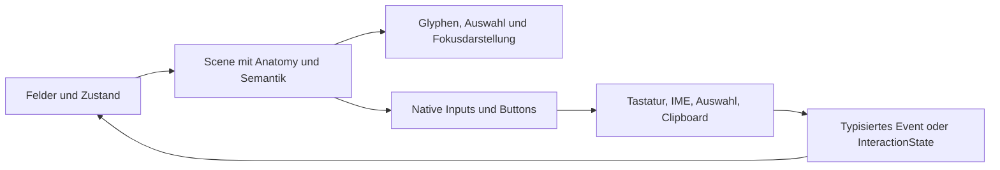

# Ein Modell für Darstellung und Bedienung

SceneNodes enthalten ID, Bounds, Kind, Text, Anatomy und gegebenenfalls Semantik,
Binding oder Aktivierungsevent. Layout, Hit-Testing und native Brücke verwenden
dieselben Bounds. Containergröße ist maßgeblich; Fensterbreite allein reicht nicht.[^implementation]

Yoga ist als Layoutbaustein vorhanden, aber keine vollständige CSS-Implementierung.
Der Workspace projiziert definierte Koordinaten anhand der tatsächlichen Surface.
Kompakte Varianten ändern Textlänge und Innenabstände, ohne die Mindestschriftrollen
zu unterschreiten. Grid/Table-Virtualisierung in allen produktiven Widgets ist offen.

Glyph rendert GPU-Text aus dem lokal gebackenen Inter-Font (`inter.font.glb`). Ein
kontrollierter lokaler Noto-Sans-JP-Fallback ergänzt die deklarierte japanische
Testmenge; der primäre Inter-Font bleibt unverändert. Der
Bake-Prozess und die originalen Fontlizenzen liegen im Projekt. Das ergänzende
Fontmanifest bindet auch die Python-Vorbereitung und binären Schriftdateien, die
nicht als TypeScript-Deklarationen im AST-Inventar erscheinen.[^font-preparation] Fontmetriken und
gezeichnete Glyphen werden geprüft; DOM-Bounding-Boxes beweisen keinen GPU-Textfit.
Definierte Caption-, Label- und Body-Rollen sind 11/12/14 CSS-px. Viele ältere
Farben/Abstände sind noch nicht vollständig auf Theme-Tokens konsolidiert.



Die native Brücke bleibt im Accessibility-Baum, ist visuell transparent und
enthält echte Inputs/Buttons. Sie darf nicht durch `display:none` oder
`aria-hidden` als allgemeine Bedienbrücke entfernt werden. Composition schützt
aktive Texteingabe vor spontaner KI-Anpassung. Auswahlposition und Caret werden
an die Surface weitergegeben.

Aktive Textfelder verwenden den vollständigen bearbeitbaren Wert. Die
Ellipsenlogik statischer Labels darf ihn nicht ersetzen. Bei überlangem Inhalt
führt ein horizontaler Ausschnitt den Caret und die Auswahl mit; GPU-Text,
Auswahl und Caret werden an derselben Eingaberegion geclippt. Pointerpositionen
müssen diese horizontale Verschiebung berücksichtigen, bevor sie in eine native
Textauswahl umgesetzt werden. Auswahlrichtung und stabile Feldidentität bleiben
erhalten. Diese Korrektur erhält eigene Langtext-/Home-/End-/Drag-Nachweise;
ein kurzer korrekt dargestellter Text genügt dafür nicht.

## Kontrollierte Schriftabdeckung statt stiller Textverluste

Die Nachprüfung vom 4. November benutzt Glyph 0.1.0 und dessen öffentliches
`createFontStack`. Das Noto-Sans-JP-Regular-Artefakt beruht auf Sans2.004 und einer
mit FontTools 4.68.0 erzeugten Teilmenge. Sie enthält 512 zugeordnete Codepoints
und 783 Glyphen einschließlich Shapingalternativen: Kana, japanische Interpunktion,
Voll-/Halbbreitenformen und einen expliziten Han-Korpus aus `font-bake.config.json`.
Das ist kein vollständiger CJK-, Emoji- oder vertikaler Textunterbau.

Der Fallback wird offline mit MSDF 32/6 geladen. Fontset, Handle und die leeren,
nicht an die Szene angehängten Lease-Texte haben explizite Besitzer. Beim Freigeben
werden die gezeichneten Texte vor den Font-Leases entsorgt. Eine fehlende oder
beschädigte konfigurierte Schrift wird als Fehler gemeldet und nicht still
übersprungen. Der zusätzliche Bake umfasst rund 3,92 MiB; daraus folgt keine
pauschale Aussage über Treiberspeicher.

Normale Builds lesen die bereits vorbereitete, gehashte Teilmenge. Wird der
deklarierte Zeichenkorpus geändert, ist die Vorbereitung separat reproduzierbar:

```sh
uv run --python 3.14 --with fonttools==4.68.0 python scripts/prepare-japanese-font.py
npm run build:font
npm run check:font
```

Der zusätzliche Python-Schritt ist keine Voraussetzung für das Rendern oder
einen unveränderten regulären Paketbuild. Glyphs interner zweiter Unicode-Subsetpass
wird für das bereits vorbereitete CFF-Artefakt nicht erneut verwendet.

Die bekannten Proben `M7 — Grüße 東京` und kombinierende Zeichen werden mit echten
Font-/Glyph-Objekten geprüft. Nicht enthaltene Zeichen wie `🦄` oder `龘` dürfen
nicht aus dem fachlichen Wert verschwinden; die Fehlglyphen werden im Textaudit
diagnostiziert. Eine korrekte Fontprobe ist weiterhin kein nativer
IME-/Screenreader- oder Mobilgerätebeleg.

Semantische Tabellen verwenden Table/Row/Cell/Columnheader und die aktuelle
Sortierrichtung. Referenzen und Elternbeziehungen werden validiert. Zoom,
Screenreader, RTL/CJK, mobile Tastaturen und sämtliche IME-Journeys sind weiterhin
separat zu qualifizieren; native Elemente allein beweisen diese Abnahme nicht.

## Opt-in Nachweis tatsächlicher Komposition

Der Eingabe-Proof besitzt einen getrennten `NativeInputObserver` mit strengem
Metadatenvertrag. Erfasst werden Längen, native Auswahl, `inputType`,
`isComposing`/`isTrusted`, Core-Fokus/Kompositionsschutz, Zeit und Build. Rohwert,
`CompositionEvent.data`, Tastennamen und Clipboard-Inhalte gehören nicht zu
diesem Export. Das gewöhnliche Runformat wird dafür nicht rückwirkend verändert.

Der gewählte Prüfkontext benennt native Dead-Key-Komposition, japanische IME,
synthetische QA oder einen nicht angegebenen Ursprung. Er ist eine deklarierte
Herkunft, kein automatischer Erfolgsbeweis. Ein bestätigter Vorgang benötigt
vertrauenswürdigen Beginn, aktiven Core-Schutz, Ende mit aufgehobenem Schutz,
erhaltenen Fokus und nichtleere Kompositionsdaten. Leere Enden und untrusted
Events bleiben getrennt sichtbar. Normales vertrauenswürdiges `input` wird
nicht als IME-Sitzung hochgestuft. Native Browserbelege müssen die tatsächliche
Eingabequelle und den sichtbaren Inhalt zusätzlich dokumentieren.

[^implementation]: Implementierung und SHA-256-Dateibindung im Quellinventar.

[^font-preparation]: Deklarierter Fontumfang, Artefakt-/Lizenzhashes und SHA-256 des vorbereitenden Python-Skripts.
