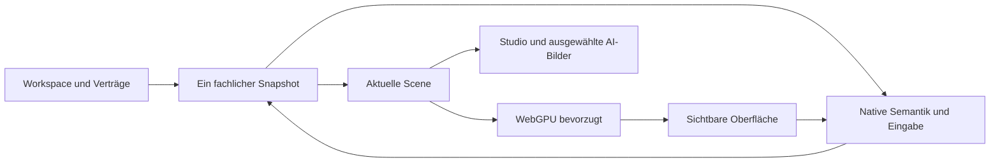

# Produktmodell

FluidKit ist ein Entwickler-Framework für zustandsabhängige GPU-Oberflächen. Ein
fachlicher Zustand wird als Szene projiziert. Dieselben Modulidentitäten können
als Tabelle, Karten, Dependency Map oder Detail erscheinen. Eine atomare Änderung
legt das fachliche Ergebnis fest; eine anschließende Animation stellt den Weg dar.
Studio-Bedienung und Dokumentation verwenden DOM. Sichtbare Runtime-Elemente werden
mit Three.js/TSL, GPU-Text und einem bevorzugten WebGPU-Backend gezeichnet.[^implementation]

Die gültige Nutzerentscheidung erlaubt einen transparent angezeigten WebGL2-Fallback.
Ältere Aussagen „WebGPU ausschließlich“ im archivierten Plan sind damit überholt.
Der Renderer entscheidet anhand tatsächlicher Fähigkeiten, nicht anhand des Browsernamens.

## Warum dieses UI-Modell?

Die Arbeitsansicht folgt der Aufgabe: Tabelle für Wertevergleich, Karten für
visuelle Auswahl, Graph für Beziehungen, Detail für weiterführende Arbeit. Stabile
Objektidentitäten verbinden diese Perspektiven. Passende Übergänge sollen den
Wechsel nachvollziehbar machen; zusätzliche Werkzeuge werden bei Bedarf entfaltet.
[Objektkontinuität](https://bost.ocks.org/mike/constancy/) und
[Progressive Disclosure](https://www.nngroup.com/articles/progressive-disclosure/)
liefern dafür Grundlagen. Studien zu
[animierten Datenvisualisierungen](https://idl.uw.edu/papers/animated-transitions)
stützen geeignete Übergänge in ihrem untersuchten Scope. FluidKit-eigene
Zeit-/Fehler-/Lernvorteile bleiben zu messen.

FluidKit kann eine Oberfläche an einen neuen Arbeitsschritt anpassen. Im Workspace liefert dafür auch Verhalten einen Hinweis: Wer dieselben zwei Module wiederholt öffnet, könnte sie vergleichen wollen. Nach ausdrücklicher Aktivierung bietet die lokale Assistenz einen gemeinsamen Vergleich an. Mit der Annahme bleiben beide Modulidentitäten erhalten, während sich die Oberfläche für die neue Aufgabe verwandelt. Die Einzelheiten stehen unter [Workspace-Case](workspace-case.md).

Die vollständige Einordnung steht in [Warum Fluid UI?](why-fluid.md): Nutzen,
Usability, Grafiktechnik, Zukunftsperspektive und bewusste Grenzen.

## Drei getrennte Ebenen

| Ebene | Zuständigkeit | Aktueller Nachweis |
|---|---|---|
| Fachlichkeit | Core, Flow, Felder, Revision, Guards, Aktionen | validierte lokale Runtime |
| Präsentation | Scene, Visual-State, Effektplan, Timeline, GPU-Ressourcen | animierter Workspace und Rehearsal |
| Assistenz | lokale Erkennung wahrscheinlicher Vergleichspaare, autorisierte Aktionen und separate AI-Designkritik | bestätigungspflichtiger Workspace-Vorschlag und optionale OpenAI-Review im Studio |

Der Vergleichsranker benötigt keinen Modellanbieter. Predictive Loading,
weitere Absichten und das Lernen aus Aufgabenergebnissen sind offen.
Alle Praxisangebote in den drei Simulationen sind synthetisch.
Die Workspace-Ansicht verwendet dagegen tatsächliche lokale Paket- und Quellstatistiken.

Die Roadmap umfasst 58 ursprüngliche Tasks und seit M7 insgesamt 435 kanonische
Einzelkriterien. Der historische Ausgangsstand mit 408 Kriterien hatte 94 im
angegebenen Scope belegte Kriterien, 190 teilweise,
123 offene und einen externen Nachweis. Diese Zahlen sind eine datierte Baseline,
kein Fertigstellungsversprechen. [Release und Roadmap](release-roadmap.md) beschreibt
Grenzen; [Quellabdeckung](source-map.md) bindet diese Knowledge an tatsächliche Dateien.

[^implementation]: Implementierung und SHA-256-Dateibindung im Quellinventar.
