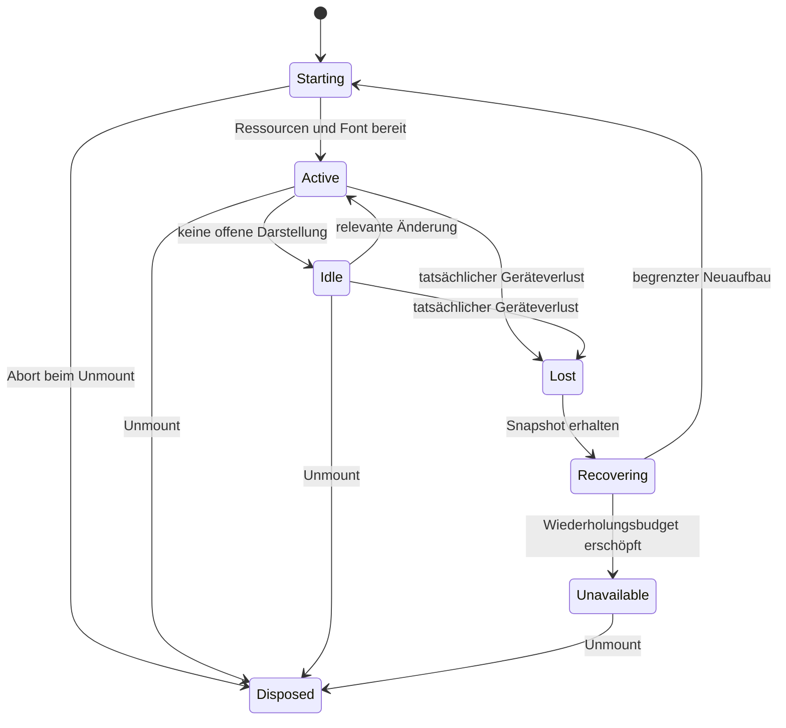
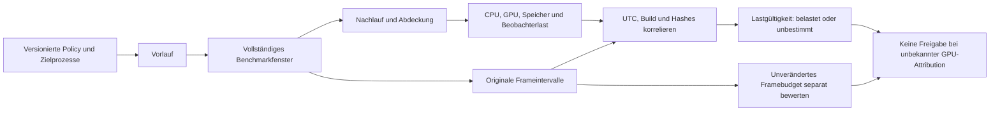

# Lebenszyklus

GPU-Objekte, Listener, Observer, Timer und asynchrone Initialisierung benötigen
einen Owner. `createResourceScope` hält Freigaben und `ResourceLedger` zählt
verwaltete Ressourcen. Der zentrale Frame-Scheduler erzeugt bedarfsabhängige
Frames und stoppt nach ruhendem Zustand oder Disposal.[^implementation]

Der React-Adapter versucht bei passendem Capability-Fehler höchstens drei
Wiederanläufe mit gestaffelter Verzögerung. Ein neuer Renderer erhält die aktuelle
Core-Projektion. Neue GPU-Objekte ersetzen verlorene Ressourcen; fachliche Felder
werden nicht aus GPU-Pixeln rekonstruiert.

Ein historischer M6-Nachweis mit 100 Zyklen prüft tatsächlich gemountete Surfaces und
eigene verbleibende Listener/Jobs/Ressourcen. Die Glyph-Allokation lag nach
Aufwärmen auf einem stabilen Plateau. Das ist kein vollständiger Treiber-/
Browserprozess-Speichernachweis und keine universelle Gerätequalifikation. Die
damals geprüften Rendererbytes bleiben archiviert; der Nachweis wird durch neue
M7-Quellen nicht rückwirkend erweitert.

M7 trennt drei Ressourcenprüfungen: 100 Wiederholungen desselben Clips, 100
Unterbrechungen mit wechselnden Darstellungsmengen und vollständige
Erzeugungs-/Disposalzyklen frischer Surfaces. Die neue imperative Prüfung vom
4. November ist ausdrücklich kein neuer React-Mount-/Unmount-Nachweis.
Replay nutzt den begrenzten Cache der Quell-/Zielobjekte
seines Clips. Am Ziel unsichtbare Quellparts bleiben für rückwärts gerichtetes
Scrubbing verfügbar; der nächste Clip entfernt nicht mehr benötigte IDs. Das
vermeidet unnötige Material-/Glyphen-Neuanlage bei jeder Wiederholung. Ein
korrekter Cache bleibt begrenzt, auch bei ständig neuen IDs; ein Endpunkt ohne
sichtbare Effekte allein beweist diese Eigenschaft nicht.

Die sichtbare M7-Surface-Qualifikation prüft 100 frische Instanzen pro gewähltem
Backend. Jede rendert alle drei neuen Rezepte; das im gezeichneten Mittelzustand
entsorgte Abschlussrezept rotiert. Besitzer, DOM-Fläche, Listener, Jobs und
verwaltete Allokationen werden nach jeder Freigabe kontrolliert. Ein kurzer
Drei-Surface-Smoke wird nicht als 100-Zyklen-Nachweis ausgegeben.

Fünf zusätzliche Fälle behandeln Initialisierungsabbruch nach tatsächlicher
Allokation, einen realen Fehler beim Laden einer bewusst ungültigen Fontdatei,
kontrollierten Device-/Contextverlust, Sensitivität und öffentliche
Wiederherstellung. Ein kontrolliert zerstörtes Device übt den Verlustpfad,
belegt aber keinen zufälligen Hardwarefehler. Ein verbleibender Owner oder
fehlender Pflichtfall verhindert den Erfolgsstatus des Berichts.

Der separate natürliche Wiedergabelauf erfasst Frameintervalle des zentralen
Schedulers. P50/P95, Maximum und Anzahl der Intervalle über 50 ms sind zusammen
zu lesen. Die erste M7-Diagnose enthielt trotz unauffälligem P95 einen Stillstand
von 491,6 ms; der damalige Bericht bleibt ein Vorbefund vor der Korrektur. Die
Messung ist weder GPU-Rechenzeit noch eine Garantie für jeden angezeigten Frame.
Im korrigierten lokalen Build `fluid-2006dfa3f94ae832a214` lagen die sechs
Desktopläufe der neuen Effekte auf WebGPU und WebGL2 bei P95 8,4–8,9 ms und
Maximum 9,1–16,7 ms; kein erfasstes Intervall lag über 50 ms. Diese warmen
Schedulerwerte enthalten keine Screenshotaufnahme und keinen Replay-Startabstand
bis zum ersten Frame. Ihre Geräte- und Szenariogrenzen bleiben maßgeblich.

`visibleRange` begrenzt rechnerisch einen großen Zeilenbereich. Das beweist noch
keine produktive 10.000-Zeilen-Table mit vollständiger Interaktion. Die aktuellen
Showcase-Daten sind bewusst klein. Zielbudgets für Framezeit, lokale Latenz,
GPU-Speicher und Mobile stehen im Releaseplan und benötigen reale Hardwaremessung.

Bei Replay-Resize wird eine Originalaufzeichnung proportional dargestellt und
explizit als solche bezeichnet. Eine Skalierung unter dem Lesbarkeitsprofil darf
nicht als erfolgreiches Live-Layout gewertet werden; „Live-Ansicht“ rekonstruiert
den aktuellen responsiven Zustand.

## Eigene M8-Echtzeitdiagnose

Die M8-Matrix mit Einzelbildaufnahme misst keine Echtzeit. Ein gesonderter
Production-Lauf erfasst pro Backend 18 echte Live-Core-Warmups, 18 Messfälle
und je mindestens 1.000 ms stabilen Leerlauf. Mess-IDs, Seeds, Datensatz,
Viewport und Parameter stimmen zwischen beiden Backendläufen überein.
Rohintervalle, P50/P95, Maximum und Ausreißer bleiben erhalten.

Im Build `fluid-e4a5afc0f4c1b34e96de` lag der höchste Fall-P95 bei 34,1 ms
für WebGPU und 17,7 ms für WebGL2; Maxima 67,0 beziehungsweise 66,8 ms.
Es gab zehn beziehungsweise vier Intervalle über 50 ms und auf beiden
Pfaden null zusätzliche Idle-Frames. Die Surface war 1.201 × 1.478 bei
Render-DPR 1. Diese Schedulerintervalle sind keine GPU-Timestamps und
kein 1080p-/200-Elemente-/20-Morph-Benchmark.

Beide Originalberichte behalten das numerische Resultat **failed** gegenüber
dem vorab definierten P95-Budget von 16,7 ms. CPU-/GPU-Fremdlast wurde nicht
hinreichend dokumentiert; die Benchmarkgültigkeit bleibt deshalb
**unqualifiziert**. Vor einer belastbaren Leistungs- oder Backendbewertung
ist ein lastkontrollierter Lauf erforderlich. Weder das Performanceziel noch
T29 wird dadurch grün. Die abgegrenzte T65-Messabnahme bewertet dagegen die
vollständig durchgeführte Messung samt negativem Ausgang und Lastgrenzen; sie
ist keine positive Leistungsfreigabe.

## Nachmessung mit beobachteter Last

Das UTC-Fenster 12:29:24.680–12:30:44.549 vom 13. November enthält 18 WebGPU-Fälle.
Höchster Fall-P95: 17,6 ms; Maximum: 66,7 ms; fünf Intervalle über 50 ms;
null Idle-Zusatzframes. Die Originale unter `observed-load-122924` bleiben
an denselben damaligen Build gebunden. Das numerische Budgetresultat ist failed.

Die Lastpolicy bewertet den Lauf als **contaminated**, seine Benchmarkgültigkeit
als **not-qualified**. Minimales CPU-Idle im Vorlauf: 44,49 %. Maximal 51,51 %
der Maschinen-CPU wurden nicht dem Ziel zugeordnet; darin ist auch der
Benchmarkbrowser enthalten. `tsc` PID 95501 erreichte um 12:29:59.445 UTC
687,79 % eines Kerns (etwa 6,88 Kerne), der Collector maximal 17,15 % eines
Kerns. Daraus wird weder eine Taskzugehörigkeit noch Kausalität für einzelne
Frameausreißer abgeleitet. Speicherdruck war normal und Swapwachstum null.

Das Benchmarkfenster sowie 30 Sekunden Vorlauf und zehn Sekunden Nachlauf sind
abgedeckt. Der historische Collector meldete dennoch failed, weil seine
Probenzahlsteuerung die konfigurierte Laufzeit verfehlte; dieser Originalbericht
bleibt unverändert. Die spätere Wallclock-Korrektur hat eigene Tests und eine
kurze reale Probe. GPU-Zählereinheiten und vollständige Prozess-/Tab-Zuordnung
bleiben unqualifiziert. Ein lastqualifizierter Wiederholungslauf steht weiter aus.

## Dauerhaftes Verfahren: Fremdlast und Beobachterlast

Der [versionierte Lastprüfplan](assets/load-validation-plan.md) gehört zu jedem
künftigen belastbaren Performance-Nachweis. Er ergänzt das Framebudget, verändert
es aber nicht. Der lokale Collector, seine Zod-Verträge und der reine Klassifikator
trennen die numerische Laufzeitbeobachtung von der Gültigkeit ihrer Umgebung.

1. Vor Messbeginn Policy, Zielprozesse und Quelle festlegen; Policy hashen.
2. Ausreichenden Vorlauf erfassen. Im Benchmarkbetrieb sind 30 Sekunden vor und
   zehn Sekunden nach dem Messfenster ausdrücklich konfiguriert; maßgeblich
   bleiben die tatsächlich im Bericht gespeicherten Werte.
3. Während des ganzen Messfensters keine eigenen Builds, Tests oder Bundles starten.
   Andere CPU-/GPU-Nutzer, Collector samt Kindern und Speicher-/Swapdruck beobachten.
4. Tatsächliche UTC-Grenzen, Build und Original-Timinghash verbinden. Nachlauf,
   Messlücken, Probeabstände und Sammlungsdauer überprüfen.
5. Lastgültigkeit und Performancebudget unabhängig bewerten. Originalberichte
   unverändert erhalten und Gegenmessungen separat archivieren.

CPU-Prozent pro Kern und Maschinenanteil werden nicht verwechselt. Prozessnamen
allein beweisen keine Zugehörigkeit zu unserem Benchmark; eine beobachtete
Elternbeziehung bleibt als solche gekennzeichnet. Exporte enthalten nur kurze
Accountingnamen, IDs und Messwerte, keine Argumente, Umgebungsvariablen oder
Browserinhalte. Der Collector beendet keine fremden Prozesse und erhöht nicht
selbst seine Rechte.

Die vorhandene private GPU-Diagnostik hat **unbekannte Zählereinheiten** und
keine vollständige Prozess-/Tab-Attribution. Der aktuelle Vertrag erlaubt daher
nur `contaminated` oder `inconclusive`, jeweils mit `performanceValidity:
not-qualified`. Auch wenig CPU-Arbeit kann diese Lücke nicht schließen.
`contaminated` nennt beobachtete Konkurrenz, beweist aber nicht die Ursache
eines bestimmten Frameausreißers. Die Kosten der Messwerkzeuge werden als
Beobachterlast getrennt geprüft. Keine Schwelle wird nach Sichtung des Ergebnisses
aufgeweicht; ein später qualifizierter GPU-Adapter benötigt einen eigenen Nachweis.

[^implementation]: Implementierung und SHA-256-Dateibindung im Quellinventar.
