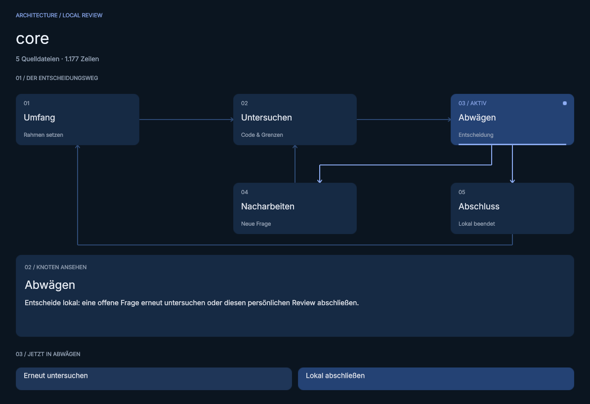
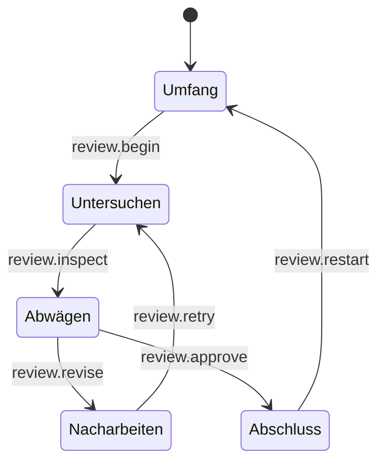
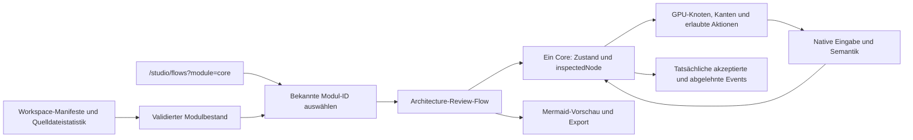
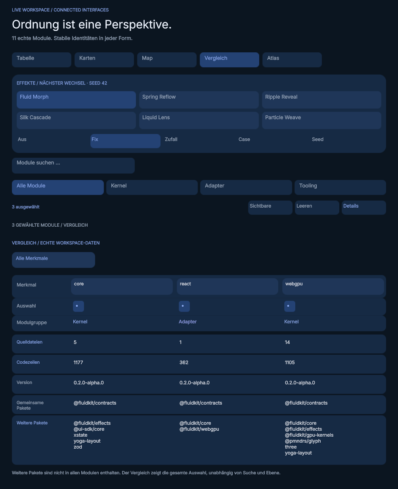
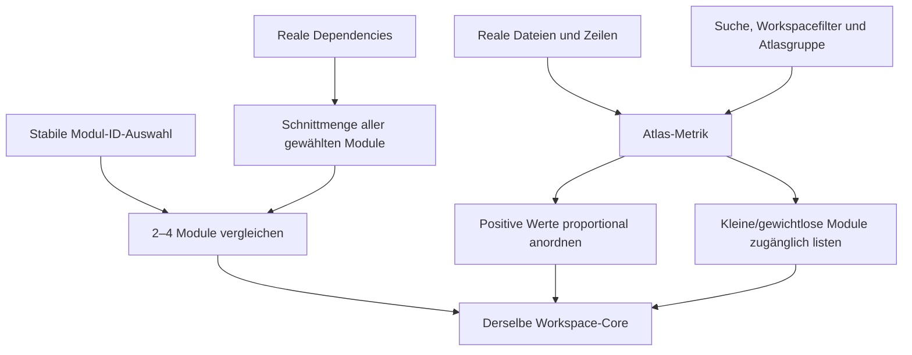

# Drei unterschiedliche Perspektiven

M9 ergänzt einen ausführbaren lokalen Review, einen expliziten Modulvergleich und
einen flächenproportionalen Atlas. Die Perspektiven beantworten unterschiedliche
Fragen und benutzen die tatsächlich gelesenen Workspace-Manifeste und
TypeScript-Quelldatei-Statistiken. Ein Graphzustand im Review ist eine eigene
Entität; er erhält keine künstlich übernommene Modul-ID.[^implementation]

| Perspektive | Fachliche Frage | Quelle und Eigentümer |
|---|---|---|
| Flow Explorer | Was ist erlaubt und welcher Schritt folgt? | eigener deklarierter Review-Flow, ein isolierter Core |
| Vergleich | Welche ausgewählten Module unterscheiden sich? | vorhandener Workspace-Core, stabile Auswahl-IDs, Manifestmengen |
| Atlas | Wie verteilt sich der Codeumfang? | vorhandener Workspace-Core, Dateien/Zeilen und Modulgruppen |

## Originale Bildbezüge

Die beiden folgenden Aufnahmen sind bytegleiche Kopien der Public-Originale
vom 14. November 2026, Build `fluid-5efc7ce43b5669cc30e9`, WebGPU.
[Register und SHA256](assets/m9-screenshots.json) halten die Herkunft fest.
Die Bilder zeigen einzelne GPU-Canvas-Frames, keine Studio-DOM-Fläche,
vollständige Transition oder allgemeine Gerätefreigabe.

*1280 px Browserbreite, 1194 × 818 px Surface; Zustand und inspizierter
Knoten sind getrennte Core-Werte.*

## Ausführbarer lokaler Review

`createArchitectureReviewFlow` validiert den Modulbezug und definiert fünf
Zustände. Die sechs fachlichen Kanten kommen aus `states[*].on`; es gibt keinen
zweiten, separat gepflegten Graphen. `architectureReviewGraph` leitet nur Kanten
mit tatsächlichem Zustandswechsel ab. `inspect.<state>` ist ein deklarierter
Selbstübergang zur Knotenauswahl und erscheint in der echten Ereignisspur, aber
bewusst nicht als zusätzliche Mermaid-Schleife.

Der Feldwert `inspectedNode` ist eine Projektionseingabe im Core. Er ist vom
aktuellen Review-Zustand getrennt: Einen späteren Knoten anzusehen führt ihn
nicht aus. Die erlaubten Aktionsbuttons werden aus den ausgehenden Kanten des
aktuellen Zustands erzeugt. Aktivierungen laufen über die bestehende native
Semantik-/Eingabebrücke und die Core-Validierung. Für diesen Case gibt es keine
externen Action-Adapter und keine Modellaufrufe.

Der Name `approved` bezeichnet hier ausschließlich das Ende eines lokalen
Review-Szenarios. Die Oberfläche nennt dies „Lokal abschließen“. Weder Tests,
Codeänderungen noch externe Rechte oder Veröffentlichungen werden behauptet.

`architectureReviewLayout` liefert die gemeinsamen Layoutmaße für Surfacehöhe
und Szene. Schmale Flächen erhalten einen vertikalen Graphen mit getrennten
Rückwegspuren; breite Flächen verteilen den Prozess auf zwei Reihen. Die IDs der
Review-Parts bleiben erhalten. Farben stammen aus den gemeinsamen semantischen
GPU-Rollen; Theme-Präferenzen besitzen keinen fachlichen Reviewzustand.

Mermaid wird nur beim Öffnen seiner Vorschau geladen. Die `.mmd`-Datei entsteht
aus demselben Flow; ein optionaler Kommentar benennt den lokalen Zustand zum
Exportzeitpunkt. Der Download trägt die dazugehörige Revision. Ein bereits
vorbereiteter Export bleibt ein gekennzeichneter Stand und wird nicht still
als aktuell ausgegeben.

### URL und Lebenszyklus

`/studio/flows?module=<id>` prüft die Modul-ID gegen den tatsächlichen Bestand.
Ohne Modulparameter wird `core` beziehungsweise das erste vorhandene Modul
gewählt. Unbekannte oder mehrdeutige IDs ergeben Not-found. Optional bezeichnet
`case=architecture-review` denselben Case; andere Cases werden hier nicht
interpretiert.

Die URL ist ein Einstieg in den Modulkontext, kein Beleg eines bereits
durchgeführten Reviews. Reload beginnt beim Umfang. Der Rückweg ist eine feste
lokale Workspace-URL mit `view=cards` und dem ausgewählten Modul, kein freier
Redirect. Der React-Host hält einen stabilen Core pro Modul und entsorgt ihn
beim endgültigen Unmount; die Surface besitzt weiterhin den einzigen
Render-Scheduler.

### Eigenständiger Flow-Nachweis

Der Workspace-Bediennachweis wird nicht auf fremde Flowzustände umetikettiert.
Der Flow Explorer besitzt `fluid-local-flow-proof` Version 1: ein unverändertes
PNG mit Digest, Build-/Datensatzbezug, gebundener Farbpräferenz, lokalem State und Revision, tatsächlicher
Präsentationsgeometrie, Textprüfung und gemessenen nativen Zielboxen.

Die Aufnahme ist auf die pausierte oder ruhende Live-Ansicht begrenzt. Importiertes
Replay, laufende Übergänge, geänderte Revision/Geometrie, Unmount und private
oder freie Text-Pixel führen zur Ablehnung. Die Ereignisspur enthält nur
registrierte Ereignisnamen und Metadaten; Payloads und freie Details fehlen.
Erst nach der Aufnahme wird ein expliziter Blob-Download angeboten. Der Export
bescheinigt keine vertrauenswürdige Eingabe, vollständige Animation oder
Performance.

## Vergleich im bestehenden Workspace-Core

Der Vergleich verwendet zwei bis vier ausdrücklich ausgewählte Module. Die
stabilen Modul-Parts und das kontrollierte Auswahlfeld bleiben dieselben wie in
Tabelle, Karten und Map. Weniger als zwei oder mehr als vier ausgewählte Module
führen zu einem erklärten Zustand. Ein angebotener Vorschlag wird erst durch
eine ausdrückliche Aktion übernommen.

`workspaceComparison` berechnet Version, Ebene, Dateianzahl, Zeilenanzahl sowie
Dependency-Mengen. „Gemeinsame Pakete“ sind die Schnittmenge **aller** gewählten
Module. „Weitere Pakete“ sind die jeweilige Differenz zu dieser Schnittmenge;
ein Paket darin muss nicht weltweit eindeutig sein. Der Filter „Nur Unterschiede“
blendet identische Merkmalszeilen aus. Auf breiten Flächen entsteht eine
semantische Vergleichstabelle, auf schmalen Flächen vollständige Modulgruppen.
Die Werte werden dabei nicht verändert oder gekürzt.

### Sichtbare Auswahl und Navigation

`workspaceCollectionOrder` beschreibt die tatsächlich bedienbare Collection.
Im Vergleich enthält sie genau die dargestellten ausgewählten IDs in ihrer
alphabetischen Reihenfolge; in den übrigen Ansichten verwendet sie die gefilterten
`workspaceRows`. Dadurch bleiben sichtbare Vergleichs-Checkboxen auch bei einem
unvereinbaren Such-/Gruppenfilter abwählbar. Select-all, Range und Typeahead
operieren auf dieser Präsentation; sie wählen keine unsichtbaren Suchtreffer aus.
Alle Runtime-Hosts verwenden denselben Adapter.

| URL-Parameter | Core-Feld | Gültige Werte / Standard |
|---|---|---|
| `view` | State | zusätzlich `compare` und `atlas` |
| wiederholtes `picked` | `selection` | tatsächliche, eindeutige Modul-IDs |
| `differences=1` | `compareDifferences` | `0`/`1`; Standard `false` wird nicht serialisiert |
| `metric=files` | `atlasMetric` | `lines`/`files`; Standard `lines` wird nicht serialisiert |
| `atlasGroup` | `atlasGroup` | `all`/`Kernel`/`Adapter`/`Tooling`; Standard `all` wird nicht serialisiert |

Die Optionen bleiben auch beim Wechsel in eine andere Workspace-Ansicht im
Snapshot und Link erhalten. `readWorkspaceLocation` validiert und rekonstruiert
sie für Reload und History. Suchtext bleibt lokal. Der Fall-Einstieg
„Beispiel vergleichen“ übernimmt bewusst den vorgeschlagenen Modulbestand;
der GPU-Ansichtsschalter „Vergleich“ verwendet die bestehende Auswahl.

*1280 px Browserbreite, 1004 × 1234 px Surface. Der Vergleich projiziert
vorhandene Modulidentitäten und erzeugt keine zweite fachliche Auswahl.*

## Atlas und proportionaler Umfang

`workspaceTreemap` verteilt positive Gewichte deterministisch. Die Gruppen
Kernel, Adapter und Tooling werden zuerst proportional aufgeteilt; ihre Module
werden anschließend in denselben Gruppenflächen angeordnet. Die mathematische
Flächenzuordnung ist von den dekorativen Abständen der sichtbaren Kacheln
getrennt.

Das Gewicht ist wahlweise die tatsächliche Anzahl der Dateien oder Codezeilen.
Nullwerte erhalten keine erfundene Fläche. Zu kleine oder gewichtlose Module
bleiben in einer separaten Detailliste bedienbar. Suche, Workspacefilter und
Atlas-Gruppenfokus bestimmen den Ausschnitt. „Übersicht“ verlässt den Gruppenfokus;
die Breadcrumb benennt ihn ausdrücklich. Ein großes Modul ist kein besseres
oder schlechteres Modul.

Der genaue Präferenz-, Kontrast- und Replayvertrag steht in der [Appearance-Architektur](appearance.md).

## Qualifikationsgrenzen

Die Flow-Tests prüfen beide Reviewpfade, abgelehnte Abkürzungen, Graph-/Event-
Konsistenz, stabile IDs, kontrollierte Exporte und Schriftgrenzen mit dem
wirklich ausgelieferten Inter-Font. Die Exporttests prüfen Abbruch-, Replay- und
Privacygrenzen an ausdrücklich synthetischen Capture-Ports. Dies ersetzt keine
tatsächliche GPU-Aufnahme oder native Browser-Journey. Sechs aktuelle Originalbilder und vier fehler-/warnungsfreie Qualitätsberichte
werden separat registriert. Der abschließende lokale Testlauf umfasst 608 Tests
in 67 Dateien. Frühere M7/M8-Screenshots und Timingberichte bleiben
unverändert und werden nicht als erneute M9-Abnahme ausgegeben.

[^implementation]: Quellinventar und M9-Nachweise binden die beschriebenen Implementierungen; der jeweilige Nachweisumfang wird ausdrücklich benannt.
