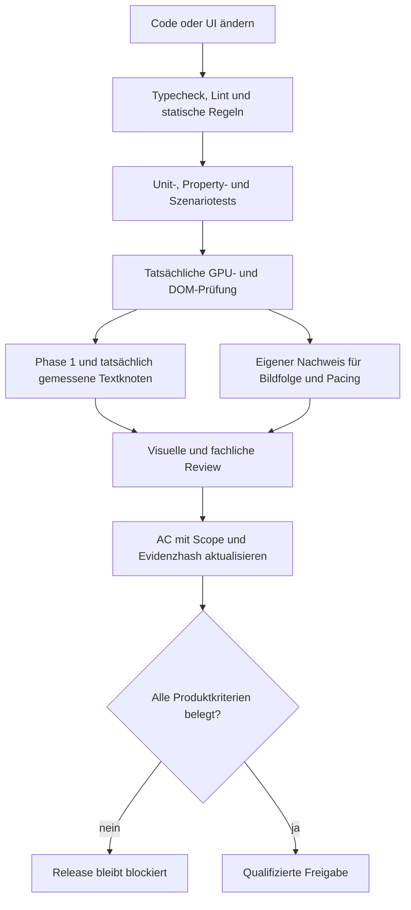

# Getrennte Nachweisarten

| Prüfer | Belegt | Belegt nicht |
|---|---|---|
| Zod-/Core-Tests | gültige Modelle und erlaubte Übergänge | sichtbare Bedienbarkeit |
| Property-/Modellfolgen | Invarianten bei konkurrierenden Ereignissen | Hardwareperformance |
| ai-design-check 0.9.0 | konfigurierte statische Studio-Regeln | fertig gerenderte GPU-Pixel |
| DOM-Geometrie | sichtbare DOM-Texte und Überlappungen | GPU-Schrift und kompletten Kontrast |
| Glyph-Textaudit | tatsächliche gezeichnete GPU-Textbounds | Screenreader-Journey |
| Semantikvergleich | Modellbezug zu nativen Rollen/Labels | manuelle IME-/AT-Abnahme |
| Screenshots | konkrete Bildzustände | kontinuierliches Timing oder alle Zwischenframes |
| AI-Review | begründete Kritik an ausgewählten Bildern | harte Freigabe oder fachliche Wahrheit |

`QualityReport` enthält getrennte Checks, Befunde, Status, Kontext und offene
Abnahmen. Ein Check kann trotz Warnungen nicht dieselbe Bedeutung wie ein
fehlerfreier Gesamtrelease haben. Keine geprüften Elemente bedeutet „not-checked“,
nicht stillschweigend „alles lesbar“.[^implementation]

Sticky-Überdeckungen werden anhand opaker Hintergründe und tatsächlicher Paint-/
Hit-Test-Reihenfolge eingeordnet. Transparente Overlays und normale Textkollisionen
bleiben Negativkontrollen. Diese Stichprobe ist keine allgemeine Pixelanalyse.

Die datierte Ausgangsabnahme enthält 127 Tests, zwölf saubere Endpunktkombinationen
und 42 syntaktisch gültige Mermaid-Diagramme. Neue Knowledge-Prüfungen kommen
separat hinzu. Diese historischen Zahlen werden nicht als automatisch aktuelle
Testanzahl ausgegeben. Die Knowledge-Abnahme vom 2. November ergänzte neun Werkzeugtests und eine Regression zur Trennung
des Runtime-Fingerabdrucks: Damals bestanden 137 Tests und 69 Mermaid-Diagramme, davon 27 neue
Knowledge-Flows. Der M7-Abschlussstand vom 3. November hatte 216 Tests. Die Nachprüfung
vom 4. November erhält eigene Ergebnisse. Werkzeugnachweise erweitern keine Hardware-/Produktfreigabe.

## M7-Nachprüfung: getrennte Berichte statt eines Sammelerfolgs

`/studio/m7` enthält einen Workspacepfad und eine isolierte Surface-Qualifikation.
`WorkspaceQualification` bindet echte Workspace-Daten und Core-Events an sechs
Richtungen, drei neue Rezepte und fünf feste Zeitpunkte. Ein Lauf umfasst 18 Fälle
mit 90 Checkpoints bei einer tatsächlichen Browsergröße und einem Backend.
Vier Größen und die zwei vorhandenen Backends ergeben die begrenzte Matrix mit
144 Fällen. Bildabdeckung und numerische Abdeckung werden getrennt angegeben;
ausgewählte Original-PNGs sind keine vollständigen Bildfolgen.

`M7SurfaceQualification` prüft pro angefordertem Backend entweder einen ausdrücklich
benannten Drei-Surface-Smoke oder 100 frische Surfaces. Jeder Zyklus zeichnet alle
drei neuen Effekte und gibt seine Ressourcen während des letzten Übergangs frei.
Initialisierungsabbruch, ungültiger Font, kontrollierter Device-/Contextverlust,
Sensitivitätsproben und öffentliche Wiederherstellung sind separate Fälle.
Ein abgebrochener Lauf oder fehlender Pflichtfall darf keinen Erfolgsstatus tragen.

Der Surfacebericht belegt imperative Ressourcenbesitzer und Aufräumwege. Er ist
kein React-Mountreport, keine Domain-/Historyjourney und keine Messung gesamten
Treiber- oder Prozessspeichers. Sensible Testinhalte sind synthetisch; die produktive
Capturegrenze muss sie blockieren und der strukturierte Export sie redigieren.
Eine öffentliche Positivkontrolle muss danach wieder funktionieren.
Die neue Sensitivitätsprüfung umfasst Text und zugängliche Labels, damit eine
ausgeblendete Beschriftung nicht über Exportmetadaten doch freigegeben wird.
Die 100-Zyklen-Fassung enthält zusätzlich fünf spezielle Fehler-/Schutzfälle;
die 13 einzelnen Privacy-Versuche bleiben im Bericht nachvollziehbar.

Native Pointer-/Tastatur-/Historyereignisse, tatsächliche Sichtbarkeit und der
Media-Query-Pfad erhalten eigene Browsernachweise. Eine echte Browser-Media-Emulation
kann den lokalen Reduced-Motion-Pfad prüfen, wenn ihr Ursprung benannt ist.
Direkte Getter-/Callbackmanipulation belegt diesen Browserpfad nicht. Synthetische
CompositionEvents prüfen den Bridge-Vertrag, aber keine native IME-Kandidatenauswahl.
Die lokale funktionale M7-AC14-Abnahme vom 4. November stützt sich auf die
manuelle OS-Dead-Key-Probe und ausdrücklich begrenzte Ereignisnachweise. Eine
vollständig trusted Composition, japanische Kandidatenauswahl und globale
AT-/physische Touch-/Mobilgerätegates bleiben davon getrennte offene Aufgaben.

`check:acceptance` schützt kanonische AC-Texte und Evidenzhashes. `check:release`
verlangt alle Kriterien und scheitert im Alpha-Stand erwartungsgemäß. Änderungen an
Nachweisen werden erst nach Review und erneuter relevanter Prüfung neu gehasht.

## Performance-QA prüft auch das Messumfeld

Ein lesbares Bild, eine vollständige 720-Punkte-Matrix und eine niedrige
Framezeit beantworten verschiedene Fragen. Für eine belastbare Timingabnahme
verlangt der [Lastprüfplan](assets/load-validation-plan.md) Vorlauf, vollständiges
Messfenster und Nachlauf mit tatsächlicher UTC-/Hash-Korrelation zum Originalrun.
Konkurrierende CPU-/GPU-Arbeit, Collectorlast und Speicher-/Swapdruck werden
getrennt bewertet. CPU-/Prozessnamen sind keine belegte Browser-Tab-Zuordnung.

Der aktuelle GPU-Adapter liefert nur Diagnosewerte mit unbekannter Einheit und
unvollständiger Attribution. Deshalb entsteht daraus nie ein `valid`-Nachweis:
beobachtete Konkurrenz bedeutet `contaminated`, fehlende oder nicht qualifizierte
Daten `inconclusive`. Auch ein Framebudget-Pass wäre dann keine kontrollierte
Benchmarkfreigabe. Umgekehrt bleibt ein numerisches Budget-Fail erhalten, wenn
das Lastumfeld unbestimmt ist. Die [Performance-Anleitung](performance-lifecycle.md)
beschreibt die einzelnen Schritte. Schwellen werden vor dem Lauf festgelegt,
Beobachterkosten einbezogen und nachträglich nicht zur Freigabe gelockert.

[^implementation]: Implementierung und SHA-256-Dateibindung im Quellinventar.
