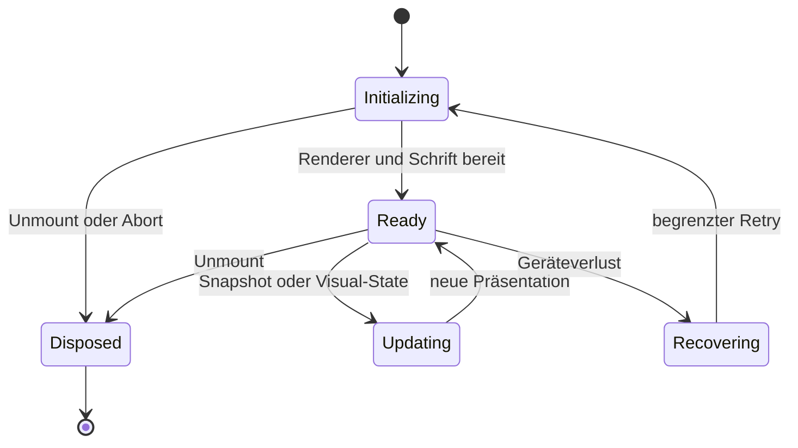

# React-Adapter

`FluidProvider` nimmt eine bereits erzeugte Runtime und stellt sie per Context
bereit. `useFluid` liest fachlichen, visuellen und interaktiven Zustand mit
externen Store-Abonnements. Hostkomponenten speichern keine fachliche Kopie des
Snapshots in unabhängigem React-State.[^implementation]

```tsx
const runtime = createFluidRuntime({
  flow,
  collectionOrder: (snapshot) => workspaceRows(data, snapshot).map(module => module.id),
  projections: { workspace: (snapshot, viewport, effects) =>
    workspaceScene(data, snapshot, viewport, effects) },
});
// Innerhalb einer Client-Komponente:
<FluidProvider runtime={runtime}>
  <FluidSurface height={1348} backendMode="webgpu-first" />
</FluidProvider>
```

Der Host besitzt die Runtime und muss sie nach der letzten Nutzung entsorgen.
Das Beispiel setzt einen gültigen `flow`, `data` und die entsprechenden Importe
voraus; es ist keine bereits veröffentlichte npm-Installationsanleitung.

## Native Texteingabe

Die native Eingabebrücke hält den vollständigen Feldwert, Auswahlgrenzen und
Auswahlrichtung. Das native `maxLength` wird aus der gebundenen Felddefinition
der Runtime abgeleitet; es gibt weder einen unabhängigen festen Grenzwert noch
ein stilles nachträgliches Abschneiden. So verhindert der Browser eine
überschreitende Eingabe, bevor der Core den gesamten Edit ablehnen müsste. Pointerpositionen werden über die tatsächlich geformte
Glyph-Geometrie und den sichtbaren horizontalen Textausschnitt zu Textpositionen
zugeordnet. Die GPU zeichnet Text, Auswahl und Caret innerhalb desselben Clips;
Labelkürzung wird nicht auf editierbare Werte angewendet. Composition hält den
Interaktionsschutz im Core aktiv. Ein bloß gesetzter CJK-String belegt deshalb
noch keine native Komposition. [Typografie und Eingabe](layout-text-input.md)
beschreibt den begrenzten Fontumfang und die Nachweisgrenzen.

## Surface-Eigentümerschaft

Ein ResizeObserver misst den Canvascontainer. Ein AbortController schützt asynchrone
Initialisierung; ein verspätet erzeugtes Objekt wird sofort entsorgt. Cleanup
stoppt Recovery-Timer, löst Controls und ruft `dispose` auf. StrictMode- und
Mount/Unmount-Verhalten sind relevante Testpfade.

Neue Snapshotrevisionen aktualisieren Scene und Transition. Visual-State-
Änderungen aktualisieren die Präsentation; Fokus/Selektion haben eigene
Abonnements. Importiertes Replay ist schreibgeschützt. `restoreLive` projiziert
den aktuellen Core-Zustand erneut auf die aktuelle Containergröße.



Die Surface meldet ihre tatsächlichen Fähigkeiten initial und nach einem
Reduced-Motion-Wechsel über `onCapabilitiesChange`. React übernimmt diese
Meldung in die visuellen Core-Fähigkeiten, damit auch ein späterer Effektplan
die aktuelle Präferenz verwendet. Ein gemeinsamer Media-Query-Listener wird
mit seinem Surfacebesitzer entsorgt; es gibt keinen zusätzlichen Polling-Takt.

`onControls` liefert den Lifecycle-gebundenen Zugriff auf Pause/Replay/Capture;
bei Ausfall/Unmount wird `null` gemeldet. `onMetrics`, `onError`, `fontUrl`,
`backendMode`, `deviceLossToken` und optional `resourceLedger` sind aktuelle
Surface-Props. Die [API-Referenz](api-reference.md) bleibt für genaue Signaturen maßgeblich.

## Multipart-Semantik und native Ziele

Die Bridge leitet native Buttons, Checkboxen, Textboxen und semantische
Elternrollen aus denselben instanziierten Parts wie die GPU-Szene ab. Für
Collections liest `checked` die Core-Schlüssel. Roving Tabindex stellt einen
Tastatureinstieg je Collection bereit; Pfeile und Home/End bewegen den Fokus,
Shift erweitert den Bereich, Ctrl/Meta+A wählt sichtbare Elemente. Space nutzt
die native Checkboxaktivierung; Typeahead bewegt den Fokus, nicht die Auswahl.
Native Texteingaben, laufende Composition und importiertes Replay werden von
diesen Shortcuts ausgenommen.

Eine Zielgeometrie allein reicht während eines Morphs nicht aus. Der bestehende
Surface-Scheduler meldet deshalb die aktuelle Präsentation an die Bridge. Diese
aktualisiert Position, Größe und Rotation der nativen Ziele. Unsichtbare,
deaktivierte oder an ihrem Prüfpunkt verdeckte Controls sind nicht erreichbar.
Dabei entstehen weder eine zweite Animationsschleife noch React-Stateupdates
für jeden Frame. GPU-Hit-Testing und native Erreichbarkeit beziehen sich auf die
laufende Darstellung.

Fokus wird anhand von Part-/Komponentenidentität beziehungsweise Collection-ID
und Item-ID wieder zugeordnet. Die Bridge übernimmt ausschließlich Fokus, der
ihrer Surface gehörte: bewusstes Tabben oder Klicken in Studio-Controls hat
Vorrang. Bei einem noch nicht sichtbaren Ziel wartet die Rückgabe auf eine
Präsentationsmeldung. Der Workspace-Inspector bleibt nichtmodal; Escape und sein
Schließen-Command verwenden die deklarierte Rückgabe zum auslösenden Part.

Diese Implementierung beschreibt die aktuelle Grenze, keine pauschale
Screenreader- oder Plattformfreigabe. Native Eingabe und die bewegten Ziele
besitzen eigene aktuelle M8-Nachweise. Der lesende `getPresentationMode()`
unterscheidet Live-Darstellung von importiertem Replay; der Bediennachweis
verlangt Live. Frühere M7-Prüfungen werden nicht still wiederverwendet.

[^implementation]: Implementierung und SHA-256-Dateibindung im Quellinventar.
