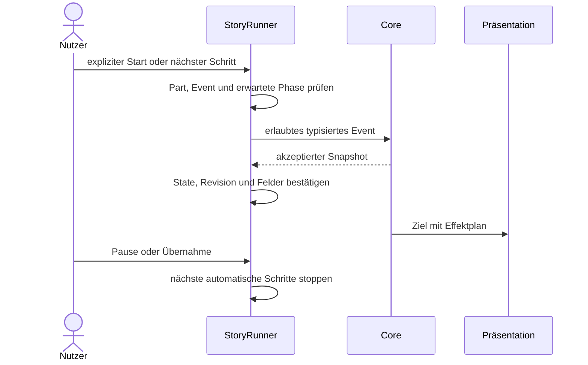

# Storyvertrag

`createWorkspaceStory` erzeugt fünf deklarierte Beats: Bestand lesen → nach
Abhängigkeiten sortieren → Karten → WebGPU-Detail → bewusster Reset. Jeder Beat
besitzt Zielpart/Event, erwarteten State, Felder und Haltezeit. Der Runner prüft
den tatsächlichen aktuellen Part und dessen Aktivierungsevent.[^implementation]

`createStoryRunner` verwaltet logische Beatnachweise. Der Workshop orchestriert
Haltezeiten, Pause und Sichtbarkeit. Hintergrund-/Offscreenbedingungen pausieren
die Führung. Zielmarkierung misst echte DOM-/Scene-Geometrie; sie darf den
Tastaturfokus nicht stehlen. Der Reset ist ein sichtbarer Studio-Button und muss
als solcher aktiviert werden.

## Aufnahme und Vergleich

Capture pausiert die Präsentation, liest Pixel im Rendercallback und führt ein
separates Textaudit aus. Wenn sich der Fachsnapshot dazwischen verändert, wird
abgebrochen. Der lokale Puffer hält höchstens zwölf Bilder. Bilder sind mit
Build, Revision, State und Beat verbunden. Der Vergleich wählt ein unverändertes
Bild als Referenz und ein anderes als Kandidat.

Der Runexport enthält Story, Beats, ausgewählte Bilder und Audit. Sein Status
bleibt `inconclusive`, solange eine kontinuierliche Bildfolge, natives Pacing,
weitere Geräte und manuelle Accessibility fehlen. Eine Kontaktansicht oder zwölf
saubere Endpunkte sind kein Vollscan aller Zwischenframes.

Die aktuelle Aufnahmepipeline ist keine gespeicherte Replay-Datenbank und kein
CI-Kamera-Runner. [Qualität](quality-testing.md) trennt logische, semantische,
GPU-geometrische und visuelle Nachweise.

## M7-Effektvorführung und Sequenzvertrag

Die zusätzliche Showcase-Vorführung führt von Tabelle über Silk-Cascade-Karten
und Liquid-Lens-Detail zur Particle-Weave-Map. Sie ersetzt die fünfteilige Story
oben nicht. Nutzerübernahme oder Stoppen beendet kommende Schritte, behält den
erreichten fachlichen Zustand und stellt die zuvor gespeicherten Effekteinstellungen
wieder her. Eine verborgene oder verlorene Surface spielt nicht im Hintergrund weiter.

M7 ergänzt einen gesonderten Sequenzvertrag mit Frameindex, normalisierter und
tatsächlicher Zeit, Rezeptversion, Seed, Build, Viewport/DPR und tatsächlichem
Backend. Eine Vollständigkeitsprüfung muss die erwarteten Samples zuordnen.
Fehlende Samples bleiben `inconclusive`; ausgewählte CapturedFrames behalten
`selected-frame` und werden nicht rückwirkend zu Vollsequenzen erklärt.

Im Motion-Bereich startet „Sequenz prüfen“ ein deterministisches Raster mit
logischen 60-Hz-Abständen und exaktem Endpunkt. Der lokale Lauf ist auf drei
Sekunden, 181 Samples und 64 MiB begrenzt. Abbruch, geänderter Run/Fachsnapshot,
vertrauliche Inhalte, fehlende Bilder oder überschrittenes Bildbudget ergeben
`inconclusive`. Der Export bindet das Raster an die Originalaufzeichnung,
Rezept/Seed, Build, Datenbezug und Revision. Bilder, Glyphenprüfungen und
Darstellungsgeometrie bleiben gemeinsam prüfbar.

Die Rastervollständigkeit ist unabhängig vom Qualitätsurteil. Glyphenbefunde,
benachbarte Geometrieschritte und der genaue Endpunkt werden geprüft; natürliche
Frame-Pacing-Messung, ein Pixelvergleich aller Nachbarbilder und unabhängige
visuelle/manuelle Abnahmen sind zusätzliche Gates. Ein vollständiges Raster ist
deshalb keine pauschal bestandene Bewegungs- oder Gerätequalifikation.

„Effekt-Stresstest · 100 Zyklen“ wiederholt den aufgezeichneten Clip in einer
Surface. Fünf Aufwärmzyklen bilden die Referenz; explizit verwaltete Ressourcen
und Glyphenbytes werden gegen ein Plateau mit fünf Prozent Toleranz geprüft.
Am Ziel dürfen keine Effekttargets oder Partikel verbleiben. Dieser Ablauf ist
kein Ersatz für 100 vollständige Mount/Unmount-Zyklen, Initialisierungsabbrüche
oder einen allgemeinen GPU-Speicherbeweis.

„Retargeting prüfen · 100 Zyklen“ verwendet deklarative visuelle v3-Imports und
unterbricht bei 25/50/75 %. Quelle und Ziel stammen aus dem ursprünglichen Run;
die neue Quelle übernimmt den aktuellen Darstellungssnapshot. Nach zwölf
Aufwärmzyklen prüft der Lauf C0-Kontinuität, das verwaltete Ressourcenplateau und
leere Effektressourcen am Ziel. Rezept, Version und Seed bleiben zuordenbar.
Der ursprüngliche Run wird nur wiederhergestellt, wenn Besitz-Fingerprint und
Fachrevision unverändert sind. Das ist ein isolierter Darstellungsnachweis,
kein echter Pointer-/Keyboard-/Navigations-Journey und kein Mount-/Treiberspeichertest.

„Wiedergabe messen“ führt nach Aufwärmen einen separaten natürlichen Wiedergabelauf
ohne Bildaufnahme aus. Der Bericht nennt P50/P95 der tatsächlich vom Surface-
Scheduler beobachteten Frameintervalle, Maximum, Intervalle über 50 ms und den
bestätigten Endpunkt. Ein niedriger P95 allein schließt einzelne sichtbare
Stillstände nicht aus. Das sind
keine GPU-Timestamp-Queries und keine garantierten Compositor- oder Displayzeiten.
„Diagnoseberichte herunterladen“ exportiert die Ergebnisse mit ihren Grenzen;
fehlende Metriken werden nicht als bestandener Ressourcencheck behandelt.
Bericht und Oberfläche zeigen das darin gespeicherte Rezept samt Version,
Fachrevision, aufgezeichnetem Viewport und Backend. Ein alter Silk-Bericht wird
dadurch nach einem Wechsel zu Liquid Lens nicht als Nachweis der neuen Auswahl
ausgegeben.

Die erste M7-Prüfung zeigte, warum diese Trennung nötig ist: numerisch vollständige
Bildfolgen enthielten noch ausgehende Labels beziehungsweise einen unpassenden
Linsenanker; ein natürlicher Lauf enthielt ein Intervall von 491,6 ms. Die
archivierten Daten bleiben Vorbefunde des damaligen Builds. Neue Quellstände
benötigen neue Bild- und Timingnachweise; eine bestandene Datenstruktur ersetzt
die visuelle Prüfung nicht.
Ein weiterer Lauf zeigte trotz vollständigem Raster eine vertikal falsche
Linsenabtastung mit wiederholten, unbeteiligten Controls. Deshalb müssen visuelle
Prüfer auch den Zusammenhang des abgebildeten Inhalts beurteilen; reine Bounds-
und Glyphenchecks erkennen einen plausibel lesbaren falschen Bildausschnitt nicht.

Der gemeinsame Präsentationssampler ermöglicht direkte und rückwärts gerichtete
Zeitabfragen. Die Prüfung umfasst Endpunkte, Unterbrechungen bei 25/50/75 %,
mehrfache Übernahme während der Restphase und die Folge 0 → 1 → 0,5 → 0.
Echtzeit-Pacing und GPU-Ressourcen werden unabhängig vom langsameren Capturelauf
gemessen. Die tatsächlich bestandenen Teilgates stehen in der [AC-Matrix](acceptance-reference.md).

[^implementation]: Implementierung und SHA-256-Dateibindung im Quellinventar.
