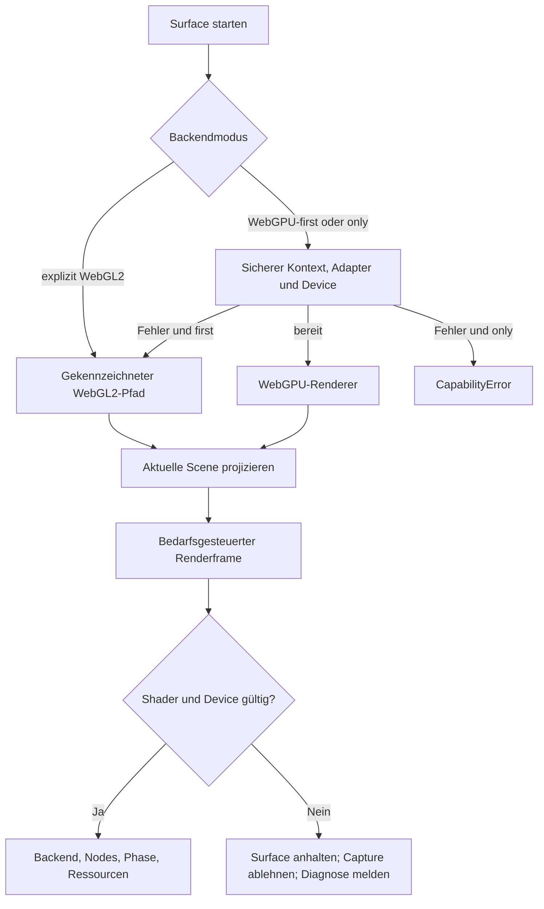

# Rendering

`createFluidSurface` erzeugt eine Surface mit Three.js, öffentlichem Renderer-/
Backendaufbau, TSL-Materialien, Glyph-Text und eigenem Scheduler. Die Defaultoption
`webgpu-first` versucht WebGPU und meldet einen eventuellen WebGL2-Fallback.
`webgpu-only` verweigert einen Ersatz; `webgl2` ist eine ausdrückliche Diagnose.
Das aktive Backend und der Grund werden in `SurfaceMetrics` veröffentlicht.[^implementation]

Die CPU hält die gültigen Snapshots und Scene-Daten; GPU-Ressourcen sind Projektionen.
Ein Frame zeichnet sichtbare Boxen, Text, Bilder und Übergänge. `setScene` kann
animieren, `updatePresentation` aktualisiert visuelle Änderungen. `pause`, `play`,
`seek` und `replay` steuern die Präsentation, nicht den fachlichen Commit.
`getPresentation` liefert die gesampelte Darstellung für Prüfung und Hit-Testing.
`getResources` zählt ausdrücklich verwaltete Ressourcen; `getFrameTimings`
liefert beobachtete Schedulerintervalle für den separaten natürlichen Lauf. Diese
Werte ersetzen weder GPU-Timestamp-Queries noch eine visuelle Sequenzprüfung.

`captureFrame` liest die PNG-Pixel im Rendercallback. Es verbindet die Aufnahme
mit Framezähler, Renderzeit, tatsächlicher Viewport-/Pixelgröße, Backend und Parts.
Sensitive Parts verweigern die Aufnahme, einschließlich noch ausgehender Inhalte.
Die Studio-Schicht fügt Build, Revision, State und Beat hinzu und verwirft die
Aufnahme, wenn sich der Snapshot währenddessen ändert.

Ein ausgewähltes Standbild ist kein vollständiger Film und kein Echtzeit-Pacing-
Nachweis. GPU-Zeit, Browser-/Treiberkosten und selbst verwaltete Ressourcen sind
getrennte Messgrößen. [Lebenszyklus](performance-lifecycle.md) beschreibt Disposal
und Geräteverlust; [Effekte](effects.md) die eingefrorene Übergangsauswahl.

## Eignung und Entwicklungsspielraum

WebGPU bietet Rendering und Compute; Three.js/TSL ergänzt Scene, Materialien und
Shaderbausteine. Das passt zu verbundenen Datenansichten, gemeinsam choreografierten
Übergängen und möglichen späteren Simulationen. Wiederverwendbare Renderbefehle
können CPU-Aufwand senken; der eigene Skalierungsnachweis bleibt erforderlich.
[WebGPU](https://www.w3.org/TR/webgpu/),
[Three.js](https://threejs.org/manual/pages/webgpurenderer).

Die [GPUWeb-Implementierungsmatrix](https://github.com/gpuweb/gpuweb/wiki/Implementation-Status)
zeigt am 2. November 2026 ausgelieferte Unterstützung in allen großen
Browserfamilien mit verbleibenden OS-/GPU-Unterschieden. Künftige Geräte und lokale
Modelle erweitern mögliche Einsatzfelder. Die vorhandene Cloudanalyse wird dadurch
nicht lokal; neue Pfade brauchen eigene Ressourcen- und Gerätemessungen.

Grafische Darstellung ist kein Kopierschutz. API-Daten, Assets, sichtbare Pixel und
unsere native Semantik bleiben relevante Zugriffspfade. Die Semantikbrücke soll
assistive Werkzeuge und erlaubte Automation unterstützen. Öffentliche Inhalte
benötigen außerdem indexierbares HTML und Links. CPU-/GPU-/Energiegewinne sind
szenarioabhängig; auch DOM/CSS kann effizient animieren. [Sicherheit](security.md)
und [Lebenszyklus](performance-lifecycle.md) behalten ihre bisherigen Grenzen.

Die vollständige Einordnung steht in [Warum Fluid UI?](why-fluid.md): Nutzen,
Usability, Grafiktechnik, Zukunftsperspektive und bewusste Grenzen.

[^implementation]: Implementierung und SHA-256-Dateibindung im Quellinventar.
