# Vertrauensgrenzen

Hostdaten, importierte JSON-Dateien und Modellantworten werden validiert.
Deklarativer Flowcode kann keine frei erfundenen Modell-URLs oder beliebige
Modellskripte ausführen. Fachliche Aktionen benötigen ausdrückliche User-/
Hostautorität und eigene Berechtigungsprüfung.[^implementation]

## Lokaler Reviewadapter

Der Reviewendpunkt ist für Loopback freigegeben. Er akzeptiert nur validierte
Loopback-Hostnamen auf demselben Port, den exakten Browser-Origin und keine
`cross-site`-Requests. NextURL normalisiert Loopback-IP-Adressen; deshalb wird die
tatsächliche, streng geprüfte Host-Autorität verwendet. Forwarded-Header erweitern
die Allowlist nicht.

HttpOnly-/SameSite-Sessioncookie und separater CSRF-Token verfallen nach einer
Stunde. Der Studio-Speicher führt Sitzungen und gemeinsame Budgetreservierungen für Authoring und Review in einer lokalen SQLite-Datei. Transaktionen serialisieren konkurrierende Zugriffe auf dieselbe Datei. POST liest maximal
8,5 MB tatsächlich gestreamte JSON-Bytes, prüft höchstens drei Bilder, PNG-Header
und Geometrie. Es gibt keinen frei nutzbaren Bild-/URL-Proxy.

```mermaid
flowchart LR
    Browser["Explizite Bildfreigabe"] --> Origin["Lokale Origin- und Hostprüfung"]
    Origin --> Auth["Session und CSRF"]
    Auth --> Body["Tatsächliche Bytes, Schema und PNG"]
    Body --> Reserve["Serverseitige Reservierung"]
    Reserve --> Provider["Festgelegter Provider"]
    Provider --> Validate["Schema und vorhandene Referenzen"]
    Validate --> Text["Als Text dargestellte Vorschläge"]
```

Sensitive Scene-Parts verhindern Capture; allgemeine pixelgenaue Maskierung fehlt.
Ausgewählte Pixel, Brief und begrenzte Metadaten werden nur nach bewusster Freigabe
an den konfigurierten Provider gesendet. `store:false` ist keine allgemeine
Zero-Retention-Zusage. Nutzungsbedingungen und Anbieter-Datenhaltung bleiben
Anbieter-/Hostverantwortung.

## Weitere Grenzen

`/api/validate` ist ein separater lokaler Flowproof. Es prüft Origin/Host, Schema
und einen Content-Length-Deckel; es hat noch nicht dieselbe gestreamte Byte-/
Sessionhärtung wie der Reviewpfad. Öffentlicher Serverbetrieb benötigt eine eigene
Security-Abnahme. Gleiches gilt für Rollen, Mandantentrennung, Secrets-Manager,
Retention, Backups und dauerhafte Autorität.

Beim Knowledge-Aufbau meldete npm einen bestehenden moderaten Dev-Toolchain-Befund
über `minimatch` und ESLint-Abhängigkeiten. Das betrifft nicht die neuen
Markdown-/YAML-Parser. Ein erzwungener Majorwechsel oder Toolchain-Downgrade wurde
nicht als unbegründeter Audit-Fix angewendet; der Befund gehört in das offene
T30-Security-Gate. Das Datum und die Abhängigkeitskette sind für Nachqualifikation
maßgeblich, nicht eine pauschale Behauptung „alle Abhängigkeiten sicher“.

[^implementation]: Implementierung und SHA-256-Dateibindung im Quellinventar.
