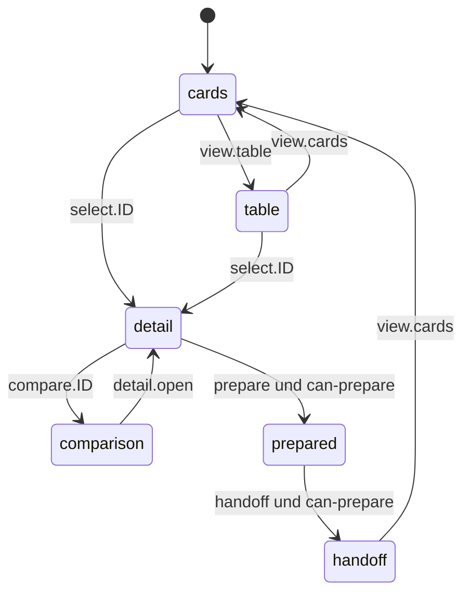

# Drei Cases

Die JSON-Dateien unter `packages/cases/src/fixtures` sind bewusst synthetisch.
`SimulationDatasetSchema` prüft Herkunft, eindeutige IDs, Recordart, Preise in
Euro-Cent, Varianten/Bestand und Angebotszeiten. Die Nutzerfreigabe für realistisch
wirkende Mockdateien ersetzt keine Kennzeichnung als Simulation.[^implementation]

| Case | Fachfelder | Vorbereitung erlaubt wenn |
|---|---|---|
| Immobilien | Ort, Fläche, Zimmer, Nebenkosten, Kaution, Energieklasse | ausgewählter Record verfügbar |
| Commerce | Kategorie, Steuer, Versand, Varianten, Bestand | Auswahl verfügbar und gewählte Variante auf Lager |
| Reise | Check-in/-out, Erwachsene, Rating, Storno, Quote-Zeiten | Auswahl verfügbar und Szenariozeit vor Quote-Ablauf |

Jeder Zustand registriert weitere erlaubte View-/Sort-/Selection-Events. Das
Diagramm zeigt den typischen Weg, nicht jede kombinatorische Kante. Das
[API-/Schema-Inventar](api-reference.md) und der erzeugte Flow bleiben für die
vollständige Eventmenge maßgeblich.

`scenarioTime` ist eine kontrollierte Szenariozeit, nicht die laufende Browseruhr.
„Quote ablaufen lassen“ setzt sie im Case auf zwanzig Minuten nach dem Quellenzeitpunkt.
„Szenariozeit zurücksetzen“ stellt den Ausgangspunkt wieder her. Ein gültiger
Deep Link darf die Guardprüfung nicht umgehen.

`prepared` und `handoff` visualisieren eine Vorbereitung/Übergabe. Sie führen weder
Anfrageversand noch Kauf, Reservierung oder Buchung aus. Echte Providerzugänge,
Preis-/Bestandsrevalidierung, Hostauth und Transaktionsbelege sind offene Adapterarbeit.
Die recherchierten Anbieteroptionen stehen im bestehenden Anbieter-Rechercheplan;
ihre Zugangsmöglichkeiten sind kein bereits integrierter Dienst.

[^implementation]: Implementierung und SHA-256-Dateibindung im Quellinventar.
