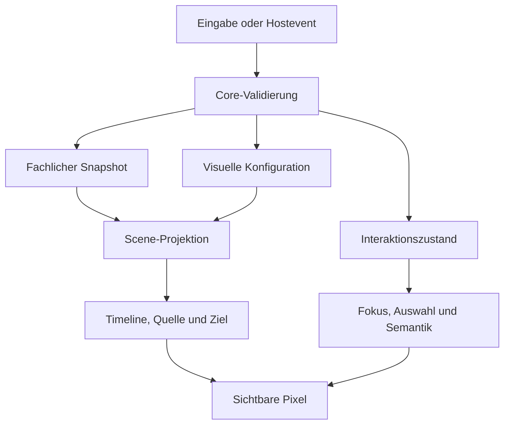
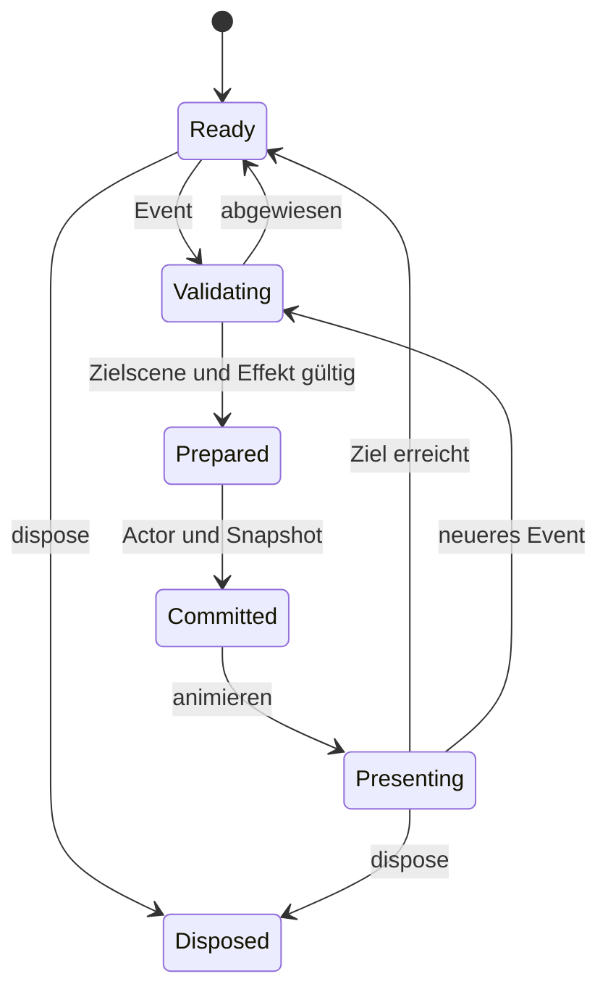
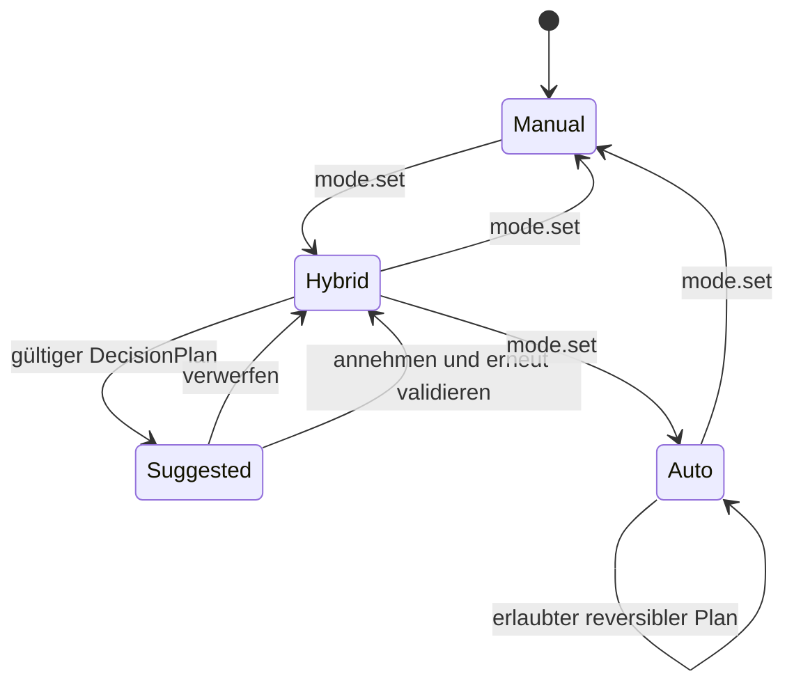

# Zustandsbesitzer

Der RuntimeSnapshot besitzt Flow, fachlichen State, Felder, Modus und Revision.
InteractionState besitzt Fokus/Hover/Press/Composition. VisualState besitzt
Effekteinstellungen, Fähigkeiten, aktuelle/gespeicherte Effektpläne und eine eigene
Revision. Rendererzustand wie Pause oder Replay gehört zur Präsentation.[^implementation]

Die Animation besitzt keine fachliche Zwischenrevision. Unterbrechungen können von
der aktuell gezeichneten Geometrie zum neu bestätigten Ziel retargeten. Externe
Aktionen werden dadurch nicht rückgängig gemacht. Replay einer Aufnahme ändert
keinen fachlichen Zustand; eine echte neue Bedienung beendet den Importmodus.

Ein gültiges `navigation.restore` übernimmt den fachlichen Historyzustand und
löst den zur aktuellen Effektpolicy passenden Darstellungsplan aus. Das erzeugt
keine fachliche Action. Off/Reduced-Motion stellen das Ziel sofort her und löschen
einen veralteten Live-Replaybezug. Historische Core-Replays ohne gespeicherten
Historyplan behalten ihre ursprüngliche sofortige Bedeutung.

Ein verborgenes Dokument suspendiert die Timeline. Die Rückkehr hebt nur diese
Suspendierung auf; eine vorherige manuelle Pause bleibt bestehen. Ein Wechsel
zu Reduced Motion setzt unmittelbar den gültigen Endpunkt. Das sind getrennte
Präsentationsregeln, keine zusätzlichen fachlichen Revisionen.

Der Diagrammteil „DecisionPlan“ beschreibt implementierte Core-Regeln. Er belegt
keine vorhandene Intent-/Providerpipeline; `intelligence` liefert derzeit nur den
Providervertrag. Die Studio-Designanalyse ist ein separater Advisory-Pfad.

[^implementation]: Implementierung und SHA-256-Dateibindung im Quellinventar.
