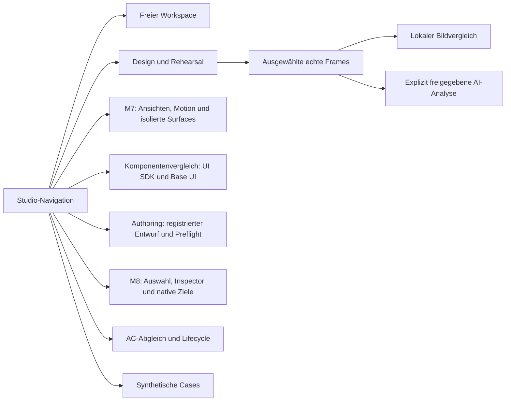
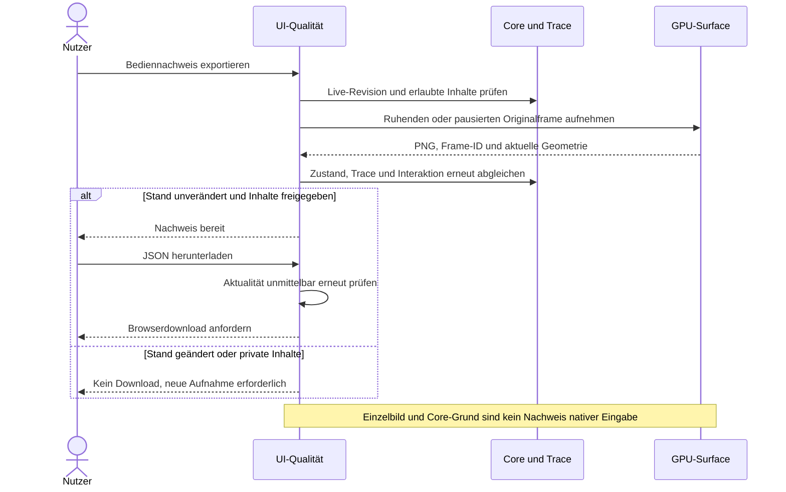
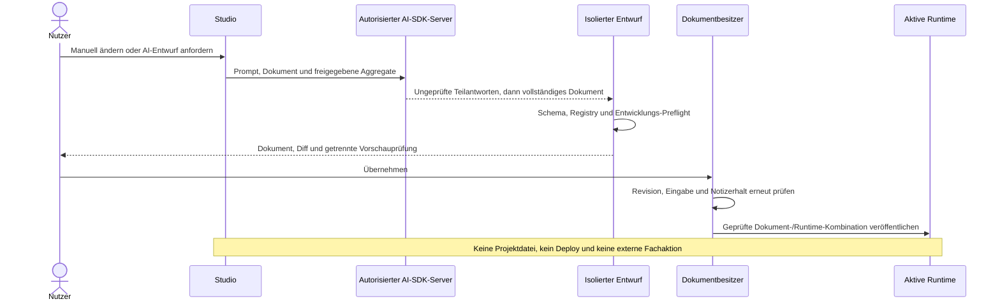

# Studio

Die Studio-Bedienoberfläche ist DOM-basiert und nutzt Base-UI-Primitives, native
Controls und die echten GPU-Surfaces. M8 ergänzt eine begrenzte Vergleichsroute
mit den öffentlichen React-Primitives des UI SDK. Base UI dient als Referenz und Werkzeug für
Bedienverhalten/Komposition; seine HTML-Darstellung wird nicht als unsichtbarer
Ersatz für sichtbare Runtime-Elemente verwendet.[^implementation]

| Oberfläche | Statebesitz | Hauptaufgabe |
|---|---|---|
| Formvergleich | zwei Surfaces am selben Core mit getrennten Fokuszuständen | ursprünglichen und strukturellen Sampler gemeinsam scrubben |
| freier Workspace | eigene Core-Runtime plus lokales Panel-/Backendsetting | Exploration, Effekte, Trace, Anatomy und Qualität |
| Input-/State-Proof | eigene Proof-Runtime | Feld-/Modus-/Transition-Verträge nachvollziehen |
| Design & Rehearsal | eigene Manual-Runtime und lokaler Reviewstate | fünf Beats, Capture, Vergleich und AI-Review |
| M7-Nachprüfung | eigene Workspace-Runtime und getrennte imperative Surface-Besitzer | feste Ansichts-/Größenmatrix, native Umgebungsbeobachtung, Ressourcen und Capturegrenzen |
| Komponentenvergleich | gemeinsame Workspace-Core-Runtime; Bibliothekswahl und DOM-Dialog lokal | UI SDK gegen Base UI bei derselben GPU-Vorschau |
| Kompositionseditor | Host besitzt Dokumentversion und aktive Runtime; Entwurf getrennt | registrierte Palette, AI-Stream, Entwicklungsdiff und kontrollierte Übernahme |
| M8-Matrix | eigene Manual-Workspace-Runtime mit kontrollierter Auswahl | fünf Phasen je Übergang, native DOM-Zielgeometrie und buildgebundener Export |
| AC-Abgleich | kanonisches Register plus lokaler Lifecycle-Proof | Scope, Nachweise, verbleibende Gates |
| Case-Simulationen | eigene Runtime je Datensatz | Suche, Auswahl, Vergleich und Guardfehler |

Die isolierte Rehearsal-Runtime verhindert, dass eine geführte Story den freien
Showcase heimlich zurücksetzt. Ein Tabwechsel in der Werkstatt verändert keine
fachliche Revision. Der AI-Tab bleibt montiert, damit Konfiguration, Befunde und
Bewertungen beim Öffnen eines Vergleichsbilds erhalten bleiben; versteckte Panels
bleiben für die Bedienung inaktiv.

Die M7-Werkstatt unter `/studio/m7` hat getrennte Backendwahlen und Berichte für
Workspace und isolierte Surfaces. Ein Erfolg in einem Panel qualifiziert nicht
automatisch das andere. Matrixevents werden bewusst kontrolliert ausgelöst;
native Pointer-/Tastatur-/History-Eingaben haben eigene Journeynachweise. Die
Umgebungsbeobachtung protokolliert echte Media-/Sichtbarkeitsereignisse, verändert
aber keine Betriebssystemeinstellung. [Qualitätsprüfung](quality-testing.md)
führt Fallzahlen, Exportgrenzen und Nichtaussagen auf.

Ein vollständiger grafischer Floweditor mit Monaco, Undo/Redo, dauerhaftem
Projektöffnen, Konfliktauflösung und immutable Runs ist Zielarbeit. Die aktuellen
Inspector-/Previewbereiche dürfen nicht als vollständiges Authoringprodukt
beschrieben werden. [Releasegrenzen](release-roadmap.md) führen diesen Unterschied fort.

## UI SDK und Base UI am gleichen Workspace

`/studio/behaviors` lädt den echten Bestand serverseitig mit `readWorkspace`.
Wählbar sind UI SDK 0.1.0-beta.13 und Base UI 1.9.0. Für Beta.1 und Beta.13 wurden dieselben 40 Verhaltensprüfungen in isolierten Installationen ausgeführt. Genau ein
DOM-Adapter ist aktiv; Tabs für die Ansicht und Select für die Ebene lesen
kontrollierte Werte aus derselben Core-Runtime. Ein Bibliothekswechsel ersetzt
weder Daten noch GPU-Surface. Abgewiesene Core-Requests werden nicht als lokaler
Erfolg dargestellt.

Der Vergleich verwendet die öffentlichen Pakete `@ui-sdk/react/tabs`,
`@ui-sdk/react/select` und `@ui-sdk/react/dialog` sowie die entsprechenden
öffentlichen Base-UI-Bausteine. „Kontext prüfen“ öffnet einen DOM-Dialog mit den
aktuellen Workspace-Metadaten. Dieser Modalvergleich ist vom nichtmodalen
GPU-Auswahlinspector zu unterscheiden. Escape und die Rückkehr zum Auslöser
gehören zu den jeweiligen Dialogprüfungen. Während der Dialog offen ist, bleibt
der Bibliothekswechsel gesperrt.

Die Anzeige „WebGPU aktiv“ beziehungsweise „WebGL2 aktiv“ stammt aus den
Surface-Metriken; eine Fallbackursache wird sichtbar. Das lokale Protokoll hält
Interaktion, Adapter, Eingabegrund und Core-Revision fest. Es ist kein automatisch
berechneter Bibliotheksscore. Die Route startet keinen AI-Aufruf und aktiviert
keine Fluid-Agent-Bridge.

Der eigene native Vergleich vom 13. November besteht auf beiden Adaptern:
Tabelle → Karten → Map und Kernel-Auswahl per Tastatur, Dialogfokus, Tab-Begrenzung,
Escape und Rückkehr zum Trigger. Beide nutzen dieselbe Runtime, elf Module,
Theme, konfigurierten Seed 42 und eine WebGPU-Surface bei 1280 × 900. Der
Detail-Tab ist ohne Modulziel fokussierbar, aber nicht aktivierbar. Öffnen,
Schließen und Bibliothekswechsel ändern die Fachrevision nicht. Die nach einem
Browserbefund korrigierte Eingabeherkunft wurde erneut nativ geprüft. Das
belegt diesen lokalen Ablauf, keine Screenreader-/Mobilefreigabe.

Die Teileentscheidung behält Base UI für Studio-Tabs, Select und Dialog.
Beide erfüllen den benötigten lokalen Ablauf; eine zusätzliche erforderliche
Fähigkeit des SDK wurde dabei nicht nachgewiesen. Der identische isolierte
Bundlelauf ergibt für die drei kombinierten SDK-Adapter 73.165 gzip Bytes
gegenüber 56.386 bei Base UI, also +16.779 Bytes. Das ist kein gesamtes
Next.js-Anwendungsdelta und kein Qualitätsranking. Die gepinnte Beta-Version
bleibt mit ihren öffentlichen DOM-Bausteinen im Vergleichslabor verfügbar.
Die SDK-Selection wird hingegen im Fluid-Core übernommen; Typeahead bleibt
wegen der benötigten expliziten Uhr timerfrei bei Fluid.

T63 implementiert eine ausdrücklich begrenzte Agentenschnittstelle im Core.
T64 ergänzt die getrennte Authoring-Arbeitsfläche. Die vorhandene AI-Designanalyse
unter Rehearsal bleibt ein eigenes serverseitig angebundenes Werkzeug und ist
kein Nachweis für den neuen Generierungspfad.

## M8-Matrixwerkzeug

`/studio/m8` führt je tatsächlicher Browsergröße und Backend 18 Übergänge mit
90 Kontrollpunkten aus. Tabelle↔Karten, Karten↔Map und Map↔Tabelle werden mit
den drei neuen Effekten geprüft. Zwei vorhandene Modul-IDs und der offene
Inspector werden vor jedem Übergang durch gültige Core-Events hergestellt.
Die Auswahl muss in allen Phasen erhalten bleiben.

Zusätzlich zu Originalbild, Textaudit und Präsentationsgeometrie liest die Route
die nativen DOM-Zielbounds. Rotation wird in achsenparallele CSS-Bounds
umgerechnet; fehlende oder doppelte Ziele, falsche Part-Identität, abweichender
Checked-Zustand oder mehr als 1 CSS-px Geometrieabweichung schlagen fehl.
Das ist eine lokale lesende Messung, keine ausgeführte native Eingabe.

„M8-Matrix prüfen“ startet, „Matrix abbrechen“ beendet den Lauf und
„M8-Bericht herunterladen“ exportiert das eigene M8-Format mit tatsächlicher
Browser-/Surfacegröße, Build, Datensatz und Backend. Resize oder ein versteckter
Tab während der Aufnahme verhindert einen vollständigen Erfolgsbericht.
Die vier Breiten und zwei Backends werden als acht getrennte Läufe bedient.
Fünf Phasen ersetzen weder einen Film noch visuelle Review, native Journeys oder
Echtzeitmessung. Die historischen M7-Berichte behalten ihr Schema und ihre
abweichenden Detail-Richtungen. Die neue Matrix wurde inzwischen separat ausgeführt: acht Berichte mit
144 Fällen und 720 Kontrollpunkten bestehen die automatisierten Struktur-/
Geometrieprüfungen. Sieben Originalbilder besitzen eigene visuelle Review.
Unterschiedliche Seeds verhindern eine Same-Seed-Pixelvergleichsbehauptung.
Eine abschließende M8-Gesamtfreigabe folgt daraus nicht.

## Gebundener nativer Bediennachweis

Der explizite Showcase-Export verwendet `NativeProofSchema` und den gemeinsamen
`captureNativeProof`-Orchestrator. Er bindet genau einen unveränderten PNG-Frame
an Build-/Run-ID, Datensatzdigest, Snapshotrevision, Trace-Metadaten, aktuelle
Partidentitäten und tatsächliche native Zielbounds. Browser- und Surfacegröße
werden getrennt gespeichert; ein Framezähler/Progress/Backend-Mismatch oder
Änderungen während asynchroner Aufnahme verwerfen den Nachweis.

Nur Live-Darstellung ist zulässig, ruhend oder ausdrücklich pausiert. Freie
Eingaben und sensitive aktuelle, Quell- oder Zielparts verhindern die Aufnahme;
Pixel werden nicht als vermeintlich redigiert ausgegeben. Im Trace verbleiben
höchstens 1000 Metadateneinträge ohne Payloads oder Fehlermeldungsdetails.
`applicationReportedReason` ist kein `isTrusted`-Nachweis. Tatsächliche native
Bedienung wird gesondert vom Operator protokolliert.

„Bediennachweis exportieren“ bereitet zunächst einen Blob vor. Erst der explizite
Link „JSON herunterladen“ fordert den Browserdownload an. „Bereit“ bedeutet
nicht gespeichert. Vor dem Klick wird Aktualität erneut geprüft; Zustandswechsel,
Resize oder Unmount invalidieren den vorbereiteten Nachweis und geben die
Object-URL frei. Der Export verändert keine Fachwerte und führt keinen Upload,
Provideraufruf oder zweiten Renderloop ein.

Die tatsächlichen Desktop-/Kompaktarchive aus Build `3cf71edcdbac59235548`
enthalten 17 beziehungsweise 22 Traceeinträge, je 45 native Ziele mit null
Geometrieabweichung und separat geprüfte Original-PNG-Bytes. Der gemeinsame
Datensatzdigest bleibt gleich; die Auswahl folgt der jeweiligen Bedienfolge.
Die frühe Matrix `dfc8a56ebe0e58ace2ea` behält ihren eigenen Nachweis und wird
nicht auf den neuen Build umetikettiert.

## Registriertes Authoring

`/studio/authoring` lädt echte Workspace-Daten. Der Nutzer bearbeitet einen Titel
und das deklarative Dokument oder fordert bewusst einen AI-Entwurf an. Die
Palette besteht aus Kennzahlen, einem erforderlichen Modul-Explorer und einer
optionalen lokalen Notiz. Reihenfolge, initiale Ansicht und Akzent ändern die
Komposition; unbekannte Komponenten oder ausführbarer Modellcode werden abgewiesen.

Die rechte Arbeitsfläche zeigt den angewandten Stand. Ein gestreamter Entwurf
ändert diesen nicht. „Entwurf prüfen“ validiert das Dokument, prüft stabile IDs,
führt einen echten TypeScript-`noEmit`-Lauf gegen die installierten Contracts aus
und prüft begrenzte lokale Runtime-Projektionen. „Änderungsdiff ansehen“ und
„Diff herunterladen“ machen das Resultat prüfbar; beide installieren nichts.
Ein Preflight ist kein GPU-/Screenreader- oder Performance-Gate.

„Entwurf übernehmen“ prüft Dokument- und Runtime-Revision erneut, schützt laufende
Eingabe/Composition und eine nichtleere Notiz. Eine vollständig aufgebaute
Kandidatenruntime übernimmt Auswahl, Suche, Filter und Werte, bevor der Host
Dokument und Runtime gemeinsam austauscht. Die vorherige Runtime wird nach dem
UI-Wechsel freigegeben. „Entwurf visuell ansehen“ erstellt nach bestandenem
Preflight eine eigene Kandidatenruntime mit übernommenen Ausgangswerten.
Die Anzeige kennzeichnet „Isolierter Entwurf · noch nicht übernommen“ und
„Aktiv“; die Umschaltung verändert den aktiven Workspace nicht. Interaktionen
in der Vorschau bleiben in deren Runtime. „Entwurf übernehmen“ erstellt und
prüft den Kandidaten erneut aus den aktuellen aktiven Werten; es übernimmt
keine während der Vorschau ausprobierten Fachänderungen. Verwerfen, ein neuer
Entwurf oder Unmount gibt die Kandidatenruntime frei. Dieser neue UI-Pfad
benötigt weiterhin seine eigene Browserabnahme.

Der neue Modellpfad verwendet serverseitig Vercel AI SDK `streamText` mit
`Output.object` und OpenAI. API-Key, lokale Autorisierung und konservative
Budgetreservierung bleiben auf dem Server. Input-/Outputgrenzen, Deadline und
Abort begrenzen den Auftrag; bei fehlender Usage bleibt die Reservierung
konservativ verrechnet. Review und Authoring belasten denselben dauerhaften, lokalen Projektetat. Zwei Prozesse am selben Projekt koordinieren ihre Reservierungen über SQLite. Getrennte Installationen haben eigene Etats.

An den Provider gehen Prompt, bestehendes Designdokument, Registry und drei
Aggregatwerte. Notiz, Auswahl und Suchtext gehören nicht zum automatisch
bereitgestellten Kontext. Der eingegebene Prompt selbst wird ausdrücklich
übertragen. Ohne Provider bleibt die manuelle Dokumentprüfung verfügbar.
Ein eigener lokaler Live-Lauf am 13. November 2026 hat diesen Pfad tatsächlich
mit OpenAI und WebGPU ausgeführt: gültiger Indigo-/Tabellenentwurf, Typecheck ohne
Diagnose, 16 lokale Preflight-Projektionen, isolierte GPU-Vorschau, Rückkehr zum
unveränderten aktiven Workspace und ausdrückliche Übernahme mit erhaltener
Auswahl und Notiz. Das Protokoll `live-authoring.json` bindet sechs Quellhashes;
die UI zeigte Modell und Usage. Spätere Änderungen an API-Route und Workshop
werden separat requalifiziert; der ursprüngliche Lauf wird nicht auf den
aktuellen Gesamtquellstand umetikettiert. Er archiviert keinen Response-ID-Beleg, Prompt,
Notizwert oder Key. Dieser konkrete Funktionsnachweis ist keine vollständige
Fehlerfall-, Accessibility-, Hardware- oder M8-Freigabe.

[^implementation]: Implementierung und SHA-256-Dateibindung im Quellinventar.
