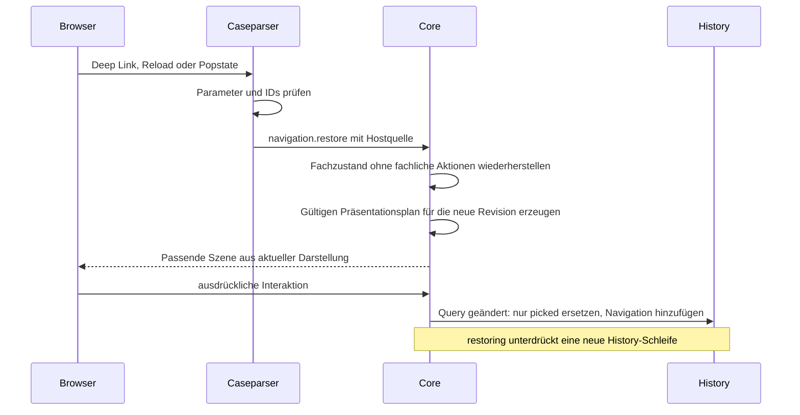
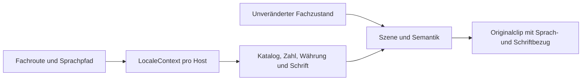

# Aktuelle Routen

| Route | Eigentümer | Verhalten |
|---|---|---|
| `/` | Showcase | Workspace, alternativ Input-/State-Proof über lokale UI |
| `/studio` | Aufgabenübersicht | Navigation zu Authoring, Formübergängen und Prüfung |
| `/studio/transitions` | Bewegungsvergleich | Derselbe Core steuert zwei GPU-Flächen. Scrubbing und Akzentwahl bleiben in der Sitzung. |
| `/api/local-project` | lokaler Projektspeicher | Geschützte Entwurfsversionen, Review-Nachweise und Budgetstand |
| `/api/evidence?criterion=…&index=…` | Abnahme | Das Register identifiziert den Download. SHA-256 wird vor dem Versand geprüft. |
| `/studio/rehearsal` | isoliertes Studio | Story, Frames und Prüfpanels im lokalen React-State |
| `/studio/flows?module=core` | Flow Explorer | validierter Modulkontext, lokale Review-Runtime; keine Freigabe über URL |
| `/studio/behaviors` | Bibliotheksvergleich | UI SDK oder Base UI steuert eine gemeinsame Workspace-Runtime; Adapterwahl und Dialog lokal |
| `/studio/authoring` | Kompositionseditor | aktive Dokumentversion, isolierter Entwurf, Preflight und ausdrückliche Übernahme |
| `/api/authoring` | lokaler Node-Server | eigene Session, begrenzter Modellstream oder Entwicklungs-Preflight |
| `/studio/m8` | begrenzte Multipart-Qualifikation | sechs Richtungen, kontrollierte Mehrfachauswahl, Inspector und native Zielgeometrie; ein Bericht je tatsächlicher Größe und Backend |
| `/studio/m7` | begrenzte Nachqualifikation | Workspace-Matrix, isolierte Surface-/Privacy-Prüfung und getrennte lokale Berichte |
| `/studio/acceptance` | Abgleich | kanonische AC-Matrix und Lifecycle-Proof |
| `/studio/simulations/[caseId]` | Simulation | real-estate, commerce oder travel |
| `/api/design-review` | lokaler Serveradapter | GET Konfiguration/Session, POST freigegebene Analyse |
| `/api/validate` | Server | Flow-Validierung für den Proof |

Projekt-/Run-/Compare-Routen des Zielplans existieren noch nicht als persistentes
Studio-Navigationsmodell. Frame- und Befundnavigation ist derzeit lokal, nicht
ein unveränderlicher Deep Link auf gespeicherte Runs.[^implementation]

Die neue M7-Route ist ein Werkzeugziel. Prüfframes, sensible Marker, Seed,
Fortschritt und Reportpayloads werden nicht in ihre URL geschrieben. Die
Workspace-URL-Regeln bleiben für tatsächliche Browserjourneys separat maßgeblich;
ein Matrixlauf erzeugt keine zusätzliche produktive Fachnavigation.

## Workspace

Serialisiert werden `view=table|cards|map|detail|compare|atlas`, `sort=name|files|dependencies`,
`direction=asc|desc`, `selected`, `group=all|Kernel|Adapter|Tooling` und seit M8
wiederholte `picked`-Schlüssel für die Mehrfachauswahl.
M9 ergänzt `metric=lines|files`, `atlasGroup=all|Kernel|Adapter|Tooling` und
`differences=0|1` für die neuen Perspektiven. Die Modul-ID und `picked` bleiben
gemeinsam; die Darstellung erzeugt keine Kopie der Daten. Siehe [Perspektiven](perspectives.md).
Die Geschichte „Karten → Vergleich“ setzt `cards=selected`. Die Ausgangsansicht enthält damit nur die gewählten IDs. „Alle Karten anzeigen“ stellt den vollständigen Katalog her. Der Link „Workspace“ im Studio verwendet die zuletzt besuchte kanonische Workspace-URL aus der Tabsitzung.
Suche, Farbpalette, Fokus, der offene Kontextinspector, Secrets, Modus, Effekte und
Animationsfortschritt gehören nicht in diese URL.
Detail benötigt eine existierende Modul-ID. Bekannte Parameter werden validiert;
unbekannte Querykeys werden vom Workspaceparser nicht übernommen.

Der Workspace schreibt neue Navigation, Sortierung oder Gruppe mit `pushState`.
Ändert sich ausschließlich die Mehrfachauswahl, ersetzt `replaceState` den
aktuellen Eintrag. So erzeugt jede Checkbox keinen eigenen Zurück-Schritt.
`picked=core&picked=webgpu` beschreibt zwei IDs; die Ausgabe ist stabil sortiert.
Parser und Core prüfen alle Schlüssel gegen die vorhandenen Module, lehnen
Duplikate ab und übernehmen eine fehlende Mehrfachauswahl als leere Liste.
`selected` bleibt davon unabhängig die einzelne Detail-ID.

Back/Forward liest beide Auswahlverträge aus dem referenzierten Eintrag und
führt keine neue fachliche Action aus. Der Restaurierungspfad unterdrückt eigene
History-Einträge. Simulationen behalten ihren gesonderten Push-Vertrag. Die
Vergleichsroute `/studio/behaviors` hat derzeit keine persistierte Workspace-
Query; ihre Adapter- und Dialogwahl ist lokaler Werkzeugzustand. Das umfassende
Projekt-/Editor-URL-Modell bleibt Zielarbeit.

Die native M7-Nachprüfung fand am 4. November einen konkreten Unterschied zwischen
Fachzustand und Darstellung: Back/Forward stellte die Domain wieder her, ließ aber
den bisherigen Clip im Szenarioexport stehen. Der korrigierte Pfad erzeugt für
`navigation.restore` einen passenden Präsentationsplan mit geschützten IDs und
übernimmt die tatsächlich sichtbare Darstellung. Ein sofortiger Live-Wechsel
entfernt stattdessen den veralteten Replaybezug. Es werden dabei weiterhin keine
fachlichen Transition-Aktionen oder neuen History-Einträge ausgeführt.

Historische Core-Aufzeichnungen ohne einen solchen History-Präsentationsplan
bleiben ausdrücklich sofortig lesbar. Die Änderung verändert weder V2/V3- noch
Rezeptversionen. Fehlgeschlagene native History-Exporte des vorherigen Builds
bleiben negative Nachweise; neue Tests und Browserpaare erhalten einen eigenen
Buildbezug.

## Simulationen

Die Query trägt View, Auswahl, Vergleichs-ID, Sortierung und Variantennummer.
Suchtext, Entwurf und Szenariozeit bleiben lokal. Auswahl und Vergleich werden
gegen den aktuellen Datensatz geprüft. Back/Forward darf keine Übergabe oder
externe Action ausführen. Ein zurückgekehrter `prepared`-Zustand ersetzt keine
aktuelle Verfügbarkeits-/Quote-Guardprüfung.

## Authoringroute

`/studio/authoring` benennt die Arbeitsfläche. Prompt, generierte Teilantworten,
Notiz, Auswahl und API-Key werden nicht in die URL geschrieben. Dokumentrevision
und Runtime-Revision gehören zum Übernahmevertrag, nicht zu einer behaupteten
persistenten Projektroute. Reload oder Navigation ist keine gespeicherte
Projektwiederherstellung. GET auf `/api/authoring` eröffnet eine getrennte lokale
Session; POST unterscheidet Generierung und Preflight. Diese Route schreibt keine
Projektdateien und erzeugt keine freie Navigation aus Modellantworten.

## Statische Knowledge-Ziele

`/knowledge/engineering/handbook.html` und `/knowledge/public/handbook.html` sind
statische Lesefassungen unter derselben Studio-Herkunft. Ihre relativen Bilder,
Schriften, Mermaid-Skripte und OKF-Dateien liegen im jeweiligen Unterverzeichnis.
Die Sidebar öffnet sie in einem eigenen Tab; dadurch verändert sich weder der
fachliche Workspacezustand noch seine History. Der Build-/Dev-Schritt kopiert
geprüfte Bundledateien nach `apps/studio/public/knowledge`. Diese Kopie ist
generiert und nicht die Inhaltsquelle.

[^implementation]: Implementierung und SHA-256-Dateibindung im Quellinventar.

## Sprachgebundene Einstiege

`/de`, `/en` und `/fr` wählen den Hostkontext bereits für die erste Serverantwort. Ein Link ohne Präfix berücksichtigt eine gespeicherte Wahl, dann `Accept-Language`, zuletzt Deutsch. `replaceState` ersetzt beim Sprachwechsel nur den Pfadanteil der Sprache. Suchparameter, Auswahl, Fragment und Eintragsanzahl bleiben erhalten. Die Studio-Kataloge stehen lokal bereit. Eingebettete Hosts können getrennte Kataloge laden und die zuvor valide Projektion bei Fehlern bewahren.

