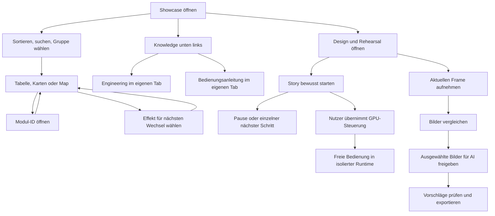

# Nutzerwege

Die UI verbindet Exploration, nachvollziehbare Übergänge und getrennte Prüfung.
Der freie Showcase verändert den tatsächlichen lokalen Core; die geführte
Rehearsal-Story besitzt eine eigene isolierte Manual-Runtime.[^implementation]

## Autorität

Der Core prüft fachliche Invarianten, Guards und explizite Events. Eine Führung
aktiviert nur den im Storyvertrag benannten Part mit dem erwarteten Event. Ein
Pointer-/Tastatureingriff in die GPU-Vorschau stoppt weitere Führungsschritte.
Die Führung darf nicht heimlich Tastaturfokus übernehmen.

AI-Review besitzt keinen Event-Ausführungsweg in die Anwendung. „Bild öffnen“
wechselt die Prüfpanel-Auswahl, nicht die Fachansicht. Bestätigen/Verwerfen ist
lokale Bewertung; eine bestätigte Beobachtung ist nicht automatisch eine Änderung.

## Fehlerwege

Ungültige URLparameter zeigen einen korrigierbaren Fehler; Reset setzt definierte
Defaults. Ein fehlendes GPU-Backend zeigt eine Diagnose. Fehlerhafte Aufnahme,
veralteter Snapshot, fehlende Pixelabdeckung oder nicht konfigurierter AI-Zugang
bleiben ausdrücklich sichtbar. Ein Fehler darf nicht als erfolgreicher Run oder
Anbietertransaktion erscheinen.

[^implementation]: Implementierung und SHA-256-Dateibindung im Quellinventar.
