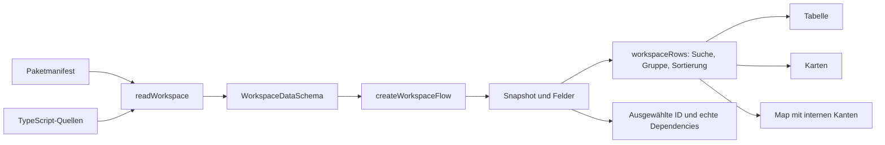
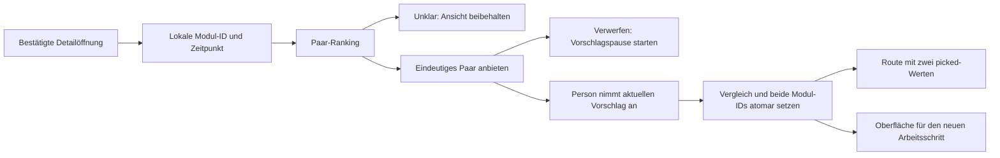

# Workspace-Daten

`readWorkspace` läuft serverseitig. Es liest die Projektwurzel, Paketmanifeste und
`src/**/*.ts(x)`, zählt Dateien/Zeilen und ignoriert Symlinks. Die Gruppen Kernel,
Adapter und Tooling werden explizit aus Paketnamen zugeordnet. Interne Beziehungen
werden aus `@fluidkit/`-Dependencies abgeleitet.[^implementation]

Diese Ansicht ist ein lokaler Bestandsimport, keine Live-Abfrage eines externen
Anbieters und keine erfundene Produktmetrik. Zeilenzahlen können sich mit dem
Quellstand ändern. Der Schema-Deckel von 1.000 Modulen ist kein Performancebeweis
für 1.000 vollständig gezeichnete Karten.

`workspaceRows` filtert Namen/Gruppen lokal, sortiert Zahlen numerisch und löst
Gleichstände anhand stabiler IDs. `createWorkspaceFlow` registriert erlaubte
View-/Selection-/Sort-/Filter-/Reset-Events für jede Ansicht. Der Wechsel ändert
nicht die Modulidentität oder die fachlichen Quelldaten.

Die gemeinsame Projektion zeichnet alle vier Ansichten, die Such- und
Gruppensteuerung sowie die Effektleiste. Bei schmalen Surfaces werden Overline,
Schriftrollen und Innenabstände angepasst. Die historische Alpha-Stichprobe vor M8 prüfte
Tabelle/Karten/Detail bei Surfacebreiten von 268 bis 838 CSS-px ohne Textbefunde.
Die Dependency Map besitzt zusätzliche kompakte/wide Geometrie; sie ist keine
vollständig qualifizierte generische Graph-Editorbibliothek.

[Routing](url-routing.md) beschreibt, welche Felder in den Deep Link gehören.
[Userflows](user-flows.md) beschreibt die Bedienketten. Suche bleibt lokal und
ist absichtlich kein URL-Feld.

## M8: ein Modul als zusammengehörige Parts

`WORKSPACE_MODULE_DEFINITION` beschreibt Öffnen, Auswahl und Zusammenfassung als
getrennte Parts derselben Komponente. Tabelle, Karten und Map binden diese Parts
an ihre jeweilige Geometrie. Ein Klick auf die Auswahlmarkierung ändert das
kontrollierte Feld `selection`; ein Öffnen-Command setzt weiterhin `selected`
und navigiert zum Moduldetail. Beide Aktionen haben unterschiedliche Bedeutung.

Die Auswahlleiste zeigt Anzahl und gegebenenfalls ausgeblendete gewählte Module.
„Sichtbare“ wählt die aktuelle gefilterte Reihenfolge, „Leeren“ leert die Auswahl.
„Details“ öffnet den GPU-Kontextbereich mit zusammengefassten echten Quell- und
Abhängigkeitsdaten sowie den ausgewählten Modulnamen. Er ist eine nichtmodale
Region; andere Workspace-Controls bleiben erreichbar. Schließen oder Escape
führt zum auslösenden „Details“-Control zurück. Suchtext und native Composition
behalten ihren eigenen Eingabeweg.

`inspectorOpen` gehört zum Core, wird aber nicht in die URL geschrieben.
Filter und Ansichtswechsel entfernen keine bestehenden ausgewählten IDs. Die
sichtbare Reihenfolge begrenzt neue Bereichs- und Alle-Operationen. Die
[URL-Projektion](url-routing.md) serialisiert die Mehrfachauswahl separat als
wiederholte `picked`-Parameter.

Die M7-Effektlibrary stellt auch diese gemeinsamen Parts dar. Ihre bisherigen
Buildnachweise bleiben historische Nachweise: neue Geometrie, Semantik und
Trefferflächen besitzen eigene M8-Prüfungen. Die vollständige lokale Matrix
mit 144 Fällen/720 Checkpoints und native Desktop-/Kompaktarchive ergänzen sich.
Die nativen Exporte binden Originalbild, Trace und Geometrie an denselben Run;
sie ersetzen keine vollständige Film-, AT- oder Hardwareprüfung.

## Registrierte Authoring-Komposition

`createAuthoredWorkspaceFlow` erweitert den vorhandenen Flow um das sensible
Feld `workspaceNote` und übernimmt die im Dokument gewählte initiale Explorer-
Ansicht. `authoredWorkspaceScene` komponiert die registrierten Abschnitte;
`authoredWorkspaceHeight` liefert aus denselben Daten die Hosthöhe.

Der Explorer verwendet weiterhin `workspaceScene` und seine bestehenden
Multipart-Module. Seine alte Heroüberschrift und das interne Effektdock entfallen
in dieser Einbettung. Der äußere Editor besitzt die Effektsteuerung. Neue
Abschnitte erhalten einen getrennten ID-Namensraum; `module-*`, Commands und
Collection bleiben erhalten. Die Kennzahlen sind Modulanzahl, summierte Quellen
und eindeutige Paketabhängigkeiten des realen Bestands.

Die Notiz ist eine native/GPU-Textbox. Ihr Feld und ihre dargestellten Parts
bleiben sensibel, auch bei leerem Wert. Surface-Capture wird dadurch bewusst
blockiert; das Authoring-Dokument und der Providerkontext enthalten keinen
Notizwert. Der Host verhindert zusätzlich, dass das Entfernen des Bausteins einen
nichtleeren Entwurf verschwinden lässt. Die Standard-Resetaktion löscht die Notiz
nicht. Die Fontprüfung umfasst ausgelieferte Fonts und sehr lange Labels;
zugängliche Namen behalten den Originaltext trotz visueller Zeilenumbrüche.

## Einen möglichen Vergleich aus Modulbesuchen ableiten

Die optionale Workspace-Assistenz führt zwei Entscheidungen getrennt aus. Der Ranker bestimmt aus den bestätigten Detailöffnungen der laufenden Sitzung, ob ein Vergleichspaar plausibel ist. Die Person entscheidet, ob der Workspace tatsächlich wechseln soll. Der manuelle Modus bleibt der Einstieg.

Der Ranker betrachtet höchstens 24 Beobachtungen in einem zweiminütigen Fenster. Jede Beobachtung enthält eine freigegebene Modul-ID und einen Zeitpunkt. Abwechselnde Öffnungen wie `core → webgpu → core → webgpu` können ein Paar qualifizieren. Wenn mehrere Paare in Frage kommen, umfasst die Rangliste standardmäßig bis zu drei Kandidaten und lässt sich auf eins bis fünf begrenzen. Der Score beschreibt die Stärke des Musters. Eine Gleichrangigkeit oder zu wenig Evidenz kann zur Enthaltung führen. Der Studio-Inspector erklärt die Beobachtungen. Bei aktiver Eingabe und im Replay unterbleibt die Anpassung.

Ein Vorschlag löst keinen Datenabruf und keine Transaktion aus. Vorladen anhand von Intent (T23), persönliche Varianten (T24) und Lernen aus Ergebnissen (T28) besitzen eigene Abnahmen. Der synthetische Prüfsatz bewertet einen festgelegten Zeitpunkt je Sitzung. Bei sieben Aufgaben mit Vergleichsziel schlug die Regel sechsmal das richtige Paar vor. Bei neun anderen Aufgaben enthielt sie sich achtmal. Beim Nachschlagen zweier unabhängiger Fakten erzeugte dieselbe Besuchsfolge einen unerwünschten Vorschlag. Wie hilfreich die Anpassung für reale Personen ist, erfordert die unabhängige Erhebung von Aufgabe und Ergebnis. [Kriterienscharfe Nachweise](acceptance-reference.md)

[^implementation]: Implementierung und SHA-256-Dateibindung im Quellinventar.
