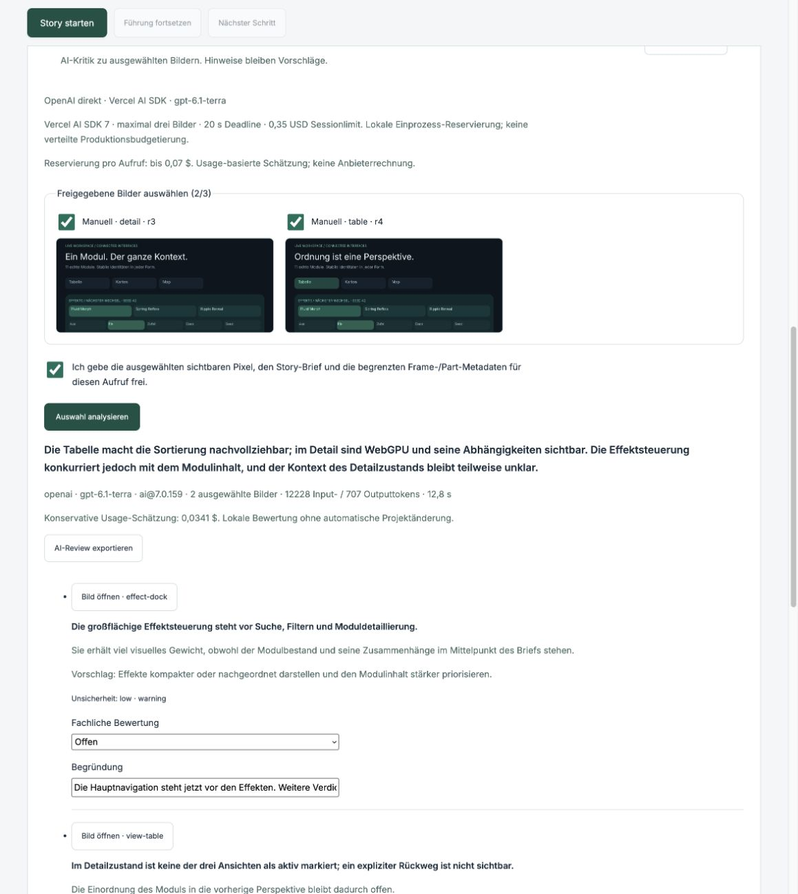

# Eine zweite Perspektive

Die AI-Analyse betrachtet ausgewählte Bilder und den Story-Brief. Sie kann
Hierarchie, Text, Dichte, Wiederholungen und Gestaltung kommentieren. Hinweise
bleiben Vorschläge. Sie führen keine automatische Projektänderung aus.[^product]

## Analyse starten

1. Nimm zuerst mindestens einen Frame auf.
2. Öffne „AI-Analyse“.
3. Wähle „AI-Zugang prüfen“. Kontrolliere Provider, Modell und Reservierung.
4. Wähle höchstens drei Bilder.
5. Lies den angezeigten Datenumfang und bestätige die Bildfreigabe.
6. Wähle „Auswahl analysieren“.
7. Prüfe Befunde anhand der zugehörigen Bilder und des jeweiligen Storyschritts.

Das abgebildete Beispiel stammt aus einem dokumentierten Live-Test desselben
Produktstands. Ein neues Bild oder ein neuer Lauf kann andere Hinweise ergeben.
Es handelt sich nicht um simulierte Providerantworten.

## Hinweise fachlich einordnen

„Bild öffnen“ springt zur lokalen Vergleichsansicht, nicht zu einem anderen
fachlichen Zustand. Die Bewertung kann Offen, Bestätigt oder Verworfen sein.
Ergänze eine Begründung. Ein positiver Befund kann ebenfalls bestätigt werden,
ohne dass ein Fix erforderlich wäre. „AI-Review exportieren“ speichert Befunde,
Herkunft, Usage und Bewertungen; Cookies und Keys gehören nicht hinein.

## Daten und Kosten

Es werden nur freigegebene Pixel, Brief und begrenzte Frame-/Part-Metadaten
gesendet. Keine automatische Analyse nach jeder Änderung. Die Anzeige nennt bis
zu 0,07 USD Reservierung pro qualifiziertem direkten Aufruf, 0,35 USD Sessionlimit,
fünf Aufrufe und 20 s Deadline. Angezeigte Usage-Kosten sind Schätzungen, keine
Anbieterrechnung. Bei Abbruch ohne Usage kann die Reservierung bestehen bleiben.

Wenn der Zugang fehlt, bleibt die normale Anwendung und lokale Prüfung nutzbar.
Die Administration hinterlegt den Key serverseitig; es gibt keinen Key-Dialog in
diesem Panel. Einzelbilder beweisen weder Bewegung noch Accessibility. Weitere
Grenzen stehen unter [Datenschutz](privacy.md) und [Fehlerbehebung](troubleshooting.md).

[^product]: Produktstand, tatsächliche Aufnahmerouten und Einschränkungen im Fakten-/Bildregister.
