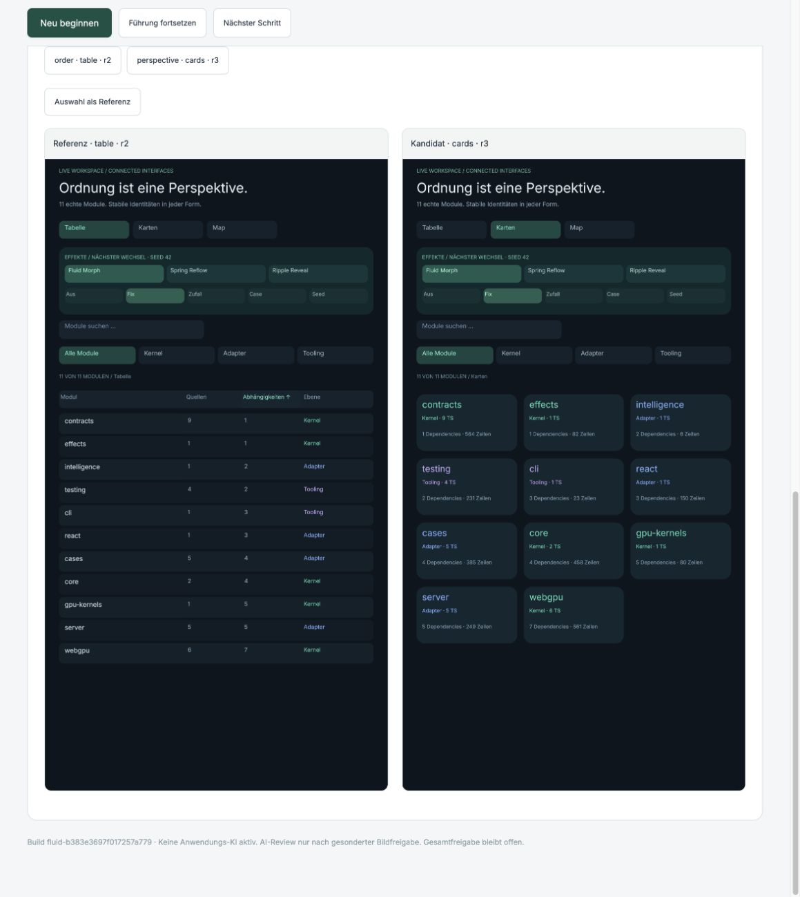

# Eine Aufnahme erstellen

**Voraussetzung:** Die GPU-Vorschau ist bereit. Stelle einen gewünschten Zustand
her oder pausiere die Story an einem geeigneten Schritt.

1. Wähle „Aktuellen Frame aufnehmen“.
2. Die Präsentation wird für die Aufnahme angehalten.
3. Erzeuge einen zweiten gewünschten Zustand und nimm ihn ebenfalls auf.
4. Öffne den Tab „Vergleich“.
5. Wähle das erste Bild und „Auswahl als Referenz“.
6. Wähle das zweite Bild als Kandidaten.

**Erwartetes Ergebnis:** Zwei tatsächlich gerenderte GPU-Aufnahmen stehen mit
State und Revision nebeneinander. Die Auswahl eines Bilds verändert nicht die
aktuelle fachliche Workspace-Ansicht.[^product]

## Was eine Aufnahme beweist

Sie zeigt diesen konkreten gerenderten Zustand. Sie beweist keine vollständige
Animation, keine Screenreader-Journey und keine allgemeine Produktfreigabe.
Eine saubere Referenz-/Kandidatenansicht ist auch noch kein kontrollierter
A/B-Nachweis einer Designverbesserung.

Der lokale Puffer hält bis zu zwölf Bilder. Bei neuen Aufnahmen können ältere
Bilder herausfallen. Ein AI-Befund mit nicht mehr vorhandenem Bild behält seinen
Exportbezug; sein Bildknopf wird deaktiviert. Speichere benötigte Runs rechtzeitig.

Wenn sich der fachliche Zustand während der Aufnahme ändert, wird die Aufnahme
verworfen. Bei sensiblen Parts wird sie verweigert. Es wird kein vermeintlich
bereinigtes Bild erzeugt, wenn sichere Pixelmaskierung noch nicht nachgewiesen ist.

Nutze „Run exportieren“ für den lokalen Prüflauf oder
[AI-Analyse](ai-analysis.md) für bewusst ausgewählte Bilder.

[^product]: Produktstand, tatsächliche Aufnahmerouten und Einschränkungen im Fakten-/Bildregister.
