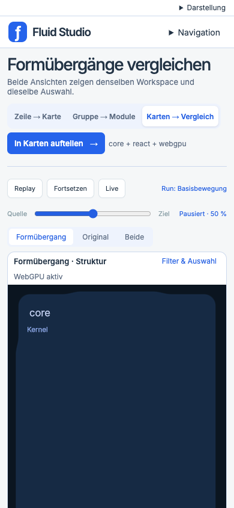
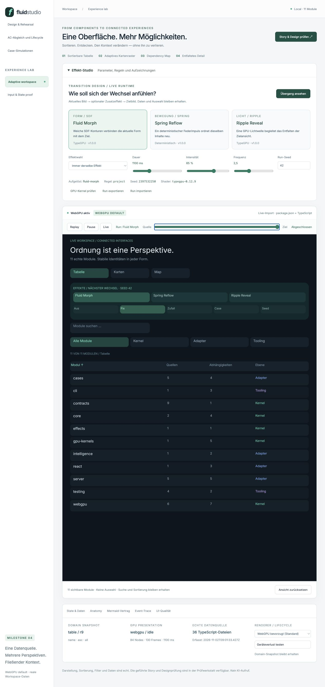
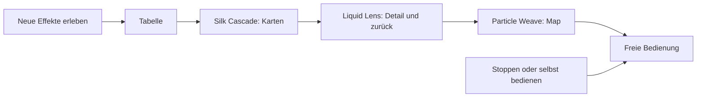
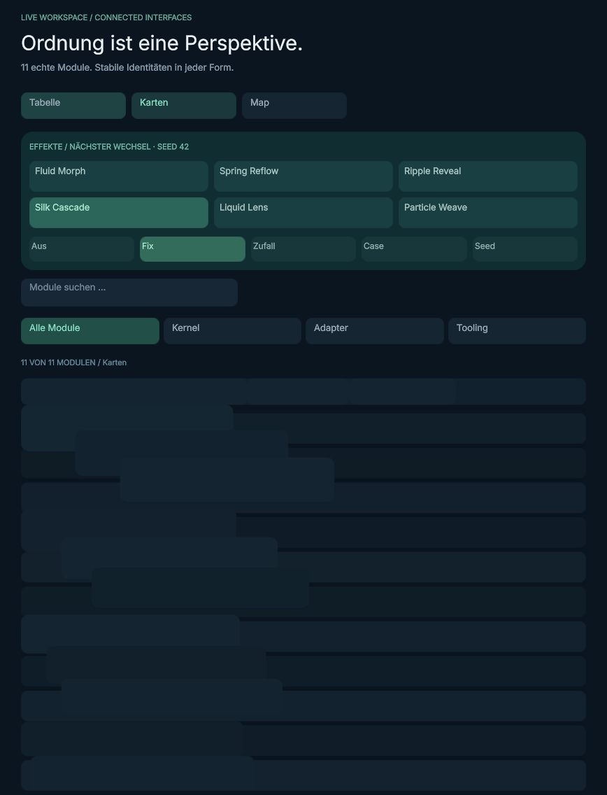
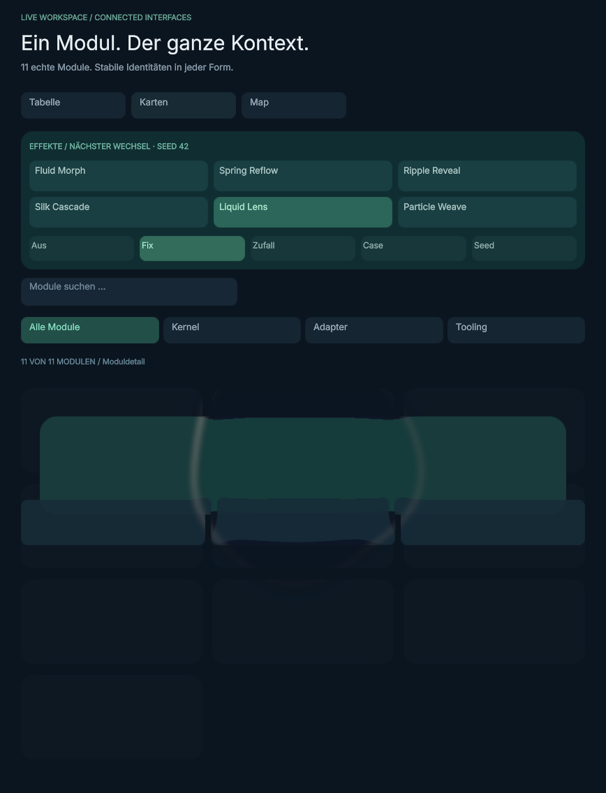
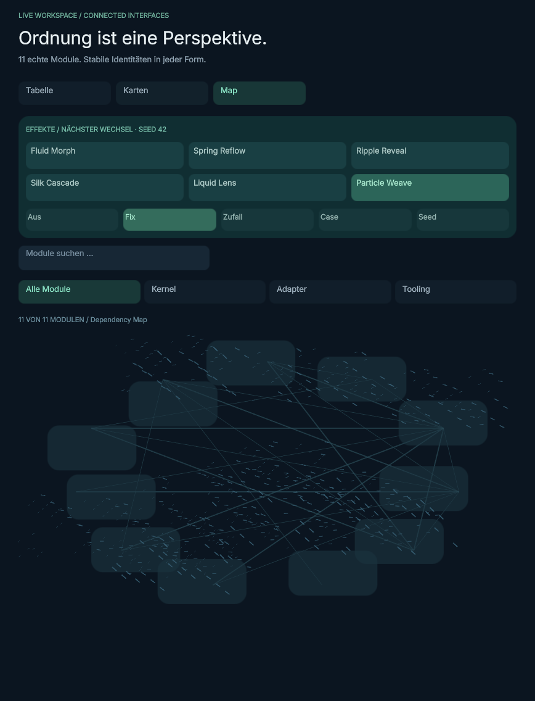

# Der Ablauf

Aktueller Zustand → optionaler Zusatzeffekt → neuer Zustand. Inhalte und Auswahl
bleiben erhalten. Der Effekt ändert die Darstellung, nicht die fachliche Bedeutung.[^product]

## Eine Verwandlung ausprobieren

Wähle oben in der Modulwerkstatt eine der drei Aufgaben. Unter **Zeile → Karte** kannst du eine Zeile anhand des Modulnamens ins Raster verfolgen. **Gruppe → Module** öffnet den Atlas. Mit „Kernel aufteilen“ siehst du seine einzelnen Mitglieder. **Karten → Vergleich** verbindet zwei bis vier gewählte Module auf einer gemeinsamen Fläche. Ohne passende Auswahl bereitet die Werkstatt drei vorhandene Module vor. Der blaue Aktionsknopf führt auch wieder zurück. Unter „Filter & Auswahl“ findest du Suche, Gruppenfilter und Auswahlwerkzeuge.

Bei „Karten → Vergleich“ zeigt die Ausgangsansicht die gewählten Module. Mit „Alle Karten anzeigen“ öffnest du aus dieser Ansicht wieder den gesamten Katalog. Über „Im Studio vergleichen“ öffnest du beide Bewegungsvarianten. Wähle denselben Übergang und ziehe am gemeinsamen Regler, um die Hüllen im selben Moment zu betrachten. Auf schmalen Bildschirmen wechselst du zwischen „Formübergang“ und „Original“. „Beide“ zeigt die Flächen untereinander. Die Formbewegungen starten ohne dekorativen Akzent.

## Akzente im Effekt-Studio

| Auswahl | Wirkung |
|---|---|
| Fluid Morph | weiche Formverbindung |
| Spring Reflow | federnde Neuordnung |
| Ripple Reveal | Lichtwelle beim Entfalten |
| Silk Cascade | elegante Staffelung; zusammengehörige Flächen ordnen sich ruhig neu |
| Liquid Lens | lokale Glaslinse; der Hintergrund bricht sich, Texte bleiben scharf |
| Particle Weave | geordnete Fragmente lösen Flächen und setzen sie am Ziel wieder zusammen |
| Aus | keine zusätzliche Effektbrücke; Basisbewegung kann bleiben |
| Fix | immer das gewählte Rezept |
| Zufall | reproduzierbare Auswahl aus passenden Rezepten |
| Case | ein zum Praxisfall hinterlegtes Rezept |
| Seed | verändert die Grundlage der nächsten Zufallsauswahl |

1. Wähle ein Rezept und einen Modus.
2. Wechsle anschließend die Ansicht oder öffne ein Modul.
3. Beobachte den neuen Übergang. Ein bereits laufender oder aufgezeichneter Wechsel
   wird durch eine spätere Rezeptwahl nicht rückwirkend geändert.

## Ausführliche Einstellungen

Öffne „Effekt-Studio“. Stelle Dauer und Intensität ein und nutze
„Übergang ansehen“. Der dritte Regler passt zum Rezept: etwa Staffelung,
Linsenbreite oder Strangdichte. Der Run-Seed erlaubt reproduzierbare Varianten.
Die Angabe „Aufgelöst“ zeigt das tatsächlich verwendete Rezept und seine Regelquelle.

Die reine Rezeptwahl erhält deine Parameter. Mit **„Empfohlenes Preset übernehmen“**
übernimmst du bewusst die aktuell empfohlenen Werte:

| Rezept | Dauer | Intensität |
|---|---:|---:|
| Silk Cascade | 900 ms | 55 % |
| Liquid Lens | 1.100 ms | 55 % |
| Particle Weave | 1.300 ms | 65 % |

Ein bereits laufender Run übernimmt spätere Änderungen nicht rückwirkend. Im Modus
„Zufall“ kannst du neue Rezepte ausdrücklich in den Pool aufnehmen; ein bestehender
Pool wird nicht unbemerkt erweitert.

Die Aufnahme dokumentiert den früheren Aufbau mit drei Rezepten. Die erweiterte
Library ergänzt die drei oben beschriebenen Möglichkeiten; der Aufbau der
Parameter- und Wiedergabesteuerung bleibt vergleichbar.

## Die neuen Effekte erleben

Öffne im Showcase **„Effekt-Studio · Akzent wählen“**. Darin findest du **„Form. Fokus. Verbindung.“**. Wähle **„Neue Effekte erleben“**:

1. Die Tabelle zeigt deine aktuelle gefilterte Auswahl.
2. Silk Cascade ordnet dieselben Daten als Karten an.
3. Liquid Lens öffnet ein sichtbares Moduldetail und führt zurück.
4. Particle Weave verbindet die Karten zur Dependency Map.

**„Stoppen“** beendet die Führung. Auch deine eigene Bedienung übernimmt sofort;
die bereits erreichte Ansicht bleibt erhalten. Die Vorführung verändert keine
Workspace-Dateien und spielt nicht endlos weiter. Filter, Suche und Sortierung
bleiben erhalten. Ist kein Modul sichtbar, ändere zuerst den Filter oder die Suche.
Nach Ende werden deine zuvor gewählten Effekteinstellungen wiederhergestellt.

Die neue Effektvorführung und die [fünfteilige Prüfwerkstatt-Story](rehearsal.md)
sind zwei getrennte Bedienfolgen. Für einzelne Effekte kannst du jederzeit die
Schnellwahl und einen eigenen Ansichtswechsel verwenden.

## Drei Übergänge im Bild

Diese Originalaufnahmen zeigen die drei Effekte aus demselben lokal geprüften
WebGPU-Stand vom 3. November. Die bewegten Inhaltslabels blenden während des
Positionswechsels aus und erscheinen am Ziel wieder scharf. Die feste Steuerung
bleibt sichtbar. Den gesamten Ablauf kannst du im Showcase abspielen; ein
einzelnes Bild beschreibt nur den angegebenen Zeitpunkt.
Für diese Vergleichsaufnahmen wurden einheitlich 1.100 ms und 65 % Intensität
eingestellt. Die einzelnen Presets in der Tabelle oben haben eigene Werte.

### Silk Cascade · 24,24 %

Die zusammengehörigen Flächen lösen sich gestaffelt aus der Tabelle und ordnen
sich als Karten an.

### Liquid Lens · 50 %

Die lokale Linse folgt dem ausgewählten Inhalt und verändert die Abbildung des
Hintergrunds auf dem Weg zum Detail.

### Particle Weave · 50 %

Feine Fragmente bewegen sich geordnet mit den Flächen zur neuen Map-Komposition.
Schrift wird nicht in Partikel zerlegt.

## Prüfung und ruhige Darstellung

Die Betriebssystempräferenz für reduzierte Bewegung hat Vorrang. Dann erscheint
der gültige Zielzustand ohne Linse, Partikel oder zusätzliche Bewegung. Ein
Effekt verändert weder die Auswahl noch die Bedeutung einer Aktion.

„GPU-Kernel prüfen“ führt einen begrenzten technischen Test aus. Ein nicht
verfügbarer Compute-Test bedeutet nicht automatisch, dass jede Darstellung
unbenutzbar ist. Bei inkompatiblen Fähigkeiten kann ein ausdrücklich begründetes
Ersatzrezept oder die Basisbewegung genutzt werden.

„Run exportieren“ und „Run importieren“ betreffen Aufzeichnungen und
Einstellungen dieses Bereichs. Das ist ein anderer Export als ein vollständiger
Rehearsal- oder AI-Reviewbericht. Weiter: [Replay und Dateien](replay.md).

[^product]: Produktstand, tatsächliche Aufnahmerouten und Einschränkungen im Fakten-/Bildregister.
