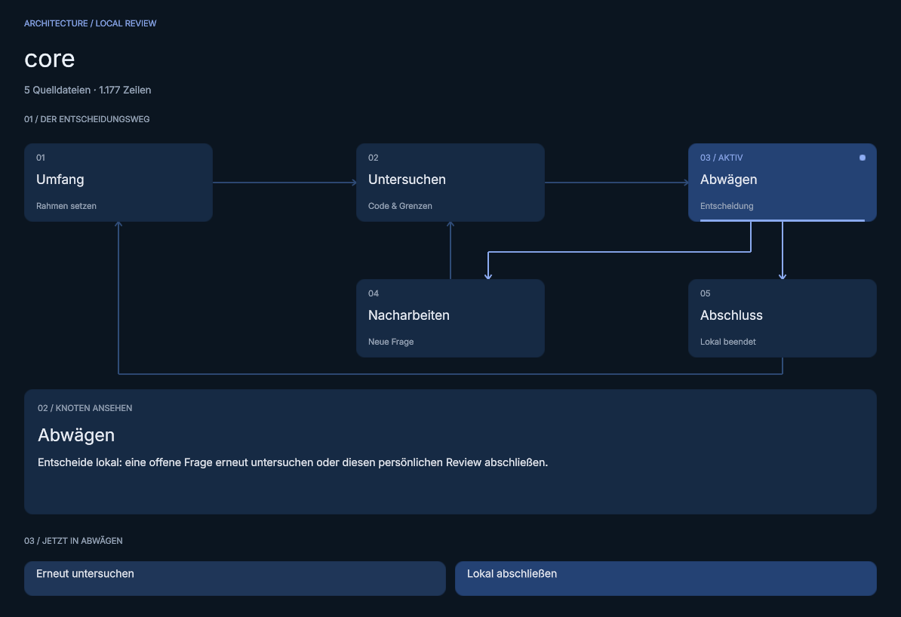
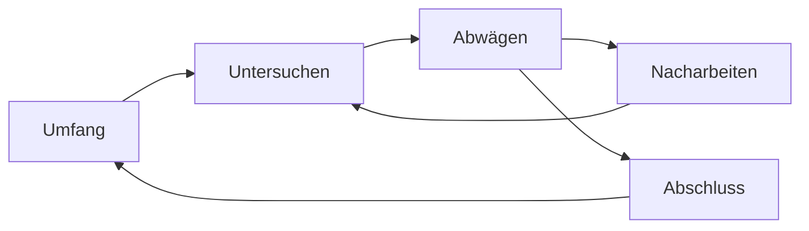
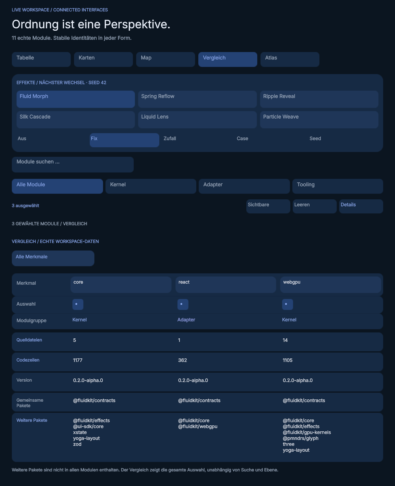
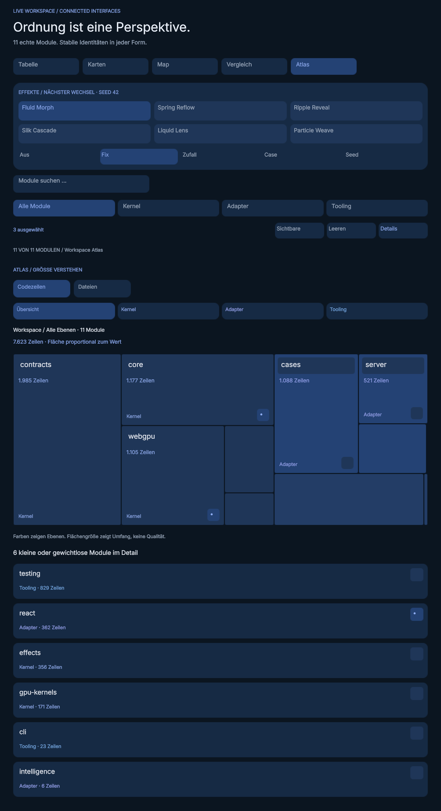
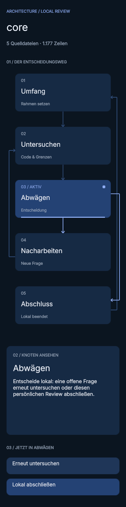

# Für jede Frage die passende Perspektive

| Du möchtest … | Öffne … |
|---|---|
| einen Ablauf verstehen und eine Entscheidung nachvollziehen | **Architecture Review / Flow Explorer** |
| Unterschiede zwischen zwei bis vier Modulen erkennen | **Dependency Compare / Vergleich** |
| die Verteilung von Dateien und Codezeilen entdecken | **Workspace Atlas** |

Alle drei Perspektiven nutzen die tatsächlichen Modul- und Paketdaten dieses
Workspaces. Der Flow Explorer führt einen eigenen lokalen Review; Vergleich und
Atlas bleiben Teil deiner vorhandenen Workspace-Auswahl.[^product]

## Aktuelle Originalaufnahmen

Die folgenden Bilder stammen vom **14. November 2026**, Build
`fluid-5efc7ce43b5669cc30e9`, mit tatsächlich aktivem WebGPU und der blauen
Standardpalette. Es sind unveränderte Canvas-Aufnahmen; die umgebende
Studio-Bedienung und eine vollständige Bewegung sind nicht abgebildet.
Das [Bildregister](assets/screenshots.json) enthält Route, Zeitpunkt und Maße.

## Einen Architektur-Review ausprobieren

Öffne **Flow Explorer** in der Navigation oder den Case **Architecture Review**.
Der direkte Einstieg lautet beispielsweise `/studio/flows?module=core`.
Oben siehst du das betrachtete Modul und den tatsächlich aktiven Renderer.
WebGPU ist bevorzugt; ein verwendetes WebGL2-Backend wird ausdrücklich angezeigt.

*Desktop: 1280 px Browserbreite, GPU-Fläche 1194 × 818 px. Der aktive
Schritt „Abwägen“ bietet zwei ausdrücklich lokale nächste Aktionen.*

1. Wähle im Graphen einen Knoten aus. Der Detailbereich erklärt seine Aufgabe.
2. Starte mit **Untersuchung starten** den ausführbaren Ablauf.
3. Wähle **Zur Abwägung**, wenn du die nächste lokale Entscheidung betrachten möchtest.
4. **Erneut untersuchen** führt in die Nacharbeit. Mit **Zur Untersuchung** kehrst du in den Review zurück.
5. **Lokal abschließen** beendet diesen persönlichen Ablauf. Mit **Neuen Review starten** beginnst du erneut.

Die Markierung **AKTIV** zeigt den wirklichen Prozesszustand. Der ausgewählte
Knoten und sein Detailbereich dürfen davon abweichen: Du kannst bereits den
Abschluss ansehen, ohne den Review zu überspringen. Die Aktionsbuttons unter dem
Detailbereich zeigen nur die gerade erlaubten Schritte.

Mit Tab erreichst du die Controls; Enter oder Leertaste aktiviert den fokussierten
Button. Auf schmalen Flächen wird der Graph vertikal angeordnet. Unter der
Zeichenfläche zeigt **Core Trace** die tatsächlich angenommenen oder abgelehnten
Events und ihre Revision. Dort werden keine vorgeschriebenen Demoereignisse
als bereits ausgeführt dargestellt.

**Lokal abschließen ist keine externe Freigabe.** Dabei werden weder Tests
behauptet noch Dateien verändert oder etwas veröffentlicht. Ein Reload startet
wieder beim Umfang. **Workspace** führt zu den Karten mit dem betrachteten Modul
zurück. Ein unbekanntes Modul kann nicht geöffnet werden.

### Effekte, Mermaid und eine Aufnahme

Unter **Effekte gestalten** wählst du eines der sechs vorhandenen Rezepte und
passt seine Parameter an. Die Presetauswahl behält zunächst deine Werte;
**Empfohlenes Preset übernehmen** lädt die kuratierten Einstellungen. Die
Bewegungspräferenz kann Bewegungen reduzieren. Die fachlichen Reviewaktionen
bleiben dieselben.

**Übergang ansehen** wiederholt einen bereits vorhandenen visuellen Run. Führe
zuerst eine Review-Aktion aus. **Replay** ist eine visuelle Wiederholung;
**Live** stellt die aktuelle bedienbare Oberfläche dar.

**Mermaid-Vorschau öffnen** zeigt den aus demselben Flow erzeugten Vertrag.
Mit **Mermaid-Export vorbereiten** und anschließend **.mmd herunterladen**
speicherst du den beschrifteten Graphen. Die Revision am Download benennt den
Stand seiner Vorbereitung. Reine Knotenauswahl erzeugt keine zusätzlichen
Schleifen im Diagramm.

Für einen sichtbaren Nachweis:

1. Stelle den gewünschten Zustand her oder pausiere einen Live-Übergang.
2. Wähle **Flow-Nachweis aufnehmen**.
3. Lies die gemeldeten Text- und Zielgeometrie-Befunde.
4. Speichere über **JSON mit Originalbild herunterladen**.

Die Datei enthält das unveränderte GPU-Bild zusammen mit lokalem Flowzustand,
Revision, Farbpräferenz, Ereignismetadaten und Geometrie. Ändert sich der Stand währenddessen,
wird die Aufnahme verworfen. Sensible oder freie Texteingaben verhindern die
Bildaufnahme. Ein einzelnes Bild bestätigt keine vollständige Animation oder
allgemeine Produktqualität.

## Module miteinander vergleichen

Markiere zwei bis vier Module mit ihren Auswahlkästchen und öffne **Vergleich**.
Die Übersicht stellt Dateien, Codezeilen, Version, Ebene und Paketabhängigkeiten
gegenüber. Bei kleiner Browserbreite werden die vollständigen Werte unter den
jeweiligen Modulen angeordnet.

- **Gemeinsame Pakete** werden von allen gewählten Modulen verwendet.
- **Weitere Pakete** gehören nicht zu dieser gemeinsamen Schnittmenge. Sie können trotzdem bei mehreren der Module vorkommen.
- **Nur Unterschiede** blendet gleiche Merkmale aus; **Alle Merkmale** zeigt sie wieder.

Bei keiner oder nur einer Auswahl bietet **Vorschlag auswählen** einen bewussten
Einstieg. Die Auswahl wird beim normalen Ansichtsschalter nicht automatisch ersetzt.
Die Fallkarte **Beispiel vergleichen** ist ein eigener Einstieg: Sie übernimmt
bewusst eine vorgeschlagene Modulauswahl. Sind mehr als vier Module
markiert, reduziere sie über die Auswahlkästchen. Ansichtswechsel und Filter
löschen deine Auswahl nicht; der Vergleich berücksichtigt die gewählten Module
auch dann, wenn sie im aktuellen Suchausschnitt nicht sichtbar sind.

*Desktop: `core`, `react` und `webgpu` bei 1280 px Browserbreite. Die
GPU-Fläche ist 1004 × 1234 px; Werte stammen aus dem aufgenommenen Workspace.*

## Den Workspace als Atlas erkunden

Öffne **Atlas** und wähle **Codezeilen** oder **Dateien**. Die Flächen zeigen die
Verteilung genau dieser Metrik; die Gruppenfarbe ordnet ein Modul Kernel,
Adapter oder Tooling zu. Eine große Fläche bedeutet größeren Umfang, keine
Qualitätsbewertung.

Mit **Kernel**, **Adapter** oder **Tooling** vertiefst du eine Ebene. **Übersicht**
führt zurück. Die Zeile `Workspace / …` zeigt den aktuellen Ausschnitt. Suche
und Workspacefilter wirken weiterhin mit; ein leerer Ausschnitt erklärt deshalb,
welche Einstellungen du ändern kannst.

Sehr kleine oder gewichtlose Module findest du unter dem Diagramm in einer
bedienbaren Detailliste. Nullwerte erhalten keine künstliche Fläche. Du kannst
dort wie im Diagramm Module öffnen und auswählen. Die bestehende Auswahl bleibt
beim Wechsel zu Karten, Tabelle oder Vergleich erhalten.

*Desktop: 1280 px Browserbreite, GPU-Fläche 1004 × 1843 px. Große Flächen
zeigen Codeumfang; sie sind keine Bewertung der Modulqualität.*

### Derselbe Ablauf auf schmaler Fläche

*390 px Browserbreite, GPU-Fläche 348 × 1392 px. Knoten, Rückwege und
Handlungsmöglichkeiten bleiben erhalten. Weitere unveränderte Kompaktaufnahmen:
[Vergleich](assets/m9-compare-390.png) und [Atlas](assets/m9-atlas-390.png).*

Die Farbwahl ist in [Farben und Erscheinungsbild](appearance.md) erklärt.

## Einen Link weiterverwenden

Die Workspace-URL merkt sich die Perspektive, Auswahl und Ansichtseinstellungen.
Ein Vergleich kann beispielsweise `view=compare` und mehrere `picked`-Einträge
enthalten. `differences=1` steht für „Nur Unterschiede“. Im Atlas bezeichnet
`metric=files` die Dateianzahl und `atlasGroup=Kernel` den Gruppenfokus.
Die Voreinstellungen Codezeilen und alle Ebenen benötigen keine zusätzlichen
Parameter. Browser-Zurück/Vorwärts und Reload stellen diese gültigen Angaben
wieder her. Suchtext und die Fortschrittsposition einer Animation stehen nicht
im Link.

Der Flow Explorer besitzt einen eigenen Moduleinstieg. Sein Link speichert
keinen abgeschlossenen Review und ersetzt keine Aufzeichnung.

## Farbwelt und Nachweisstand

Die Farbwahl im Studio gilt auch für diese Perspektiven. Blau ist der Standard;
weitere Paletten und eine eigene Akzentfarbe stehen zur Verfügung. Der Farbwechsel
ändert keine Reviewentscheidung und keine Modulauswahl.

Die in diesem Kapitel beschriebenen Bedienelemente gehören zur M9-Erweiterung.
Sechs aktuelle Originalbilder und ihre Browsernachweise sind mit dem Build
`fluid-5efc7ce43b5669cc30e9` registriert. Historische M7/M8-Bilder bleiben ältere Nachweise; daraus folgt keine
pauschale erneute Abnahme aller neuen Ansichten.

[^product]: Produktfakten und Bildregister unterscheiden implementierte Bedienung, gezielte Tests und tatsächlich beobachtete Browsernachweise.
